# Python超全入门教程-p61-P61-Learn-Python-property-in-7-minutes--BV1fcdLYXEw9_p61-

Hebody， so in today's video， I got to talk about the property decorator in Python。

 The property decorator allows us to define a method as a property。

 We can access it like it's an attribute。 One of the benefits is that when reading。

 writing or deleting attributes， we can add additional logic。

 The property decorator gives us a getter method to read a setter method to write and a delete method to delete when working with attributes in this example will create a class of rectangle。

😊，We need a constructor。 Let's define that。When constructing a rectangle object。

 we will need a width。And a height。We will assign the attribute of width equal to the width that we receive when constructing this object。

 self dot height。いくさ。Let's construct a rectangle object。 rectangle equals rectangle。

We need to pass in a width and a height。Then， I will print。By rectangles width， rectangle dot width。

And the height。Rectangle dot height。With my rectangle， the width is 3。

 the height is 4 using the property decorator。 When reading these attributes of width or height。

 I can write some additional logic。 Let's say that when accessing the width or the height。

 I would like to display one digit after the decimal。 Then add centimeters。

 Here's one way in which I can do that。For each of these attributes， I'm going to create a method。

 We will define a method of width。No parameters beside self。For now， I'll write pass。And define。

Height。Preceding each of these methods， I will use the property decorator。So at property。Now。

 when accessing the width or the height will be returned with whatever is within these methods of width and height。

But there's one change we're going to make to these attributes。

 We'll set these attributes to be private。 Prefix each of these attributes with an underscore。

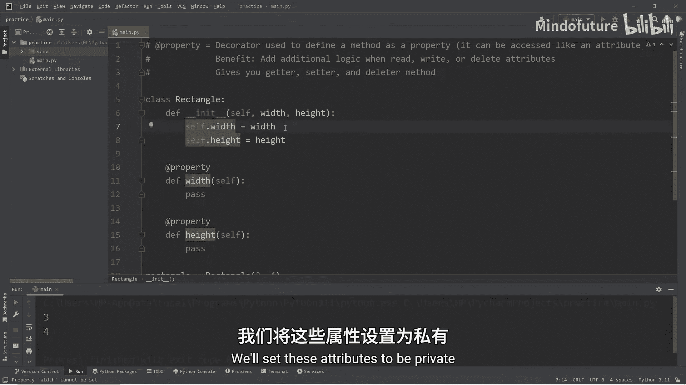

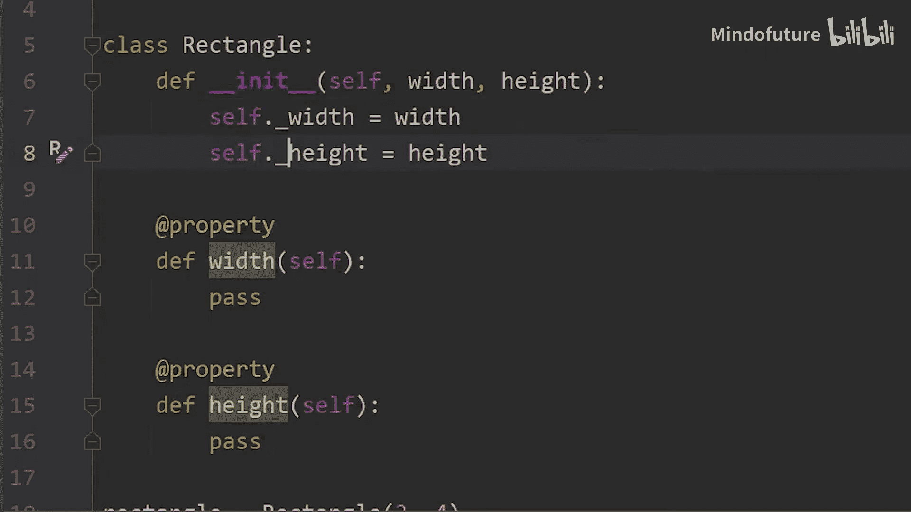

This tells you and other developers that these attributes， they're meant to be protected。

 they're internal， we shouldn't access the width or the height directly outside of this class。

Technically， we could， I will access the internal version of width and height。We get 3 and 4。

 but we do have a warning access to a protected member width of a class that applies to height as well。

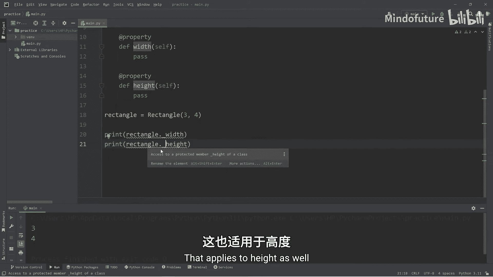

Our width and our height are only meant to be used inside of this class。

 If we need to get the width and the height， we will do so through these getter methods provided by the property decorator。

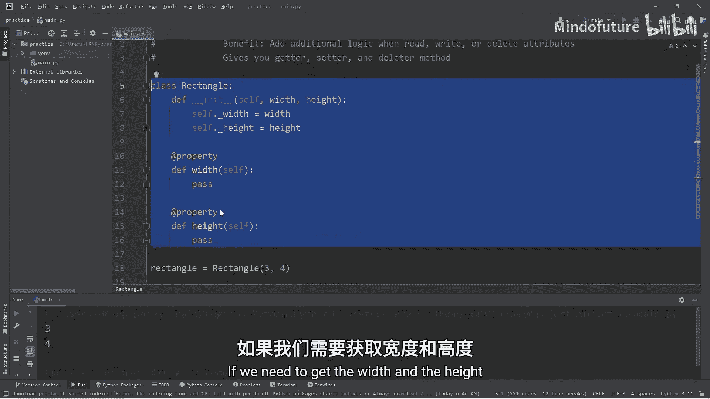

So when accessing the width， let's return enough string。

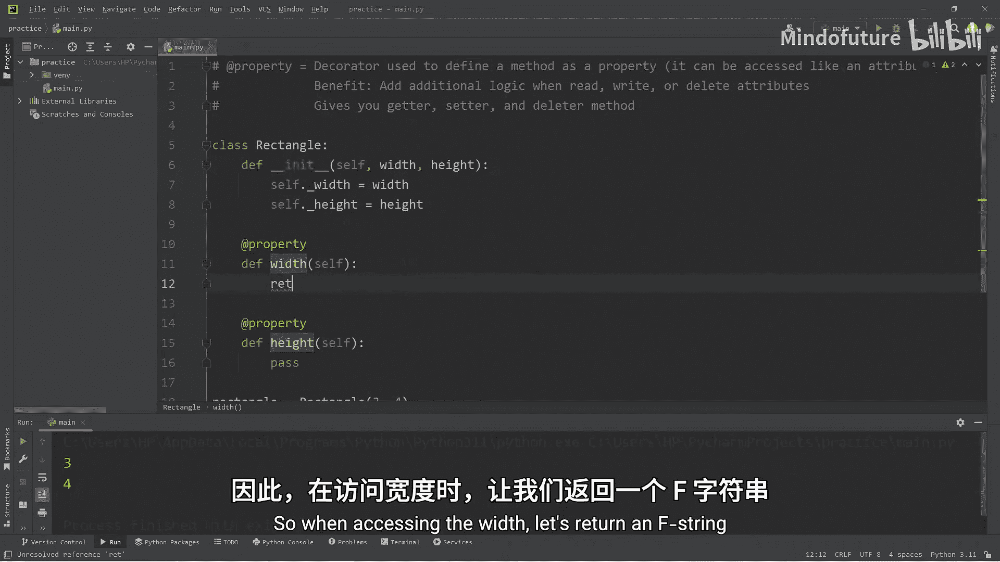

I will access self dot。

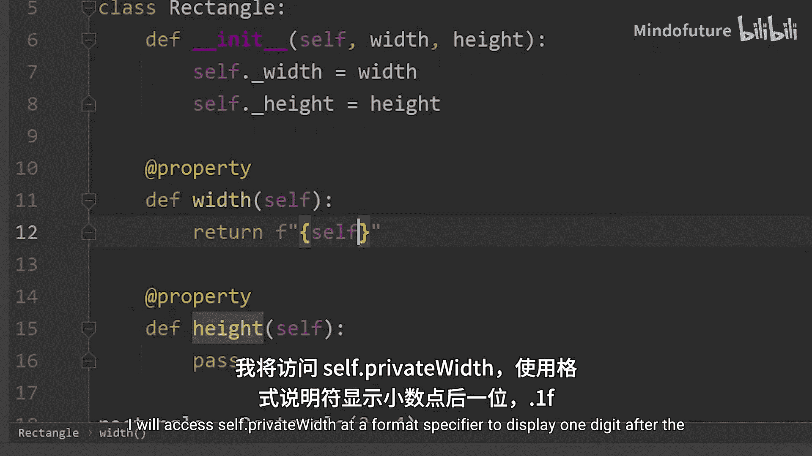

Private width。Add a format specifier。To display one digit after the decimal 01 F。

 followed by centimeters。We'll do this with the height as well。

We will return self dot private height。

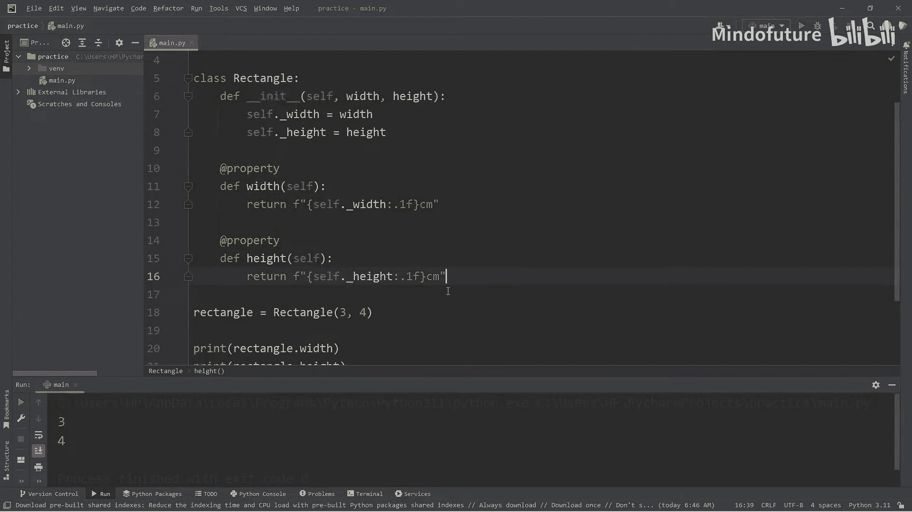

So now when we access the width or the height。We will do so， using these getter methods。

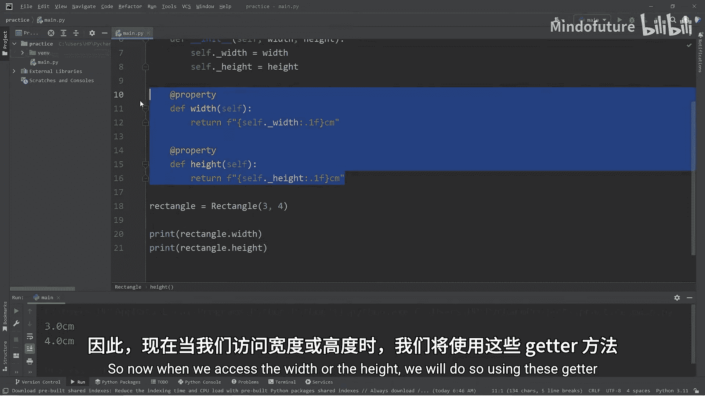

If I access these private width and height attributes instead。Again， they will be 3 and 4。

 It's kind of like their raw。 These attributes are meant to be used internally inside of the class。

 So that's the point of a getter method。 We can add additional logic when reading one of these attributes when we tried to get them。

We can also add set methods if we would like to set or write these attributes。 Here's how。

Let's take our width。 We will create a decorator of at width doter。When attempting to set the width。

 we will do so using this method。 We will define our method name of width。We will have one parameter。

 a new width。 We don't want the parameter name to be the same as the method name。

 That's why we're naming it something different。When setting the width。

 let's check to see if the new width is greater than 0。If so， we will take self dot private width。

Equals are new width。Else， let's print something。Let's print。Withdth must be greater than 0。

And let's do this with the height。Height dot sutter， define。Height passing a new。Height。

 if our new height is greater than zero， assign self dot private height equals the new height。Else。

 print height must be greater than 0。Before printing the width and the height。

 let's take our rectangles。With set it to be zero， then see what happens。Well， we get that message。

Wth must be greater than 0。If I were to set width to be 5。Well that does work， our width is now five。

Let's change the height。Rectangle dot height。I will set this to be a negative one。

Height must be greater than 0， and the height hasn't changed。What about6？

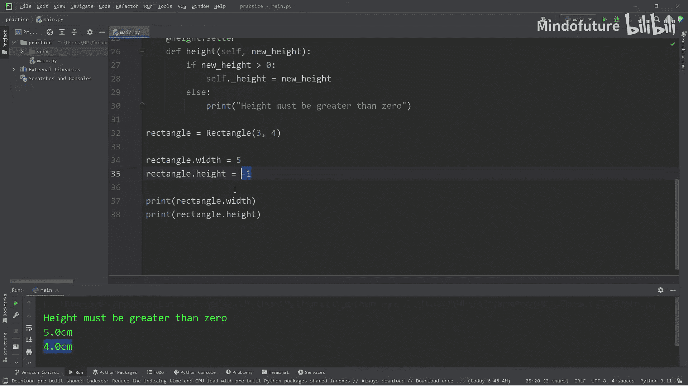

Six does work。When using these set methods， we can add additional logic when writing or changing one of these attributes。

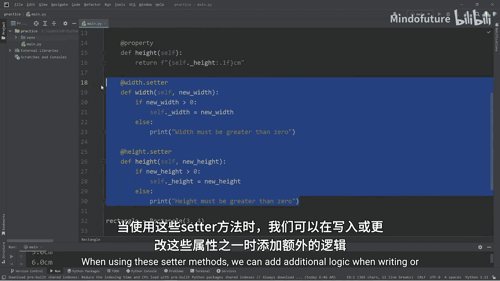

These are set methods。Now， if you need to delete an attribute， here's how。There is a delete keyword。

 We will delete our rectangles width。And delete our rectangle's height。 In this series。

 we really won't be using the delete keyword， but you should still know that it exists。

So we will create a deleter method。At take one of the attributes in this example width。

We will create a delete method。The method name will be with the name of the attribute。

There will be no parameters besides self。We will delete。Self dot private width。

Then let's print something just to confirm that this was deleted。Wt has been deleted。

Same thing applies to height。Take the attribute of height。Define。height。Delete private height。

Height has been deleted。When deleting our width or our height。

 we get that confirmation message width has been deleted and height has been deleted。Al right。

 everybody。 So that is the property decorator。 We can define a method as a property。

 meaning it can be accessed as if it was an attribute。

 One of the benefits is that we can add additional logic when we read， write or delete attributes。

The property decorator gives us a getter， setter and delete method。

 getter methods to read setter methods to write and delete methods to delete。 And well， everybody。

 that is the property decorator in Python。

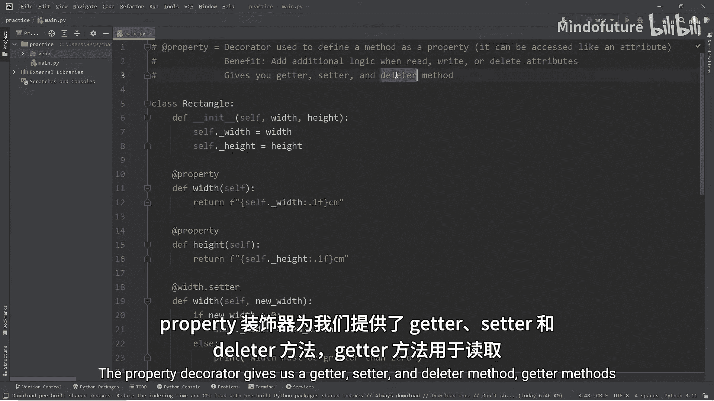

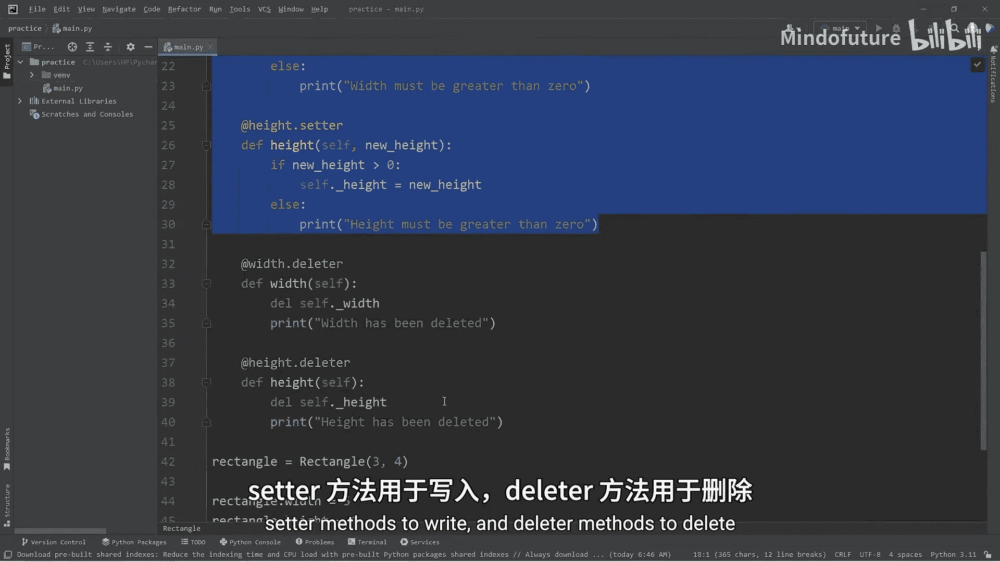

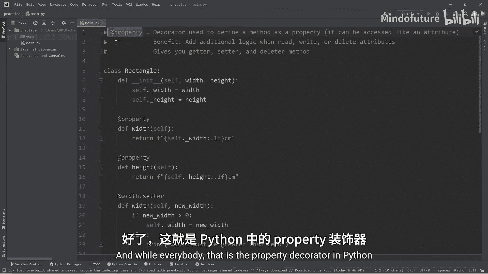