# Python超全入门教程-p64-P64-Learn-Python-MAP()-in-3-minutes--BV1fcdLYXEw9_p64-

Everybody， today， I'm going to explain the map function in Python。

 The map function applies a given function to all items in a collection。

 The map function takes at least two arguments， a function and a collection。

 We will apply this function to every item in this collection。 Here's what we'll do。

 We will create a list of temperatures in Celsius。 which well convert to be Fahrenheit。

 We have a list of Celsius temps。 Make up some numbers。😊。

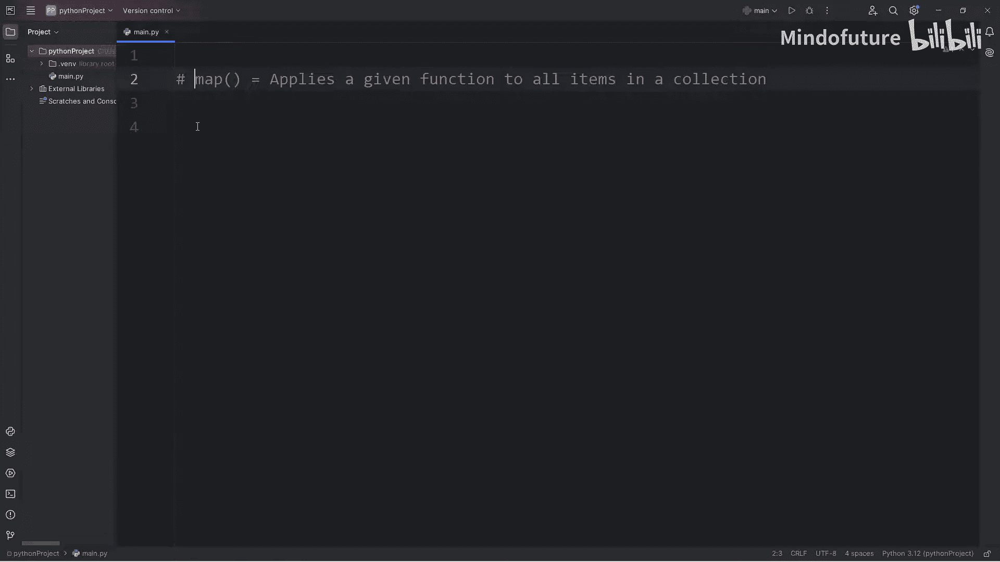

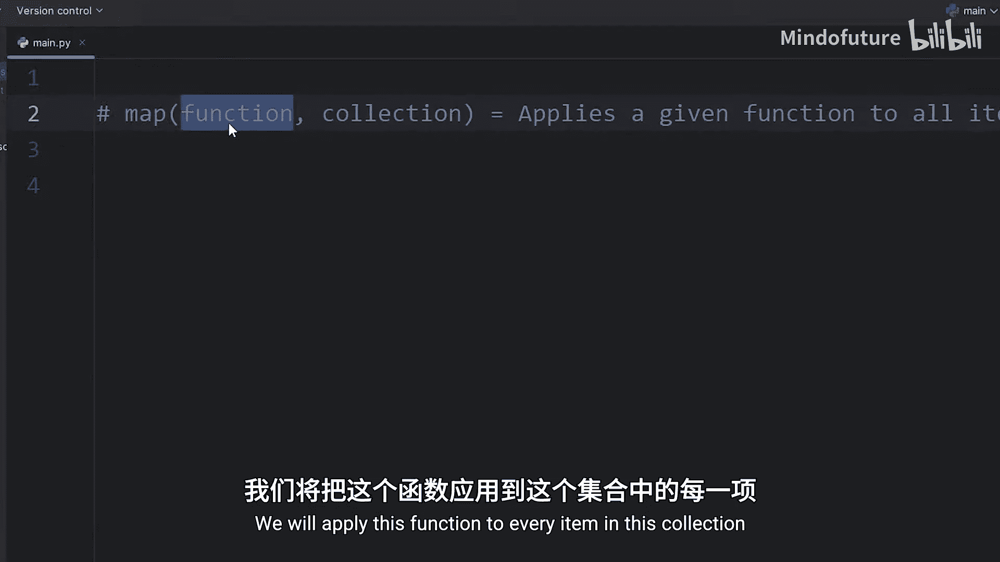

That's good enough for this example。 Then at the end。

 I will print my list of temperatures in Celsius。

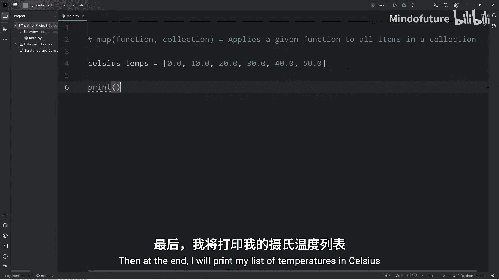

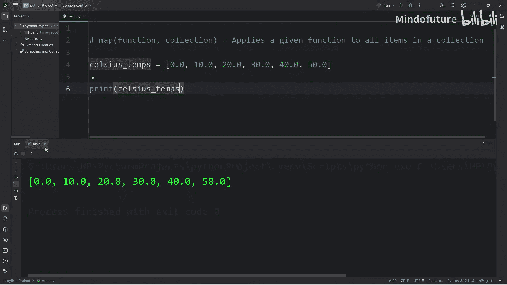

We would like to convert all these temperatures from Celsius to Fahrenheit。 Well。

 we can use the map function for that， but we'll need a function to pass in as an argument。

 There's two ways in which we can do that。We can declare a function and pass in the name of that function or use a Lambda function。

Let's start by defining a function。Let's name this function C2 F， meaning Celsius to Fahrenheit。

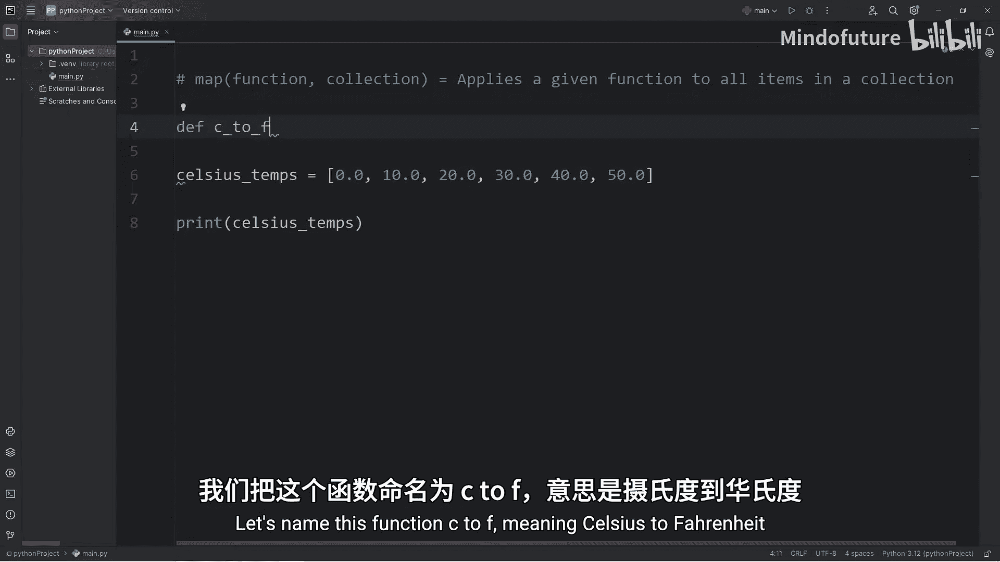

We have one argument。A temp for temperature。Once we receive our temperature in Celsius。

We can return the following formula。Take our temp。Multiply it by 9， divided by 5。Plus 32。

So now using the map function。Let's create a new list of Fahrenheit temps。

I think I spelled that right， I can never spell Fahrenheit。We're going to use the map function。

 We have to pass in a function and a collection。 Which function would we like to apply to every item in this collection。

We're going to take the name of our function， C to F。That's the first argument。

 and the second argument。Is the collection our Celsius temps？

And then we will print our Fahrenheit temps。

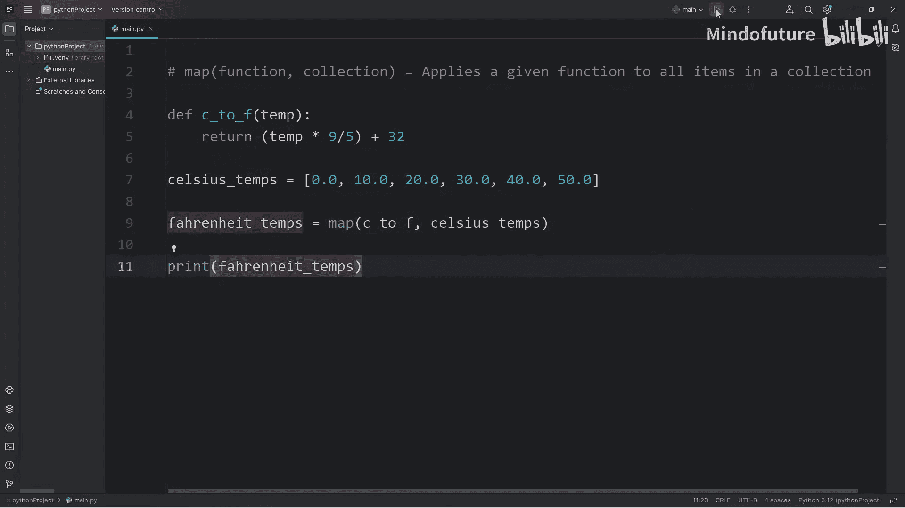

So the map function returns a map object。

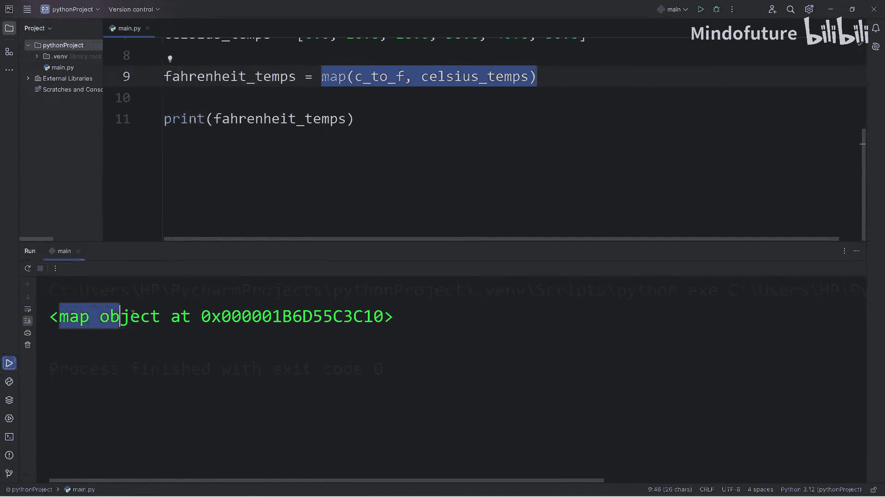

They are iterable。 We can iterate over it using a for loop， like so。For every temp。

And Fahrenheit temps。Print each temp。That would give me these new temperatures in Fahrenheit。

If you would like to keep it as a list。When we're done mapping。

We can enclose this function within a list function to type cast it to a list。

And then I will print by Fahrenheit temps。And it should be a list， which it is。

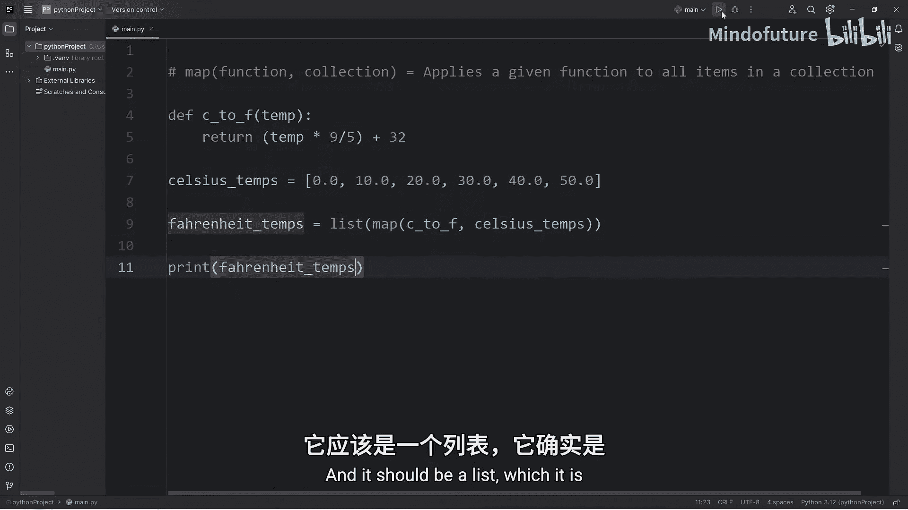

So using the map function， we have converted these temperatures which were originally in Celsius to Fahrenheit。

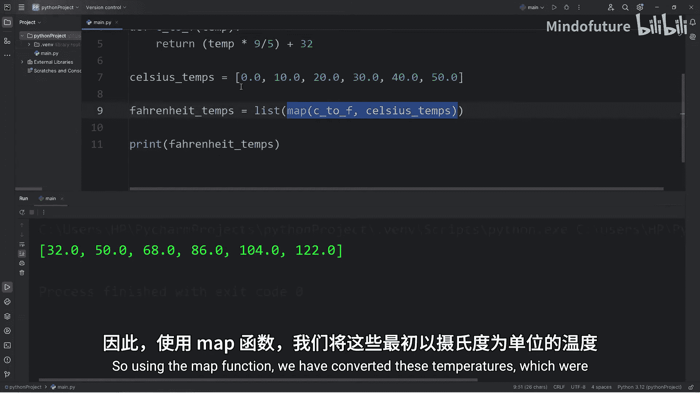

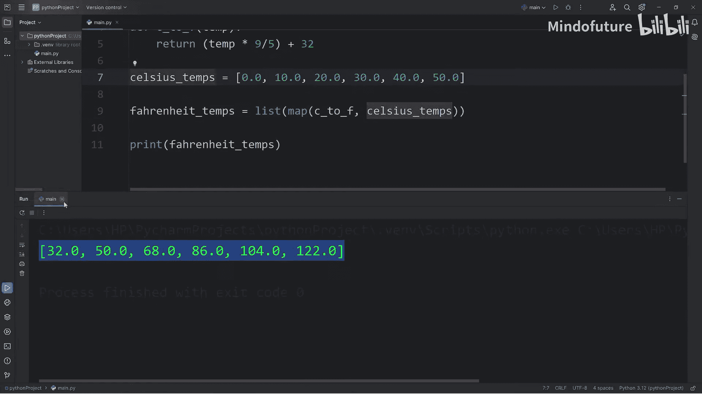

If you would rather not define a function， we could use a lambda function instead。

So we don't clutter the namespace and have to think of unique names for each function。

Let's copy this equation， deletete our function。When we pass in the name of a function as an argument。

 we will instead write a lambmbda function。A Lambda function is a small， anonymous function。

 We type Lambda。Any parameters， we had one parameter of temp， colon。

Then what would we like to return。The formula that we just copied。We'll paste it。

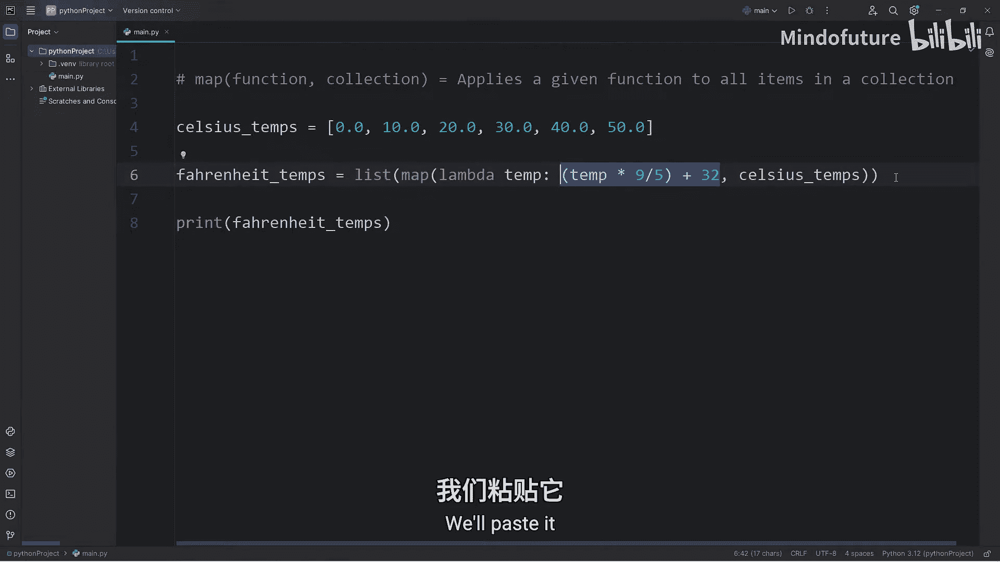

This should work too。It does work， and here are the temperatures in Fahrenheit。

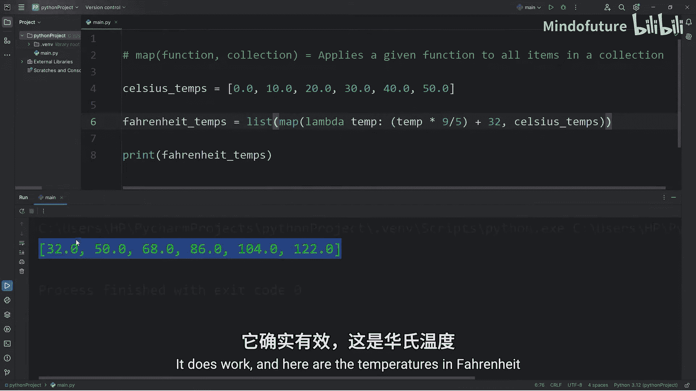

Al right， everybody。 That is the map function。 It applies a given function to all items in a collection one by one。

 And well， everybody， that is the map function in Python。

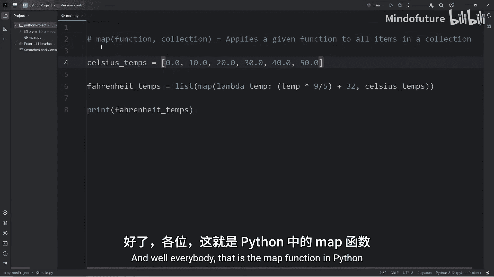