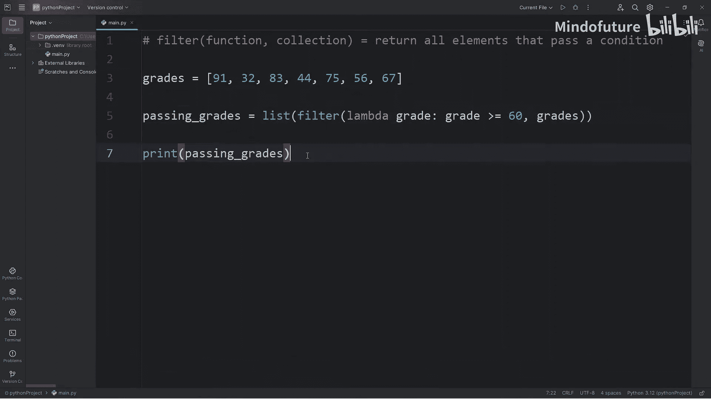
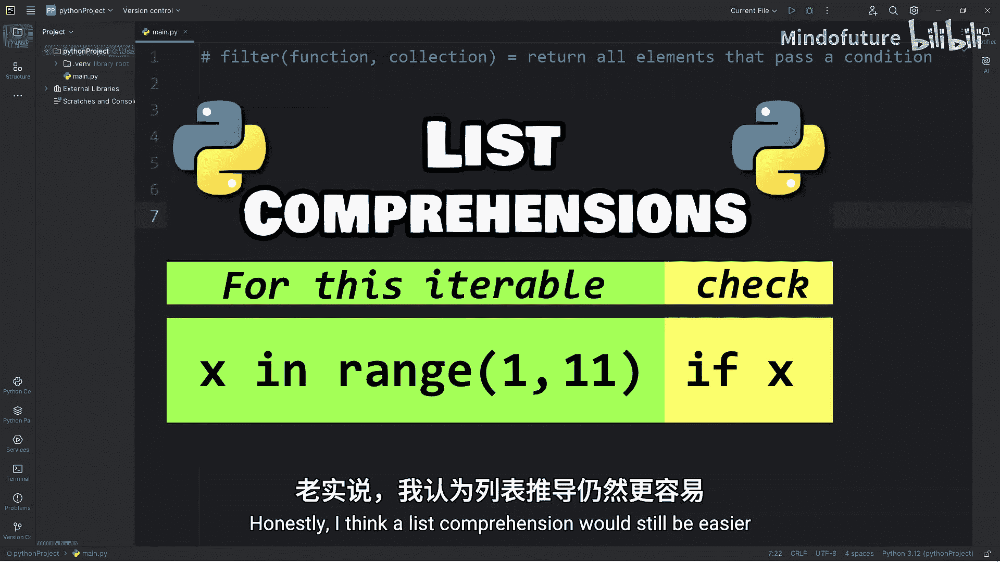
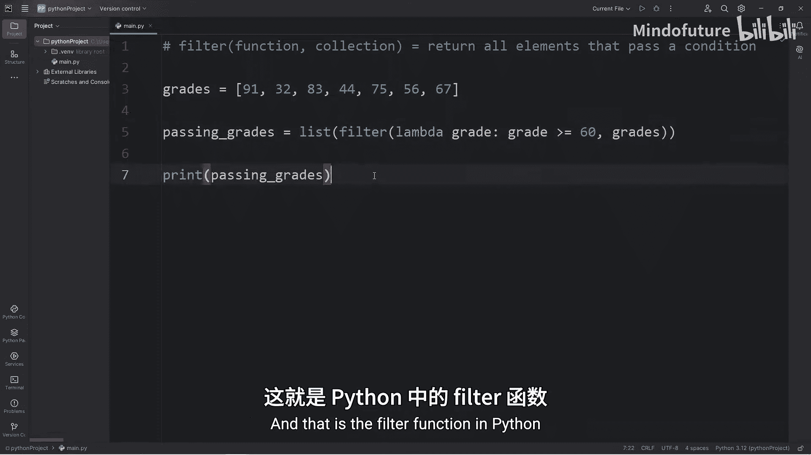

# Python超全入门教程-p65-P65-Learn-Python-FILTER()-in-3-minutes--BV1fcdLYXEw9_p65-

What is going on everybody today I'm going to show you how we can use the filter function in Python。

 The filter function returns all elements that pass a condition， some sort of test。

 we pass in a function and a collection， something that's iterable In this example。

 we will create a list of grades such as student grades make up some numbers。

Here is my list of grades。I will filter any grades that are 60 or above and store them within a new list named Pass grades。

If your grade is 60 or above， you pass， we'll add you to this new list。

So we are going to use the filter function。We pass in a function and our collection。

We can either declare a function or pass in a lambmbda function， in this first example。

 let's declare a function。Of is passing。We will pass in a grade。Now with this function。

 we have to check a condition。We will return a Boolean value by examining our grade。

 then checking to see if the grade is greater than or equal to 60。 If so， you pass。 If not。

 we return false。We will pass in the name of this function as the first argument。

The second argument to the filter function will be our collection of grades。

Now here's what happens if I print my passing grades。We are given a filter object。

It is iterable if we need to look at the elements。For every grade in passing grades。

I will print each grade。So here are the passing grades， 91， 83，75，67 all the grades are 60 or above。

We could convert it back into a list by type casting it。

Enclose the filter function within the list function。And this will stay as a list。

I will print my passing grades。And now we can see them 91， 83， 7567。

Rather than passing in the name of a function to the filter function。

 we don't necessarily need to think of a unique name for this function。

 we could pass in a Lambda function instead that does the same thing。

Rather than passing a function name， we will pass in a lambda function， a small anonymous function。

We type Lambda。The first parameter， which was grade， colon， then our condition。

We will return a booleion。By stating， is our grade greater than or equal to 60？

And this would work too， and it does help keep the name space clean because we don't constantly need to think of unique function names。

A right everybody， so that is the filter function we pass in a function that checks a condition。

 as well as a collection。The filter function takes each element within that collection and runs it past a condition。

If it's true， we can put it within a new list or other type of collection using a list comprehension is another possibility for this Honestly I think a list comprehension would still be easier。

 but you should still be familiar with both methods you don't know when you're going to run into either but hey。

 at least you're familiar with the filter function and that is the filter function in Python。

