# Python超全入门教程-p66-P66-Learn-Python-REDUCE()-in-3-minutes--BV1fcdLYXEw9_p66-

Sub peoplele today， I'm going to talk about the reduce function。

 The reduce function in Python reduces elements in a collection to a single value。

 kind of like we're getting a sum。 We're adding everything together。 Just so you know。

 a for loop tends to be better in most cases。 using the reduce function is an alternative。

 It provides a more functional approach and has better readability Honestly。

 I prefer to use four loops rather than the reduce function。

 but you should still be familiar with both。 You'll understand the reduce function in case you run into it to use the reduced function will need to import it。

From the module of funk To。Import， reduce。In this demonstration， we will create a list of prices。

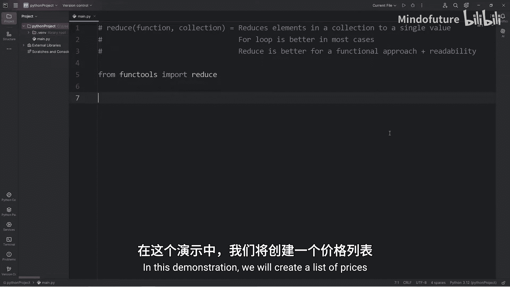

Using the reduce function， we will sum up all the prices together to give a total Let's make up some numbers。

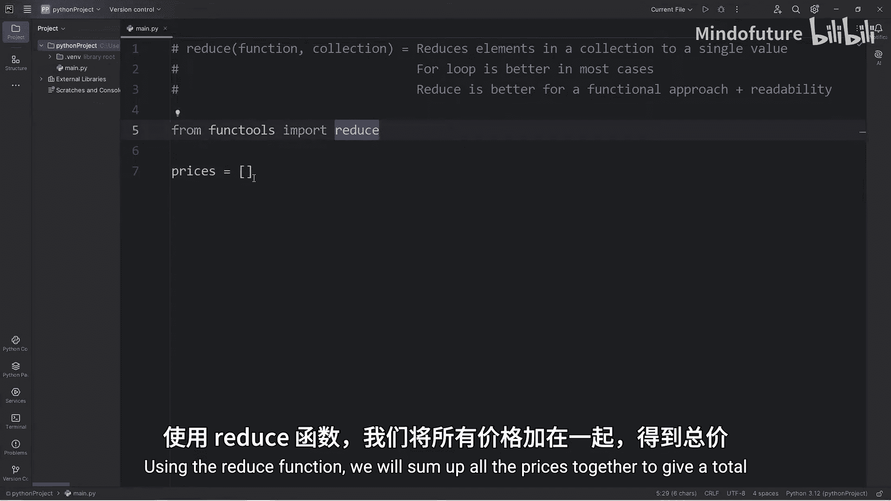

Just type in whatever numbers come to mind。These will all be prices。Here is my list of prices。

I will sum them all together using the reduce function with the result。

 we will assign it to be total。

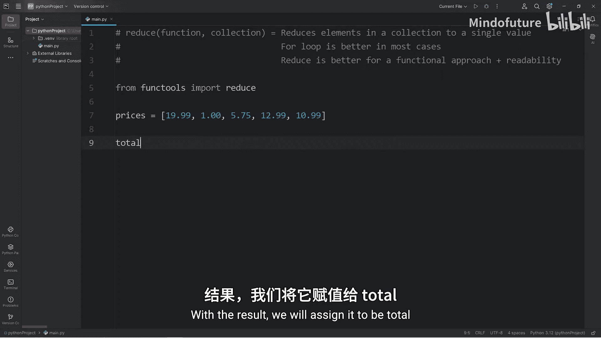

What is the total price that we're paying after adding all these prices together。

 Maybe this is a shopping cart program of some sort。

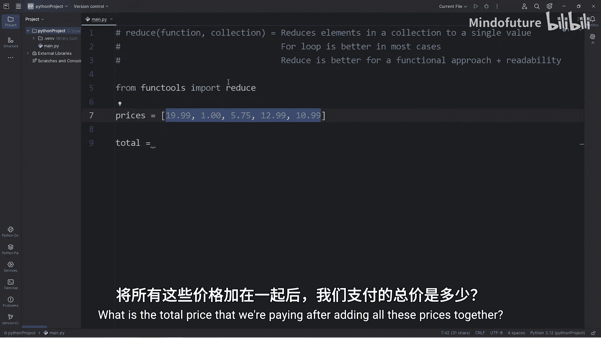

We will call the reduce function。We have to pass in a function and a collection。

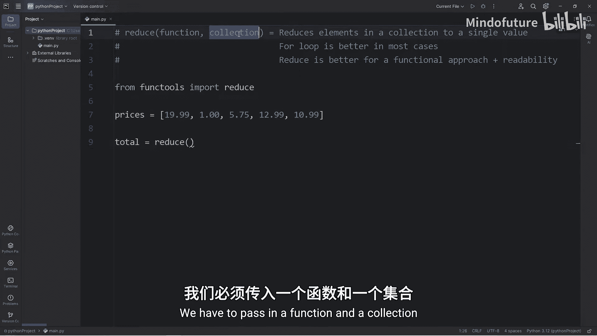

So for the function。Let's say we have a function to add。X x will be the first parameter。

 y will be the second。

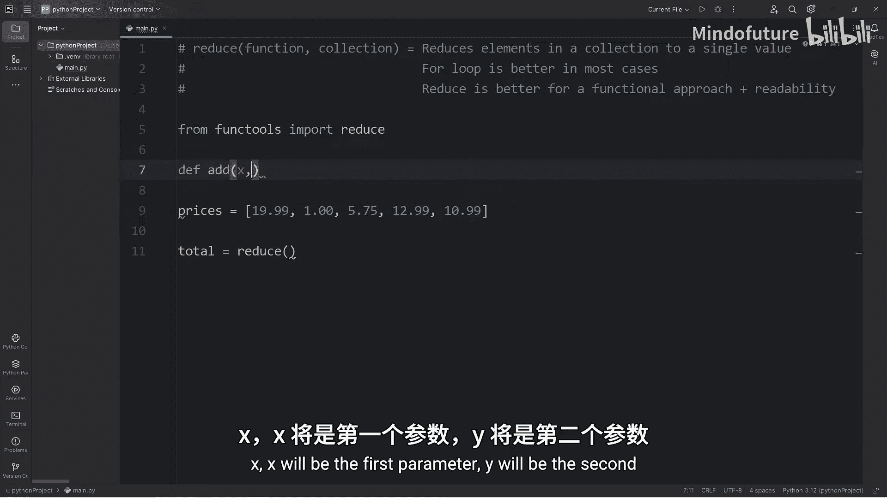

Then I will return x plus y。

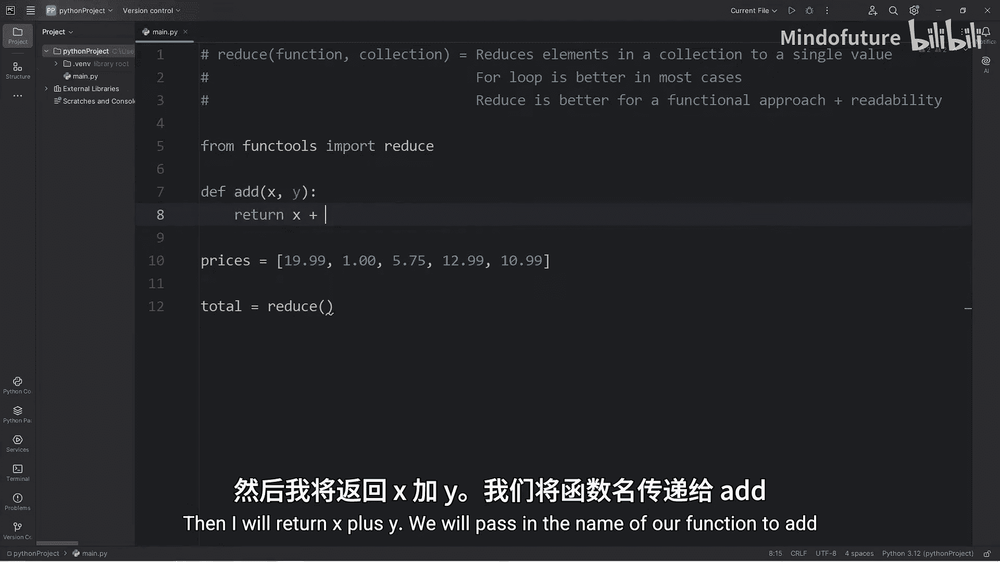

We will pass in the name of our function to add。Let me zoom in a little。

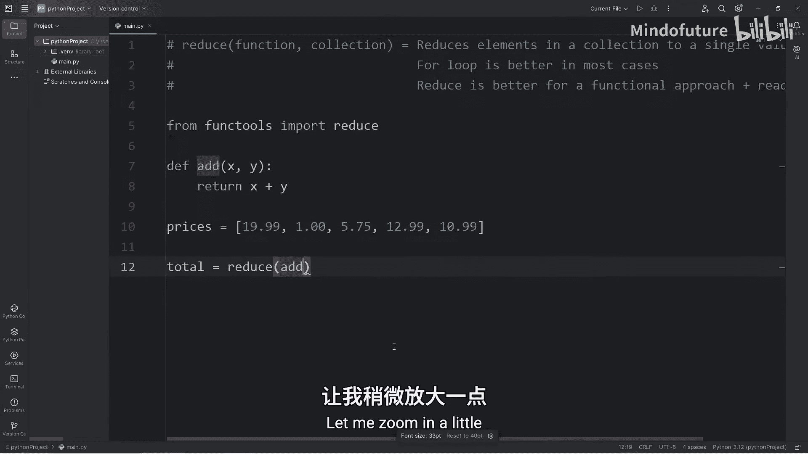

Then we pass in our collection of prices。Then I will print my total。I'll use enough string。

Add a placeholderer。Display my total。 Then prefix this with a unit of currency。

 such as American dollars。Here is my total。$50。72。Rather than defining a function。

 I would rather pass in a lambda function。So let's delete our function and instead use a Lambda function to do so。

 we will type that keyword of Lambda。

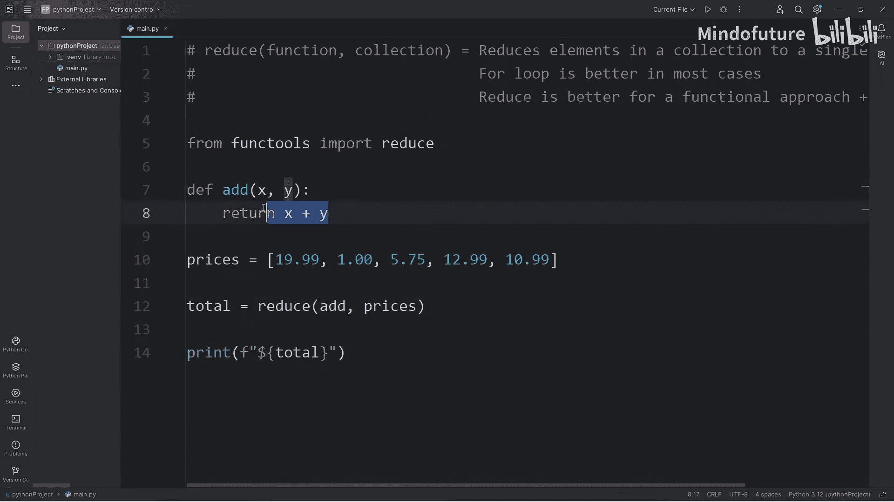

We have our parameters of x and y。What would we like to do？We would like to add X and Y together。

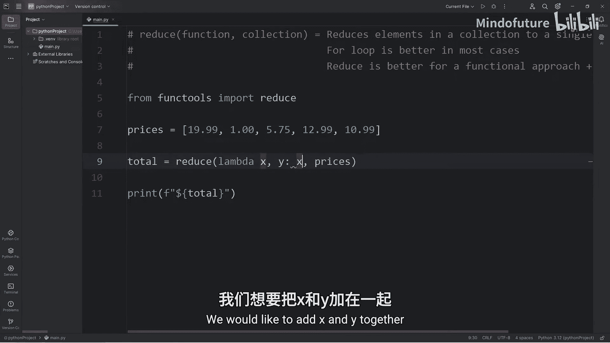

And that should work too。

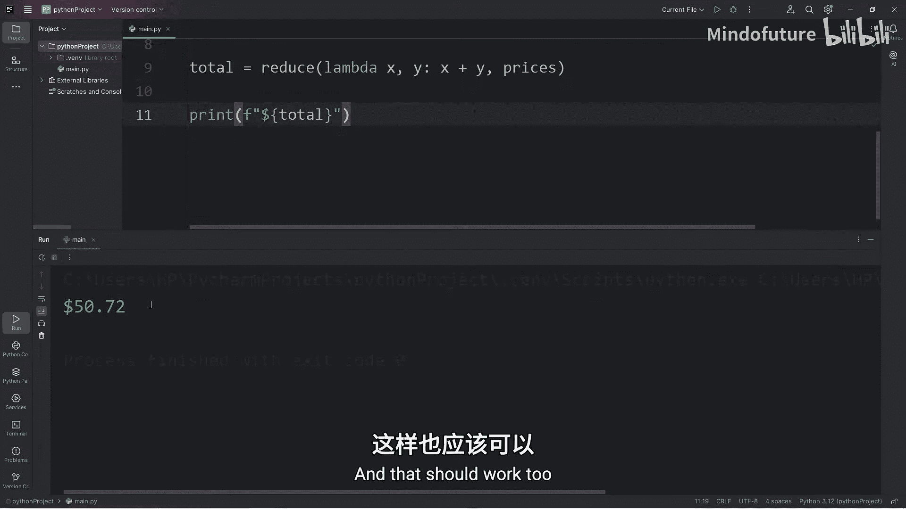

The total is $50。72。So this can get a little confusing with how this works。

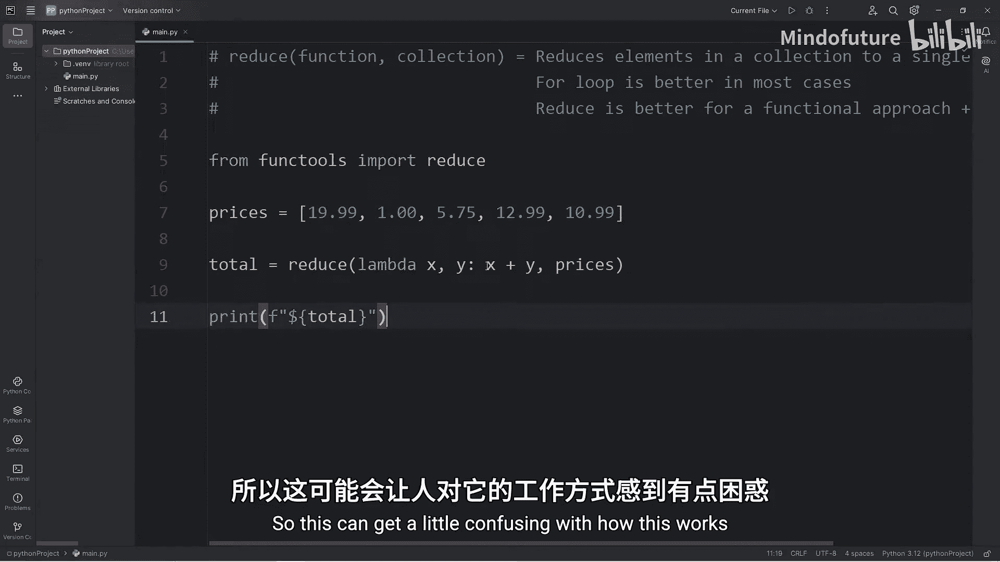

X is going to be the first value。 Y will be the second。 We're going to add them together。

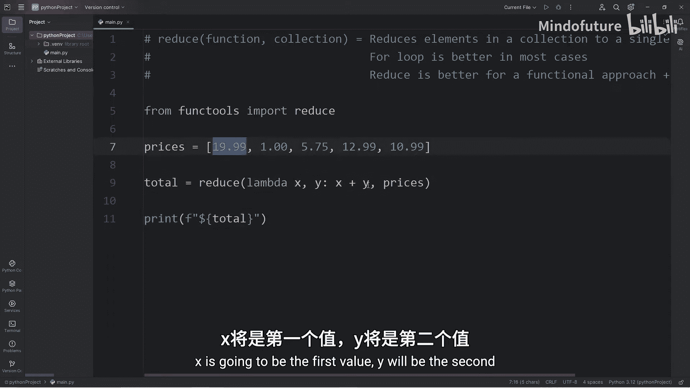

We're returning the result and using it as the parameter for the next iteration。By doing so。

 we're going to reduce all these values into one single value。 Al right everybody。

 So that is the reduced function。 We reduce the elements in a collection to a single value。

 There is a lot of overlap where you could use a for loop or the reduced function。 Honestly。

 I still think a for loop is better in most cases。 However。

 the reduced function gives a functional approach。 and it has better readability。

 So if you see the reduced function， you'll know that it reduces the elements in a collection to a single value。

 and that is the reduced function in Python。😊。

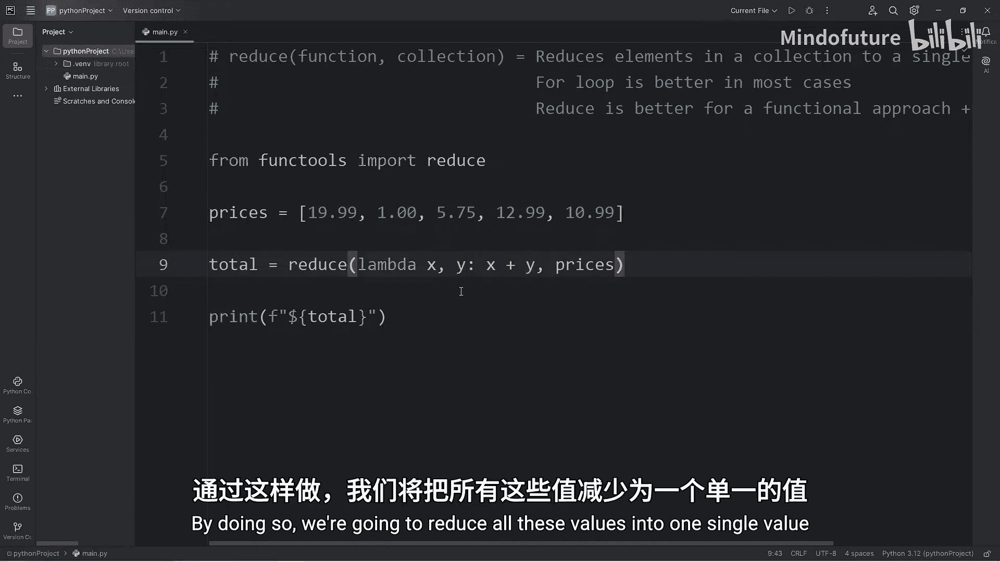

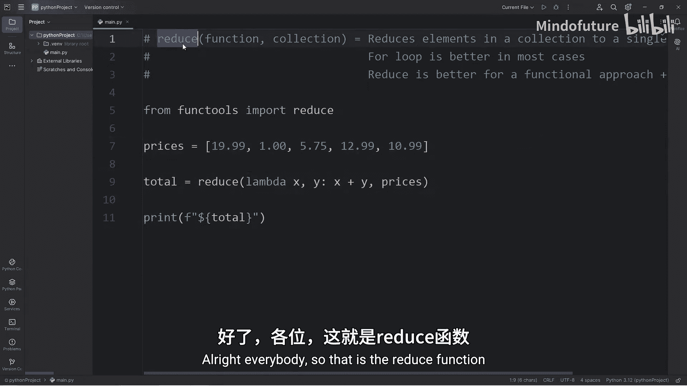

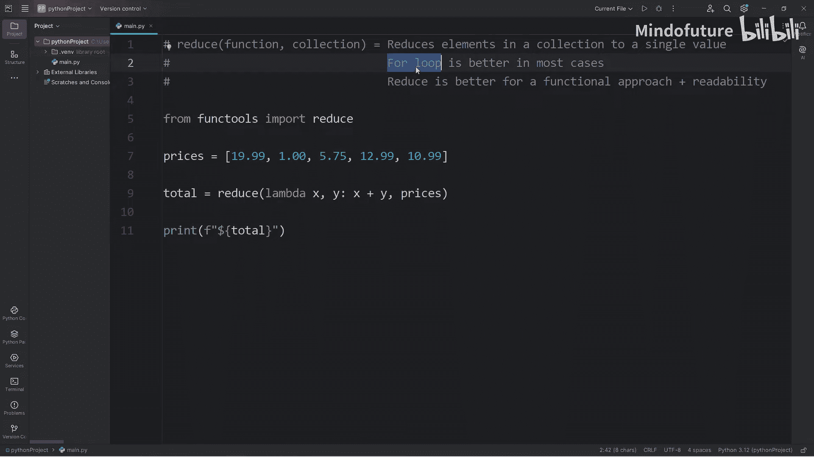

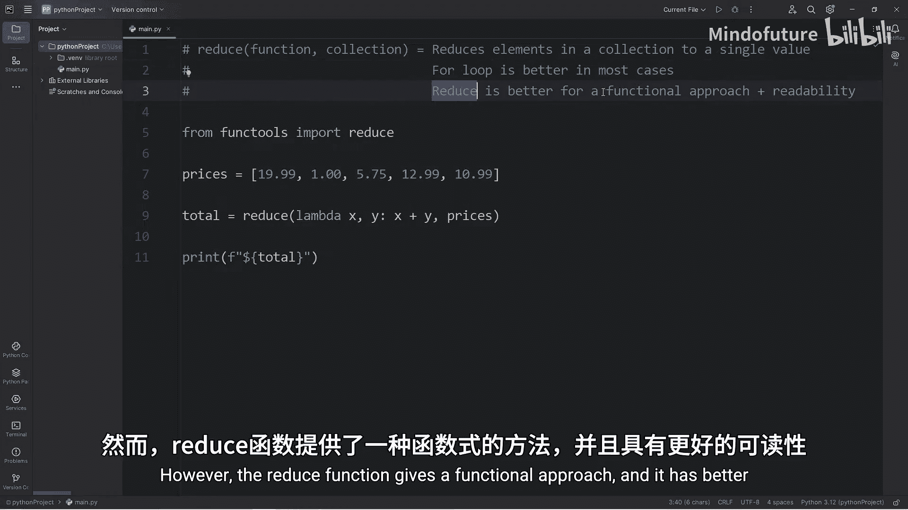

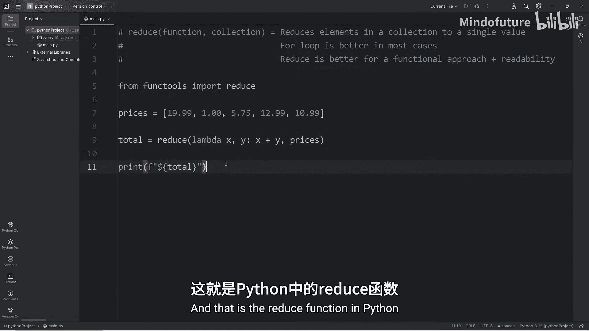