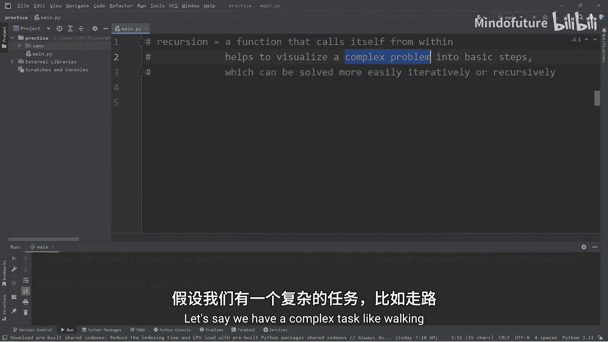
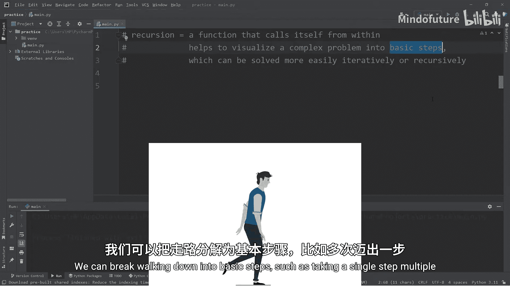
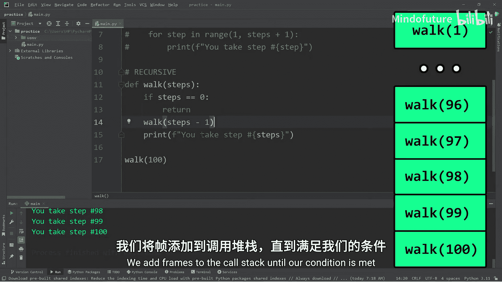
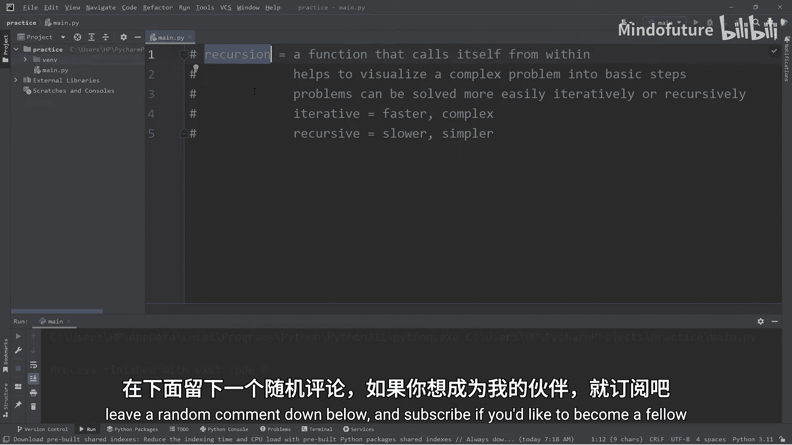

# Python超全入门教程-p68-P68-Learn-RECURSION-in-5-minutes--BV1fcdLYXEw9_p68-

Hello， everybody。 Today， I'm going to attempt to explain recursion in just a few minutes。

 Think of recursion as just a function that calls itself from within。

 It helps to visualize a complex problem into repeatable basic steps。

 These steps can be solved more easily， either iterativeively using a for loop or a while loop or recursively。

 which we'll talk about momentarily。 Let's say we have a complex task like walking。

 we can break walking down into two basic steps。 such as taking a single step multiple times。

 Let's write a program that does this both iterativeively and recursively and take a look at the differences。

 If I were to create an iterative walk function。😊。

Let's define a function to walk， but a user has to pass in a given amount of steps。

 How many steps you want to take。Then I'm going to invoke this function。 Let's say，100 steps。

 If I were to take an iterative approach within this function， I could create a loop。

 such as a for loop。For every step in my range。One through steps plus one。

I'm going to print an F string。 You take step number。Step。So that solves our problem。

 We have taken a single step 100 times to simulate walking。 So that's an iterative approach。

 We're looping within a function。 Now， let's take a recursive approach。

Recursion involves a function calling itself from within At the end of our function。

 I'm going to invoke the walk function again， but I will pass in steps，-1。 Let's change step 2 steps。

 We're invoking this function from within。 It's creating a loop。

 but we will include the function itself， Where in with iteration。

 We're looping only within the function。 Let's see what happens。Recursion error。

 maximum recursion depth exceeded。This time， we're beginning at 100。We're iterating downwards。

 and we're going below 0。 We don't want to take negative steps。

 We need what is known as a base condition。 When do we want to stop， I'm going to add one line。😡。

If steps is equal to 0。To exit a function， you can return。Let's try that again。That's much better。

 But we're counting downwards。 I would like to count up。

 I'm only going to print the number of steps after we invoke the walk function。Okay。

 that solves our problem。 So how does this work exactly。

 When we enter the walk function After accepting a number of steps， we check our base condition。

 Then we invoke the walk function again， but pass in one less than the number we originally accepted。

 In a way， we're creating a loop。 but we're involving the function itself。

 When you invoke a function， you add what is known as a frame to the call stack。

 There is a certain order in which we resolve functions。 It's a stack data structure。

 You start at the top and work your way down。 It's like a stack of Cds or movies。

 We add frames to the call stack until our condition is met。 Then we undo everything。

 starting at the top。 If you have too many frames on the call stack。 Let's walk 1000 steps。

 This is what would happen。

Recursion error， maximum recursion depth exceeded。 There's a limit to how many frames can be on the call stack。

 That's an issue to keep into consideration。 You can solve many problems。

 either iteratively or recursively。 for a problem such as this。

 I would stick with an iterative approach。 A recursive approach tends to be slower than an iterative approach。

 But at times， it can be simpler to write， which you'll see in data structures and algorithms。

 Recursion is going to be your best friend。 Let's take a different approach。

 We will find the factorial of a number both iterativeively and recursively。

 I will define a factorial function。 We will pass in X as an argument。

 If I was to write this function iterativeively。 I will want to keep track of a result。

 Re equals one。If x is greater than 0。I will iterate using a for loop for y， N range。1。

 comma X plus 1。I will take our result equals result。Times y。

 but we could simplify this to result times equals y。 Then outside of the for loop。

 I will return whatever the result is。So let's invoke the factorial function。

 passing a number like 10， then I will print whatever is returned。So factorial 10 is 3620800。

If I was to take a recursive approach。That would look something like this。

 We'll need a base condition。 When do we stop if x is equal to  one。Then we will return。1。Else。

 all we need to do is return X times。Invoke the factorial function again， but we will pass in x -1。

And that's all we have to do。 Even though recursion is slower than iteration。

 the code can be simpler and easier to write with a problem like this。

 I would stick with a recursive approach。Al right， everybody。 In conclusion。

 recursion is just a function that calls itself from within。

 It helps to visualize a complex problem into repeatable basic steps。

 Problems can be solved more easily， either iteratively or recursively。 Well， everybody。

 that is recursion。 Hey， if this video helped you out。

 please help me out by smashing that like button。 Leave a random comment down below and subscribe if you'd like to become a fellow bro。

😊。

