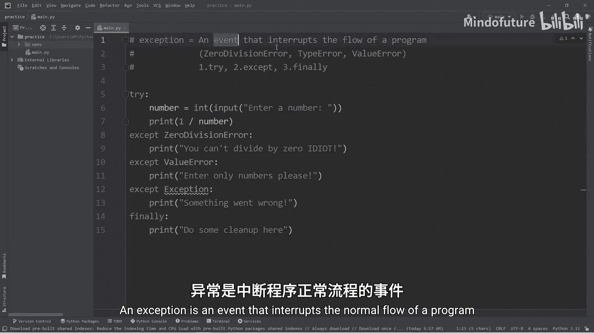
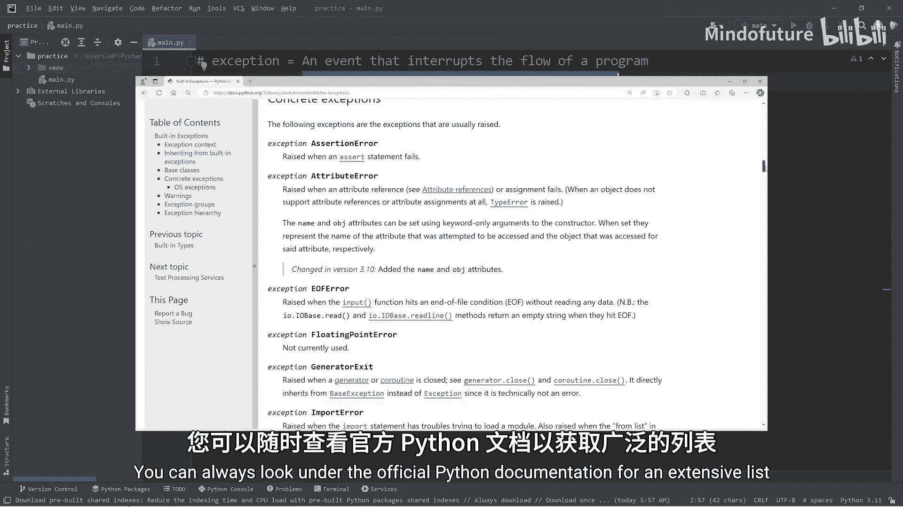
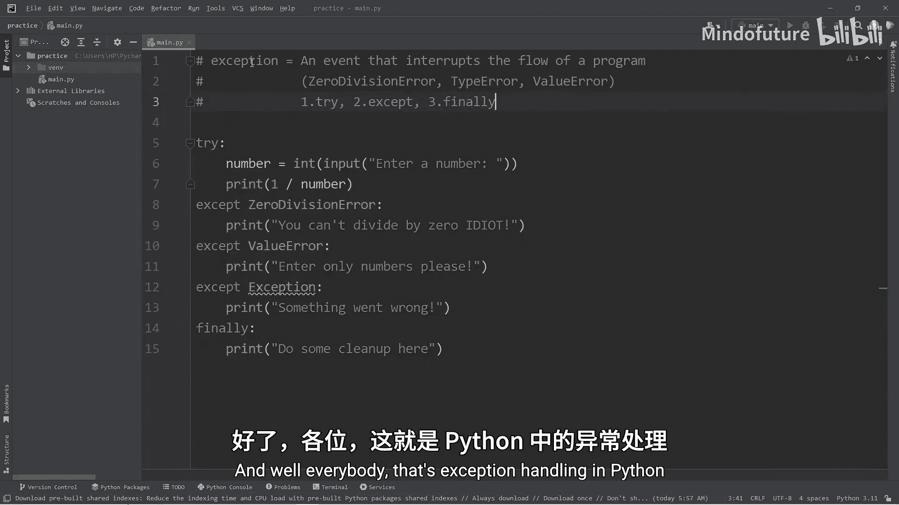

# Python超全入门教程-p69-P69-Learn-Python-EXCEPTION-HANDLING-in-5-minutes--BV1fcdLYXEw9_p69-

Everybody， So today， Ive got to talk about exception handling in Python。

 An exception is an event that interrupts the normal flow of a program。

 There are many different types of exceptions， which include。

 but are not limited to zero division error exceptions。 when you attempt to divide a number by 0。

 for example， one divided by 0。 That would interrupt our program。 We have a zero division error。

 Another is a type error。 That's if we attempt to perform an operation of a value that's of the wrong data type。

 For example， one plus a string of  one。That would give us a type error。

 unsupported operaand for int and string Val errors tend to happen when you attempt to type cast a value of the wrong data type。

 So let's say we attempt to type cast the word pizza as an integer。Well， pizza isn't a number。

 we have a value error， invalid literal for int base with 10 pizza。

 so exceptions will interrupt our program if they're not handled gracefully。

 and here's how we can do that。There's three steps We can write a try， except。

 and finally block any code that's dangerous where it could cause an error you'll place within a try block。

For example， anytime we accept user input， that is considered dangerous code because a user can type in anything。

 so let's say we have a number。Number equals， we will accept some user input。

We will tell a user to enter a number。Then we're going to type cast it as an integer。Then。

 I'm going to print。One， divided by whatever the user types in。If I were to type in zero。

We get a zero division error。If I type in the word pizza， we get a value error。

We would like to prevent our program from stopping。 This code is considered dangerous。

 A user can really type in anything。So we're going to surround this code within a Tri block。

We'll type try。Colon， and then indent any coat underneath it。We're going to try this code。

 If an exception happens， we will move on to step 2。Subsequently following the try block。

 we will add an accept block。If we run into one of these exceptions。

We can execute some alternative code， for example， a zero division error。

If somebody attempts to divide a number by  zero， we can take a different course of action instead of our program crashing and coming to a halt。

Let's print。You。Can't divide by zero。Idiot。Let's attempt to divide by0， enter a number0。

You can't divide by zero， idiot。We have gracefully handled this exception。 So now。

 let's say somebody types in the word pizza when we're asking for a number。Well。

 we have a value error。While we can chain except blocks， if we encounter a value error。

Let's add an accept block for that， Ac value error。We're going to print。Enter only numbers， please。

Enter a number， I'll type in the word pizzaizz。End her only numbers， please。That's good。

 We're not interrupting our program。 Now， what you may see some people do is they will just catch all exceptions。

 except。Exception。Now， this is actually considered bad practice。

 Exceptceptiontion will catch all exceptions。 However， it's too broad of a clause。

It's good practice to tell the user what went wrong exactly。

 If we resort to just catching all exceptions。You may see an error message such as something went wrong。

I'm looking at you， Microsoft。 We want to tell the user what went wrong exactly。

 I would only catch all exceptions as a last resort。 First。

 let's try and tell the user what went wrong exactly。So I'm going to undo all this code。

If there' is an exception that occurs， it's not a zero division error， and it's not a value error。

Then we can add that catch all where we catch any unseen exceptions。Now， lastly。

 we have the final block。 The final block always executes。 regardless if there's an exception or not。

 it's usually used for any sort of cleanup that you need to do， such as if you're handling files。

 You may try and open a file。 And then you want to be sure to close that file when you're done with it。

 that would be handled within the final block。 but we'll get to file handling pretty soon in the next topic。

So just for the time being， I'm going to print。Do some cleanup here。All right， let's test this。

Enter a number， I'm going to divide by 0。You can divide by zero。

 and we still execute the finally block。Enter a number， I'll enter in one。1 divided by one is one。

And we still execute that finally block。The finally block will be more useful in future videos。

 All you need to know is that it always executes regardless if there is an exception or not。

 Al everybody。 So that's exception handling。 An exception is an event that interrupts the normal flow of a program。

 There are many different types of exceptions。 You can always look under the official Python documentation for an extensive list。

And well， everybody， that's exception handling in Python。

