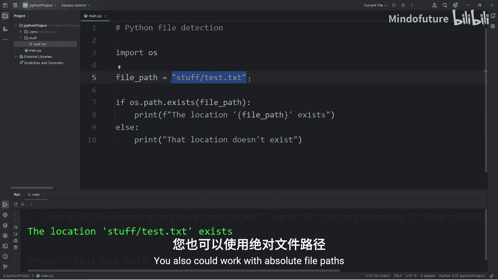
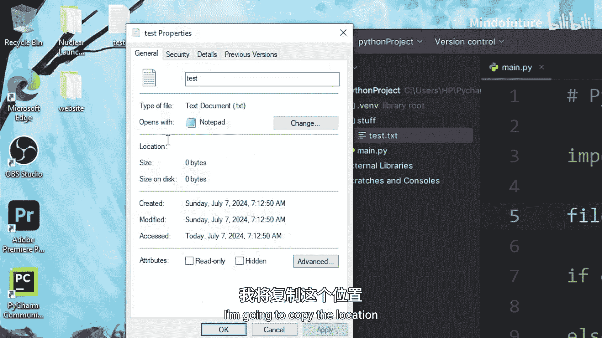
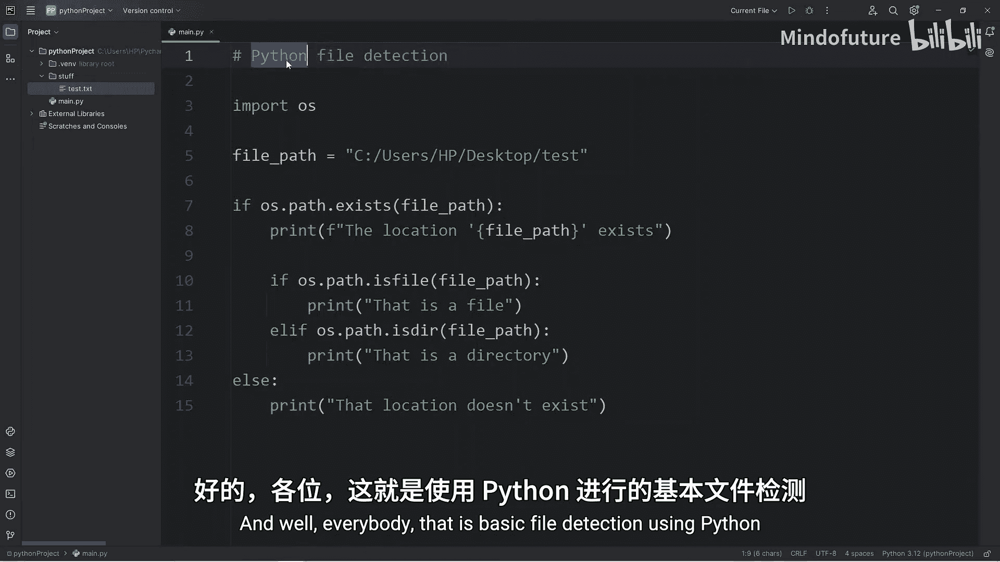

# Python超全入门教程-p70-P70-Learn-Python-FILE-DETECTION-in-7-minutes--BV1fcdLYXEw9_p70-

Hey， what's going on， everybody。 Today， I'm going to show you how we can handle basic file detection using Python。

 This topic is the first of many involving a minise on file handling using Python。 First。

 we'll need to cover file detection before we read and write files to work with files using Python。

 We will import the O S module。 O means operating system。

 This module provides a way for Python programs to interact with the operating system。

 Be sure to import the O module at the top。For my demonstration within my project folder。

 I'm going to create a new file， new file。 I will name this file test。

 and this will be a plain text file。 It will have the file extension of T， X T。

This file really doesn't need to say anything。 I'm just going to type， I like pizza because I do。

The context doesn't matter， we're not going to be reading files in this video。For convenience。

 I'm going to assign a variable of Fpath。This will be a string for file detection。

 We can either use a relative file path or an absolute file path。

 We'll cover relative file paths First。 These two files are right next to each other。

 My main python file and my test file。 If we're using a relative file path。

 I only need the file name， including the extension test dot T X， T。

We'll be passing in this string of fileile path as an argument。To check to see if this file exists。

 I will use an if statement， if access the OS module。Access the path。

There is a built in method of exists。We'll pass in our file path as of the argument。

This method returns a Boolean value of true or false if this file exists。So if this file does exist。

 test。txt， let's print the following。I'll use an up string。The location。I'll add a placeholder there。

Exists。I will place my file path within that placeholder。

And I'll surround it with single quotes to make it look nice。If this method returns true， do this。

Else， we'll do something else。I will print。That location。Doesn't exist。All right。

 let's see what happens。The location test。txt exists。Now what if I get the extension wrong。

 let's say that I'm looking for a PDF， but it's really a TXT file。Well， that location doesn't exist。

You do have to be sure to get the file extension correct。What if this file was in a folder。

Within my Python project， I will create a new directory。I will name this directory stuff。

Then I will place my test file within the stuff folder。

Pe Char wants me to refactor my code because the location changed， I'm not going to do that。

I'm going to be sure that this box is unchecked and press refactor。We're using a relative file path。

 that test file is no longer next to my main Python file， here's what happens。

That location doesn't exist。With our relative file path， we'll have to navigate to our stuff folder。

 then find the test file。 So preceding this file name。

 I will access the stuff folder St slash the name of the file， test TXG。

And now we can locate that file， the location stuff slash test exists。

When working with relative file paths， you may need to open up a folder， then find your file。

You also could work with absolute file paths。

So for this demonstration on my desktop， I'm going to create a new file。new。Text document。Test。

If I were to look at the properties。This is a TXT file， a text document。

I am going to copy the location。

Within my file path， I will paste it。😡，Then list the name of the file， test。txt。

This is an absolute file path。One problem we're running into when working with strings。

 a back slash does serve as an escape sequence。 Python thinks we're trying to print a tab character。

We can solve this with doubleback slashes。Or we could use a forward slash。The other one works。

 All right， let's see if that file exists。That does。

The location of that absolute file path does exist。If I were to get the extension wrong。

Let's say this is a PDF。Well， that location doesn't exist。

There is a built in method of is file to check to see if that file is， in fact。

 a file and not a directory。 Let's add the following。After we detect this file。

 we'll write a nest statement F O。path dot is file。Then pass in our file path as an argument。

If this file is in fact a file and not a directory。I will print。That is a file。

The location of that absolute file path does exist。 That is a file。 What if it was a directory。

 a folder。I'm going to delete this， go to new。Folder。I will name this folder test。

To check to see if a location is a directory， let's add an Elsive statement else， if O S。Dot path。

Dot is D， meaning is directory。This is a method we'll pass in our file path。If this is a directory。

 a folder。I will print。That is a。Directory。Let's run this again。That location doesn't exist， Oh。

 we have to get rid of the file extension。It is not a plain text file。

The location of that absolute file path exists。 that is a directory， a folder。Al right everybody。

 that's basic file detection in the next few videos we're going to be reading and writing files and well everybody that is basic file detection using Python。

