# Python超全入门教程-p71-P71-WRITE-FILES-using-Python--(.txt,-.json,-.csv)--BV1fcdLYXEw9_p71-

Hey， what's going on， everybody。 In today's video， I'm going to show you how we can write and output files using Python。

 We'll cover plain text， Json and CSV files， but we'll start with plain text because it's the easiest。

 Suppose we have some data that we would like to output。I'll create a variable of text data。

Think of a food you like， I will output， I like pizza。For convenience。

 we'll create a variable of file path。This can be a relative file path or an absolute file path。

Within this file path， we'll need a name for this file。I will name this output。

 then include the file extension， this will be a TXT file， a plain text file。

This is a relative file path When I generate this file。

 it will be within the same project folder as my main Python file。To create a file。

 we'll write the following。With。Open function。Pass in our file path。And a character of W to write。

 as file。And for now， I'll right pass。There's a few things going on here。With is a statement。

 It's used to wrap a block of code to execute。 If we open a file。

 the width statement will also close that file when we're done with it。

 So we don't need to manually close files。 When you open a file， it is good practice to close it。

 because if you don't， you may run into unexpected behavior。

 The width statement takes care of that for you。 The open function will return a file object。

 The first parameter is the file path。 The second parameter is the mode。 W is right。

 X will also write if this file doesn't exist。 If it already does exist， will receive an error。

A is for append to appendophile， and R is to read， but we'll take care of reading in the next video。

 So we will stick with W to write a file。 The open function returns a file object。

 The first argument is the file。The second argument is the mode。

You can set these to be keyword arguments if it's easier for you to read。

When the open function returns a file object for us。

 we're using the as keyword to give it a name as file。

 It's kind of like we're instantiating a file object file equals file。

File is the name of the file object。To write to this file， we're going to take our file object。

 use the built in right method。Then pass in our text data。Then when this is done。

 I'm going to print a confirmation message。I'll use enough string， let's say text file。

I'll add our file path。Place it within single quotes。Was created。Let's see what happens。

TextViile outputput。txt was created。And here's that file。I like pizza。

We also have the capability of setting an absolute file path。

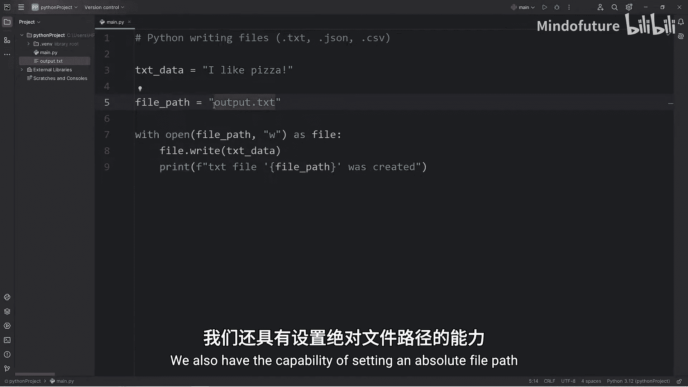

Let's say I would like to output this file to my desktop。I would just need that location。

Let me just get the location from one of these folders by going to properties。

I will copy this location。 This is the location to my desktop。

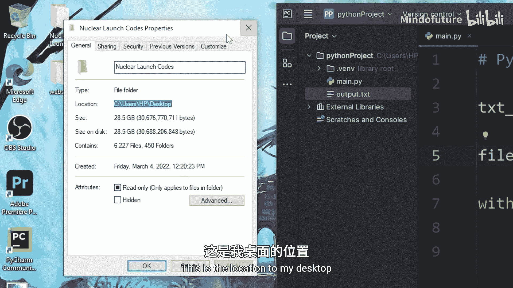

But for you， it's probably going to be different。Then I will paste the absolute file path。

A backslash is an escape sequence within a string。We either could use double back slashes。

Or a forward slash。Now， let's see if this outputs to my desktop。

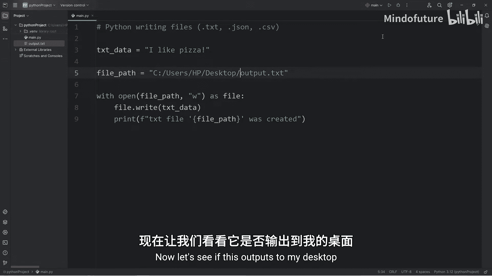

Text file。Here's the file path was created， and here's that file。It's a plain text file。And it says。

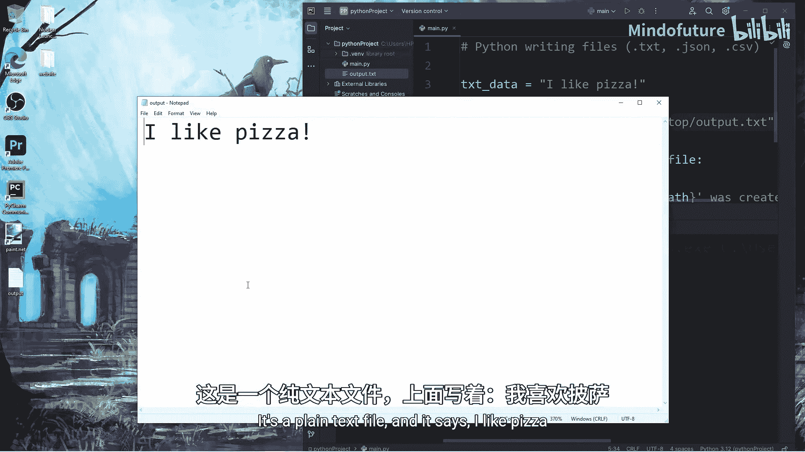

I like pizza。So when working with the file path， it can be a relative file path or an absolute file path。

All right， now for our text data。There are different modes as well。 W is her right。If we use X。

 we'll write a file if that file doesn't already exist in this case it does on my desktop。

 we already have a file named output， and it's a plain text file。So when I run this。

With the boat of X， we get a file exists error。 That file already exists。

We could catch this exception so that our program isn't interrupted。

 I will copy the name of this error。I will place my code within a try block。

We will try this code and catch any exceptions。Acept file exists error。If this file already exists。

 let's take a different course of action。 Let's print that file。Already exists。

So now when I run this again， our program isn't interrupted。 We received this message。

 That file already exists。If I were to delete that file。拜e拜e。Then run this again。Well。

 we created a new file， text file， that absolute file path was created。And here it is again。

Now for the mode， there's also a， a to append， Any new data will be appended to that file。

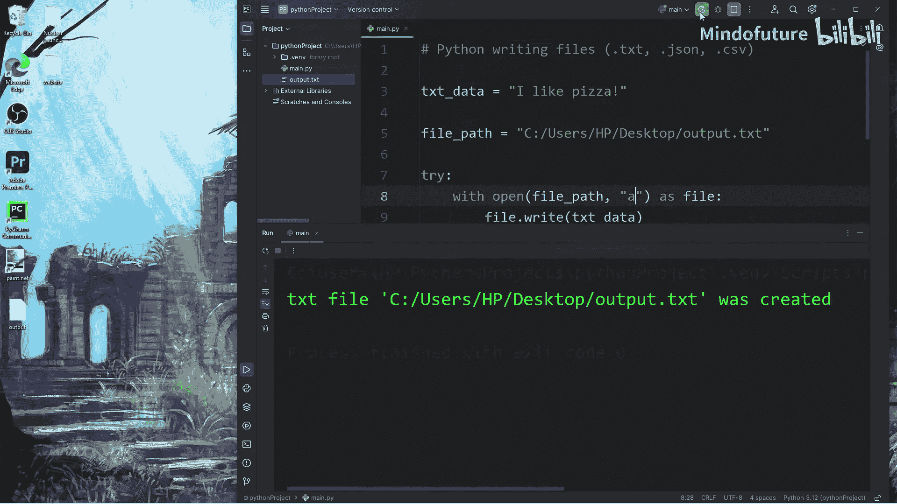

We get。I like pizza， I like pizza。

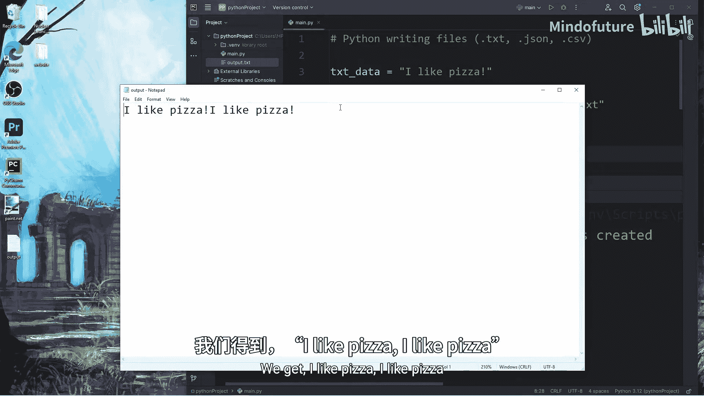

When app data， if you would like that data on a new line， we can add a new line character。

W will overwrite a file。So we're back to the original。

When app either before or after we write our text data， we could add a new line character。 Let's say。

 let's do that before。New line plus our text data。

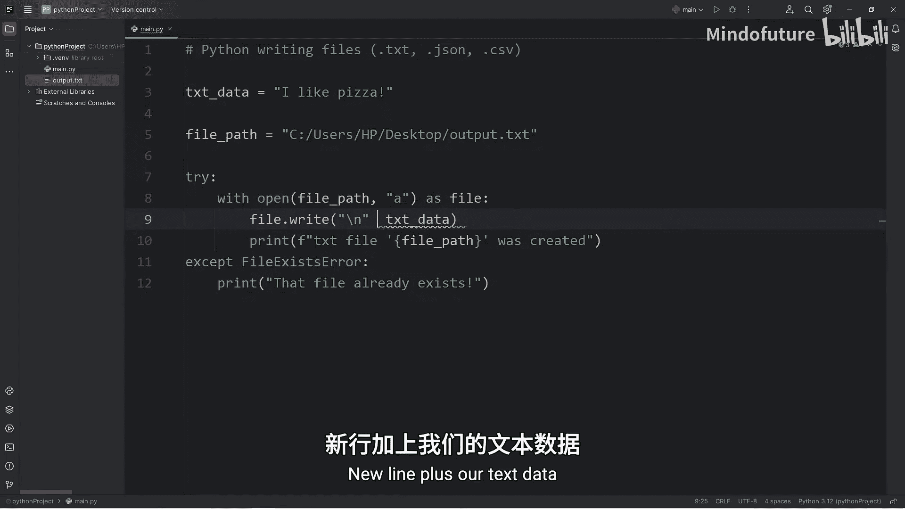

Here's the output。Again， we're appending， not writing。I like pizza。 I like pizza。

 Our second sentence is on a new line。 Let's run this a couple times。

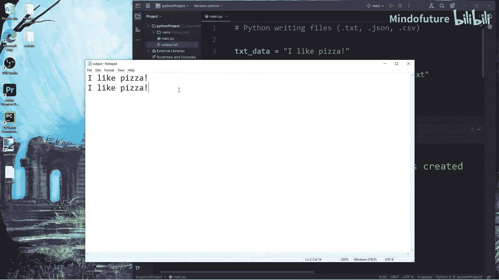

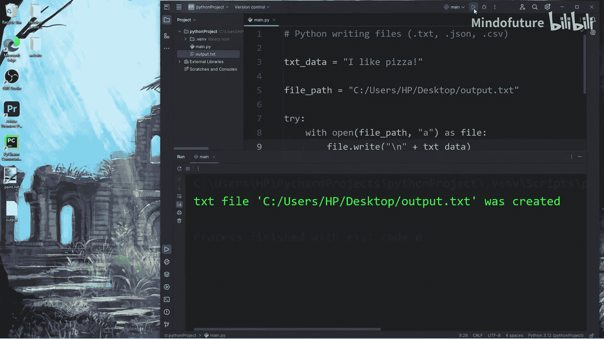

We should have several lines now。

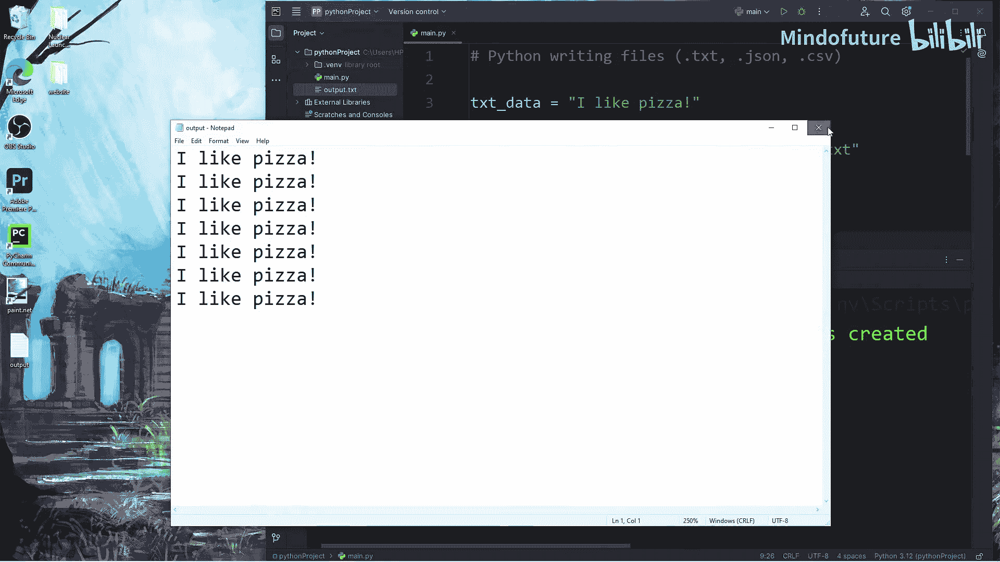

Let's work with a collection。 Let's say we have a list of employees。

We'll pick some employees at the crusty crab。So we have Eugene。

 I guess he is technically the manager， I don't know if that counts as an employee。Squiid word。

Spgeebob。And Patrick， Patrick worked at the crusty crab in one episode。 he counts。

Then we'll to be sure we're writing our employees。This is what's going to happen。

We have a type error。Right argument must be a string， not a list。

In order for us to write each item within a list， we'll need to iterate over it using some sort of loop。

 We can't write a list or any other collection directly。Here's what will change。For every employee。

In our collection of employees。We're iterating over something that is iterable。

We will access our file object， use the right method， then write each employee。

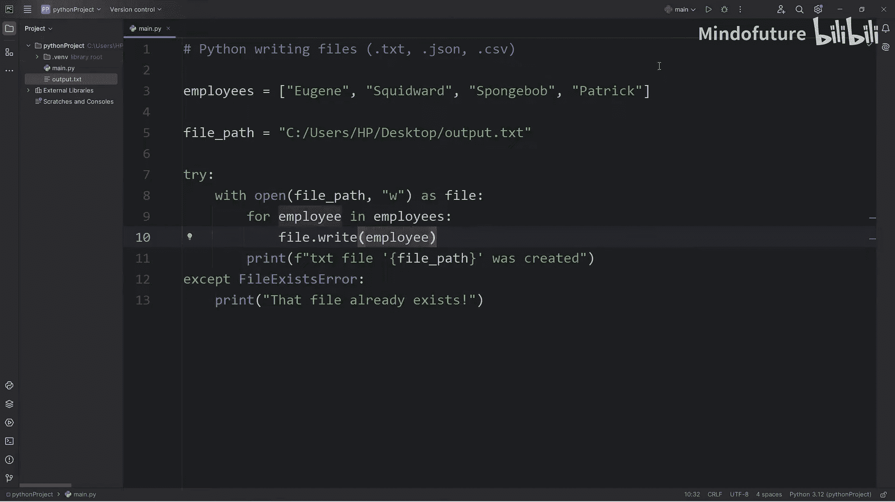

Here's the result。We get one long string of each item in this list。

If you prefer， after writing each employee， we could add a new line character after。

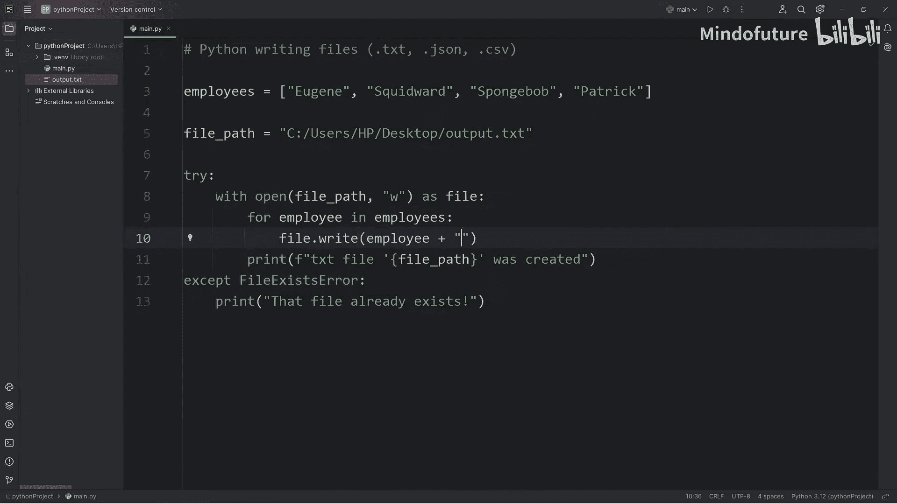

And here's the output。We get each item in our list on a new line。Or rather than a new line character。

 we could use a space。This would output all the employees， but space them out。

Now we'll be outputting a JSON file In summary， a JSON file is made of key value pairs。

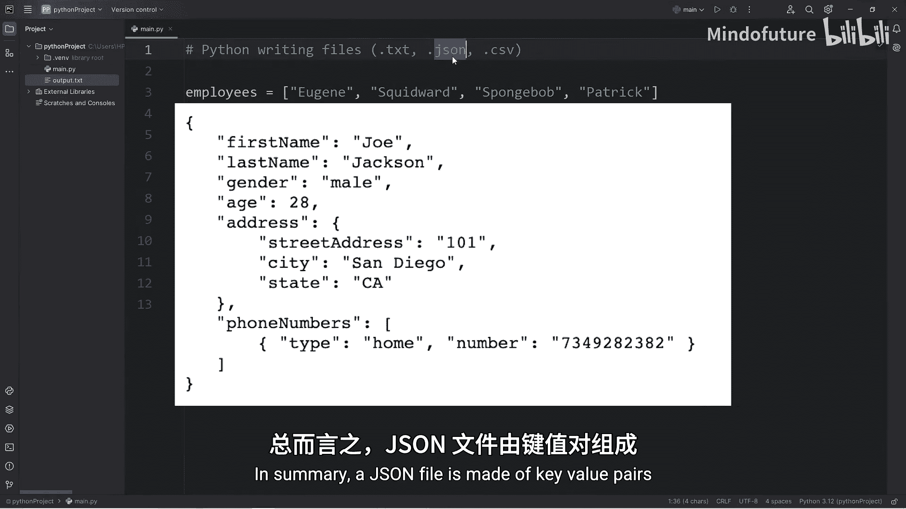

Far data， let's say we have a dictionary。Of employee。A dictionary is made of key value pairs。

 will have a name。Of sponge，ebob。Sponggeebob's age。Will be 30。His job， his position。

Is that he is a cook。So this is the data I would like to output， I'll keep the file path the same。

We'll change the file extension to dot JSON。We will need the help of the JSON module。

 let's be sure to import that。Import Json。Within our width block， we'll make the following change。

We're going to access our JSON module。Use the dump method。

The dump method will convert our dictionary to a JSO string， to put it。

So we have to pass in our JSON data ofEmploy。Our file as the second argument。

Then for a confirmation message， let's print Json file was created。Here's the result。

JSON file at this location was created。

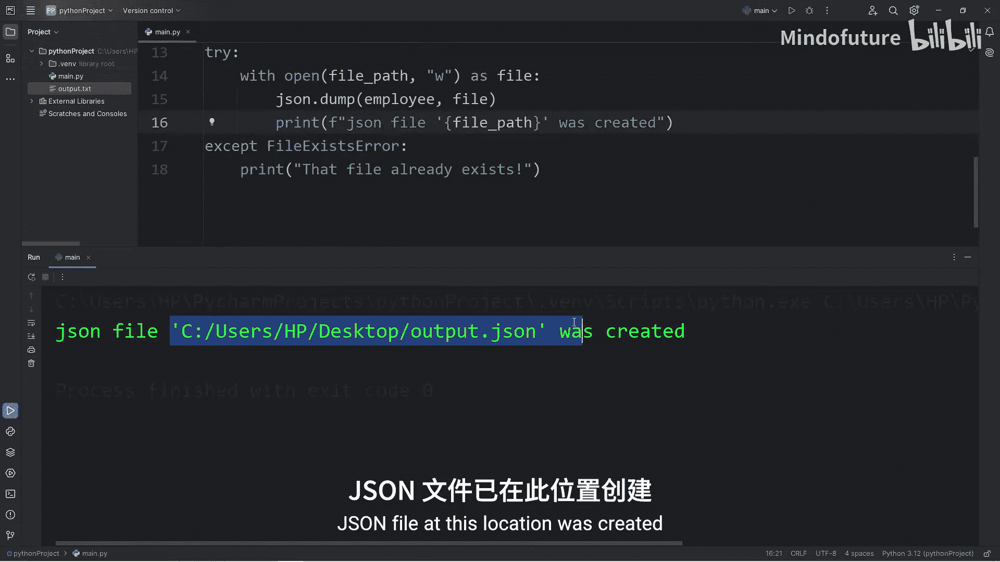

And here's my JSON file。 I'll go to properties。 We'll confirm it is a JSON file It is。

And I'll open it。Here's the result。Now you could add indentation after each key value pair。

 here's how。

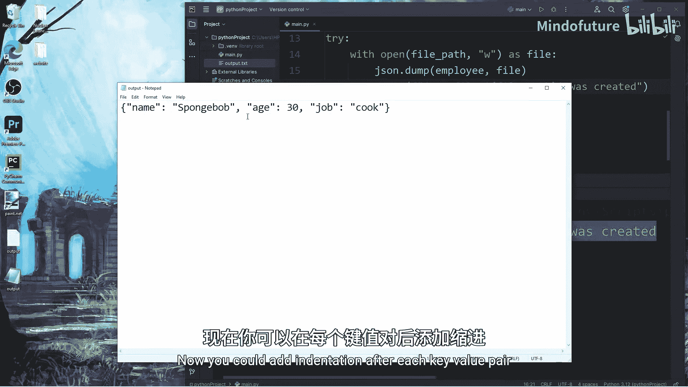

After our second argument， our file。We can pass in a keyword argument of indent。

For each key value pair， by how many spaces do we want to indent each， let's say4。

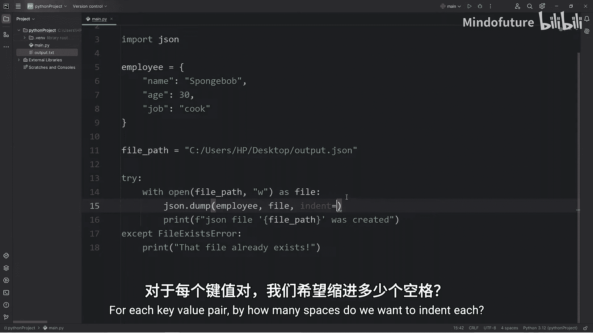

And let's take a look。I think that's more readable。

We're indenting each key value pair by four spaces。So that is a JSON file。

 it's a collection of key value pairs。

A dictionary or anything that uses key value pairs is a great candidate to be output to a J file。

All right。 Now we're going to work with CV files。 CV means comma separated values。

 CV files are pretty common with a spreadsheet of data like an Excel spreadsheet。

 We will create a 2D data structure of employees。This will be a list of lists。Let's add4。

We' need the help of the CSV module， import CSV。Think of our 2D data structure as a table of rows and columns。

 So for the first row， I will add name， comma age。Coma job。

The second row will have a name of Sponongebob。Age 30。Job， cook。For the next row， we'll have Patrick。

Patrick will be 37。What is Patrick's job， I don't know。 He's unemployed。Then we'll have Sandy。

Sandy will be 27。Sandy is a scientist。Okay， now with our file path。

 the file extension is going to be a CSV file， comma separated values。

Within the context of our width block。We're going to create a writer object。To write to a file。

Writer equals access the CSV module， use the writer method of that module。Then pass in our file。

Wrier is an object， it provides methods for writing data to a CSV file。

And then we'll print a confirmation message of CSV file was created。Here's the output currently。

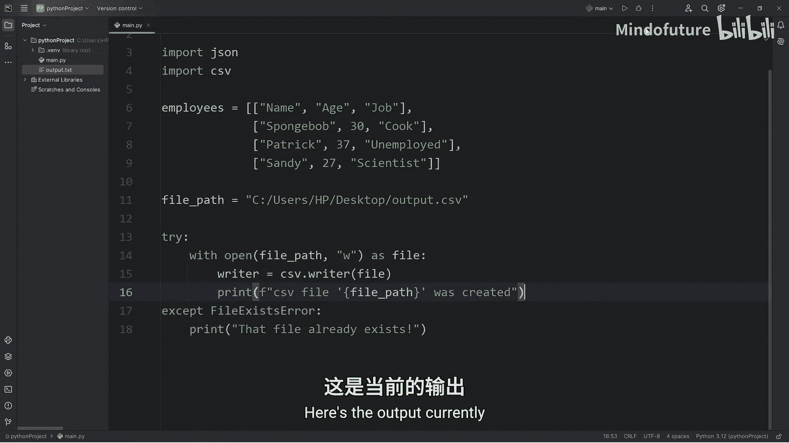

We have a CSV file， I'll go to properties to confirm it。Well， we have no output。

We have to iterate over all the rows in our 2D collection。We'll write the following。For every row。

In our data of employees。We'll take our writer object。Use the right row method。

And pass in that row that we're iterating over。Now， let's take a look。

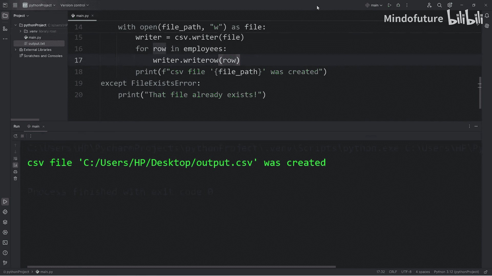

That's better。However， the writerer method gives us a new line after each row。

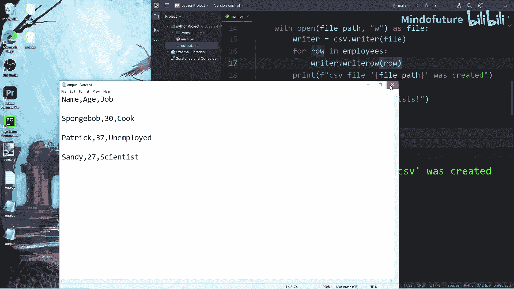

So if we would like to prevent that。When we open this file。

I will set the keyword argument of new line。Equal to。No characters。An empty string。

Let's take a look again。

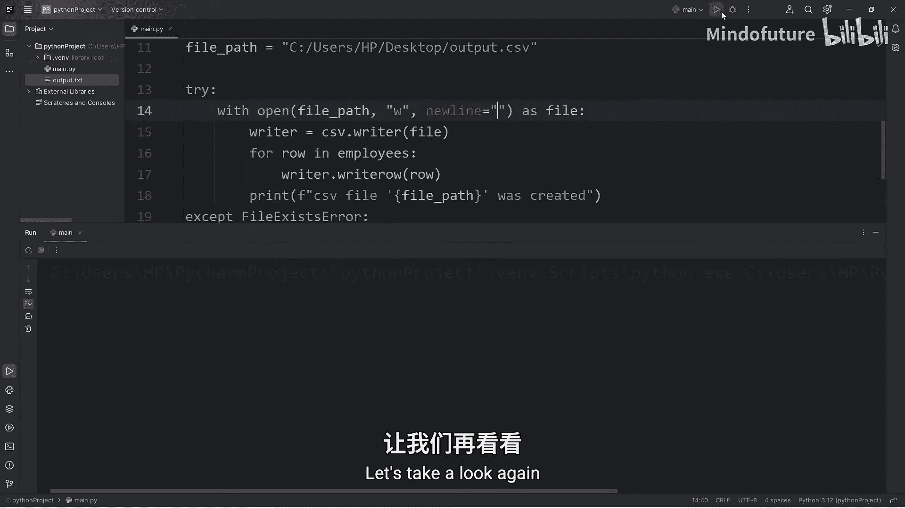

Yeah， that's much better。So this is a CSV file。 It's made of comma separated values。

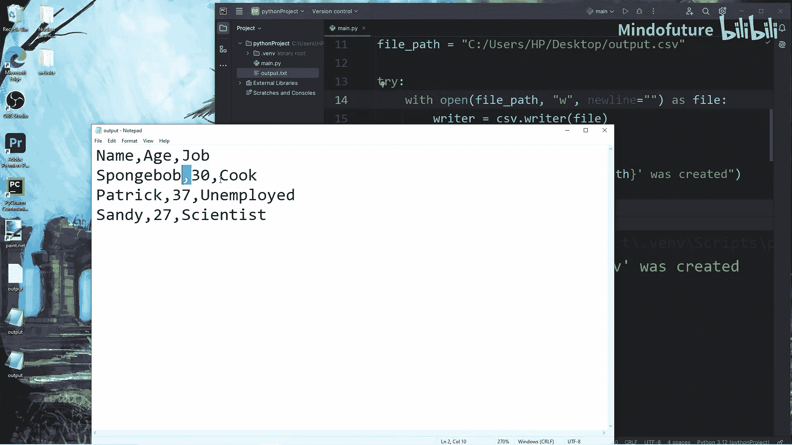

All right everybody， so that is an introduction to writing files using Python。

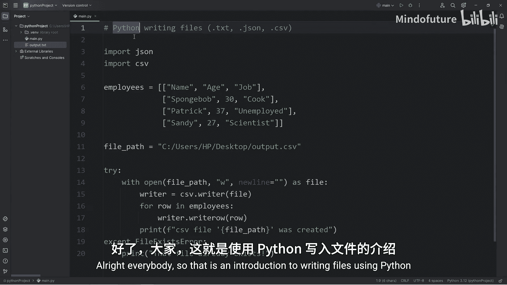