# Python超全入门教程-p72-P72-READ-FILES-using-Python-(.txt,-.json,-.csv)--BV1fcdLYXEw9_p72-

What's going on， Everybody。 Today， I'm going to show you how we can read files using Python。

 We'll cover plain text， Json and CSV files In the previous topic。

 we have created some sample files to work with。Here is my plain text file。

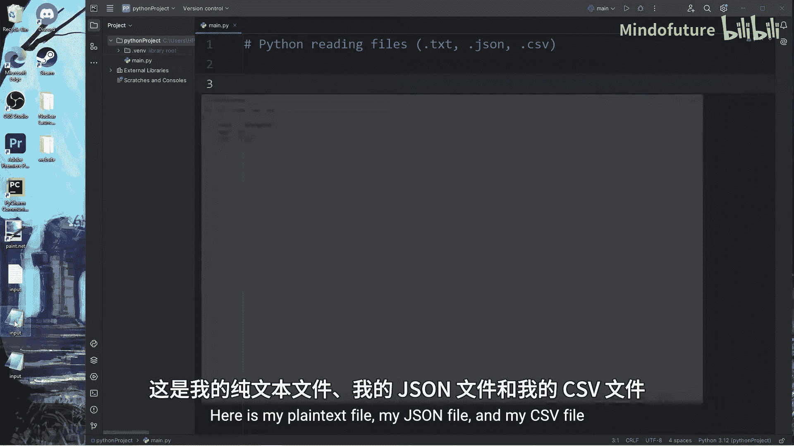

My json file。And my CSV file。

They're all named input， they each have a different file extension。For convenience。

 I will create a variable a file path。We can list a relative file path or an absolute file path。

 I'll use an absolute file path。

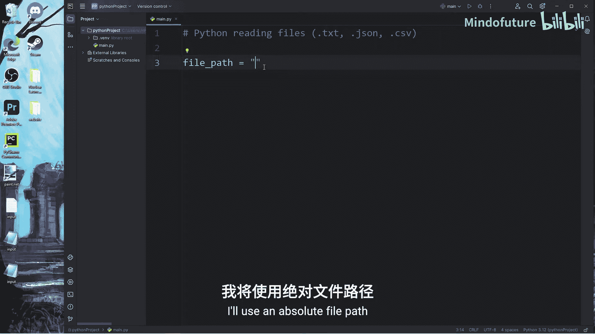

I'm going to right click on the file I would like to read， go to Properties， copy the location。

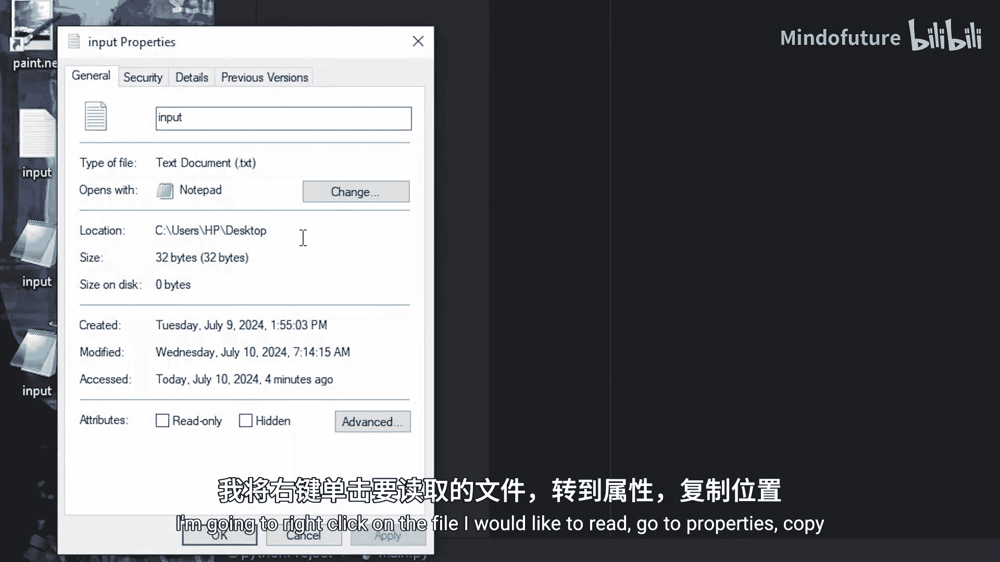

Then paste it。Then add the file name， including the extension input， and this is a TXT file。

Within the context of a string， back slashes are escape sequences for special characters。

 we would either need to use double back slashes or a forward slash。

Here is the absolute file path to the file I would like to read。To read this file。

 I will add a width block。With is a statement， it's going to wrap a block of code within a context manager。

And it'll close a file if we open it。 it is good practice to close a file。 if you do open it。

 if you don't， it can lead to unexpected behavior。 We will use the open function。

The open function has two arguments。Our file path。And a mode。

To read a file we'll set the mode to be R for Read。

The open function is going to return a file object。Which we will give a nickname of file。As file。

When we read our file object， it's going to return one long string。

Which we will assign to a variable named content。Content equals file。

 use the read method and assign it to this variable。Then I'm going to print the content。

Print our content， the content of the file。 Here's the result。That is the content of my file。

 I like pizza。 It's really good。

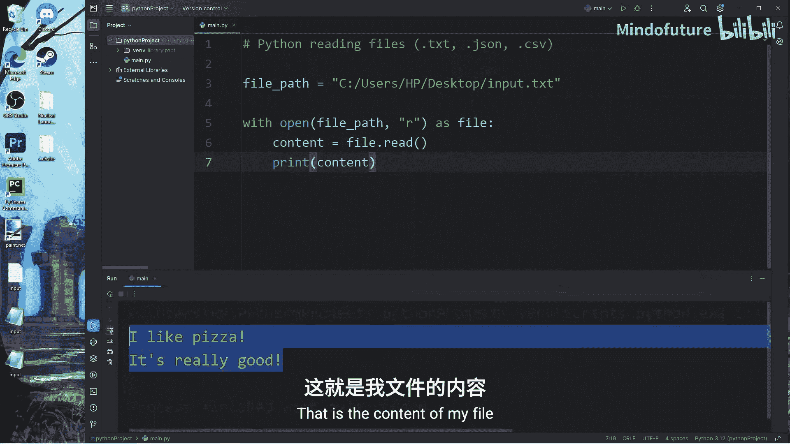

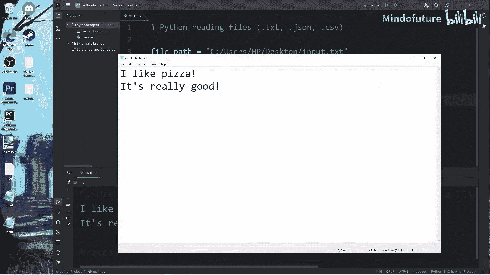

Let's say we can't find this file， perhaps I forget the file extension。

We'll run into a file not found error。 This will interrupt our program。

 We can catch exceptions when they happen。 Any dangerous code that may cause an exception。

 we can wrap within a try block。If there's an exception。We will catch them。

By stating accept the name of the exception， in this case， file not found error。

Instead of our program being interrupted。Let's take a different course of action。We will print。

That file was not found。Let's try this again。That file was not found。

 At least our program isn't being interrupted。Let's add the file extension back。

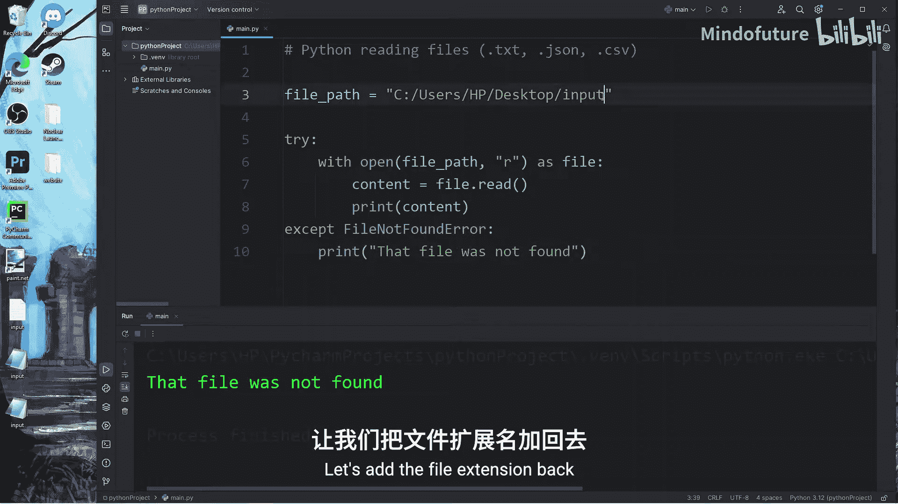

What if we don't have permission to read this file？

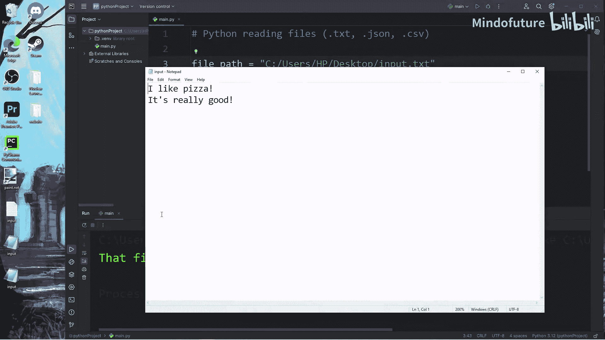

To demonstrate that， I'm going to right click on that file， go to propertiesper， go to security。

Edit the permissions。

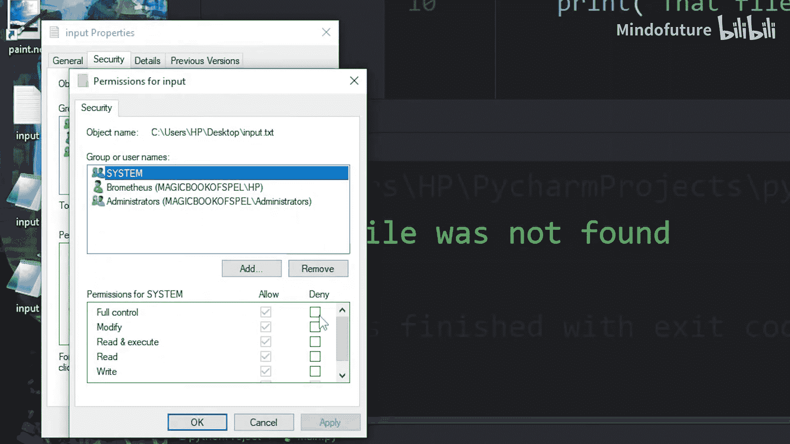

I will deny any sort of control。I will attempt to read this file。And we get a permission error。

 permission denied。We could handle this exception as well。If we encounter。A Per error。

I will print the following。You do not have permission。To read that file， let's run this again。

You do not have permission to read that file。Those are a few exceptions we can handle in case they appear file not found errors and permission errors。

Let's say we would like to read a JSON file。 We will need the help of the JSON module。

 I will import the JSON module at the top of my program。

I need to get the file path of this JSsonN file。It's pretty much the same as before in this case。

The file extension is a JSO file。There's only one change we're going to make。

We will assign our variable of content equal to access the JSO module。

Use the load method and load our file。And that should read the contents of my file。

Here's my Json file name Sponongboob age 30， job Cook。With the data of your JSON file。

 you could access a value given a key。I will access our content by its key of name。

That will return the value of SpongBob。Age。30。Job。Cook。😡，Now here's how to read a CSV file。

We will import the CSV module。The file extension is going to be CSV。 Again。

 this is on my desktop in the same location as the previous files。

My content will equal access the CSV module。Access the reader method。And pass in our file。

Here's the content currently。We're given a memory address。With the CSV file。

 what we need to do is read the CSV file line by line。

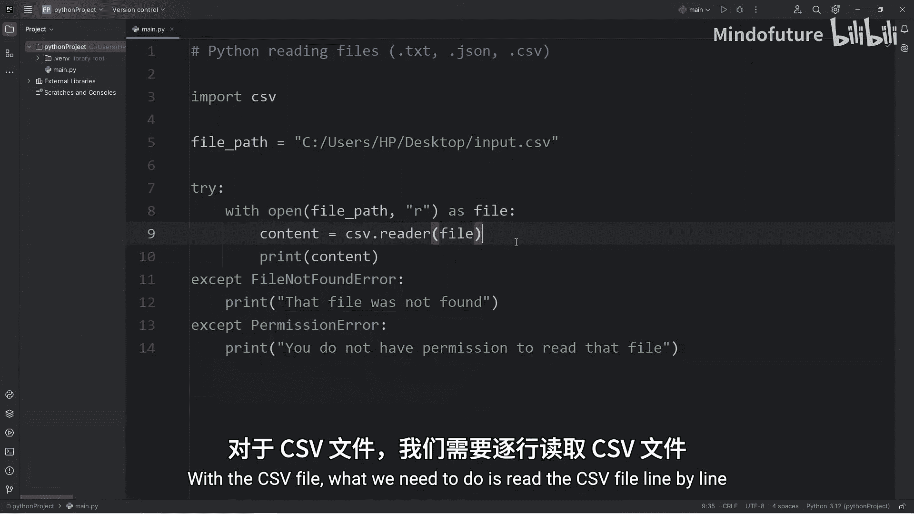

All of the data is within a collection， which we need to iterate over。

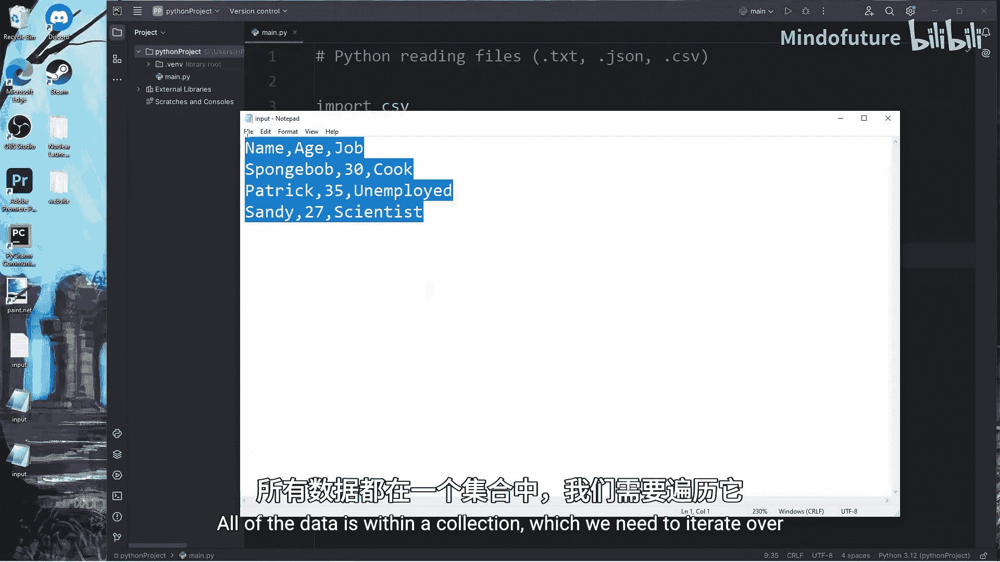

So to do that。We're going to create a for loop for every line。In my content， I will print each line。

That's much better。The format resembles a spreadsheet like an Excel spreadsheet。There's Rose。

And columns。To get a specified column， we can access an index。In my example。

 our line at index of  zero。Would give me the first column name， Sponggeebob， Patrick， Sandy。

The next index would be all the ages of each person。30， 35，27。And index 2 would be the job positions。

 cook， Unemployed and scientist。If you need a specific column of data from a CSV file。

 you can use an index as one possibility。Al right everybody。

 so those are a few ways in which we can read files using Python。

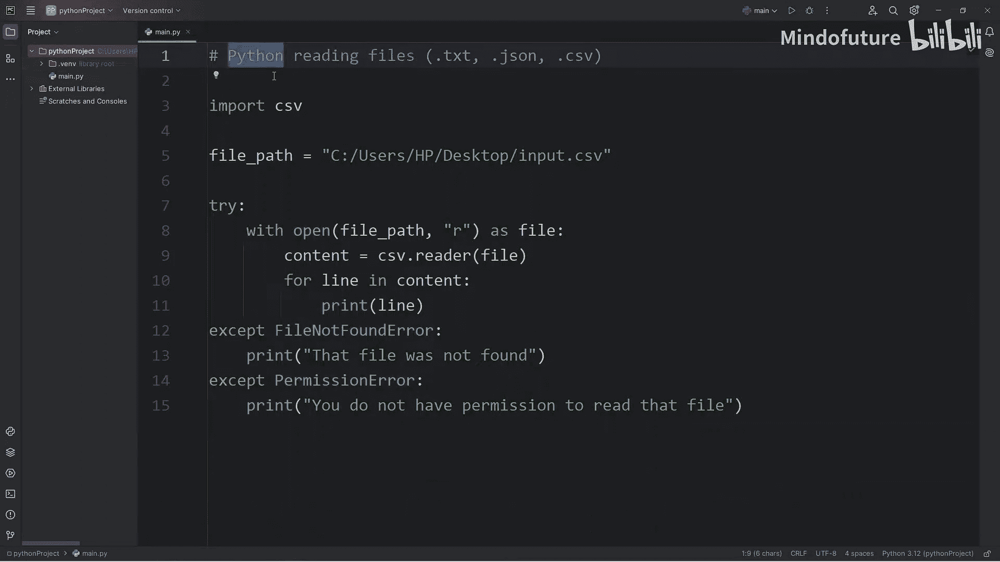