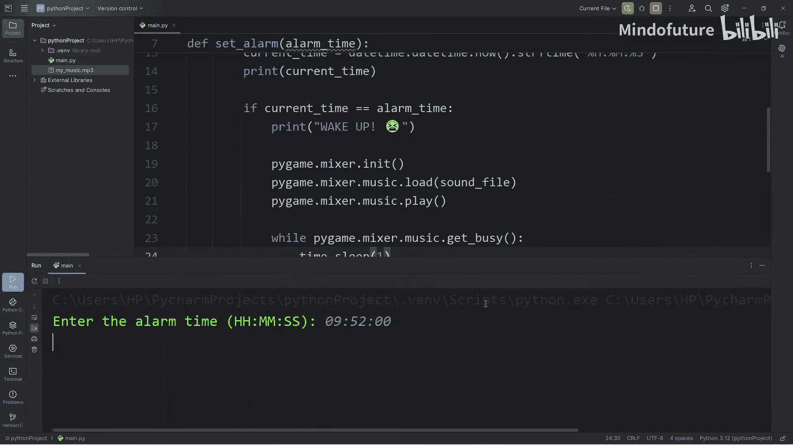
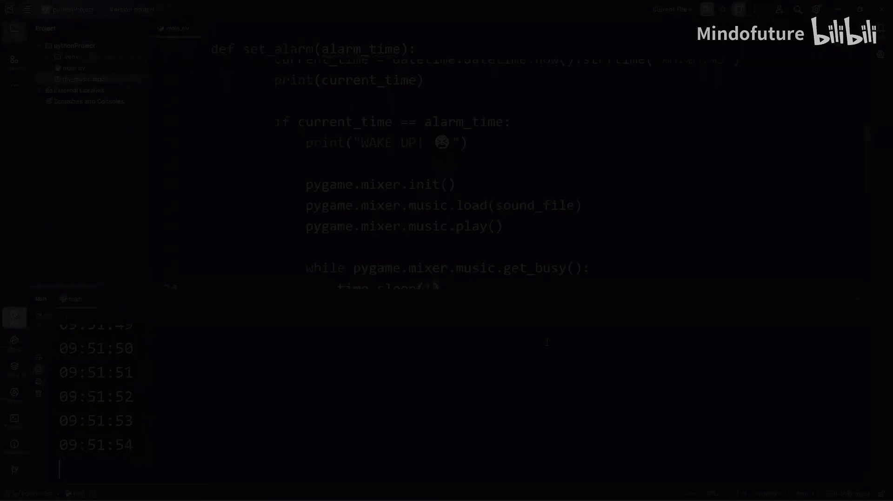
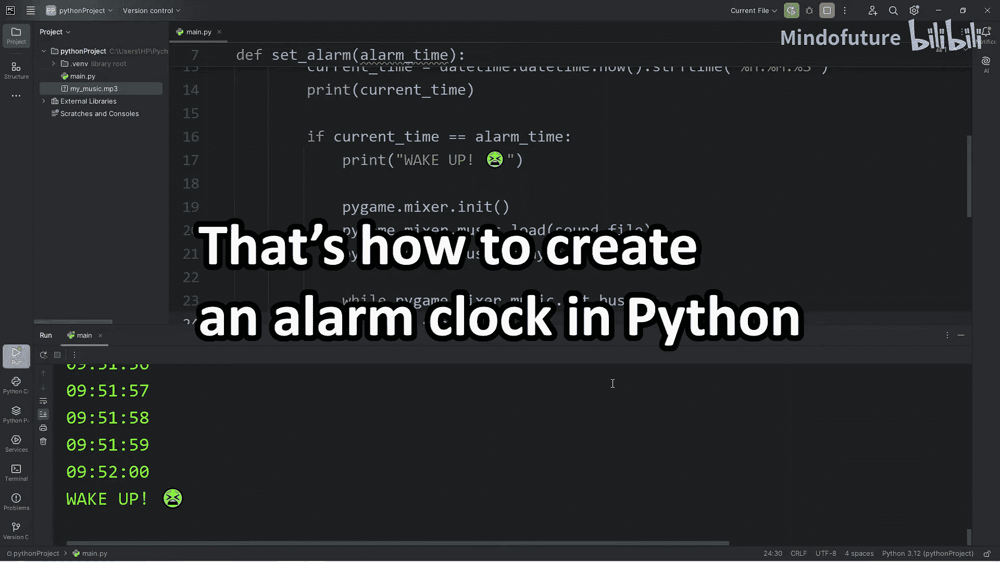

# Python超全入门教程-p75-P75-Lets-code-an-ALARM-CLOCK-in-Python--BV1fcdLYXEw9_p75-

Al right everybody， so in today's video we're going to create a working alarm clock using Python。🎼。

Yeah。🎼。For this project， we will need the following imports。 We will import time。

 We'll be updating our clock every second。 The time module is going to help us with that。

As well as import date time， the date time module allows us to work with string representations of a time。

 In my opinion， the easiest way to work with sound effects is to actually use pi game。

 So we will import Pi game。Now， you may need to download the pie game package here。

 I'm getting a message that there is no module named Piga。 There might be a link to install it。

 even too。One way in which you can download the pie game package is to open up a terminal。

Then use Pip Pip is Python's package manager。Pip， install pie game。All right。

 We have our three imports。Let's create a function to set alarm。We have one parameter， an alarm time。

And for now， a right pass。Our alarm time parameter is going to be a string representation of a time in military time。

I would like to start this program if I am running my main Python file directly。

I can add the following of statement。If under name。Is equal to a string。Ofb Dunder Maine。

If we are running this main Python file directly， then we will set the alarm。 But first。

 we have to prompt the user what they would like to set the alarm to。

 So we will define a variable of alarm time equals。 ask for some user input using the input function。

 We will prompt the user to enter the alarm time and give a format。Hs。Minutes and seconds。Again。

 this is going to be in military time。Once we have our alarm time。

 we will call the set alarm function。And pass in our alarm time。All right。

 We are now within the set alarm function。When we call this function， let's print the following。

 I'll use enough strain。Alarm set for， then include the alarm time。

You will need an MP3 file to work with。If you don't have one available， heres one recommendation。

You could use YouTube's audio library and then search for sound effects or some music。

 These audio files are only allowed for non commercial use outside of YouTube。

So you can search for a song or some sound effects。 Find one that you like and download it。

Once you find a song that you like， move it to your project folder。

Now I will create a variable of sound。File equals。This will be a relative or absolute file path。

 My MP3 file is right next to my main Python file。 I only need to list the file name。 I named mine。

 my music， and this is an MP3 file。I'm going to perform a test run。

 We're not going to play our sound quite yet。We do have this output that displays that says hello from the pie game community。

 Let's say I set my alarm to 9 AM。Then enter alarm set for 9 AM。

If you would like to suppress this output for pie game， we can navigate to our virtual environment。

 go to library。Pi game。Underneath this file named Dunder inni。Let's scroll all the way to the bottom。

And we should have this if statement。 We displayed the version of pie game we're using and a print statement of hello from the pie game community。

 We could comment this out， or even just delete it。That is the most simple solution。

So we shouldn't get that message anymore。We're going to create a Boolean variable of is running。

Is our alarm clock running， I will set that to be true。Whileile is running， While this is true。

 we will continue the alarm clock。We need to get the current time。Current time。Equals。

 we will access the date time module。Access the class of date time。

Call the N method to get the time and date right now。We could method chain the string format method。

S TRF time。I would like the hours， minutes and seconds， but not the date。So we will type percent H。

Cold in， let me zoom out a little。Percent M for minutes。And percent as for seconds。

We're getting the hours， minutes and seconds of the date and time right now and storing it within this variable of current time。

Then I'm going to print the current time。We'll perform a test run， however。

 currently we're within an infinite loop。At the end of the while loop， AllAT is running to be false。

Okay， enter the alarm time， let's say 10 AM。Alarm set for 10 AM。 And the time for me right now is 9。

42 and 16 seconds。We'll get rid of this line where we set is running to be false。Instead。

 I'm going to access the time module and call the sleep method。

 We will pass in a number of seconds to sleep。 So one second。I'll set the alarm to be 10 a。Now。

 the time should update every second。Which it is。However。

 when the current time is equal to the alarm time， we have to trigger the alarm。

So after printing the current time。We will write an if statement to check if the current time。

Is equal to the alarm time。If this is true， then let's print the following。Wake up。

And I'll add an emoji， causeuse it's silly。Once our alarm triggers。

 we will set is running to be false within the SF statement。Let's do a test run。

We're not going to play the sound quite yet。I will set the alarm to 9，45。

And then I'll come back a little bit later。All right。Once the current time matches the alarm time。

 we print， wake up and set is running to be false to exit the while loop。And then subsequently。

 exiting the program。Now we need to play an MP3 file。We will access our package of pie game。

Access the module of mixer。So mixer is a module for loading and playing sounds。

But we have to initialize it。But we're going to initialize it with inni to initialize。

The initialized method is another way to call the constructor。

 We can pass in some keyword arguments for the frequency， size， channels， buffer， all that。

 But that might be a little too complicated for us at this level。

We'll use the default settings by not passing in anything。The next step is to load our sound file。

Access the package of P game， access the module of mixer。Access the module of music。

 Then call the load method。We will load our sound file。

Our sound file contains the file path to our MP3 file。Once we load our music， we have to play it。

Pie game dot mixer， dot music called the play method。

Our MP3 file is only going to play for a brief second。 I'll demonstrate that。

 I will set the alarm to 9，49。And just give it a few seconds。

Our sound file stops playing when the program terminates。

What we need to do next is continue playing our sound file while that sound file is busy。

We will add a while loop。While。Access piega dot mixer。Dot music。Call the get busy method。

This returns a boolean。If our song is busy， if it's still playing。

Then we will call the time modules sleep method。And sleep for one second。

Once the song finishes or we terminate the program prematurely。

 the sound file will no longer be busy。So this should be the finished product。Let's test it。

I will set the alarm for 9，52。

And we just have to give it some time。

。🎼う。🎼う。🎼う。🎼。

