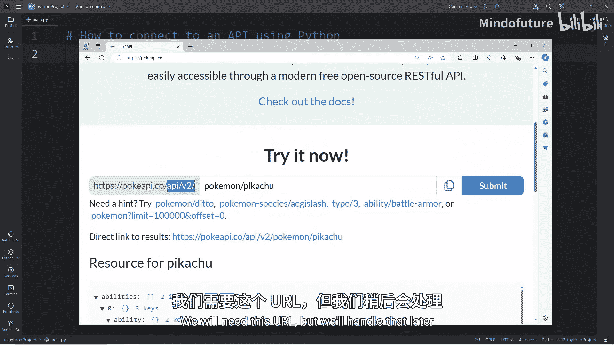
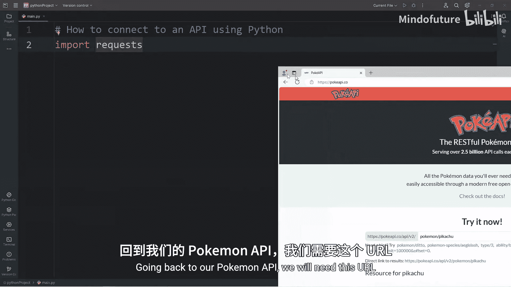
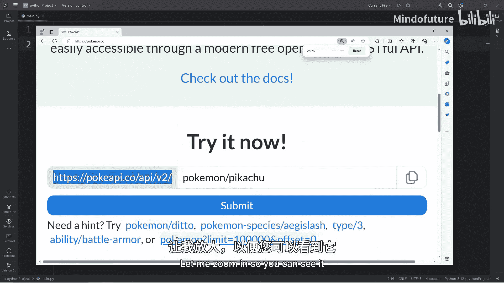
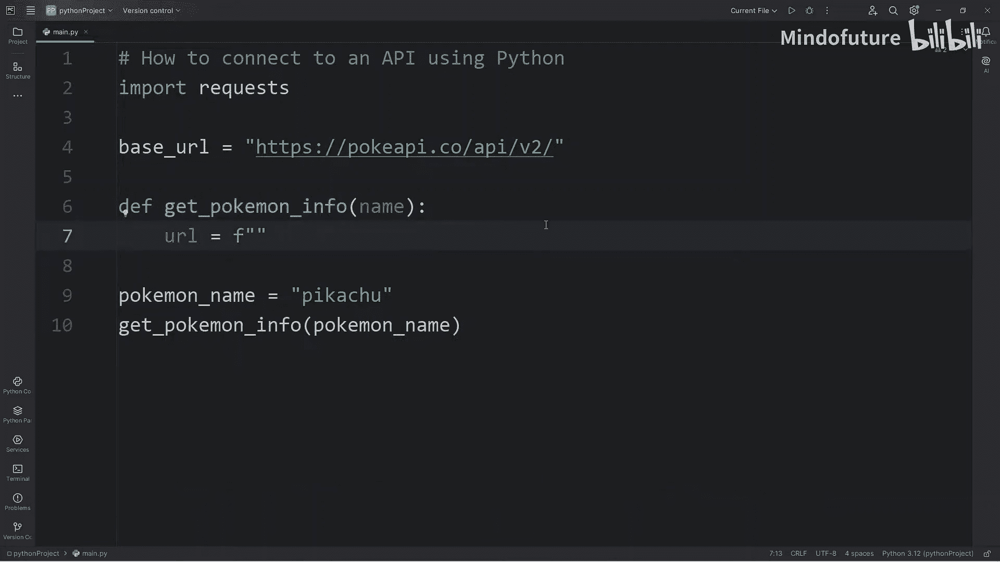
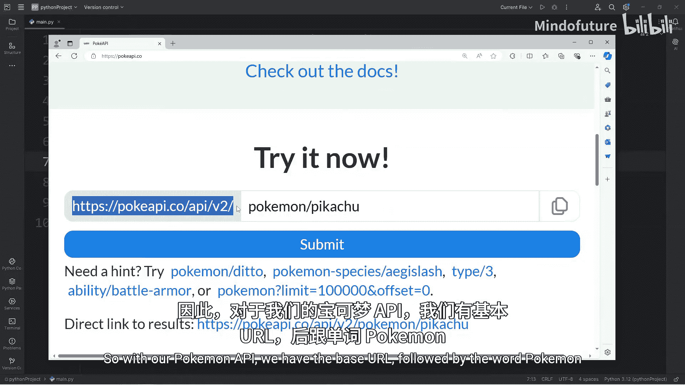
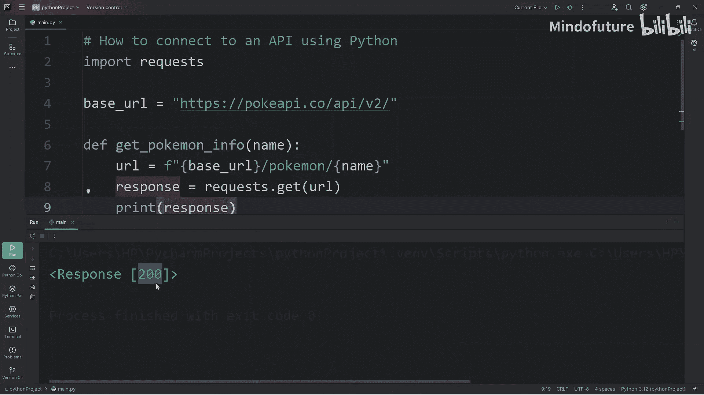
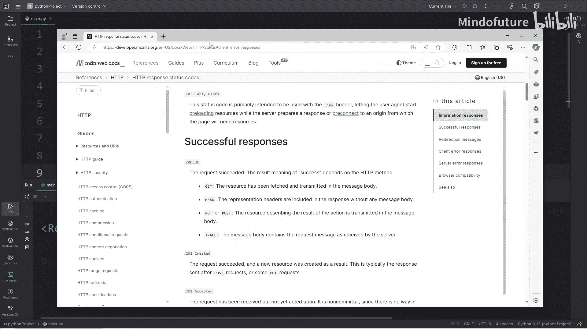
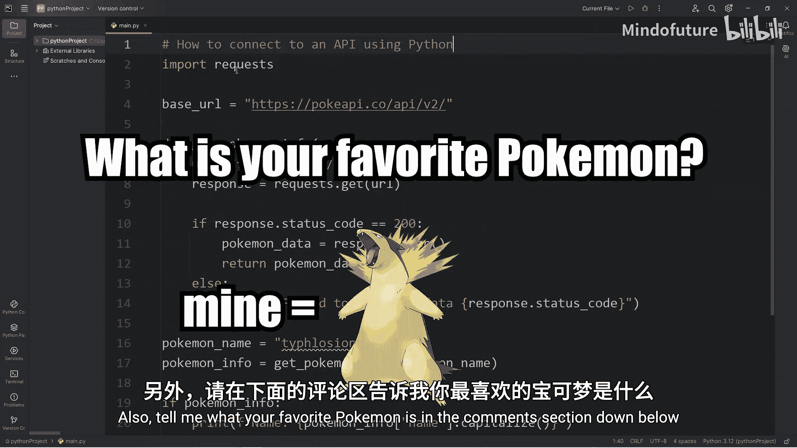

# Python超全入门教程-p77-P77-Request-API-data-using-Python-in-8-minutes--BV1fcdLYXEw9_p77-

Everybody， in this video， I'm going to show you how we can connect to an API using Python in this demonstration。

 we're going to connect to the Poa API to get some information on a Pokemon of our choosing。

 I'm assuming that most of us are familiar with Pokemon。 I thought it'd be a fun example。

 So according to this API。We can look up a Pokemon such as Pikachu。

Then we can get the stats for Pikachu， such as Pikachu's name。Height。

 I D number and all sorts of moves and abilities that a Piachccu may have。 We will need this URL。

 but we'll handle that later。

Our first step is that we're going to import the requests library to make an API request。 however。

 when I run this。I have a module not found error， no module named requests。

Request is one package we'll have to install。 It's not normally included with the standard Python download。

 If I was to go to my project folder， go to my virtual environment library site packages。

 There is no package for requests。 We'll have to download that。With Py Char and Vs code。

 there is a built in terminal that we can use。To download the request package。

 we can use PP PIip is a package manager for Python。 It's normally included when you install Python。

We'll type Pip， install requests。It'll take just a second。

And now we have that package of requests within our project folder。If I run this again。

That error goes away process finished with Exocode 0。 That means there were no errors。

Going back to our Pokemon API， we will need this URL。

Let me zoom in so you can see it。

I'm going to store that as a base URL， so it's easier to work with。For convenience。

 I'm going to create a function name。Get。Pokemon。Info。To get some info on a Pokemon。

 we'll have to pass in the name of a Pokemon for now， I'll write pass。Outside of this function。

 let's say we have a variable of Pokemon name。Pick a Pokemon。I will pick Pikachu for now。

Then I will call the get Pokemon In function。Then pass in my Pokemon name。

Remember that your parameters can be named different than your arguments when you send data to a function。

 you can rename it to something else temporarily。Now that we have the name of the Pokemon。

 we would like to look up， we can complete the URL。This will be enough string。

So with our Pokemon API， we have the base URL followed by the word Pokemon。

 then the name of a Pokemon。

So we have the base URL。I'll add a placeholder and insert it。Forward slash， the word Pokemon。

Forward slash。The name of that Pokemon。In this example， it's going to be Pikachu。

 we now have the full URL。We'll access the request module。Use the get method。And pass in that URL。

This method is going to return a response object， which I will assign to responsepon。

Response is a response object。And I'm just going to print our response just to see what we're working with。

Here's our response object， it has a status code， this is an HTTP status code of 200。

 200 means the response was okay。

Here's a few examples of response codes。You're probably familiar with 404， not found。

So we are looking for 200， the response is okay。

After we get a response。I'll add a if statement。If our response。

Our response object does have an attribute of status code to read what the status code is。

If this status code is equal to 200。That means the response is okay。But for now， I'll write pass。

Else， I'm going to print the following。Else， I'm going to print， failed to。Retriieve data。

And I will print the status code of the response object。So temporarily， I will print。

Data retrieved if it was successful。I can't spell， okay。We have our data， data was retrieved。

If our status code of our response object is equal to 200。

I will take our response object and use the JSON method。

A response is a JSson format using this method will convert it to a Python dictionary。

 It will consist of key value pairs， much like a Json file。

 But I'm going to assign that to a variable。Of Pokemon data， so it's easier to work with。

Then I will print our Pokemon data。So here's the data on Pikachu。

 It's really difficult to read all this。If you can see some keywords， we have abilities。

Base experience， this is an extremely large dictionary。Once we have our dictionary。

I will return that dictionary。Of Pokemon data。Back to the place where we call this function。

And I will store that as a variable。Pokemon。Info equals， get Pokemon info， pass into Pokemon's name。

And now we should have a dictionary that we can work with。Let me zoom out。If our dictionary exists。

 we can use the if key word。If Pokemon info， if that's true。If it exists， this will be true。

 I will print the following。I'll use enough string。To access the value of a dictionary。

 we can access it by a key， we'll take our dictionary of Pokemon In， access the key of name。

Let's see what happens exactly。We get Pikachu。 Let's get Pikachu's ID number。

We will access the key of ID the given value is 25 Pi could choose the 25th Pokemon in the franchise。

Let's get Pikachu's height。Pachus height is four， I don't know what unit of measurement they use in that franchise。

 four feet or four inches， I don't know。Let's get Pikachu's weight。P and choose weight is 60。

 60 pounds， 60 kilograms， I don't know。Just to make this look nice， I'm going to add name。Id。height。

And wait。That looks much better。Let's pick a different Pokemon。

 I will pick my favorite Pokemon of Tflion。Faied to retrieve data。

Does that have to be a lowercase to？Yes， it does， okay。So name Tfflion。

I'll follow the name with the capitalize method to make it capital。There we go。

 so my favorite Pokemon is Tlogion。I D is 157。 Tfllogian's height is 17， and weight is 795。

 All right， everybody， that is one way in which we can connect to an API using Python。 Also。

 tell me what your favorite Pokemon is in the comment section down below。

