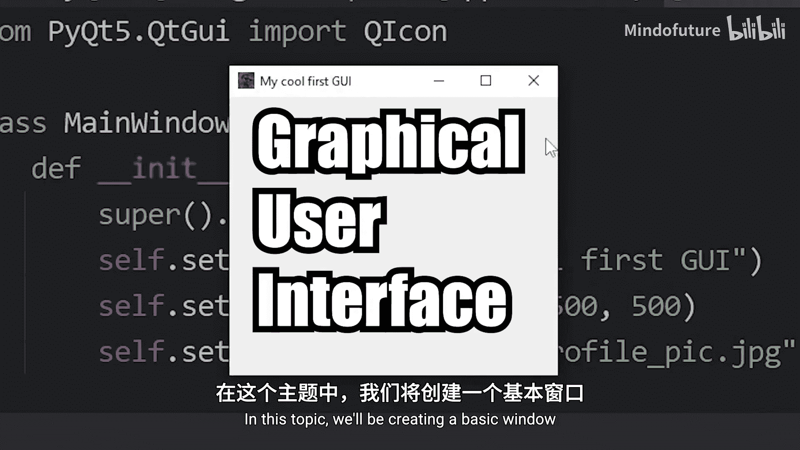
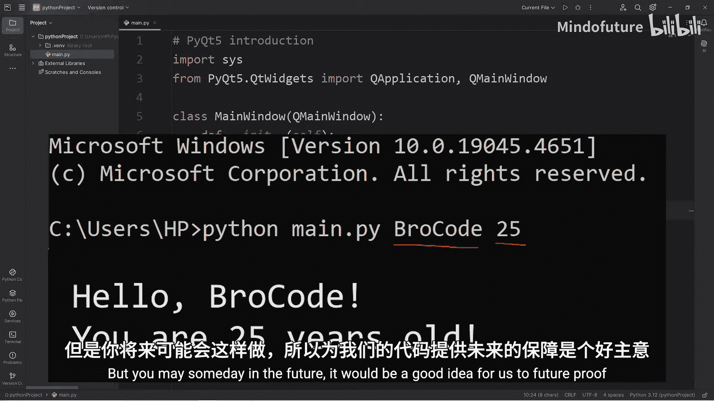
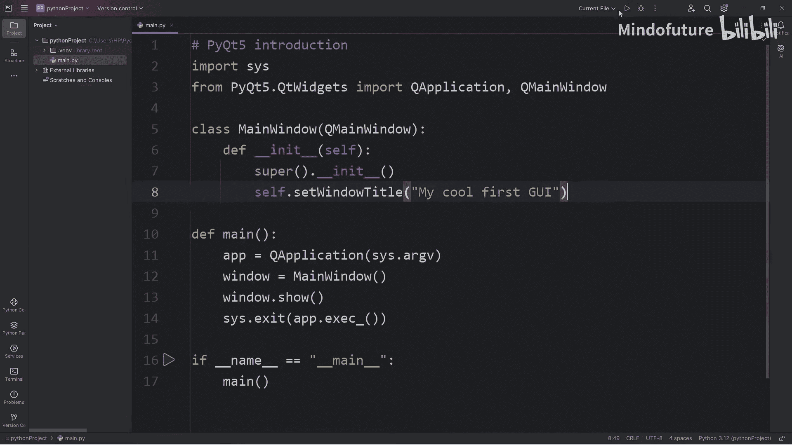
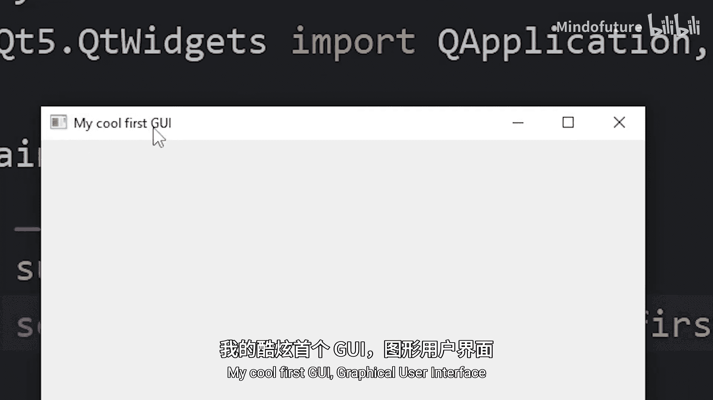
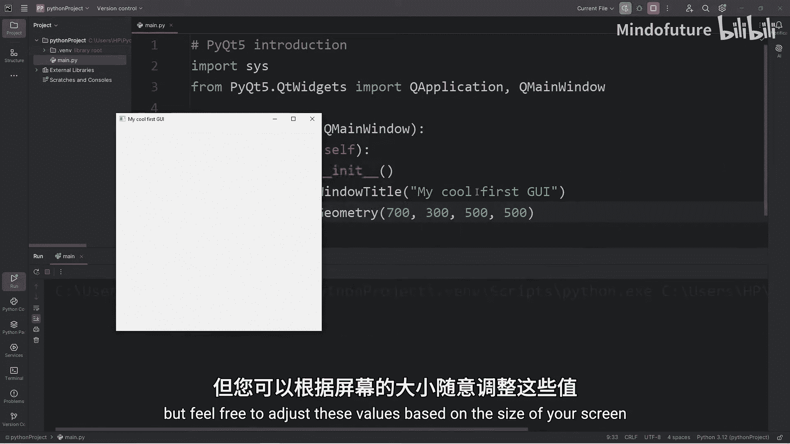
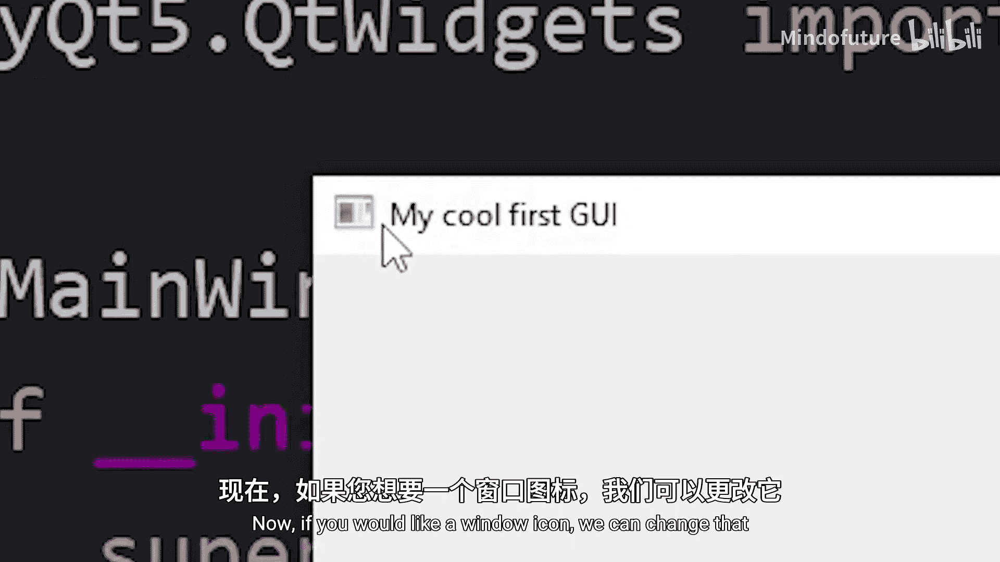
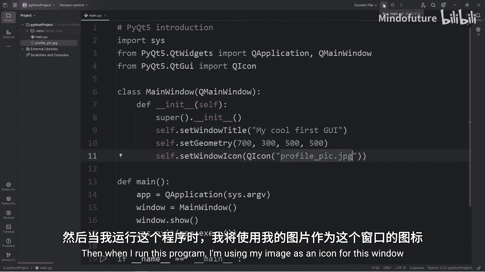
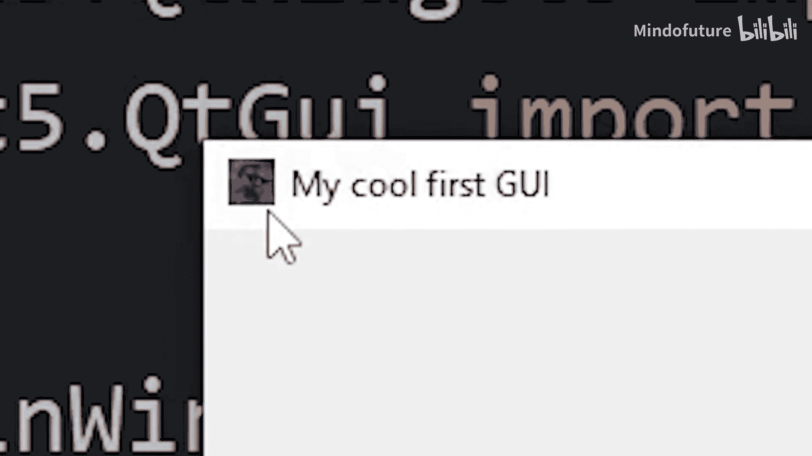
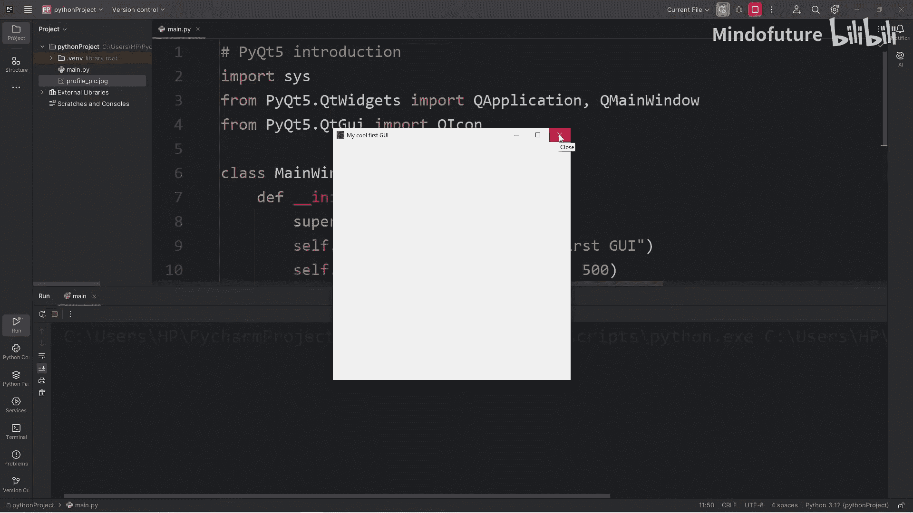

# Python超全入门教程-p78-P78-Python-PyQt5-setup-a-basic-GUI-Application--BV1fcdLYXEw9_p78-

All right， everybody。 In today's video， we're going to get started working with the pi Q T 5 graphical user interface。

 also known as a Gui G U Y in this topic， we'll be creating a basic window。 So let's get started。

 All right， The first step is that using Pip。 we're going to install the Pi Q T5 package。

 Open up a terminal。 Both P Char and Vs code have a built in terminal that you can use。😊。

We're going to use Pip。 That is Python's package manager。 Pip install Pi Q， T 5， enter。

And this might just take a second。Once your download is finished。

 you should have a package within your site packages folder named PiI QT5。

We can work with it as long as we import it。First， we are going to import the module of sis cis meaning system。

 This module provides access to variables used and maintained by the Python interpreter。

 then from the package of pi Q T5。 do pay attention to the capitalization。 It's easy to mess that up。

 Use dot to access the module of Q T。Widgets。Widgets are the building blocks of a pi QT5 application。

 They begin with Q。 That helps distinguish them from widgets from other libraries。

 They typically begin with Q from this module， import the following widgets。Qu。Application。And Q。

Main window。Here's some boilerplate code that we have to write in order to get this application up and running。

 First， we will create a class of main。Window， which will inherit from the class of Q main window。

By inheriting from the parent of Q main window， we can customize our own windows to display to the user。

 We will need a constructor。 Let's define that。Define Dunder in it。

 There will be no arguments currently beside self。 And in case we have to pass any arguments to the parent of humane window。

 we will access the super class。 That's the parent。And call the appearance Conor。But currently。

 we don't have any arguments to pass in。We will return to this class， momentarily。

Let's define a function of main。When we begin this program。

 we will call the function of main to begin the application for now， I'll write pass。

If we are running this file directly， let's add the following if statement。If D name。

Is equal to a string of Dunder main。If we are running this file directly。

 call the main function in order for us to begin。If that's true， we will call the function of main。

Within the main function， we will create an app object app equals。

 We will call the constructor for Q application that class。

 But there's one argument that we have to pass in。We will access our module of Cs。Dot A RGV。

 meaning arguments。So by passing in this argument， this allows pi Q T to process any command line arguments intended for it。

 That's if we use command prompt or terminal。 We won't be doing that in the series。

 but you may someday in the future。 It would be a good idea for us to future proof our code。

 Otherwise， you may see people passing in an empty list。

So we now have an app object。 Next， we will create a window object， window equals。

Call the constructor for our class of main window。Currently， we don't have any arguments to pass in。

 We have an app object and a window object by calling their respective constructors。 Now。

 if I run this program currently， our window is not going to show。

The default behavior for a window is to hide it。In order to show our window。

 we will access our window， call the show method to show it。

It's only going to appear for a brief second when I run the script。I don't know if you saw it。

 but it pops up for a brief second。We need to ensure that the window stays until we interact with it or close it。

 After we show our window， we will access our module of Cs。Called the exitit method。

The exit method ensures a clean exit of our program。Within our exit method。

 we will pass in as an argument， our app object。Our app object has a built in method of E X。

 E underscore， and this is a method， so we can call it。 This is the execute method。

 There is an underscore character after E X E for execute。

 That distinguishes it from the execute method。 There is a separate version of this execute function that ends with an underscore。

 Our apps execute method。 It waits around for user input and handles events。

 such as if we click buttons， press keys or close the window。

 Now that we're calling this method when we run our program， this window should stay in place。

We can maximize it。Minimize it。Or close it。That's all the boilerplate code that we need for a basic window。

 Let's customize it。Within our constructor for our main window， what would we like to add。

Let's set the title for our window。Self dot set， window title method。We will pass in a string。

 Think of a title for your program。My cool first G UI， Gui。

And now we have a new title， My cool， first Gui graphical user interface。

When this window appears， we can set the geometry of where the window appears and the size of the window。

Access self。Dot set geometry method。There's four arguments。X and Y for the X and Y coordinates。

 a width of the window and a height of the window。If I were to set x and y to be both 0。

 this window will appear in the top left corner of my screen。I'll also need a width and a height。

 Let's say， I don't know。500 for each。So now my window is now a square。

 The width and the height are both the same。 They're both 500。 The width is 500 pixels。

 The height is 500 pixels。 with the first two arguments。

 We set the initial placement of our window to be where x is 0 and y is 0。

 That corresponds to the top left corner。If I set the first argument to be 100。Well。

 then the window is going to move to the right by 100 pixels。

 There are ways to center your window in the very center of your screen。

 But that's a little too advanced for us right now。 for the time being。

 I'll pick something roughly near the middle of my screen。

700 pixels on the X axis and 300 on the Y axis。It should appear roughly in the middle。

 but feel free to adjust these values based on the size of your screen。

We'll discuss layouts in the future。Now， if you would like a window icon， we can change that。

 You will need an image to work with。

So within my project folder。I have a profile picture for my YouTube channel。

 I'll set that to be the icon。Find an image that you like， then add it to your project folder。

In order to work with icons， we'll need to make the following import。From pi QT5。That's the package。

 access the module of Q T G UI。Import the following。Q。Icon Now we can work with icons。

After we set the geometry for our window。Access this object of self。 This main window。

 Call the method of set window icon。Within this method， we will call the constructor of Q。Icon。

We'll pass in either a relative file path or an absolute file path。

My made Python file is right next to my profile picture。 That image。

 I only need the file name within a string。So the name of my image。

 it's going to be different for you， depending what the name of your image is。

My image is named profilele， underscore， P。And this image is a JPg， JPG。Then when I run this program。

I'm using my image as an icon for this window。

Al right everybody， that is how to create a window using Pi QT5。

 and in the next topic we will be creating some labels。

