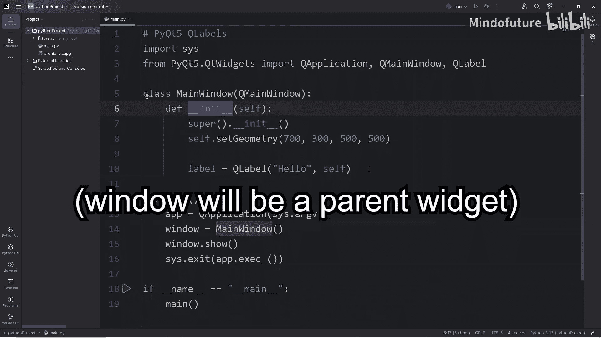
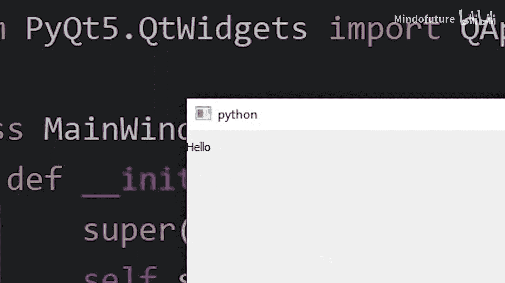
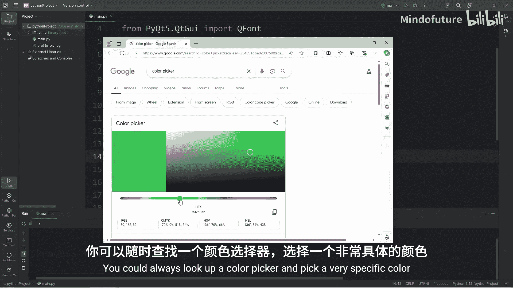
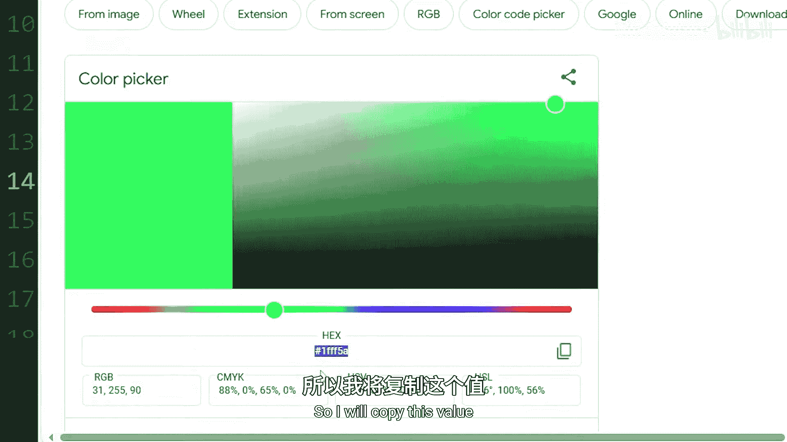
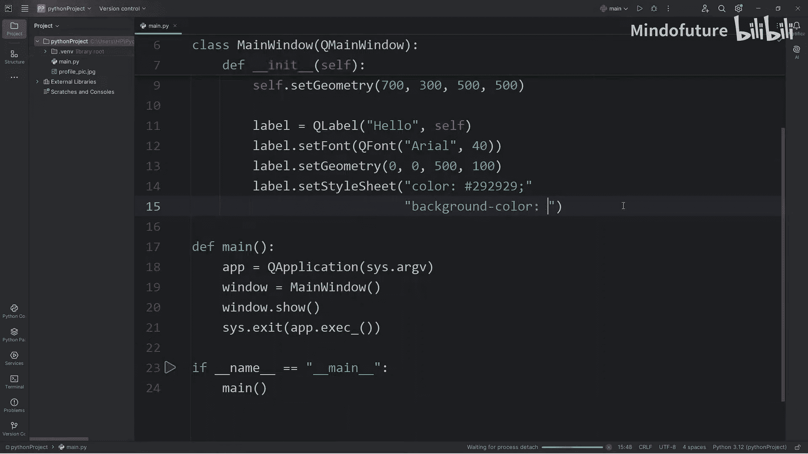
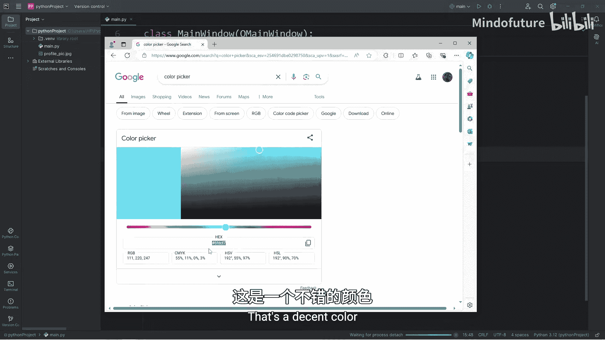
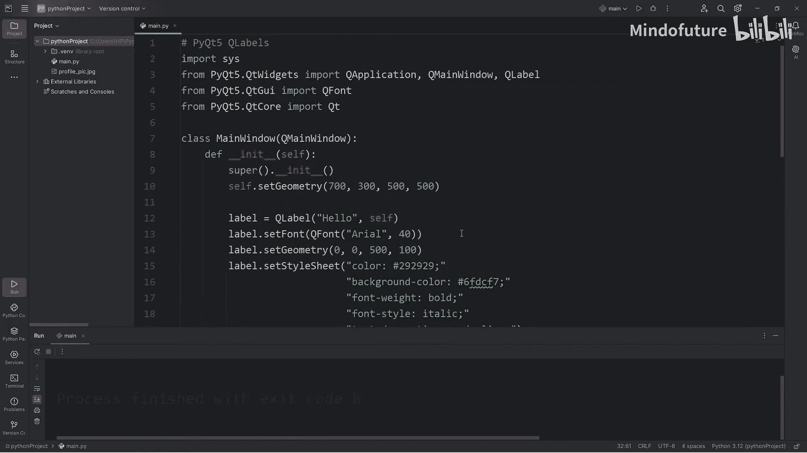

# Python超全入门教程-p79-P79-Python-PyQt5-LABELS-are-easy--BV1fcdLYXEw9_p79-

What's up， everybody。 In today's topic， we're going to create some labels using Pi Q T 5。

 We will import the widget of Q。Webel。This label class is used to create label widgets that can display text or images。

Within the constructor of our main window， this is where we'll create a label。

We will declare a label object La equals， call the constructor for Q label。For the text of the label。

We'll pass in a string。 That's the first argument。Let's say the word hello。For the second argument。

 we will pass in self。Self refers to this window object that we're calling and instanttaniating。

All right， let's do a test run。Here is my label， although you can barely see it。

 the font is really small， but it does say hello。

Let's set the font。 We'll need another import。From pi， Q T5。Dot Q， T， G Y。Import Q font。

By importing the QF class， we can begin working with fonts。We're going to take our label。

 call the set font method。Within this method， we will call the constructor a Q font。

Pick a font they you would like。I will pick Arel， but feel free to choose really any font。

Then the second argument is a font size。 I'll pick 30。Let's do another test run。That's much better。

Let's increase this to 40 for the font size。Now I'm going to set the geometry of this label。

Such as the positioning and the width and the height。Let's take our label。Use the set。

Geometry method。We will pass in X and Y coordinates。0，0 corresponds to the top left corner。

For the width， let's set the width to be 500 and the height to be 100。That's better。

I'll cover more advanced alignments momentarily。Let's add a style sheet。

Pi Q T does have styles that are very similar to CSS。 If you would like to learn more about CsS。

 I do have a full course on that topic。 We will add some CS， like properties。

By accessing our label object。Call the method upset style sheet。Within this method。

 we will pass in some CS like properties， such as a color。For the color， let's say blue。

The CSS like properties should end with a semicolon。And now the font color is blue。

You could also use RGB values or hexademal values。You could always look up a color picker。

And pick a very specific color。

Let's pick something green。We can either use RGB values or hexademal values。

 so I will copy this value。

So I will paste that hexedademal value。And now we have a very specific shade of green。

But I think I'll go with something dark。Such as that。So this color is going to be a dark gray color。

We could set a background color， this will be a new string。Background， dash color。

And I will pick a new color。

I will pick something blue。That's a decent color。

We have a blue background with dark gray text。We can set the font to be bold。

 font weight will be bold。So the font is now bold。The font style can be italic。Bunnt style。Ititaic。

So our font is italic。And we can underline。Text。Decoration。Underline。

The text on our label is now underlined。Let's work on positioning next。Currently。

 my text is left justified and set to the center vertically。To work with alignments。

 we need this import。From pi Q T5。Q T core。Import， Q， T。The class of Q T is used for alignments。

To center the text of our label at the top vertically， we will take our label。

 use the set alignment method。Then pass in a flag， access the class of QOT。

 access the flag of a line top。This will align our text vertically to the top。

So then our text is aligned vertically to the top， rather than the center。For the bottom。

We will use the flag of a line bottom。We will align vertically on the bottom。

The text is now in the bottom。To align vertically in the center。Allign the center。

This will be vertically center。Which it was originally。Now for a horizontal alignment。

 we can add the following。Okay to a align right， we will pass in a flag of a line right。Orizontally。

A line right。The text is now all the way to the right。For the center。A line H， H for horizontal。

Center。The text is now horizontally aligned in the center。For the left。A line left。

The text will be aligned to the left。We could combine both horizontal and vertical positioning。

Here's how take our label。Call the set alignment method。We will align horizontally in the center。

Follow this with the or bitwise operator， which is a vertical bar。 This allows us to combine flags。

 We will align horizontally in the center。 Then vertically， let's align to the top。

So our text should be aligned。Horizontally were aligned in the center and vertically were aligned to the top。

A line， bottom。Vertically。Horizontally， we are in the center， vertically we're aligned on the bottom。

Then for the very center of our label。A line horizontal center。And align vertical center。

Our text will now be in the very middle of our label， both horizontally and vertically。Now。

 there is a shortcut for the very center。 We don't need both of these flags。

The shortcut is the following。Set alignment。A line center。

That will align the text both horizontally and vertically。So that is center and center。

All right everybody， so that is an introduction to labels in Pi QT5。

