# Python超全入门教程-p81-P81-Python-PyQt5-LAYOUT-MANAGERS-are-easy--BV1fcdLYXEw9_p81-

Well， hello again， friends。 Today， I got to explain layouts in Pi Q T 5。 We'll discuss vertical。

 horizontal and grid layouts， but we'll need the following imports。 We will be importing Q label。Q。

 widget。I'm going to put these imports on a new line just because we have a lot。Q V for vertical box。

Layout。And I'm just going to copy this。Q， H for horizontal box layout。And Q grid layout。

Let's be sure that we have all these imports。These classes deal with layout managers。

 they aren't widgets， we'll be writing a majority of the code within our main window class。

 however it can get disorganized really quick what will help keep things organized is if we declare a separate function within the main window class。

This is a common practice that you'll see within P QT5。

 there will be a function for Inni for initialize UI for user interface。

No other arguments besides self。And for now， I'll write pass。When we construct a window object。

 we will call self dot in UI to initialize the user interface。

So anything that deals with the user interface， we're going to be writing with them this function to help keep our code clean and organized。

Normally， we can't add a layout manager to a main window object。

 Main window widgets have a specific design and layout structure that's normally incompatible with layout managers。

 What we would need to do is create a generic widget。Add a layout manager to that widget。

 then add that widget to the main window in order to display the layout。

Within our method to initialize our user interface， we are going to create what is called a central。

Widget。Call the Conor for Q Wiidget。This is a generic widget。

Then we will take self self is our window。Call the As。Central widget method。

Then pass in our central widget。When working with layout managers。

 we will add that layout manager to the central widget。

 The central widget is then added to the main window。So currently， this is what we're working with。

 we will need some widgets to organize because right now it's empty。Let's create a few labels。

Let's say label 1 equals Q label。I'll pass in some text。 number one。 Okay。

 let's create four additional labels，1 through 5。I'll just do some copying and pasting。

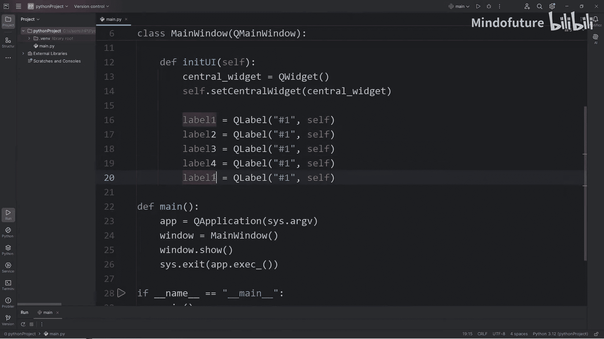

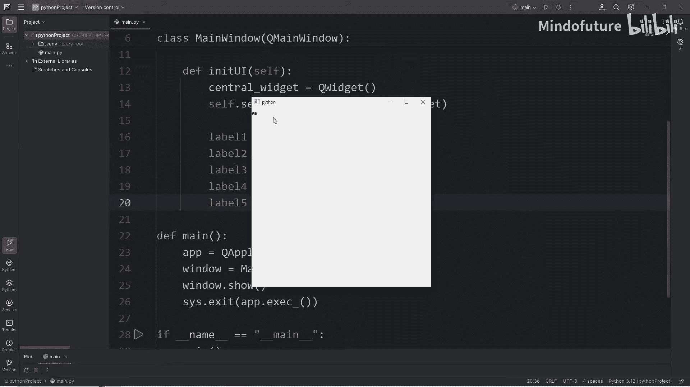

All of our labels are overlapping。Let's add some colors。Let's take label 1， use the set。

Style sheet method。Then pass in a background color as a CSS property。

Background dash color will be red。Let's copy this line of code。Paste it for additional times。

For labels one through five。We'll have a label that is yellow。Another that is green。Blue。Then。

 purple。

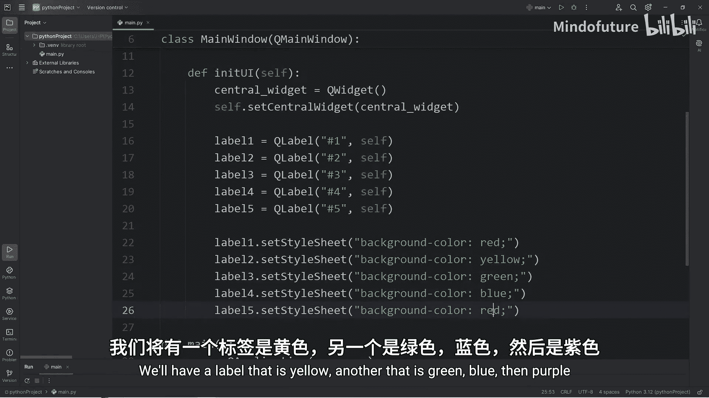

Here are the labels， they're all overlapping one another。 that's why we can only see five。

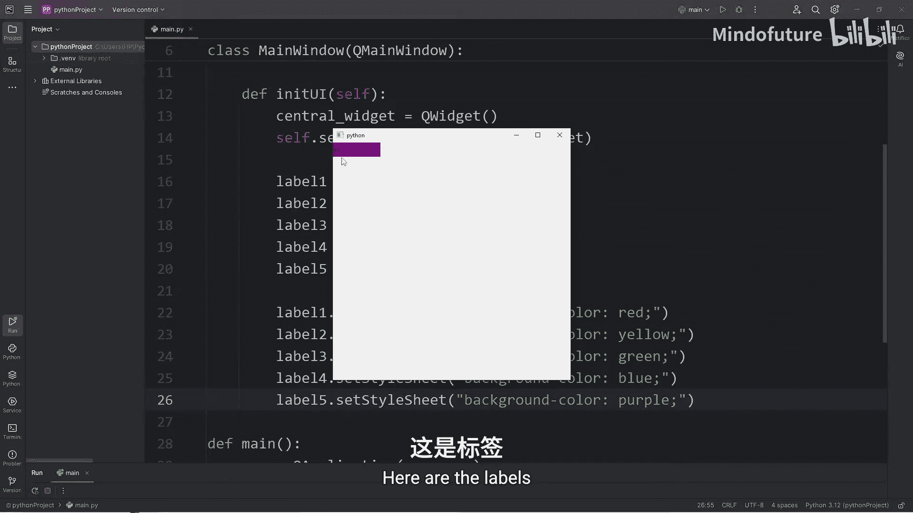

This is where a layout manager comes in。We'll start with a vertical layout。

 We will create a vertical layout manager， which we will name the box。

V box equals called the constructor for Q V。Box layout。We are calling the constructor。

We will take our layout manager。Call the add。Widget method。Then pass in a widget。

Such as label one near the top here。We'll do this with the other labels。

 we'll do some copying and pasting。Add label 2，3，4， and 5。There's one last step。

We will take our central widget， which we have declared at the top of this function。

Called the accept layout method。We are setting the layout of our central widget。

With the layout manager of Bbox verticalical box， here's the new layout。

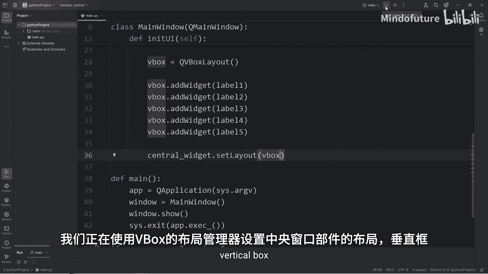

All of our labels， all of our widgets， are arranged vertically。

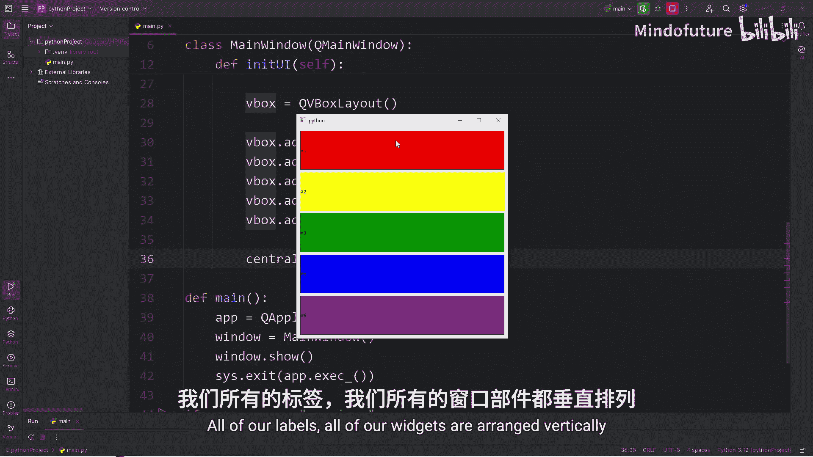

For horizontal， you will use QH box layout for horizontal。Replace any instance of V box with H box。

For the set layout method， pass in Hbox。

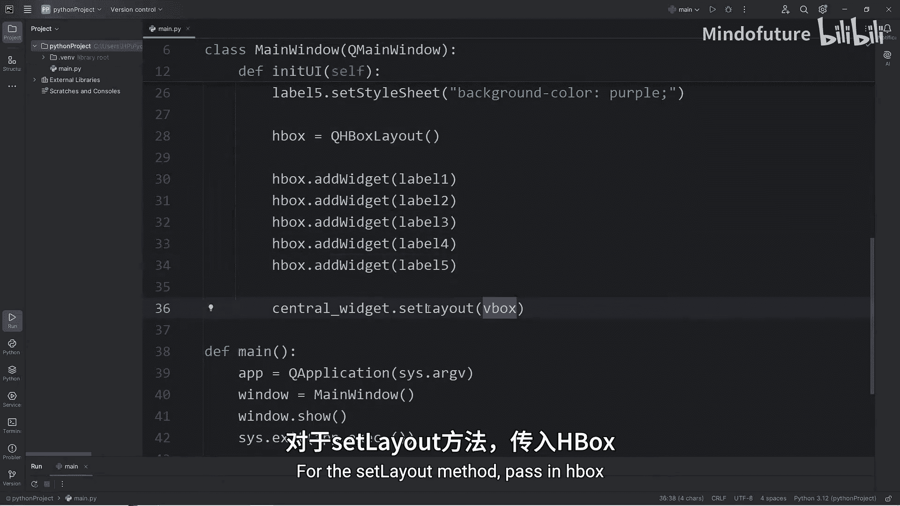

This allows for a horizontal layout。

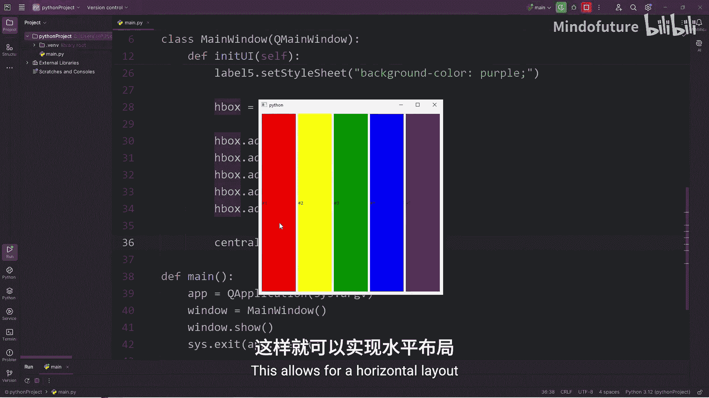

Then we have grid。Q grid layout。Replace Hbox with grid。So what we have to do with grids。

After adding a widget， we have to specify a row and column with separate arguments。

The row and column both begin with0， so row 1， column 1 would be row 0， column 0。For label 2。

 let's say row 0， column1。Label 3 will be row 1， column 0。4 will be row 1， column 1。Then5， row 1。

 column 2， so here's the current layout。

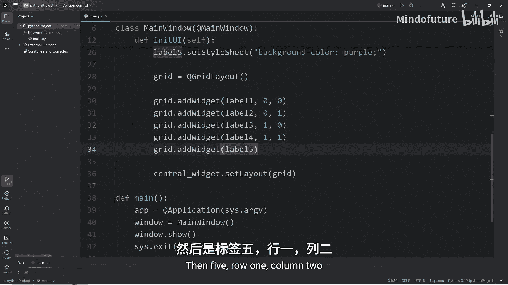

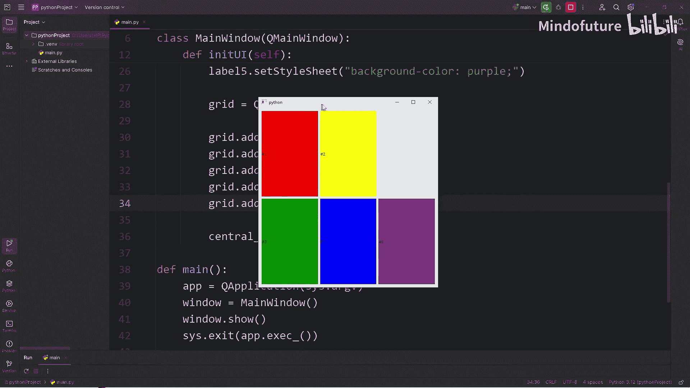

We have labels one and two， both within row 0， labels 3，4 and 5 are both within the second row。

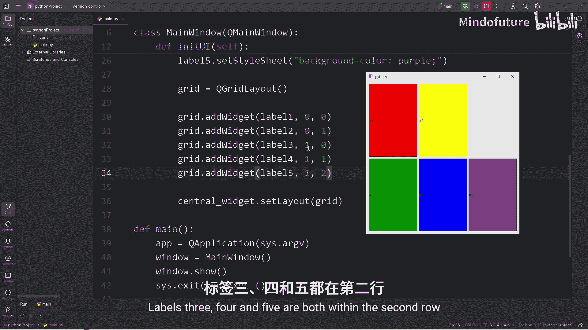

Let's say label 5 is row2 column 2 that would result with something like this。

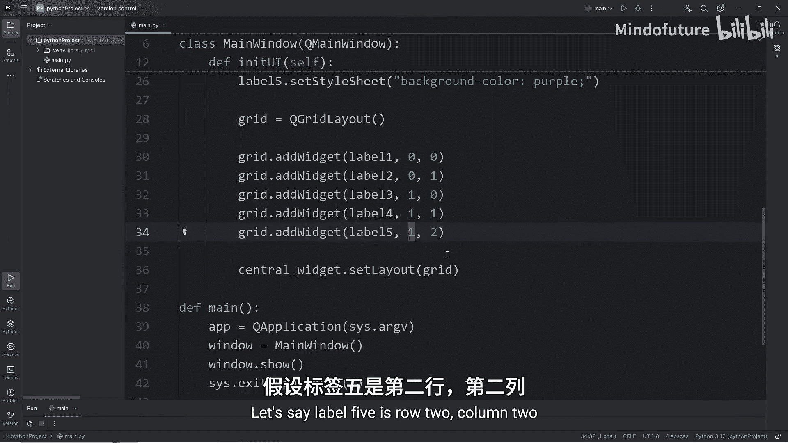

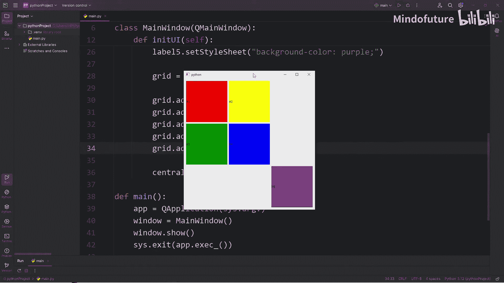

We have label 5， which is purple in row 2 column 2。

 so it depends on how you want to arrange your widgets。 All right， everybody。

 so that is an introduction to layout managers in Pi QT5。

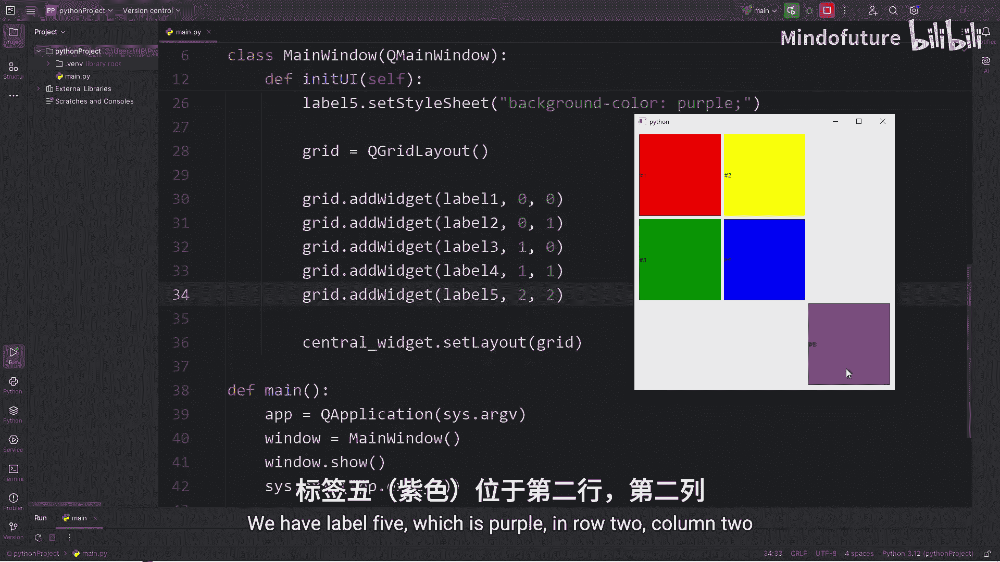

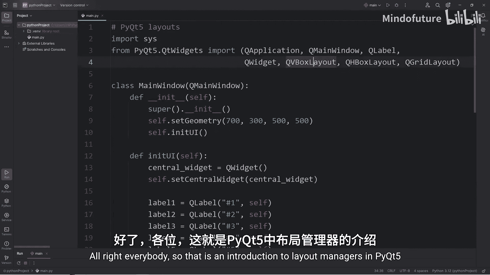