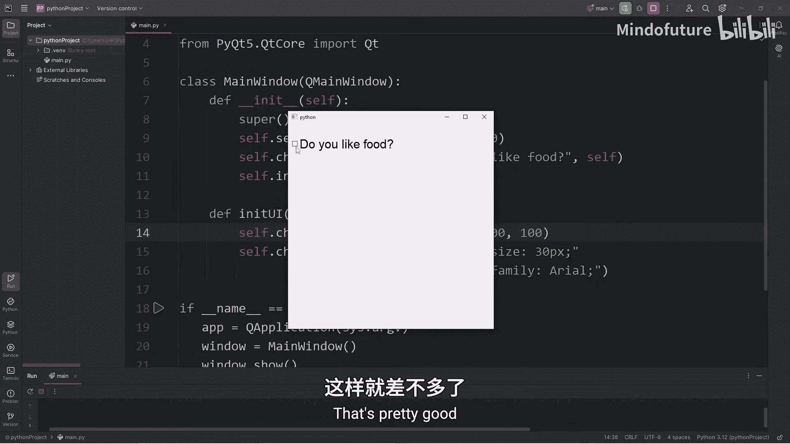
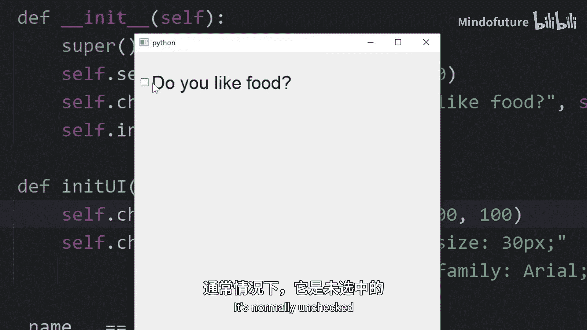
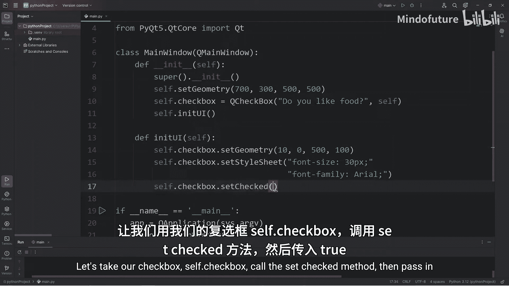
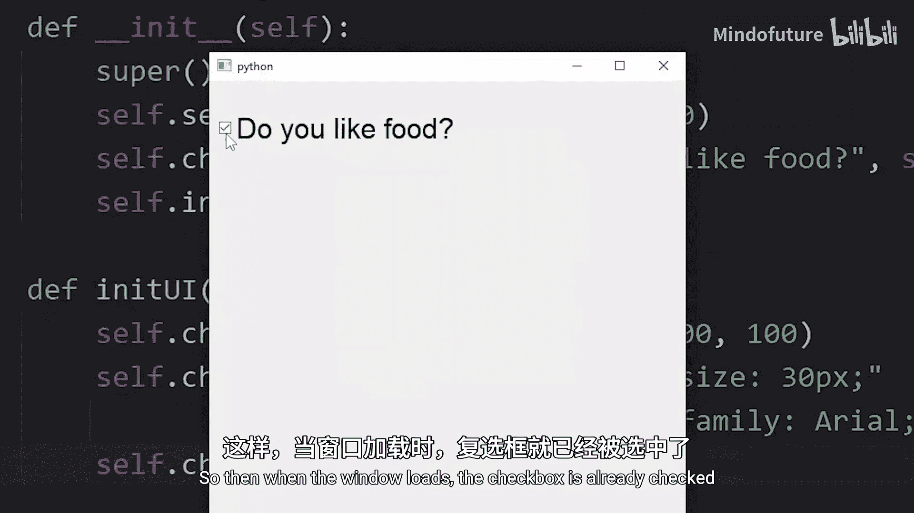
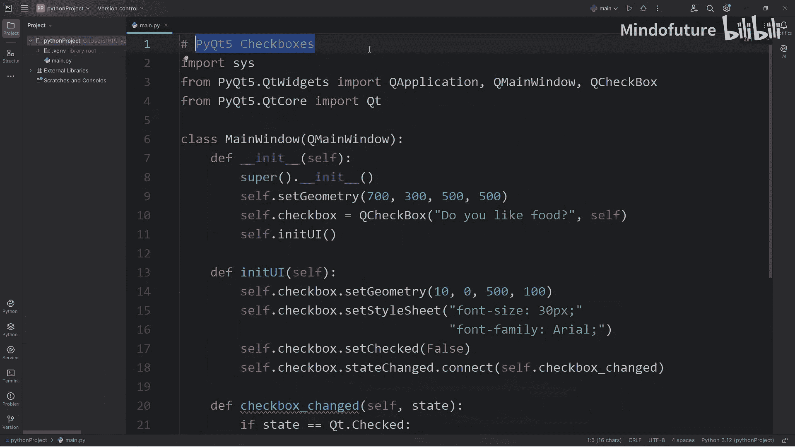

# Python超全入门教程-p83-P83-Python-PyQt5-CHECKBOXES-are-easy--BV1fcdLYXEw9_p83-

Hey， yeah。 So today， I got to explain in check boxes in Pi QT5 to work with check boxeses。

 we will need the following import from the module of widgets from Pi QT5 import Q check box。

To work with different states， we will also need the following import from Pi Q T 5 dot Q， T core。

Import Q T， this module of Q T core。 It contains non Gui classes relevant to Pi Q T 5 applications。

 So be sure that you get this import as well to create a checkbox I will create this within the constructor of my main window。

We will create a checkbox with self， the name of the checkbox， which I will name checkbox。Equals。

Call the constructor of the Q checkbox class。The first argument is going to be the text of the checkbox。

 What do you want the checkbox to say？Let's ask， do you like food？

The second argument is the parent widget， where we will be adding this checkbox， let's say self。

Self will apply to this window。We could use a layout manager。

 but I want to keep this lesson as simple as possible。

 We're just going to focus on check boxeses and their functionality。So we should have a checkbox。

However， we can barely see it， the font is really small。

I have a method to initialize the user interface。That's where we'll set the style sheet and the geometry of our checkbox。

Let's set the style sheet， self dot， the name of the checkbox， checkbox。Dot set style sheet method。

Then we can pass in some CSS like properties， Let's set the font size。To be 30 pixels。

And I will pick a font family。Fnt family， Arel。Oh， and we should change the geometry of the label。

 it's getting cut off。Self dot， the name of the checkbox。Which is checkbox。Let's set the geometry。

Pass in some X and Y coordinates for the placement。As well as a width and a height。

 I will pick 500 and 100。Maybe I'll move it a little more to the right by 10 pixels。

That's pretty good。

Our checkbox has an initial state。 It's normally unchecked。 That's the default behavior。

 but we could set that to be checked with the following method when the window loads。

Let's take our checkbox， self。t checkbox。Call the set Check method。Then， pass true。

So then when the window loads， the checkbox is already checked。

But let's keep that as false。Now， this checkbox， it doesn't do anything when I check it。

Let's add some functionality。We'll take our checkbox， connect a signal to a slot。

The slot can be a function or a method。Let's define a method within our main window class。

Let's name this method。Checkbox。Changed。We will call this method when the state of our checkbox changes。

 there is one parameter besides self。A state。 Now， the state parameter is going to be provided to us when we interact with our checkbox。

 When we check the checkbox， let's print something like a test message。You like food。

We have to connect a signal of state changed to a slot of checkbox changed。 We will take self dot。

 the name of the checkbox， which is checkbox。The signal will be state changed。

To connect a slot to a signal， we use the connect method。Then pass in a function or method name。

So we are working with methods。This method belongs to the window class。

We'll prefix the method name itself。Self dot checkbox changed。So when I run this program。

 when I check the checkbox， we execute this method， you like food。Now， when I uncheck it。

 I instead would like to display you do not like food。So that's where our state is going to come in。

 I'm going to print our state just to see what it is。Our state is going to be a value。

When we check the checkbox， our state has a value of two。When we uncheck it， it has a value of 0。

0 means unchecked。2 means checked。 There's also one for partially checked。

 but that's not going to be relevant to this topic。 So 0 or 2。

We could add an if statement such as if state is equal to 2。Then print。 you like food。 However。

 that's not really readable。 Other developers looking over your code aren't going to understand what two is by looking at it。

Instead， let's use the following， we will access the class of QT。

There's a built in constant of checked。This also equals2， but it's more readable， it's a constant。

 so if state is equal to QT checked。Print， you like food。I will check the checkbox， You like food。

When I uncheck it， nothing happens。Let's add an L statement。Else， let's print。You do not like food。

So then when I check the checkbox， we print you like food， when I uncheck it， we print。

 you do not like food。You like food， you do not like food， you like food， you do not like food。

All right everybody， so that is an introduction to checkboxes in PyQT5。

