# Python超全入门教程-p84-P84-Python-PyQt5-RADIO-BUTTONS-are-easy--BV1fcdLYXEw9_p84-

All right， let's do this thing。 Today， I got to talk about radio buttons in Pi Q T 5 to work with radio buttons。

 We will need the following imports from the module of Q T widgets。

 We will need the class of Q radio button， as well as Q button group。

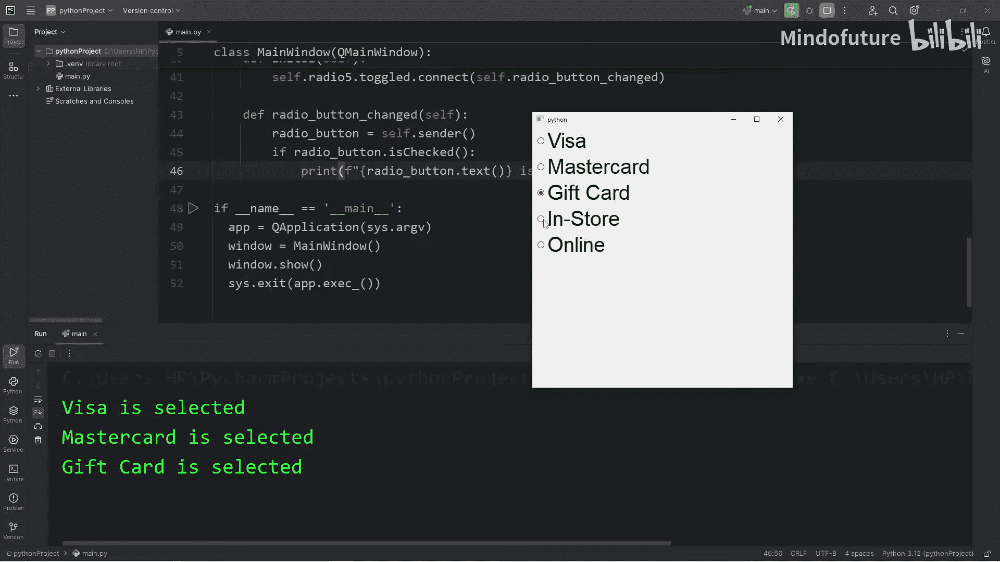

Two group together different buttons。Let's create three radio buttons within the constructor of my main window。

 we will construct three radio buttons for the first radio button， this will be named Radio 1。

We will call the constructor of the Class Q radioio button。Then we can pass in some text。

 What is the radio button going to say， Let's say that we're working with payment options。

Let's save Vi for the first option。 Then for the second argument， I will pass in self。

 We will add this radio button directly to our window。 That would be self。

Let's create two more additional radio buttons。Radio 2 and Radio 3。

 the text of Raio button 2 will be Mastercard。And three will be a gift card。

We are selecting different payment options。

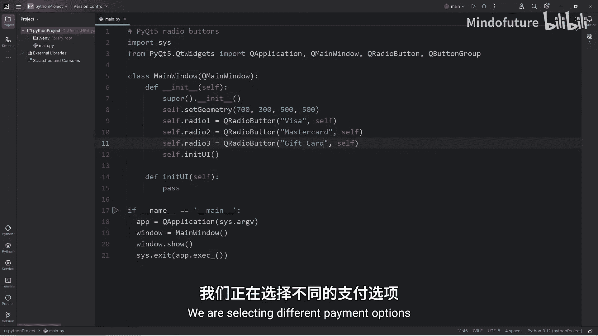

We need to set the geometry of these radio buttons because we're not using a layout manager。

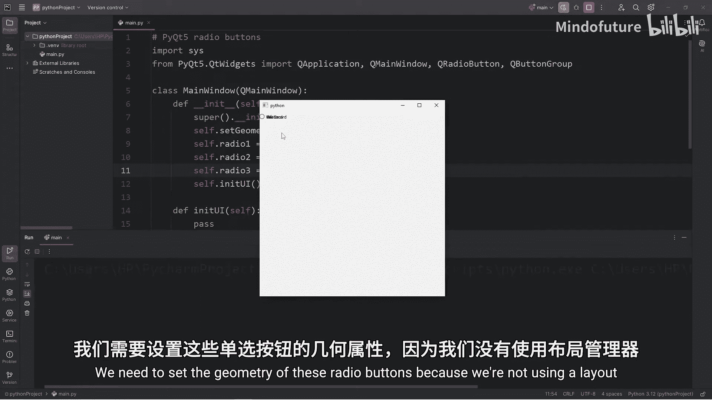

I have a method to initialize my user interface。This is where I will set the geometry of my radio buttons。

So let's say self。 Radio1， we will call the set geometry method passing in some coordinates。0。

0 is good。 That applies to the top left corner of my window for the width 300 and the height。

50 is good。Let's do this with radio buttons two and3。Radio2， Radio 3。

 We'll just move each radio button down on the Y axis by 50 pixels each， so 50， then 100。

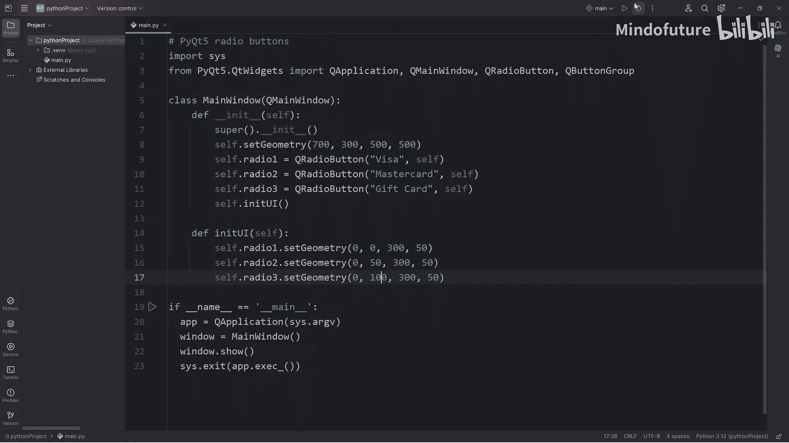

Here are the three radio buttons。 However， the font is kind of small。 We can barely see it。

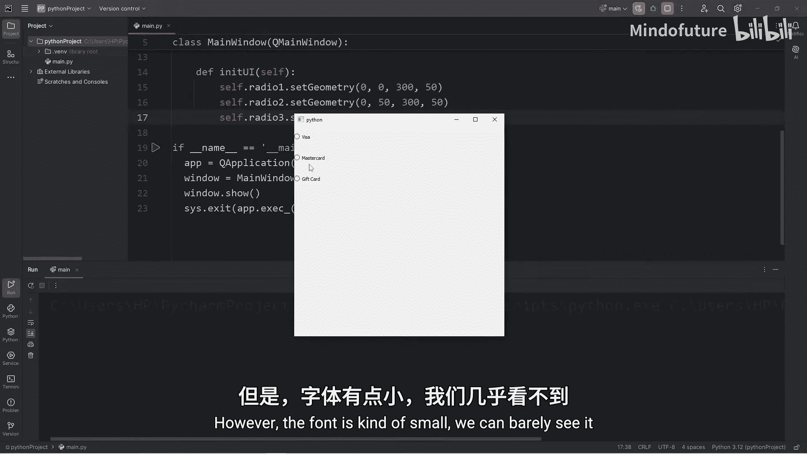

So let's apply a style sheet。Here's a trick that we can do with style sheets。

 We can apply multiple Cs S like properties to an entire group of widgets。

 rather than having to type them and apply them individually， We will select our window of self。

Set the style sheet of our window with the set style sheet method。We will add a selector。

 the selector is going to be the name of the widget。Q radio button in this case。

 then add a set of curly braces。We can apply CSS like properties to an entire group of widgets this way。

So let's set the font size。Of all radio buttons to be 40 pixels。Better。Let's set the font family。

To be aerial。Then I will add a little bit of padding around each radio button。Padding。1en pixels。

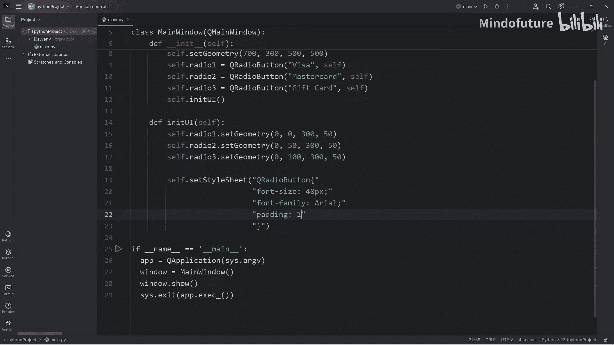

That's pretty good。So with radio buttons， we can only select one from any one radio button group。

If I was making a payment， I can't pay with a visa and a Mastercard at the same time。

 I can only select one option。That's the point of radio buttons。

 We're limited to just one option with the default behavior of pi Q T 5， All radio buttons。

 unless explicitly stated， are all part of the same group。

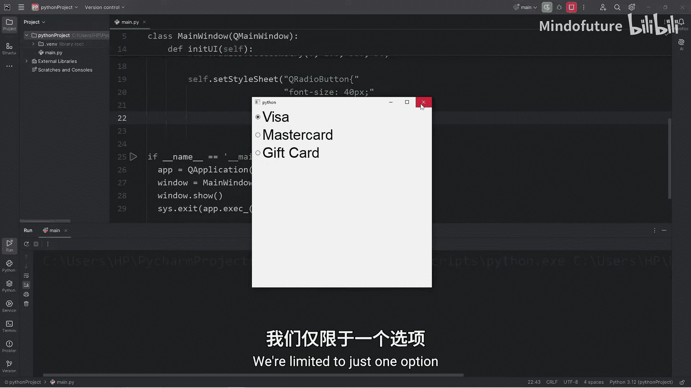

To demonstrate that， let's create two additional radio buttons。Radio 4 and Radio 5。

Radio button 4 will be for a payment method rather than a payment type。For example。

 we could say we're paying in store。Radio button 5 will be we're paying online。

Radio buttons 1 through three will be for the payment type。

Radio buttons 4 and 5 will be for the payment method we either paying in store or we' ordering something online。

We do need to set the geometry for these two radio buttons。I'll just copy these two lines。

Add Radio 4， Radio 5 will set the y coordinate of 4 to be 150 and 5 to be 200。

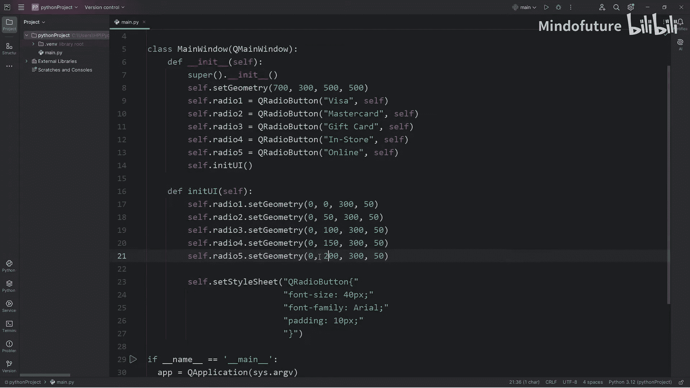

All radio buttons will be within the same button group。 If I was to select in store。

 we deselect one of these options。 What I would like is one option from this first group and another option from this other group。

These buttons are all in the same group。 I can only select one if I would like to pay with the visa in store。

 and I click the in store radio button。We unselect the radio button for Vis。

I would like these radio buttons within different groups。

We need to create two different groups and add them accordingly， here's how。

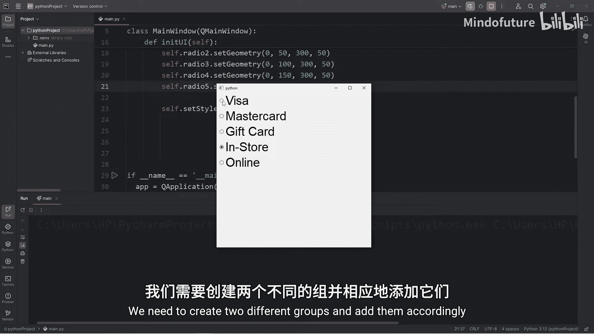

Within our constructor， we will access self。Declare a button group。 Let's name it。

 button group 1 for simplicity。Equals。Call the constructor of the class Q button Group。

Then pass himself。To set the parent widget to be the window。Then we will create button group2。

We're going to access self， select the radioio button group。Button。Group 1。

Call the add button method， then pass in a radio button。Self dot Rad1。Then we'll add Rad2 and Rad 3。

We'll select button group2 this time。Button group 2。Add radio button 4 and Ra button 5。

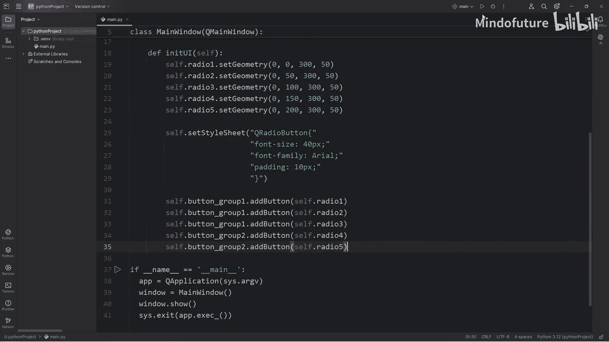

The first three radio buttons are within the same group。

 Radio buttons 4 and 5 are within a different group。

 We can only select one radio button from any one radio button group。

Maybe I would like to pay with a Vi card in store or a master card online or a gift card in store。

 These radio buttons are within different button groups。

 We're limited to one selection in any one radio button group。 When we select these radio buttons。

 They don't quite do anything for each radio button。 We have to connect a signal to a slot。

 Here's how。

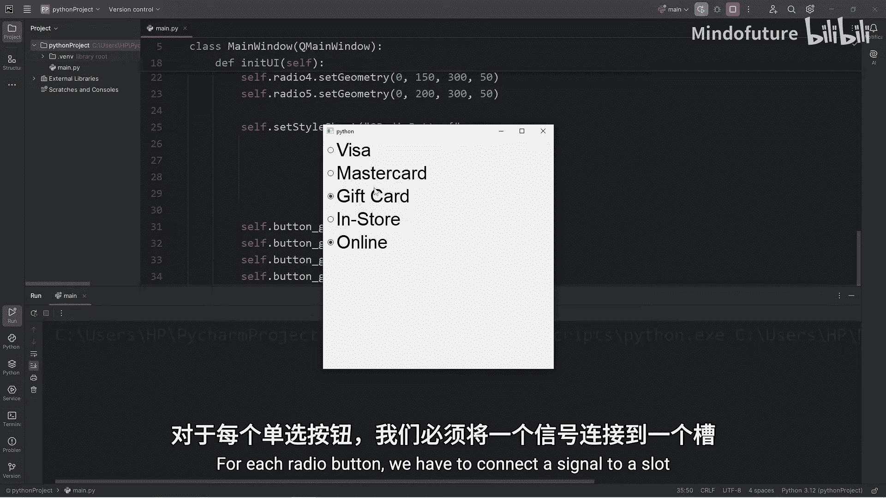

Let's define a method of radio。Button。Changed。There will be no parameters besides self。Temporarily。

 I'll write pass。 We'll fill this in in a moment。We will take each radio button。

 let's start with Radio 1。Radio1。The signal will be toggled。When this radio button is toggled。

We will connect a slot。We will pass in a function or a method。Self dot radio button changed。

Then we will do this with the other radio buttons。One through5。Let's print a test message。

You selected something。

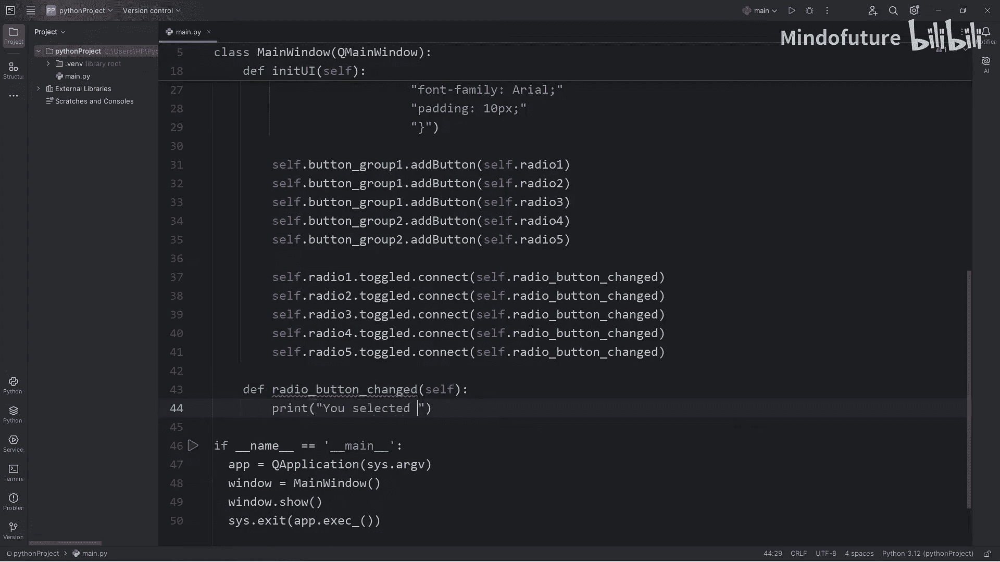

Just to be sure that everything is working。You selected something。

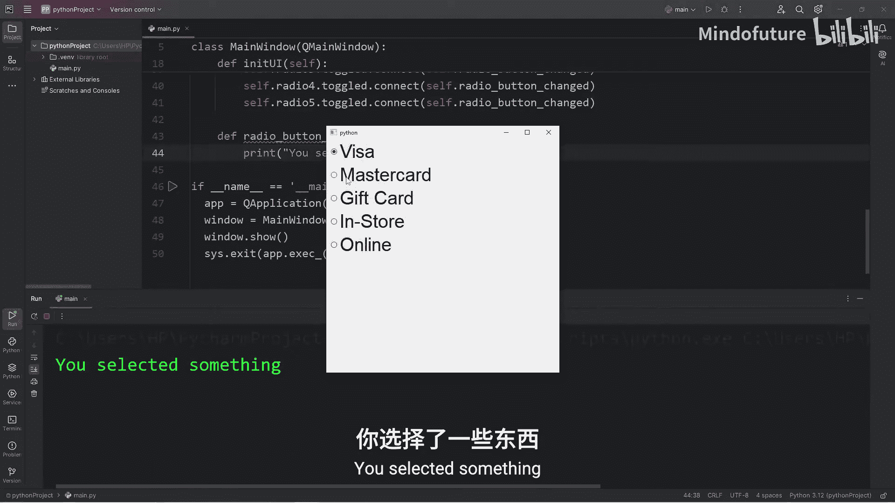

Okay， we know that that works currently。What we're going to need to do is get the sender widget。

 which radio button sent the signal of toggled。I will create a local radio button。

To store that radio button， whichever one emitmted the signal， we can determine that with self dot。

 sender method。The sender method is going to return the widget that sent the signal。

So if we select Raio button 1， our radio button will be radio button1， if it was5。

 then it's five in this case。Then we'll determine if our radio button is checked。

 take our radio button， use the is checked method。This will return a boolean， true or false。

If it's checked， if this returns true， then let's print the following。I'll use enough string。

We will get the text of the radio button。Radio button call the text method to return the text of the radio button。

Is selected。All right， then let's see if this works。

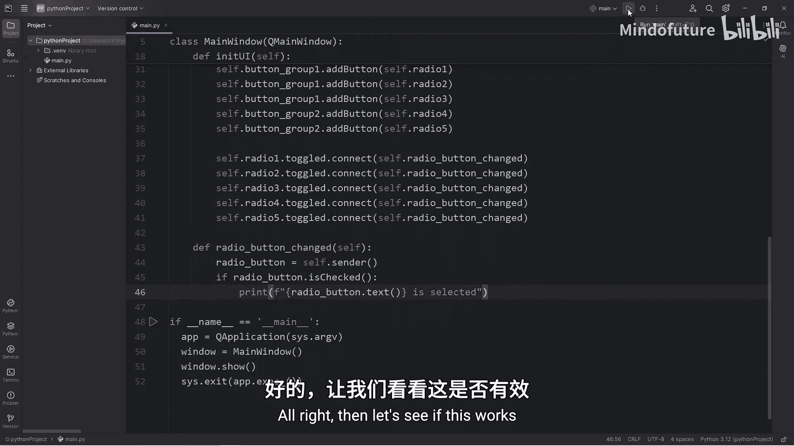

Let's select Visa， Visa is selected。 Mastercard is selected。 gift card is selected。

In store is selected， and online is selected。

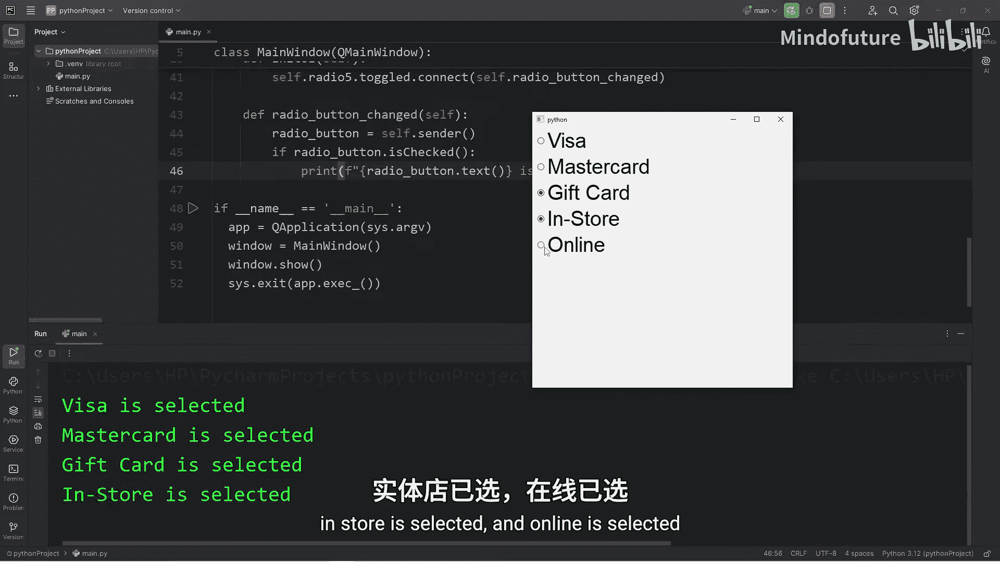

That's how to determine which radio button was selected。 Which one is the sender。

 which one sent the signal。Al right， everybody， so that is an introduction to radio buttons in PiyQT5。

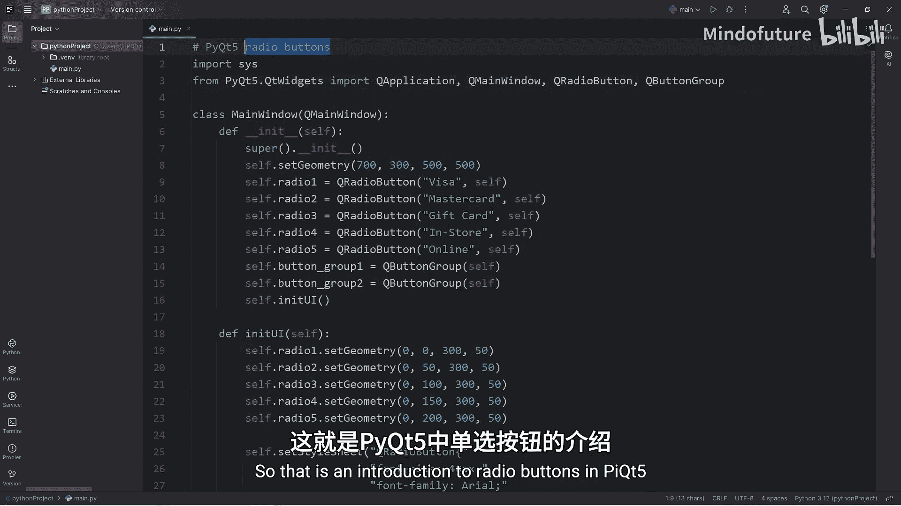