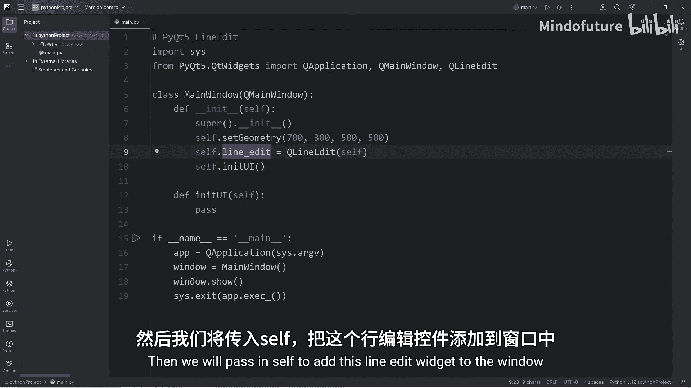
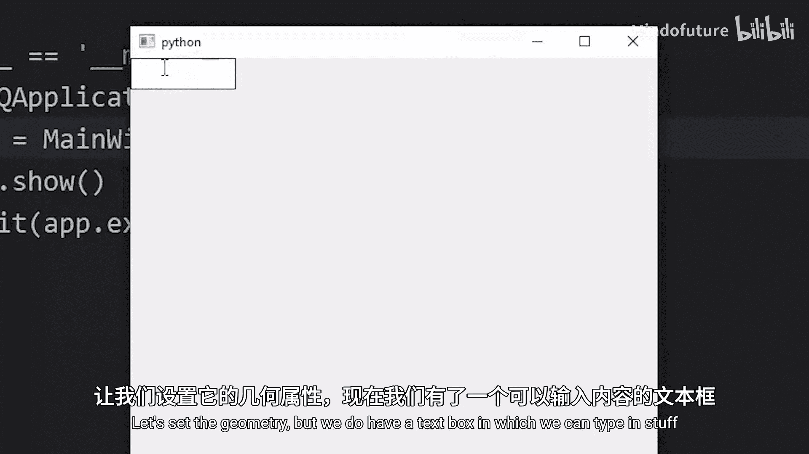
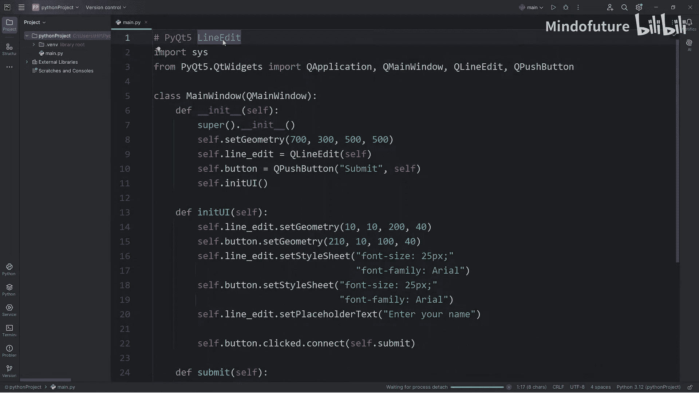

# Python超全入门教程-p85-P85-Python-PyQt5-LINE-EDITS-are-easy--BV1fcdLYXEw9_p85-

Why hello， everybody。 Today， I got to explain line edit widgets in Pi Q T 5。

 also known as text boxes in pretty much anything ever made ever。

 Why are they called line edit widgets。 I really don't know。

 Let's begin from the module of Q T widgets。 We will import the following class of Q line edit。

To create a text box， I mean a line edit widget。We are accessing our window of self。

We will call this line edit widget。Line。Edit。Equals， call the constructor of the class Q line edit。

Then we will pass in self。To add this line edit widget to the window。

Let's set the geometry， but we do have a text box in which we can type in stuff。

I have a method to initialize the user interface。Within this method， I will access self dot。

 the line edit widget。And set the geometry。Let's set it in the top left corner where x is 10。

 Y is 10 set a width，200 is good and a height，40。That's not too bad。Now， the text is really small。

We can change that by applying a style sheet。Access our window with self。

 access our line edit widget， Then call the set style sheet method。

We can pass in some CSS like properties。Including a font size。Let's pick 25 pixels。

And here's my new text box。 We can read the text now。Let's also change the font family。Font family。

 I will pick ael。This text box by itself， it really doesn't do anything。

We need some way to get the text from the text box。 Let's add a button。 When we click on the button。

 we will get the text from the text box and do something with it。 because right now。

 it doesn't do anything。We will need to import Q， push button。Let's create one button。

Self dot button equals call the constructor of the class Q push button。

Let's say that this is a submitmit button。I will pass in a string of submitit。

And we are adding this button to our window。And we do need to set the geometry of the button。

We're not using a layout manager right now。Access our window with self。

Access our button that we have previously created in our constructor。

Then call the set geometry method。We'll place our button where x is 210。Why is 10？

 The width will be 100。And the height will be 40。Not too bad。

Let's change the font size of the button。I'll copy these two lines of code， because I'm lazy。

Instead of selecting our line edit widget， we will select our button。That's better。

If I were to click on the button， it doesn't do anything。

We'll set up the signal of clicked to connect to a method that will do something。

Let's define a method of submit。 We're submitting something。

We're submitting the text within the text box。And for now， I'll right pass。

 We'll get back to this in a second。We're going to take our button， self dot button。

We'll connect the signal of clicked。Clicked dot connect method。 We will connect the method of submit。

Self dot submit。So when we click on the button， we will call this method。 Let's print a test message。

You clicked the button。Let's type in something。Press submitm。And we get our test message。

 you clicked the button。Let's get the text from the text box， then do something with it。

Let's create a local variable of text T equals。 Now we have to get the text from our line edit widget。

Self dot line。Edit， that's the widget。To get the text， we can use the text method to return the text。

Then let's print the text。I'll use an F string。We'll say hello。Add a placeholder。

 then display the text。So now。After typing in something， why do you type in your name？

Then press em it。 We will display。 Ho， your name。You could add some placeholder text， too。

Let's do that here。Let's take self dot， line edit widget。Set placeholder。Text。And let's say。

 enter your name。When I run this program， we have some placeholder text that says and your name。

This time I will type in SponongBob， then press submit Ho， Sponongebob。Al right， everybody。

 so those are line edit widgets， also commonly referred to as text boxes。And well everybody。

 those are line edit widgets and Pi QT5。

