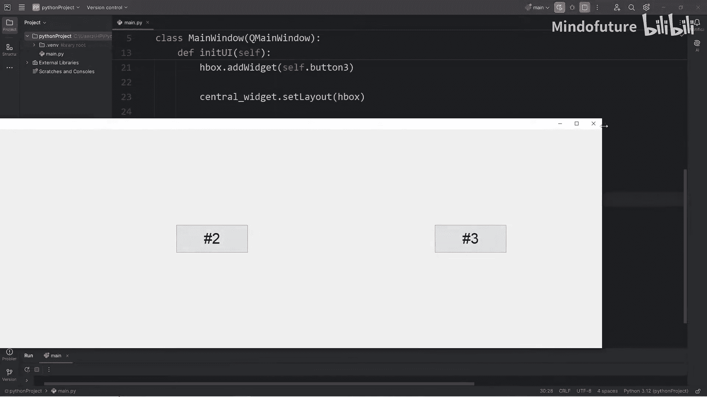
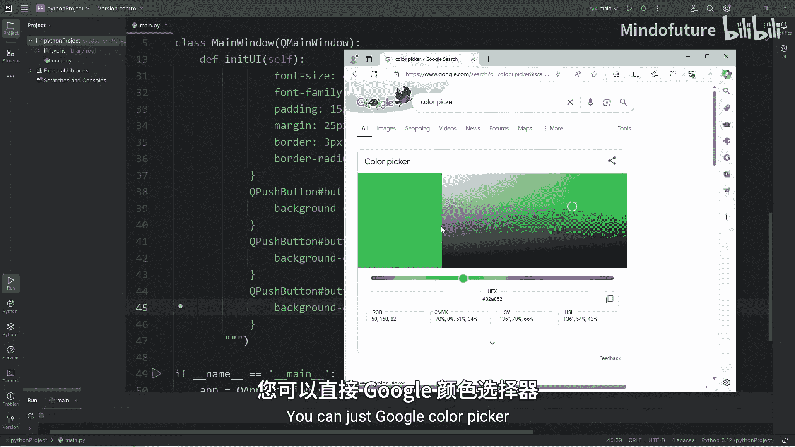
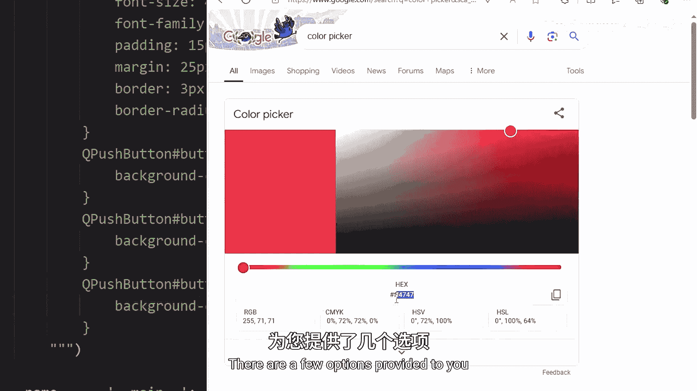
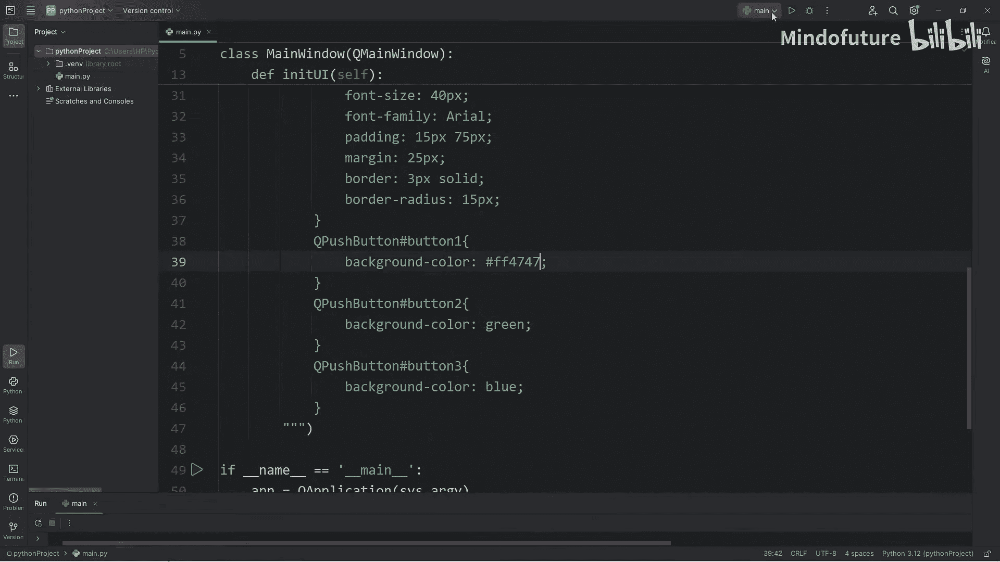
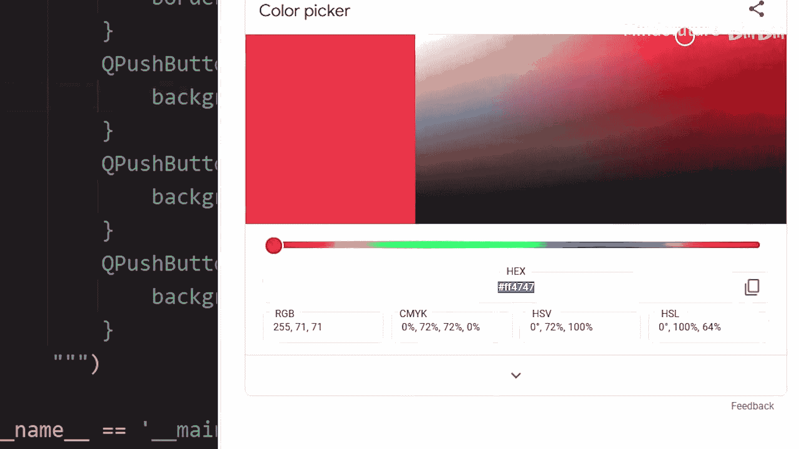
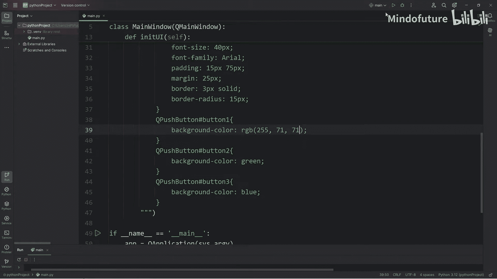
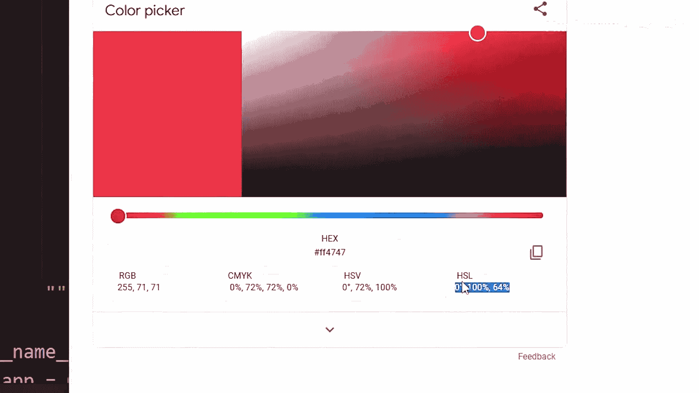
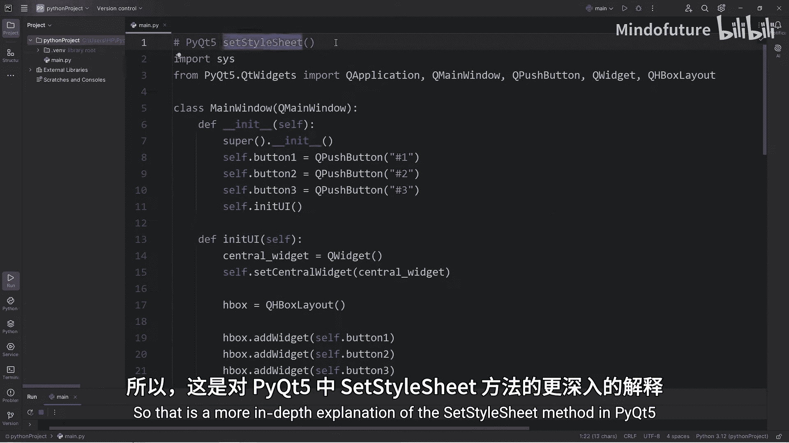

# Python超全入门教程-p86-P86-Python-PyQt5-add-CSS-like-properties-easy--BV1fcdLYXEw9_p86-

Hello， everybody。 So in today's video， I'm going to explain setting style sheets in Pi Q T 5。

 C S S means cascaing style sheets。 If you're not familiar with C S S， you can still follow along。

 but knowing C S S is helpful。 As a reminder， I do have a full free course on YouTube on H T M L and C S S。

 If you would like to learn more。 Let's begin。For this demonstration。

 we will need the following imports。 We will be designing some buttons。 we will import Q push button。

We'll be working with the layout manager， we will import Q Wiidget。

And for a horizontal layout manager， we will need Q H box layout。

 so import these three from the module of QT widgets。 Now in previous topics。

 we've set the geometry of our window since we're using a layout manager。

 we don't necessarily need that anymore， so I'm going to delete it。In the past。

 I have also created a method to initialize our user interface。

 and we are calling that within the constructor of our main window。

 we will create three push button widgets。Self dot button 1 will be the first button equals take our Q push button class and call the constructor。

 We can add text to the button。 We will pass that as an argument。 Now。

 since we're using a layout manager， we don't need to add this button to self our window。

We don't need to do that。 Let's create two more buttons。We'll have button two and button three。

 button two will say number two， button three we'll say number three。

Now we'll create a layout manager under normal circumstances。

 we can't add a layout manager to our main window with main window widgets。

 there's already a specified layout and format。 We're going to add a layout manager to a central widget。

 and this widget will be added to the main window。Let's take care of that within our initialized user interface method。

We will create a central widget。Equals called the constructor of Q widget。Then we will take self。

 That means our window。And set the central widget。Set central widget。

Then pass in our central widget to set it。 Then we will create a layout。

We will call the constructor within the class of QH box layout。

Let's name this layout H box for a horizontal box。Equals。Called the constructor within this class。

We will take our layout of horizontal box。Then add the following widgets。Add widget self dot button1。

We'll do this with two。And three。Then the last thing we need to do is take our central widget。

Call the set layout method。Then pass in our layout manager。

And now we should have those three buttons。They're all arranged horizontally。

Now we're going to apply some CSS like styling using the method of set style sheet。 Here's how。

 rather than apply the CSS properties individually such as self button 1 dot set style sheet。

And in the past， we've passed in individual CSS properties。

We're instead going to set the style sheet of our window， self。We have a lot to write。

 instead of double quotes， we're going to use triple quotes。

Triple quotes are used to write very long strings in a more organized way。

 All of the CsS properties that we're going to write are going to be within this set of triple quotes。

 So let me give you a demonstration。 We could individually apply C S S like properties to each of these widgets。

 but we could select an entire class of widgets， too。 Let's select the class of Q push button。

Then add a set of curly braces。The following CSS properties will apply to all Q pushush button widgets so currently this is what we have。

We'll increase the font size for every push button。

So we will add the following property of font size。Then set it to be 40 pixels each。

 be sure to end each CSS property with a semicolon。So the font size is now 40 for every button。

Let's set the font font family。 I will pick ael。Let's add some padding。

We can add some space around the text and the button itself。So with padding。

 if I was to set this to somebody5 pixels。We would have 75 pixels worth the space between the text and the border of the button。

 I would like to change the dimensions of the padding。

So let's apply 15 pixels to the top and bottom of the button。And 75 to the sides。That's better。

Margin is the space around a button。Let's set the margin to be 25 pixels。

Now the buttons are more spread out。If this was 250， they would really be spread out。 That's margin。

 It's the space around a widget。

Let's set that back to 25。I'm going to change the border。Border。3 pixels， solid。

This would change the border of the buttons。 We now have a black border。

 That's three pixels in width。If you would like to round the corners， we can use border radius。

 I will set that to be 15 pixels。With all the buttons， the corners are now rounded。

Within our set style sheet method， we're applying all of these CSS like properties to every push button。

Now， what if you would like to apply CSS properties to only one widget rather than all of them。

 here's how。With each of our widgets， buttons1，2， and3， we need to set an object name。

Let's do that before we call the set style sheet method。 We will take our buttons， self dot button 1。

Call the As object name method。Then pass in a name for this widget。

We'll keep the name the same as button 1。So let's do this with button two and button three。Button 2。

 button 3。Within the context of set style sheet， we will refer to these widgets by their object name。

 buttons 1，2， and 3。And now we can select them individually。Let's say that， with button 1。

I would like the background color to be red。We're going to access our class of Q push button。

 Foow this with a pound sign。I'd like to call it a hashtag。 Then we need the object name。Button 1。

Button 1 refers to the widget of button one。Again， I kept the name the same。

Then we need a set of curly braces。Between the set of curly braces。

 we can list one or many different CSS properties。Let's change the background color。

I will set it to be red。And now the background color of only that button is red and not all of them。

If I was to set the background color within the class， well， then all of them would be read。Okay。

 so with button2。I'll just copy what we have and paste it。We are selecting the IDd of button 2。

 Let's set the background color to be green。So then the background color is now green。And button 3。

Button three will be blue。If you would like a greater variety of colors。

 I recommend looking up a color picker。You can just Google coloror Picker。

So if I would like a very specific shade of red。I can pick that。Let's go with that。

There are a few options provided to you。 you can use Hex values。

Now we have a very specific shade of red。You can use RGB。

RGb。Inclose it within a set of parentheses and then paste those numbers。

Or my favorite， which is HSL。 HSL means hue， saturation and lightness。

We will enclose our values within HSL。If you copy these values directly from Google。

 you would have to remove this degree symbol。I like H SL because I can also control the saturation and the lightness pretty easily。

 Okay， let's pick a very specific shade of green。That's good， I would say。I'll use the HSL values。

HSL。Remove the degree symbol。And now we have a very specific shade of green。And blue。That's good。

 I would say。That's not too bad。If you're already familiar with CSsS， we can apply pseudo classes。

 such as when we hover over one of the buttons。 Here's how let's copy these three blocks。

Then paste them again。We can add CSS properties when we hover over something。

 we have to use the hover pseudo class after the ID of each of our buttons。We will add colon， hover。

We can apply the following CSS properties when we hover over the buttons。

All I'm going to do is up the lightness。 Let's say， by 20% each。

Then when we hover over one of the buttons。The Lightness is going to change we apply the new CSS properties。

Al right， everybody， so that is a more in depth explanation of the set style sheet method in Pi QT5。

