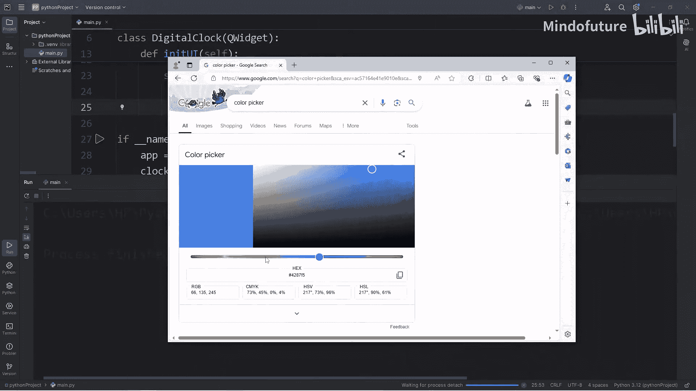
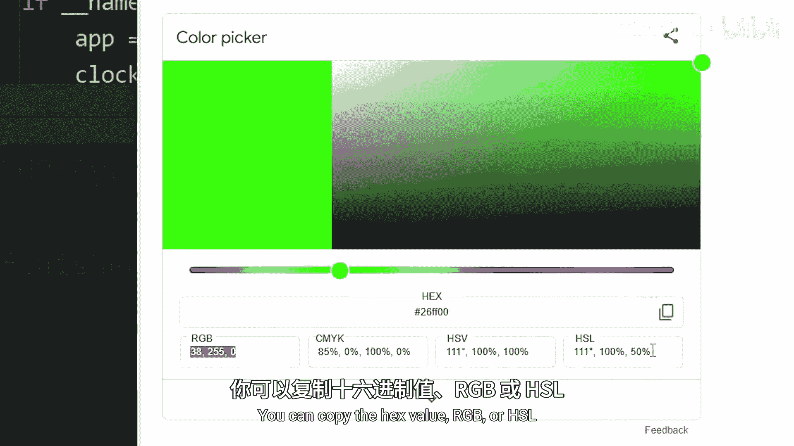
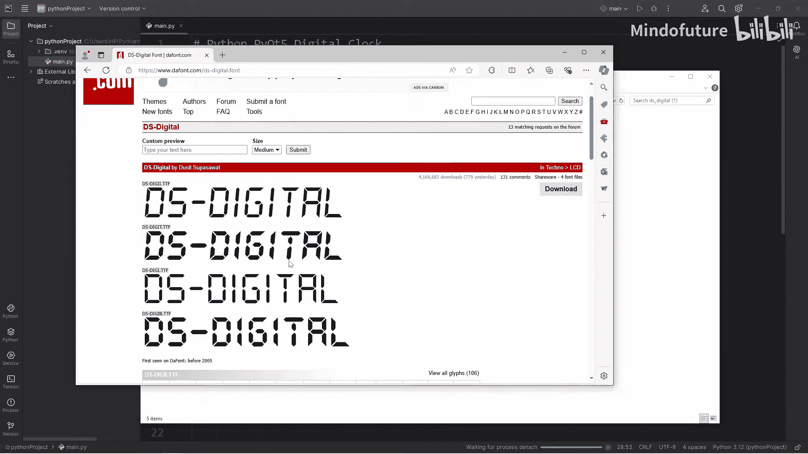
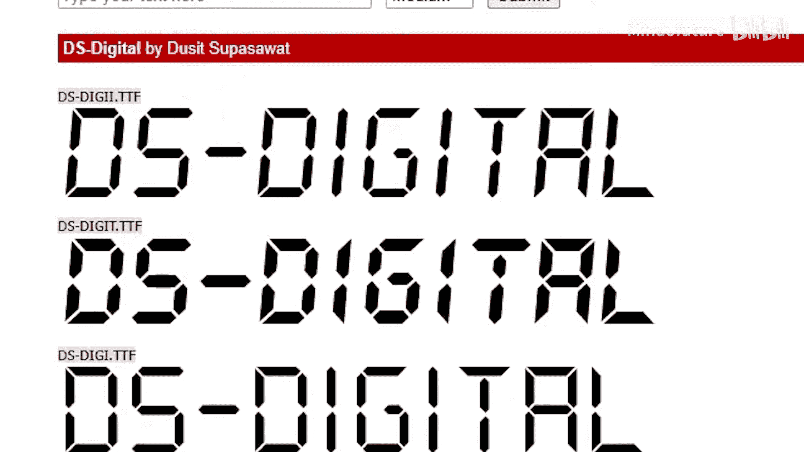
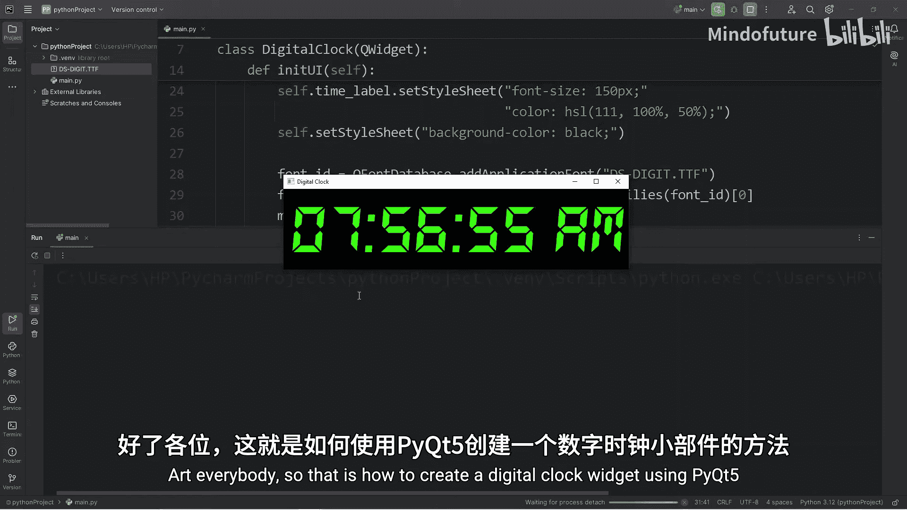

# Python超全入门教程-p87-P87-Lets-code-a-DIGITAL-CLOCK-in-Python--BV1fcdLYXEw9_p87-

Al right， everybody In today's video， we're going to build a digital clock widget using Python's P Q T5 library。

 If you're new to this channel， I have previously released a course on P Q T5 In that series。

 we've downloaded the Pi Q T5 package。 It's found within the library folder of our virtual environment within our project folder。

😊，If you don't have this package， you will need to download it。 you can open up a terminal。

Then type the following command。Pip， install Pi Q T5， enter。So I already have it installed。

 be sure that this package of Pi QT5 is within your site packages folder， so let's begin。

At the top of our Python file， we will need the following imports， import cis。Sys means system。

 This module provides variables used and maintained by the Python interpreter。

 We would also need widgets。 Wiidgets are the building blocks of a Gui application。

From the package of pi Q T5。We need to access the module of QT widdgegets。Import the following。

Q application。Q widget。 This is a generic widget。 will turn our digital clock into its own widget。

And Q label to work with labels。 We will be using a layout manager， more specifically， Q V。Box。

Layout。There' is another import we'll need to from the package of pi Q25。

Access the module of Q T core。 the Q T core module。

 It provides functionality not related to Gui components。

 This is where we'll get a timer to keep track of the time from this module， we will import Q timer。

Q time and Q T。 Q T is for alignment。We will create a class of digital。

Clock instead of inheriting from the main window widget。

 we will inherit from the base class of Q widget。Q widget is a base class to create our own widgets。

 Our digital clock will be a widget。We will need a constructor， So let's define that。 Def in。

 pass in。If there are any arguments to send to the parent。

 we will call the constructor of the parent， the super class， super。Called the init method。

At the end of the constructor， what I like to do is call a method of initialize U Y in it， U why。

 This will be a separate method define in it U Y。There are no parameters beside self。And for now。

 I'll write pass。It's within this method that we will be designing the layout of the digital clock within the constructor。

 that's where we will be constructing all of the different entities for the clock。

At the end of my Python file， I will add the following statement If Dunder name is equal to a string of Dunder main。

This statement will be true if we are running this program directly。To create an application。

 we will create an app object equals， called the constructor with the class Q application。

As an argument to the constructor， we will pass in the following argument。

 access the module of Cs A R G V， which means arguments。

 This would apply if we're running from command prompt or terminal。

 but we won't be doing that in this video。 But it's nice just to set it up in case we do in the future。

Now we are going to create a clock object。Clock equals。

 we will call the constructor of our digital clock class。 There are no arguments。 Now。

 the window doesn't appear。That's because we have to use the show method of our clock。

 Take our clock， call the show method。Now it's only going to appear for a brief second。

Just momentarily， I don't know if you saw that。To ensure a clean and proper exit of our application。

 we need to call the following method access our module of ciys， call the exit method。

Then pass in the following。 We will take our app object。Then call the following method。E， X， E， C。

 underscore， and then a set of preheses。 It's a method。 It's the execute method。

 It starts the main event loop of the application。 It also handles events such as key presses。

 mouse clicks or other user interactions。So then we should have a window that stays in place until we exit。

Okay， now we have the base functionality all set up。

We have a class of digital clock that inherits from the Q widget based class。

We're not going to be using main window in this video within the constructor of my digital clock。

 I will create a label， self dot time label。 This will be a label that displays the time。

 We will call the constructor within the class Q label。 Then be sure to pass in self。

We will be adding this label directly to our widget of clock。We will need a timer。

 self dot timer equals called the constructor of Q timer。Then pass in self。

We are adding the timer to the clock。Now， with designing the layout of our clock。

 I'll handle that within the initialized user interface method。

We're going to set a title for the window。Self dot set。Window。

Title method pass in a string that will be used for the title of the window。 Let's say。

 digital clock。Then our window should say。Digital clock。Let's set the geometry of the window。

Self dot set geometry。The first two arguments are going to be for the placement of the window。

 Where will it appear within your screen。So I'll pick something approximately in the middle for me。

 but feel free to change these values。Then we need a width for the window。

 Let's say 300 and a height，100 for the height。So my window should appear approximately in the middle of my screen。

The base width is 300。 The base height is 100。Now we're going to need a layout manager。

I will name the layout manager V box for a vertical box。The box equals。

Called the constructor within the class QV box。This will arrange all of our widgets vertically。

But we only have one widget， a time label。So we will take our layout manager of VBox。Add。Widget。

 that's a method。 We will pass in self dot time label as an argument。

We're adding our label to this layout manager of VBox。Then to set the layout。

 we will take self that applies to our clock called the set layout method。

Then pass in our layout manager of V box。So currently， if I run this， we don't see anything。

Temporarily within our label， I will add some text just as a placeholder so we can see what we're working with。

Let's say，12 o'clock。So then we should see something at least， although the font is kind of small。

We will be getting rid of this later。We just want to be sure that we can see everything。All right。

 So after our layout。I would like the label to be centerized horizontally。

Here's how we can set that up。 We will take our label， self dot time。Label， called the as set。

Alignment method。Access the class of QT。Access align center。This should center align our time。

Now let's work on the font， I can barely read it。We will take our label self。time。Label。

Set style sheet。We can pass in multiple CSS， like properties。Let's set the font size。

I'll set it to be 150 pixels。Now we can read it。You could pick a font。

 but we're going to change that at the end of this video。 We'll import a custom font。But temporarily。

 let's say， font family aerial。You could change the color too。So if I set the color to be green。

Then the font color is going to be green。But I would like a very specific shade of green。

You can always Google a color picker。

Then pick a very specific color。 Let's go with that。 something that's bright green。

You can copy the hex value， RGB。

Or HSL HSL means hue saturation and lightness。I'll use HSL values。For the color。

 we will type H SL add a set of parentheses， then paste those values。 But there is a degree symbol。

 You do have to get rid of that。 Now， the font color is going to be bright green。

Let's change the background color。 Here's how。We will take self that applies to our clock。

 then called the set style sheet method。Pass in a background color。

We will set the background color property to be black。I think that looks pretty good。

But it doesn't quite do anything quite yet。 That's the next step。 Let's create a method。

2 update time， no arguments beside self。 I will create a local variable of current time。

EqualsNow to get the current time， we can access the class of Q time。Q time。

Dot call the method of current time。We will need to convert it to a string。 We will method chain。

The two string method。Within the two string method， we will design the layout of the time。

 So I would like hours first， I will type two Hs， colon minutes。 That's  two Ms， colon，2 Ss。

To set the text of the label， we will take self do time label。Call the As text method。

Then pass in our current time。So if I run this currently， we still have our placeholder time。

Let's update it with the current time。We can get rid of our placeholder text of 12， we can delete it。

After we set the font， let's call the method of update time， self dot update time。Now。

 we should display the current time。 So me， I'm recording this video at 744 in the morning。

If you would like to add AM or PMm after your time， here's how。After our string format specifiers。

 we will add capital AP P A means antimeridium and P means post meidium。

So then we should display AM or PMm， depending on when you're coding this。Currently。

 the time for me is 745 AM。To get the clock to update every second。

We need to connect our timer widget to a slot of update time。We will take our timer， self dot timer。

 This isn't the time label。 It's the timer to keep track of the time。During a signal of time。Out。

 we will connect the following slot。Of self dot update time。Self dot update time。With our timer。

 we need to trigger a time out signal every 1000 milliseconds， every second that is to handle that。

 we will take our timer self dot timer， call the start method。

 then pass in 1000 for 1000 milliseconds。So then when we run this program。

 our clock should update every second and display the new current time。As an added bonus。

 if you would like to download a custom font， here's how。Using Google or another search engine。

 I would recommend looking up a font of your choosing。 So one font that I like is DSs digital。

 What we need is a TTF file， meaning true type font。I'll just pick this first link。

So these fonts are pretty good。So Im going to download them。I'll pick this specific font， DSS digit。

 and again the file extension is TTF。

So once you have your font， move it to your project folder。

 so for convenience we have that TTF file right next to our main Python file。Okay。

 to work with specific fonts， we will need the following import。From。Pi Q T 5。Dot Q， T。Giwa。Import。Q。

Ft。As well as Q font Data base。Since we're going to use our own custom font。

 we can delete that from the set style sheet method of our time label。

So let's set the font right here。We will assign a local variable， a font ID。Equals。Q font Data base。

Q font database is a class for managing and querying fonts available to the application to add a custom font。

 We will call the following method within it， add。Application。Funt。😡，Within the set of quotes。

 we're going to pass in a file path。 This can be a relative file path or an absolute file path。

 This T TF file is right next to my main Python file。 I only need the file name。

My font file is named D S。Digit。And get the file extension of TtF。

We will create a local variable of font family。We will retrieve the name of the font family。

 from this I。Again， we will access Q font database dot call the。Application。Font families method。

 So this method returns a list of font names。 We will pass in our font。Id。But there's another step。

 We're going to use the index of operator and get the index of 0。

 This will retrieve the first element of the font family。 That's because we're working with a list。

 We will need just the first element， at index 0。Now we'll have a font family to work with。Now。

 to set the font， we will create a local variable of my font equals called the class called the constructor within the class Q font。

Pass in the following arguments。Our font family。That's the first argument。And then font size。

 let's say 150。To set the font， we will take our time label self dot time。Label。

Called the As font method。Then pass in my font， our custom font。

So then we should have our custom font。 that digital font that we've downloaded。Art everybody。

 so that is how to create a digital clock widget using Pi QT5。

