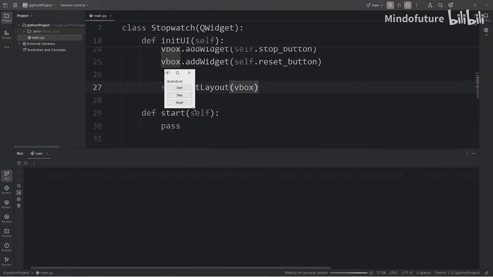
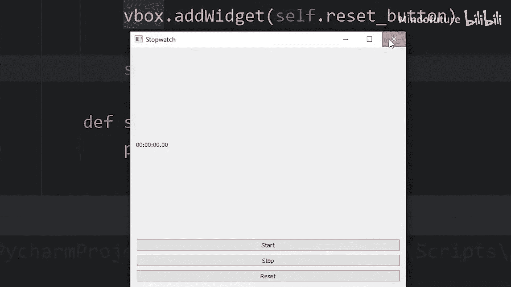
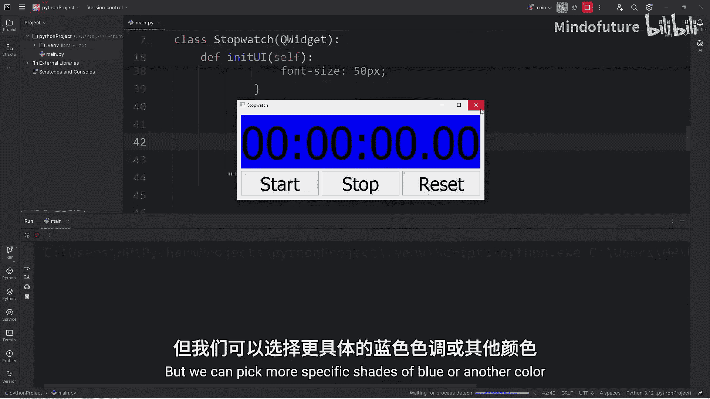
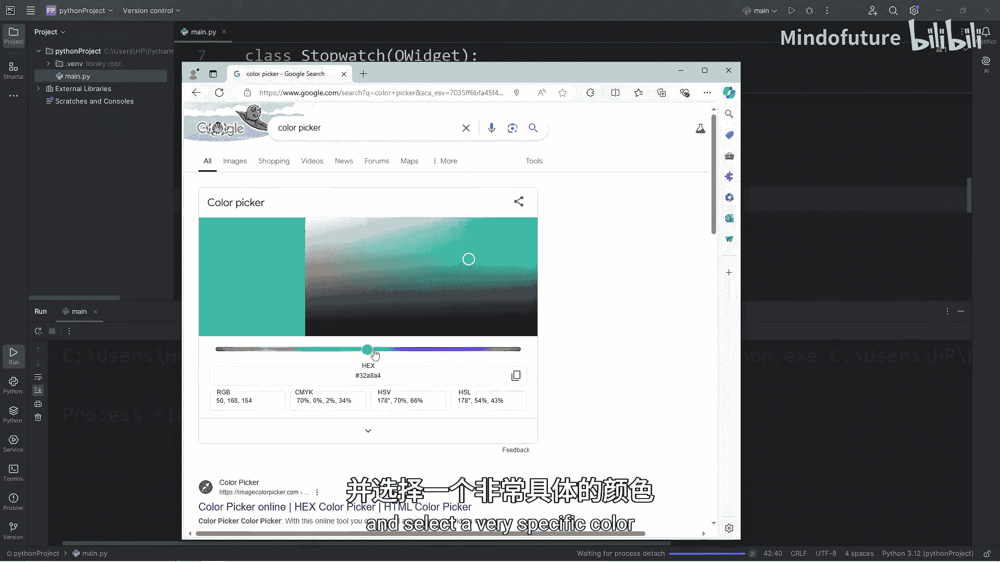
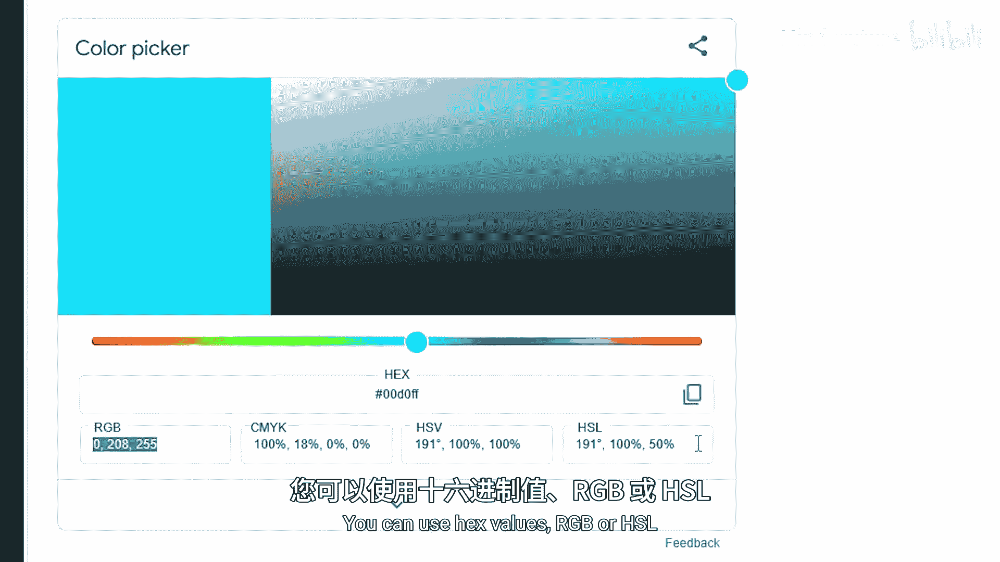
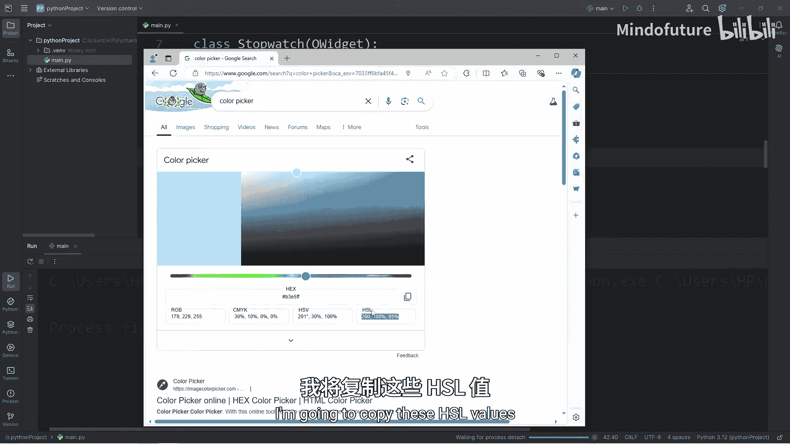
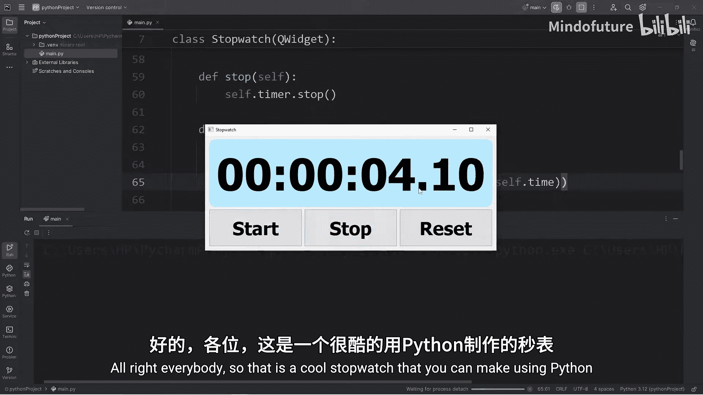

# Python超全入门教程-p88-P88-Lets-code-a-STOPWATCH-in-Python--BV1fcdLYXEw9_p88-

Hey， yeah， everybody。 So in today's video， we're going to create this stopwatch program using Python's P Q5 library。

 If you've been following the Py Q T5 series up until this point。

 you can skip ahead to the following timestamp where we've already set up a basic application。

 You just have to make some minor changes。 If you're new to the series or new to this channel。

 You will need the P Q T 5 package found within your site packages folder。

 If you don't have this package。 you can open up a terminal to download it。 You can use Pip。

 which is Python's package manager。😊，Install Pi Q T 5。But I already do have it installed。

 Once that's out of the way， you will need the following imports。Import cis， cis means system。

 It handles system variables for your Python interpreter。

 We will need the following widgets from pi Q T 5 access the module of Q T widgets。

Widgets are the building blocks of a Pi QT5 application。We will import the following widgets， Q。

Application。Q。Widget。Q。Label。Q， push button。QV box layout。And Q， H box layout。

Let me put these on a new line just so we can read everything。From the package of pi Q T 5。

 access Q T core。We will import。Q， timer。Our timer will emit a signal after a given interval。

 which is what we need for a stopwatch。Q time to keep track of the time。And Q， T for alignment。

 Let's do a test for run to be sure that there's no errors。Looks like L in label should be capital。

There we go。No errors。Once you have the following imports， we will construct a class， a class。

Of stopwatch。Which will inherit from the base class of Q widget。Our stopwatch will be a widget。

We will need a constructor。 We'll define that。Dunder in it。No arguments beside self。

 If we have arguments to pass to the parent of Q widget， we will call the super class， the parent。

Called the constructor of the parent。 No arguments currently。Now。

 if we are running this file directly， we'll use an if statement to verify that。If D name。

Is equal to a string。Of Dunder man。If this is true， if we are running this file directly。

 then we will construct a stopwach。We will create an app object。

Called the constructor within the Q application class。Pass in the following access cis， our system。

 access A， R， GV， which means arguments。This is if we're using command line arguments。

 which we won't be using， but it's nice to future proof our code， just in case we do in the future。

We will create a stop watch object。Stopwatch equals call the constructor within our class of stopwatch。

Our window is not going to show unless we call the show method。 Take our stop watch。

 Call the show method。Now， our window is only going to show for a brief second。

We need to ensure a clean exit。We can access cis， call the exit method。Passing the following。App。

Then called the E， X， E， C underscore method。 This method starts the main event loop。

 and handles events。So then we should have a basic window， which stays in place until we close it。

We now have the main skeletal structure of a pi Q T5 application set up。

 If you're one of the people that have jumped ahead up until this point。

 we have a class of stop watch， which inherits from the Q widget class。

We've constructed a stopwatch object， and we're showing it。So now we can begin designing our stopwa。

 We will create a time object， self dot time。Equals， call the constructor within the class of Q time。

4 arguments will pass in the hours， minutes， seconds and milliseconds， all 0。

We need a label for the stop watch。Self dot time。Label equals called the constructor of Q label。

What would we like the text to say。I'll display some placeholder text。A bunch of zeroes。0 hours。

 minutes， seconds and milliseconds。 We will add this label to self。Our stopwatch。

We need a start button， self dot start。Button equals。Called the constructor with then Q push button。

What would we like the text of the button to say。Let's say start。 We are adding this button to self。

 our stop watch。We need a stop button。Let's replace start with stop。

 change the text from start to stop。And reset。The name of this button will be the reset button。

The text will be reset。We will need a timer to o a signal at a given interval。Self dot timer equals。

Call the constructor within the class， Q timer。Thenhan， pass himself。

We're going to call a method of initialized UI self dot inni U I。

But we still have to define this method。All right。 within our stopwach class。

 we need the following methods。A method of innit U Y。

 This is where we'll be designing the user interface。I'll right pass for now， as a placeholder。

We need a method to start。To start the stop watch， that is。A method to stop the stopwa。

A method to reset the stopwa。We'll create a method to format our time。Format time。 beside self。

 there is one parameter。 We have to pass in a time to format。We will be returning a string。

 a string representation of the current time。And a method to update our display。Update， display。

Here are the six methods we'll need。Within our initialized user interface method。

 we will set the title of the window。 because right now， it says Python。We will take self。

 our stop watch， called the window。Title method。And we will pass in。 Stop， watch。

That should change the title of the window to stop watch。

 We're going to use a vertical layout manager for the label， and the buttons。

We will create a layout manager named V box。 V box equals called the constructor of Q V。Box layout。

We will take our layout manager。And add the following widgets。Self dot time label。Then our start。

 stop， and reset buttons。Start button。Stop button。And reset button。We will take self。Set the layout。

Pass in our vertical layout manager。

So we have all of our buttons。We have our widgets arranged in a column。

We're going to take our time label and also center it horizontally。

We will take our time label， self dot time label。Call the set alignment method。

Access our class of Q T。Access the flag。Of a line center。That's going to center align the time。

 It should be aligned both vertically and horizontally。Now， with your buttons。

 they're arranged in a column。 We could group them together horizontally。

Here's how we will create a horizontal layout manager of H box。

H box equals call the constructor of Q H box layout。

Instead of adding these buttons directly to our vertical layout manager， let's cut them。

Paste them underneath each box。Replace V box with H box。Than with our vertical layout manager。B box。

We will add。Our layout of H box。This group of buttons is arranged vertically with the time label。

Now we'll be applying a style sheet。Access self， our stop watch called the set style sheet method。

We can pass in one extremely long string with a set of triple quotes。

All of the CSss like properties will add will do so between the set of triple quotes。

Let's select our buttons。Q， push button。 We are selecting an entire class。

Within a set of curly braces， let's add the property a font size。

 The font size of all buttons will be 50 pixels。Let's customize our label。

 Select the class of Q label。Within a set of curly braces。Let's add the following properties。

Font size will be 1，20。If you would like， we can add a background color， too to the label。

We can select a background color。Temporarily， I will select blue。

But we can pick more specific shades of blue or another color。 Here's how。

You can look up a color picker and select a very specific color。

You can use Hex values， RGB， or HSL。

I've already selected a color。 I'm going to copy these HSL values。 So instead of a color name。

We will select HSL， then paste those values。If you have a degree symbol。

 you will need to remove that。And now we have a very specific shade of blue。

I will also round the corners of our label。Add the property of border radius。

I will set that to be 20 pixels。This will round the corners。Between each button and label。

 we'll add some padding。We're going to use multiple selectors。We will select。All push buttons。

And all labels。Apply the following properties to each。 I will add padding of 20 pixels。

Around these widgets。And I will also make the font weight bold。Font weight will be bold。All right。

 I think that looks pretty good。Hey， this is bro from the future。 I am currently editing this video。

 If you would like， you can add a font family。😊，One font that I think looks really good is calibri。

We'll apply that 12 push buttons and Q labels。I really like the font。 I think it fits a stop watch。

 but it's up to you if you would like to change the font。 I just thought I would mention that。Now。

 we just have to add some functionality because these buttons don't do anything。

For each of our buttons， we have to connect a signal to a slot。 We will take our start button。

 self dot start button。With the signal of clicked， we will connect the following slot。

We will call the start method。Self dot start method。Let's do this with the stop button。

Change start2 stop。Clicked connect self dot stop method。Reet。Self dot reset button。

Called the reset method。At a given interval， we're going to update our display。Self dot timer。

During a signal of time out。We will connect the following method， self dot update display。Self dot。

 update display。Within our start method， we will take our timer， self dot timer。

 Call the start method。Pass in 10 for 10 milliseconds。We will set an interval。For a time out。

 every 10 milliseconds。Within our stop method， we will take our timer。And instead。

 called the stop method。We'll get back to reset in just a moment。

 Let's work on the format time method。From our time that we pass in， we have to get the hours。

 minutes， seconds and milliseconds。 We will create some local variables。

 Ours equals access our time that we pass in。Call the hour method to return hours。

We have variable minutes。Time dot called the minute method to return the minutes。

We have a variable of seconds。 Second equals take our time， called the second method。Then。

 4 milliseconds。Access our time。Call the M S，EC， which means milliseconds and call it。

 this is a method。I'm going to return a string， an F string to represent the time。

We will add four placeholders。Hours， minutes， seconds and milliseconds。

Each will be separated with a cold， except for milliseconds， which will be a dot， a period。

We will display the hours。I'll add some leading zeros， two leading zeros。Let's do this for a minutes。

We're using a format specifier for two leading zeros， as well。Seconds。And milliseconds。

Now we will work on the update display method。We have to get the time， self dot time equals。

We will take our time。But call the add milliseconds method。M S，EC， S。

Then pass in 10 for 10 milliseconds。We're going to take our time label， self dot time。Label。

And set the text of it。We will call our format time method。But we have to pass in a time。

 We will be passing in self dot time。Let's see what we have， currently。We can start the stopwa。

And we can stop it。However， we're displaying three digits for the milliseconds。

 We can eliminate that。Within format time， when we get the milliseys， we will use integer division。

We will divide by 10。This will convert our milliseconds from  three digits to 2。

 We're basically dividing by 10。So here's our stopwatch。 Currently。 We can start。We can stop。

We can start again， and we can stop again。Now， we just need to reset。 Here's how。

Within the reset method。We will take our timer， self do timer， use the stop method to stop。

We will reassign our time。Called the constructor of Q time。We have to pass in hours， minutes。

 seconds， and milliseconds。They're all going to be 0。 We're resetting our time。

And then we'll reset the text again of our time label， self dot time label。Call the set text method。

When we set the text， we will first format it with the format time method。

But we have to pass into time。We will pass in self dot time。

And now we should be able to reset our stopwa。We can start。We can stop。We can reset。Start again。

And stop again。All right， everybody。 So that is a cool stopwatch that you can make using Python。

