# Python超全入门教程-p89-P89-Lets-code-a-WEATHER-APP-in-Python--BV1fcdLYXEw9_p89-

He， yeah， what's going on， everybody。 So in today's video。

 we're going to create a working weather app that fetches real time weather data from an API。

 This is a massive project。 So feel free to take your time。

 Take several days or even weeks if you need to complete this。 Heck。

 you can even add this project to your portfolio。 Well， let's get started， everybody。😊。

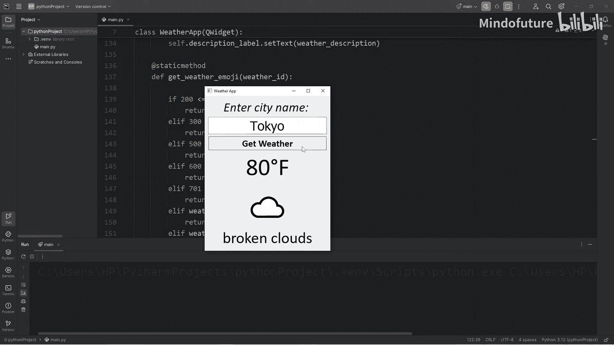

All right， let's get started， everybody。 This is a fairly useful API to get real time weather data。

 The website is openweathermap dot org。You will need your own API key。

 but signing up for an account is free to create an account will go to sign in。Create an account。

Enter your information， and then sign in。Once you're signed in to find your API key。

 go to the dropropdown menu， go to My API keys。And you would just need to copy this API key。

If the status is inactive， you'll need to toggle it to active。Like so。

Now it may take several minutes for your API key to become active。

 hopefully by the time of this project where we will need it， it'll be active。

I would either leave up this window or copy this key and paste it somewhere。

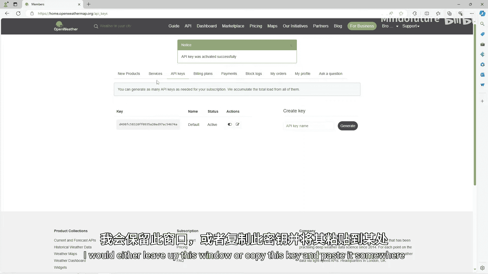

If you're new to my Python series， we have a little bit of setup to do。

 you will need the PyQT5 package installed。If you've been following my series。

 you can skip ahead to the following timestamp。 at this point。

 we'll already have a basic window set up to download Pi QT5。 You can open up a terminal。And use Pip。

 which is Python's package manager to install Pi Q T 5。And myself。

 I do already have this style loaded。Once you have this package downloaded and it's within your site packages folder。

 we will need the following imports。We will import cis。

Sysme system It handles system variables for your Python interpreter。

 We will import the request module to make a request to an API。Then we'll need widgets。

 widgets are the building blocks of a PQT5 application。From the package of pi Q T 5。

Access the module of QT widgets。Import the following widgets。Q application。Q widget。Q label。

Q line edit。Q push button。Let me put some of these on a new line for readability。QB box。Lalayout。

This is a vertical layout manager。To work with alignment we'll need the following from the package of Pi QT5。

From the module of QT core。Import the following class Q， which is used for alignment。

So these are the imports that you'll need。Just to be sure that I didn't misspell anything。

Or get the capitalization wrong。 I'm just going to do a test run。

No problems processed finished with Excode 0。Sometimes I make one of these characters a lowercase。

 and then it doesn't work。Okay， we have our imports。We will need to create a class。Of weather app。

Weather app is going to inherit from the parent of Q Wiidget。We will need a constructor。

 so we'll define that。Dunder in it。No arguments besides self。

In case we have arguments to send to the parent。We will call the parent with super。

 meaning the super class。Then call the constructor。But currently we don't have any arguments。

If we are running our main Python file directly。We can verify that with the ifF statement。

If Dunder name。Is equal to a string of Dunder main。If we are running this file directly。

 then we will create a weather app object， otherwise we won't。If this statement is true。

 we will do the following。We will create an app object app equals called the constructor within our Q application class。

But we will pass in the following， access the module of Cs， then access A R GV。

 which means arguments。If we have command line arguments to send to our application。

 this is how we would take care of that， but we're not going to be using command line arguments in this video。

 but it's nice to future proof our code just in case we do。We will construct a weather app object。

WeatherApp equals call the constructor of our Weer app class。Now， this window isn't going to show。

We have to call the show method of our weather app。Weatherapp。s。

And now it's going to show for a brief second。We need to ensure a clean exit。Access this。

Called the exit method Within this method， we will pass in the following。 Take our app。

 called the execute method， which is E X， E underscore。It is a method， so we have to call it。

This method handles events within our application。Such as closing the window。

So now our window should stay in place until we close it。

If you're one of the people that have jumped ahead， we have created a class of weather app。

 which inherits from the parent of Q Wiidget。We have constructed a weather app object。

And we're showing it。If you've made some PIQT5 projects in the past。

 you would just have to change some of these around。Within the constructor of our class weather app。

 we will declare the different widgets that belong to our weather app object。

We will create a label that prompts the user to enter in a city。 We will name this city label equals。

 This is a Q label widget。We can set the initial text of the label。Let's say， enter city name。

Then the second argument is going to be a self。We are adding this label to our weather app object。

Here is what we have currently。We still have to do some CSS formatting。

 but we'll take care of that soon。We will need a line edit widget， Basically a text box。

 We will name it city。Input。The widget is line edit。No parameters besides self。

Here is our line edit widget。 We're not currently using a layout manager。

 These widgets are going to overlap。We need a button。Self dot get。Weather button。

This is a Q push button。The text on this button will be get。Weather。We are adding this to self。

 our weather app object。Here is our button。When we click on this button。

 we'll make a request to an API。For the next following widgets。

 we're going to add some placeholders just so that we can see what we're doing when we apply CS SS styling。

We need a temperature label to display the temperature。Temperature。Label。Equals a Q label。

Temporarily for the label， let's say that the temperature is 70 degrees F or pick something else in Celsius。

 So to add a degree symbol。 If you're using windows， make sure num lock is on， hold alt。

 Then on the numppa type 0，1，7，6。 I will pick 70 degrees F。And then we will add this to self。Again。

 we're just using this temperature as a placeholder。 We'll delete it when we do a test run。

If you would like to include an emoji or some other image。We can create a label for that。

I will name this。 emoji label。Equals a Q label。I will add an emoji。Of a son as a placeholder。Again。

 we're going to delete this when we do a test run。We are adding this to self。Again。

 everything is overlapping， that is fine。And we need a description of the weather。Description。Label。

Equals a Q label。As a placeholder， let's say that it's sunny。And we are adding this label to self。

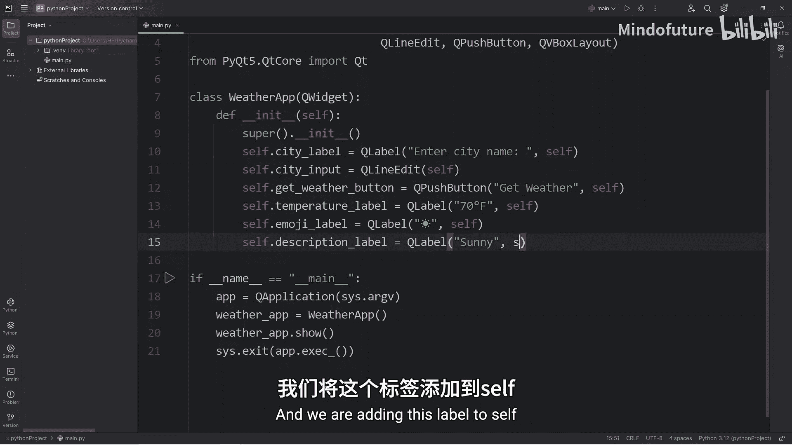

Okay， here are all the widgets。 They're all overlapping。 so we need to fix that。

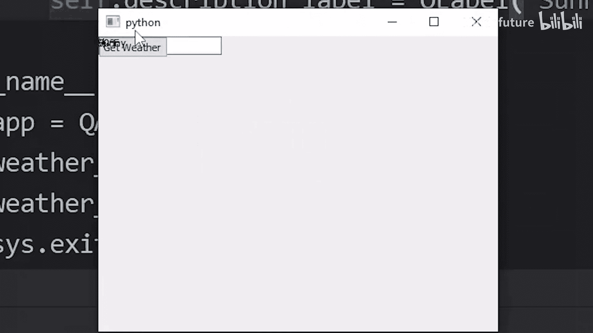

All right， moving on everybody， so now we have to design the layout of our web app。Right now。

 all of our widgets are gravitating to the top left corner。So I will define a method。

To initialize our user interface。At the end of this constructor， we will call this method self dot。

 initialize U Y， then call it。Once we've constructed our widgets。

We'll format them and design the layout。So we are now within our initialized user interface method。

First， let's set the title of our window， self dot set。Window title。

Let's say that the title is Weather app。So that should change， which it does。

We're going to use a vertical layout manager to handle all the widgets。

Let's name the layout manager V box equals， call the constructor of the class Q V box layout。

We're going to take our layout manager of Vbox。Then add a widget。We will start with the city label。

 That's first。We will pass in self dot city label。And we'll do this with the other widgets， too。

We have city input。Get weather button。Temperature label。Emoji label。And then， a description label。

Take self。Our weather app。Set the layout。We will pass in the layout manager of V box。

And here's what we have， currently。All the widgets are arranged in a column。

Now we just have to center align them horizontally， here's how。We will take self dot city label。

Called the set alignment method。Access the class of QT。Access the flag of a wine center。

We're going to align all of our widgets in the center， except for our weather button。 Currently。

 our button expands to take up the width of the window。So we don't need to horizontally align that。

So we have five widgets to align。We have city label， city input。Temperature label。Emoji label。

And description label。All of the widgets are going to be arranged in a column， horizontally。

Now we just have to apply some CSS styling because right now， it's kind of ugly。

We will apply styles based on an object name， but we have to set that object name。

 So let's start with our city label， self dot， city label。Call the set object name method。

Pass in a unique ID for this widget。I will name it city label。 I'll keep it the same。Okay。

 we have to do this with the other widgets， too。We have a total of6。We have city label， city input。

We have the getwe button。Temperature label。Emoji label。And description label。

Then we're going to set a style sheet。Take Excel our weather app。

 apply a style sheet with set St sheet。We have a lot of properties to write。

 I will do so within a set of triple quotes， just to keep everything more organized。

We can apply CSS styles based on a class。So the class is going to be Q label。

Within a set of curly braces， we can list multiple CSS properties。

I will set the font family to be calibri。As well as all push buttons。Q， push button。

So here's the font， although it's still kind of small。Let's select our IDd of City labelbel。

It's good practice to pre this ID with the name of the class。So Q label。Pound sign， the idea D。

We precede the ID with the name of the class， just so we're only applying these CSS properties to any ID that's a city label that falls within the class of Q label。

Let's set the font size to be 40 pixels。Let's set the font size to be 40 pixels。That's better。

I'll set the font style to be italic。Bonnt style， italic。That's pretty good。

Let's select the Id of city input。 This is a line edit widget。Q line， edit。Pound。

The idea of city input。Within a set of curly braces。Let's set the font size。To be 40 pixels。

We will select our push button， which is named Get Weather button。The class is Q， push button， pound。

The ID of getweather button。Within a set of curly braces， we will apply the following。

Let's set the font size to be 30 pixels。And let's make it bold。Font， weight， bold。

Let's select our temperature label。The idea is temperature label。And this is a Q label。

 pound temperature label。We will increase the font size。Font size，75 pixels。Better。

 let's work on our emoji next。We will select the ID of emoji label。The class is Q label。

The ID is emoji label。We'll set the fontta size first。Font size，100 pixels。

I would like a large image。To display emojis properly， we're going to use a very specific font。

We're going to set the font family to be。Now I don't know if I'm saying this right。Seg O， U， I emoji。

I probably pronounced this word wrong， but I don't care。

So then our emoji should display correctly using this font。It's colorful。

Then we have the description label of the weather。 That is the last widget description label。

The class is Q label。 The IDd is description label。Let's take the font size。

And set it to be 50 pixels。All right。 So this is what our weather app is going to look like。

 We have the city label。A text box to enter in a city， the get weather button， the temperature label。

An emoji label and a description of the weather currently。

Now we just have to add some functionality because currently this doesn't do anything。All right。

 So now we just have to add some functionality to our weather app。 temporarily。

 I'm going to collapse our initialized user interface method。We will define a few extra methods。

Let's declare a method of get。Weather。No parameters beside self。

All'll write pass for now as a placeholder。We will need a method to display any errors。Display。

 error。There is going to be one argument beside self。 A message。 we will pass in an error message。

 if there is one。And a method to display。Weather。That's if there's no errors。We will need some data。

 our weather data。So be sure that you write these three methods。

Back within our initialized user interface method。At the bottom。

We have to connect a signal to a slot。When we click on the button with the signal of clicked。

 we will connect a slot of getwe。We will access self。Take our get。Weather button。

With a signal of clicked， we will connect。A slot up self dot getwe。And I will print a test message。

Just to be sure that it's working。You get the weather。So I press the button and we will display。

 you'll get the weather。We can get rid of our placeholder text for the temperature。

 or emoji and the weather description。So we can delete these strings。But be sure to keep yourself。

Scrolling down to our get weather method。When we click the button。

We're going to create a few local variables。 The first is going to be our API key。

Equals this will be a string。

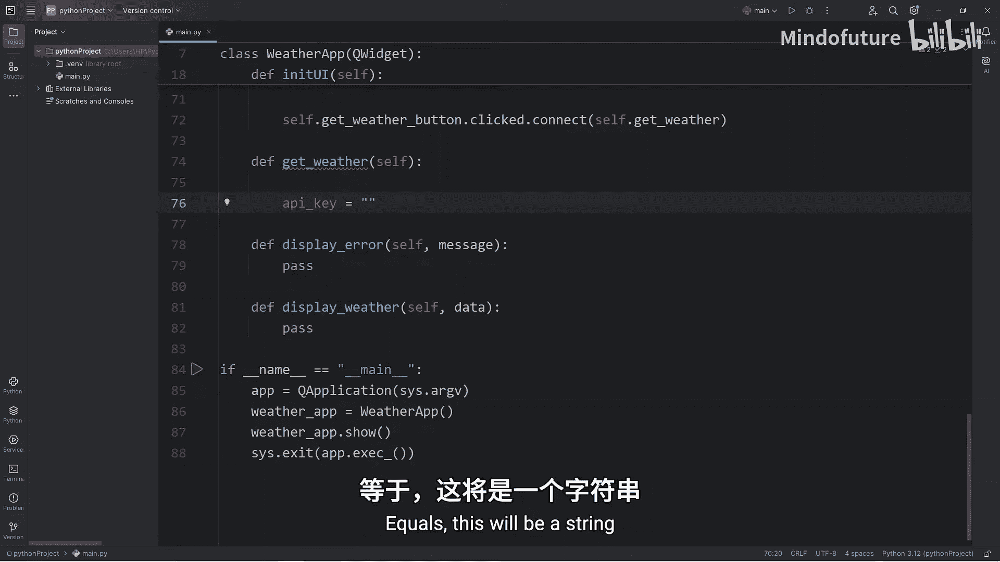

Back to the Open Weather API。You will copy your API key and make sure that it's active。

 You can use the toggle button to make it inactive and active。

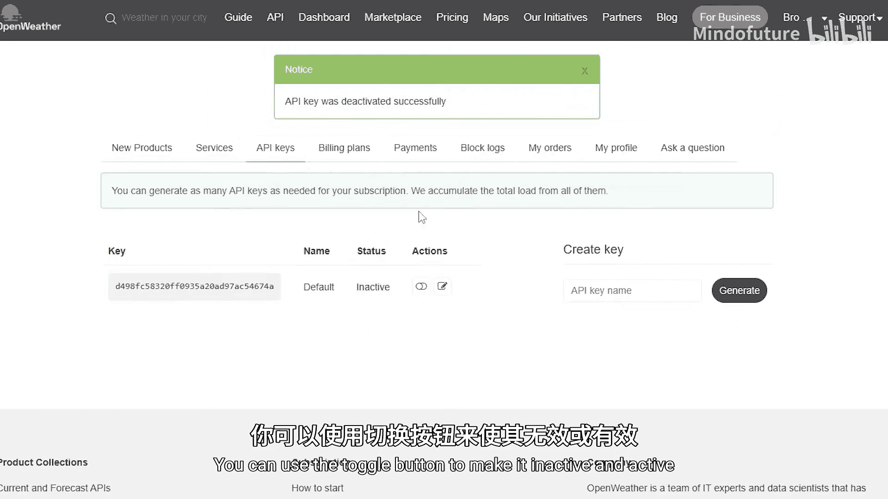

So make sure that it's active。Paste your API key within a string。Please， use your own。

It still may take several minutes for your key to be active。 Just keep that in mind。

We will need to get the city that we're looking up。So let's say we type in Miami。

I have to get the text from this widget， this line edit widget。

We will create a local variable of city， city equals。Access our line edit widget。

It had a name of city input。So self dot city input to get the text， we will call the text method。

We have the API key and the city。Now， we will create a URL。This will be enough string。

Using the request module， we will pass in a URL to make a request too。

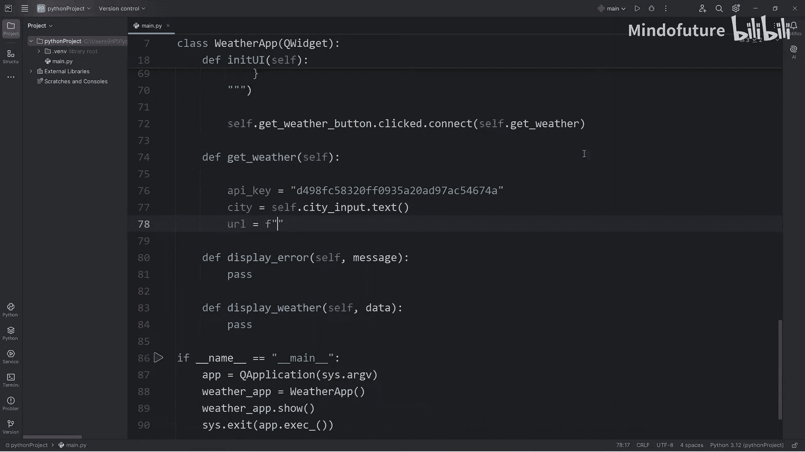

So back to our Open Weather API。To get the URL for a city， we have to go to the tab of API。

Scroll down to current weather data。And there was going to be some API documentation。To the right。

 we have a link for built in API request by city name。

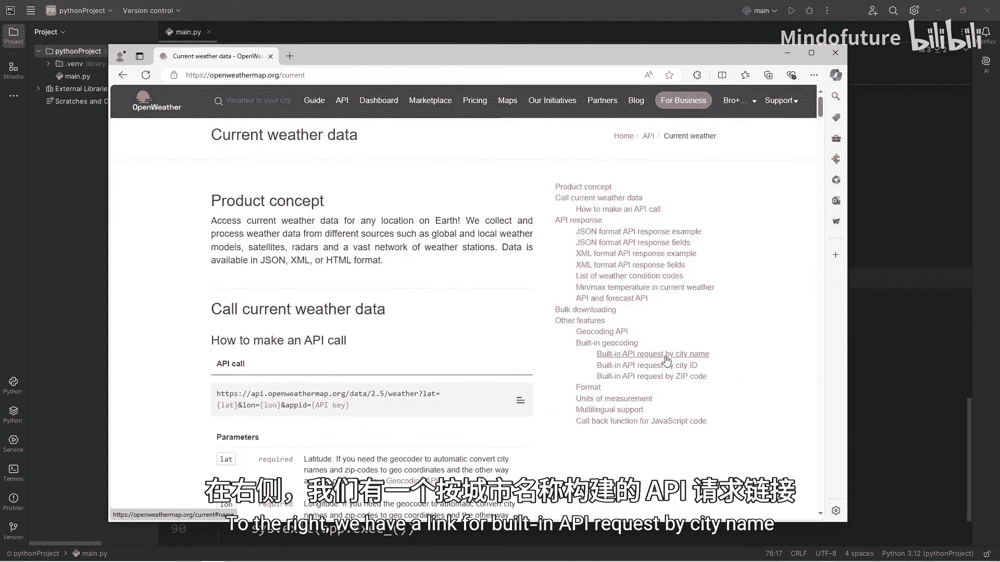

We will copy this URL。And paste it within a F string。There's two changes we're going to make。

 We will replace city name with city。 the name of that variable。

And API space key with API underscore key。It doesn't matter what you name these。

 Just make sure they're consistent with your variables。When we make an API request。

 we will be returned with a response object。Response equals access our module of requests。

Call the get method。Then pass in our URL。With our response object。

 we have to convert it to a Json format。We will be returned with an object。

 We will name this object data。 It's going to be readable to us。Data equals。

 take our response object and use the JSO method to convert it to a JSson format。

So let's print our data to see what we're working with。Let's say I look up the city of Miami。

So we have one gigantic object。This is our weather data。

We have coordinates such as longitude and latitude。A weather description。Currently in Miami。

 there's broken clouds。There's an idea of the weather。This is the temperature， but it's in Kelvin。

If we scroll all the way to the end。We are looking for an HTTP status code。Which is named COD。

 short for code。200 means that the response was successful。Depending on what this number is。

 we will display one of a few error messages。 If our status quo is 40，4。

 that means the city wasn't found。 and there's many others。

So 200 means that the request was successful。So let's write the following。

If our data object at key of COD。If this is equal to 200， if the request was successful。

Then we will call the display weather method。Self dot display weather。

But we do have to pass in our data。Now， temporarily， I'm just going to print our weather data。

We'll do some more complex stuff later。But I just want to be sure that everything is working。

So let's look up Los Angeles。So here's the weather in Los Angeles。There is currently broken clouds。

And again， the status code is 200， the request was successful。I'll write an L statement for now。

 we will print our data。What if we can't find a city。For example， I will look up the city。Blah， blah。

 blah。And get the weather。So here's our weather data。We have an error code of 404。

And a message of city not found。Let's do some exception handling in case we run into one of these status codes。

 that's not 200。We can get rid of our ill statement。

What we'll do is enclose all of our dangerous code。

 That means any code that might cause an exception within a tribe block。We will try all of this code。

And handle any exceptions with an accept block。There's two types of exceptions we're looking for。

 The first is an H T TP error。H TTP error is an exception raised by the request module when an H TTP request returns a status code that's 400 or 500。

However， this exception is found within the request module that we've imported。

So we can't simply just say， except HTTP error。We first have to access the request module。Then。

 access exceptions。Then we can list the specific exception of HTTP error。

Will'll encounter this exception。If the status code。Is between 400 and 500。And for now。

 I'll right pass。So there's one more step within our try block。

If we're going to handle any HTTP errors， we have to raise an exception。Within our tri block。

 because our tri block by itself， normally doesn't catch these。We will take our response object。

And call the raise4 status method。This method will raise an exception if there's any HTTP errors。

 Normally， our Tri block doesn't do that。 so we have to manually type this。

There's another type of exception we'll catch， and that's the request exception。

We'll add another block for， except。Request。Exception。This is found within the request module。

Requests。Exceptions。Request exception。With a request exception， this can be due to network problems。

 invalid URLs， exceptions of that nature。In case we run into one of those types of exceptions。

 We will execute this block of code。 But for now， I'll right pass。 We'll get back to it later。

Going back to our accept block where we handle any HTTP errors。Let's use a match case statement。

We need to get the status code of our response。I'll print that temporarily。

Let's print our response objects， status code。And see what it is。Again， let's make up a city。

Get the weather。We have a status code of 404。 That means the city wasn't found。

 depending on what this number is， the status code will use a match case statement。So， we will match。

Our response objects， status code。The first case will be 400。That means there's a bad request。

So let's print the following。Bad request。I'll add a new line character。Please check your input。

We'll create a total of， I believe， eight cases。 We'll copy what we have。So we have 400。401，403。404。

 that one we're familiar with。500。502。503。504。So for casese 401， that means we're unauthorized。

Maybe our API key isn't active yet。So， let's say， unauthorized。Invalid API key。For 403。

That means access is denied， it's forbidden， so let's print。Forbidden。Access is denied。

404 is for something that's not found。Not found。City， not found。

5ve00 is for an internal server error。Internal server， error。Please try again later。

502 is for a bad gateway。B。Gateway， invalid response from the server。503 is for service unavailable。

Service， unavailable。Server is down。Then 504 is for a gateway timeout。Gateway。Time out。

No response from the server。In case there is any unexpected error。

 we can add a wild card of an underscore。With our httP air。Let's give it a name as HTTP。Error。

And then we'll just print it in case there are no matching cases。 Let's print the following。HTtP。

Error occurred。Aveue line。Let's convert this to an F string。Add a placeholder。

And then I will print our HtTP air。All right， let's do a test run。So in case we can't find our city。

We should encounter a 404 error。Not found city， not found。 Eventually。

 we will display this message within our app。But we know that it works。What if my API key is invalid？

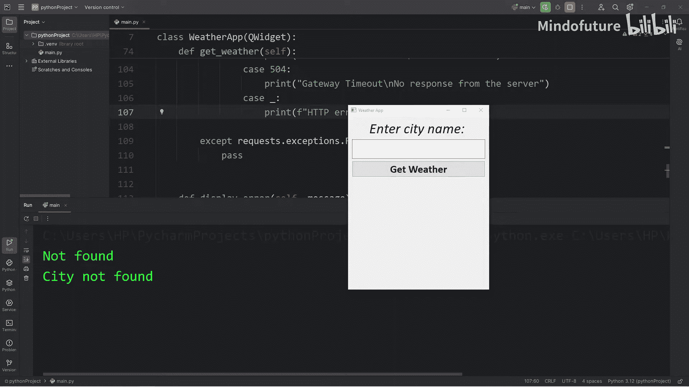

So I will take my API key。Set it to be inactive。

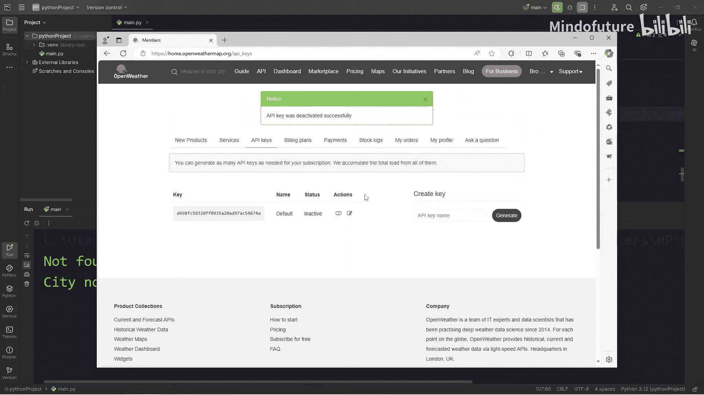

But it might take a few minutes to take effect。The status code of our response object should be 401。

So this time I am going to look up a city， I have an invalid API key。

And I get that error message of unauthorized invalid API key。Al right， everybody。

 So I am on day 3 of working on and recording this topic over the course of the day。

 I thought of one change that I can make。 We're going to add a few extra except blocks。

 So we will accept access requests， access exceptions。We will handle any connectionary exceptions。

As well as any timeout exceptions。And any redirects。Too many redirects。

So if we run into a connection error， let's say that our internet gets disconnected。 Well。

 we can print something。 So let's print the following。Let's print。Connection。Error。

I'll add a new line character。Check your Internet connection。If we encounter a timeout。

Then we will print the following。We have a time out error。The request， timed out。

If we have a too many readrex error。That M should be capital， by the way。Lets state。Too many。

Redirects。Check the URL。And if there's anything else we don't anticipate。

 I'll give this exception a name of as。Reck error。And then we'll just print it。This is a last resort。

I'll use enough string。Request。Air。I'll add a new line。I'll add a placeholder。

 then display our request error。So I'm actually going to turn off my internet。

 I'll see if I can get a connection error intentionally。So my internet is currently off。

I will attempt to look up a city。Get the weather。And we get a connection error。

 Check your Internet connection。All right， my internet is connected again。Let's perform a test run。

And we get the weather in Miami。Now what we're going to do is if we have an error。

We'll display the error message within the app and not within our console。

So we're going to replace print with the call to our display error method。

Let me zoom out a little bit。So replace print with self dot display error。

And we're passing in a message。So let's replace those。One thing I forgot to add。

 although it's not necessary， I'm going to add a colon after each initial message。

I think it'll look better。You don't have to do this， but I'm OCD about the appearance。

If we encounter one of these exceptions， we'll pass along a message to our display error method and display it within the app。

Let's take our temperature label， self dot temperature label。And set the text。

To be our message that we pass in。Let's do a test run。Let's look up a city that doesn't exist。

 get the weather。So we get that error message， not found， city， not found。

While we're within this method， I'm going to change the font size just so that it's a little bit smaller。

So let's take our temperature label， self dot。Temperature label。

 I'm just going to copy this because I'm lazy。I will call the set style sheet method。

And pass along a new property。Let's set the font size to 30 pixels。Let's look up， North Pole。

I don't think that's a city。Oh， I guess it is interesting。The North Pole is a city， I guess。

Let's look up， blah， blah， blah。Not found。 city not found。Let's do another test。

What if our API key is invalid， I'll just delete one of the digits。Let's look up Los Angeles。

Unauthorized invalid API key。Let's change that back。Again， I will turn off my internet。

Then look up Miami。Connection Airre。 Check your Internet connection。All right。

 so we know that our exception handling works。Okay， now we're within the display weather method。

We'll receive an object to represent our data。We have to get the temperature。But first。

 I'm going to print our data。 So let me zoom in a little bit。Let's look up Houston， Houston， Texas。

I need the temperature within our data object， we are looking for a key of main。

And that is right here。Main contains a dictionary with key value pairs。Once we've accessed Maine。

 we have to access temp to get the temperature， and this temperature is in Kelvin。

 We'll have to convert it to Celsius or Fahrenheit。 It's your choice。

So we need to extract this value。I will store it as a local variable。Temperature。

Let's say temperature underscore K for Kelvin equals， take our data object。Access the key。Of Maine。

 That's right here。Then we have to go one level deeper and get the temperature。 The key is temp。

Then give me the value at the key of temp。 and that should return the current temperature。

 So to test it， let's print it。Let's print the temperature in Kelvin。

So what is the weather in Houston， Texas， the temperature that is。309 celvin。

Let's convert it to Celsius and Fahrenheit。Let's create temperature C if you want to use Celsius。

If you would rather use Fahrenheit， you can skip this step。To convert from Kelvin to Celsius。

 we will take our temperature in Kelvin subtract 273。15。Thenhan for Fahrenheit。

Let's take temperature F for Fahrenheit。Equals this is a little more complicated。

Take our temperature in Kelvin。Times 9， divided by 5。Subtract 459。67。Okay。

 so let's print the temperature in Celsius。Let's look up Houston。36。46 degree Celsius。

Then in Fahrenheit， that would be。97。6 degrees Fahrenheit。That's pretty hot。All right。

 so once we have our temperature。Let's change the temperature label。Self dot temperature label。

 I'll just copy this。Then we will set the text。I'll use enough string。At a placeholder。

 I'll use Fahrenheit， but feel free to use Celsius。Then I will add a degree symbol。With windows。

 make sure num lock is on， hold alt。 Then on your numppa type 0，1，7，6 for a degree symbol。Then。

 EfferFahrenheit。Let's look up Miami。Get the weather。And here's the temperature，94。964。 Now。

 let's say I would like no digits after the decimal。I can add a format specifier。

 After our temperature， I'll add a colon00 F to display no decimals。Let's try that again。

I will look up Miami， Get the weather。The current temperature in Fahrenheit is 95 degrees Fahrenit。

Now， here's one issue。 Let's say we display an error， then display the weather。

 If we display an error， we're going to be changing the font size。So let's look up， blah， blah， blah。

 get the weather city not found。Then let's look up Miami again， get the weather。

And the font size is a lot smaller。So if we display the weather， let's reset the font size。

We can really just copy this line。So within the display weather method。

Let's set the font size back to 75。What it was originally。Let's try that again。

Let's look up a city that doesn't exist， get the weather city not found。

Then we'll look up the city that does exist like Miami， and get the weather。95 degrees Fahrenheit。

Now， let's get a description of the weather。 We'll display that at the bottom In the center。

 we'll display a picture or an emoji， but we'll handle that last。Now。

 we need a description of the weather。 Like， is it sunny， iss it cloudy， iss it raining。

So after we calculate the temperature， so I'm going to print our data again。Let's look up。

 Los Angeles。So currently it's 85 degrees Fahrenheit， so for the weather description。

That is found at the key of weather。We're now within a list。At index 0 within our list。

We'll look up the key of description， which states clear sky。

So we will create a local variable of whether。Description。Equals access our data。At the key。

Of weather。There's layers to this。 We're then， within a list。And actually。

 it's a list with only one item in it。So add the index of0。Then at the key of description。

That's going to return this description of Cl Sky。So we will take our description label。

Self dot description label。Let me just copy it。This one right here。Then we will set the text。

And then pass in our weather description。What is the weather description of Los Angeles？

86 degrees Fahrenheit， and there's a clear sky。Okay。

 now the last thing we're going to do is add an emoji。

 We'll add it right to the center between the temperature and the weather description。

 You don't necessarily have to。 but I think it'll look cool。 And that's a good enough reason。

So let's create another method to handle that。We will define a method of get weather emoji。

Or a picture， if you would rather use a picture。We don't need self necessarily。

 We're going to need a weather I。This method isn't going to rely on any class data， or instance data。

We could make it a static method。 I'll add a decorator of static method。In summary， a static method。

 we haven't covered these for a little bit。 They belong to a class。

 but don't require any instant specific data or any other methods。

 They're used as more of a utility tool。We're going to be passing in a weather I and returning an emoji。

I'm going to show you where we can find that weather I。 I'll use a print statement。

I will print our data。Let's look up Miami again。 That's the first thing that came to mind。Now。

 at the key of weather。There's a key of I D， and the value is a three digit number。

 I'll show you this chart。Depending on what this three digit number is。

 that corresponds to a certain group of weather。 So the 200 range is a thunderstorm。300 is a drizzle。

500 is rain。600 is snow。700 is atmosphere like if there's a tornado or there's a volcanic eruption。

800 exactly， is a clear sky。Anything that's 801 or above refers to clouds。So this ID is 803。

 We have broken clouds。Depending on what this idea is。

 I would like to return a certain emoji based on the weather。So we need this ID。

I'll delete our print statement， we no longer need it。Let's say before our weather description。

 we will create a local variable of weather IDd。Equals。Access our data object。

Then access the key of weather。The value at weather is a list。But this list only has one item in it。

 So we need the index of operator at 0。And then we will access the key of ID。The key is ID。

So our weather idea is going to be a number， a three digit number。Okay， everybody。

 we're near the end。 So after setting the temperature， we're going to set the emoji label。Self dot。

 emoji。Label。And call the set text method。Within the set text method。

 we will call self dot get weather emoji method。This will return a string。An emoji within a string。

But we have to pass in our weather I。It's that three digit number。

So now we are within our get weather emoji method。Depending on the range of that three digit number。

 we will return one of a few emojis。 We could use a match case statement。

 I think it's more complicated with the match case statement。

 We'll use Elsev statements for simplicity。So if。Our weather I。Is greater than or equal to 200？

And our weather Id。Is less than or equal to 2，32。Now we have two conditions here linked with the ant operator。

There is a shortcut to this。 And actually， pie charm is telling me that there is。

We can simplify these expressions。Instead of two separate conditions。

We can combine them into one if 200 is less than or equal to our weather I D。

 and our weather I D is less than or equal to 2，32。 If this one combined condition is true。

Then we will return in emoji。So to add an emoji on Windows。

 you can hold down the window key and press semicolon。So 200 to 232， that's for a thunderstorm。

Depending on the font style of your IDE， some of these emojis might not display properly。

You can always just copy them from someplace else。I think that's better。 It's more colorful。Then。

 else if。300 is less than or equal to our weather ID。And our weather ID is less than or equal to 321。

This is for a partially cloudy sky。We will return。Some clouds。A partially cloudy sky。 And again。

 I don't like that one。 So let's use this one instead。Else， if500。

Is less than or equal to our weather ID。Which is less than or equal to 531。We will return。Rain。嗯。

That's better。60 to6 twenty2。Else if 600 is less than or equal to our weather ID。

Which is less than or equal to 6，22。We will return snow。So 701 to 741 is missed or fog。

Else if 701 is less than or equal to。Our weather， I D。Which is less than or equal to 741。

We will return some mist， or fog。762 specifically is for ash， like from a volcano。

So else if our weather I。Is directly equal to 762。We will return。 Let's return a volcano。7。

71 is for a squall。That's a violent gust of wind。Else， if our weather I。Is directly equal to 771。

We will return。Let's return that。A violent gust of wind， a squall。781 is for a tornado。Else。

 if our weather I D。Is equal to 7，81。Return。A tornado。800 exactly is for a clear sky。Else。

 if our weather I D。Is equal to 800。Return。A son。 A son emoji。Else， if。

801 is less than or equal to our weather ID。Which is less than or equal to804。

We will return some clouds。Now， if there are no matches。

 let's return an empty string to not display anything。Okay， let's do a test run。Let's look up Miami。

We get scattered clouds。 It's 94 degrees。Los Angeles。Get the weather。 We have a clear sky and a sun。

Now there's one fix we need to make。Let's say that I make up a city again。Blah， blah， blah。

Get the weather。We should clear our emoji label and the weather description。

 but we still get that error message。So after we display our error within the display error method。

After we set the text of the temperature label， let's take the emoji label， self thought emoji label。

And called the clear method to clear it。Then we have to do this with the description label。

 self dot description label。And call the clear method。Now we should be able to clear it。

When we get an error。Okay， let's look up Houston。Get the weather。Few clouds，98 degrees。

 Let's make up a city。Pizza City。Get the weather。Not found。 city， not found。

 and the emoji label and the weather description are cleared。Okay， what if I type in nothing。

 what happens， let's get the weather。We have a bad request。 Please check your input。

That's if we have an HTTP status code of 400。We handled this exception， bad request。All right。

 one last city。What about Paris。Let's get the weather。It is 68 degrees Fahrenheit。

 and there's light rain。Al right everybody， so that is a weather app that you can make using Python。

 add it to your portfolio， and thanks for watching。

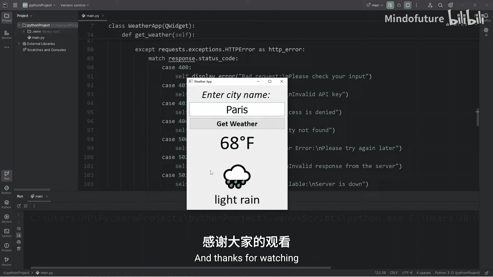