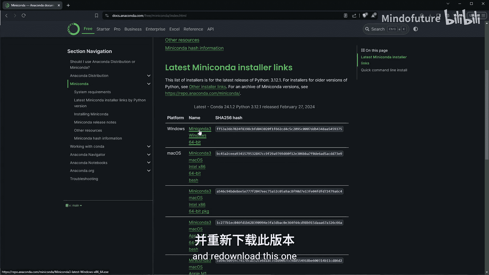
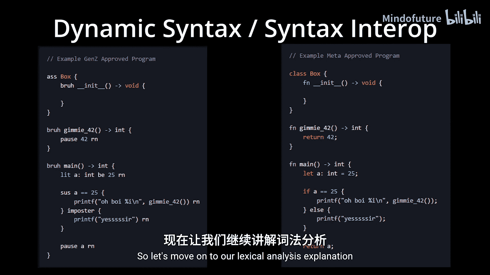
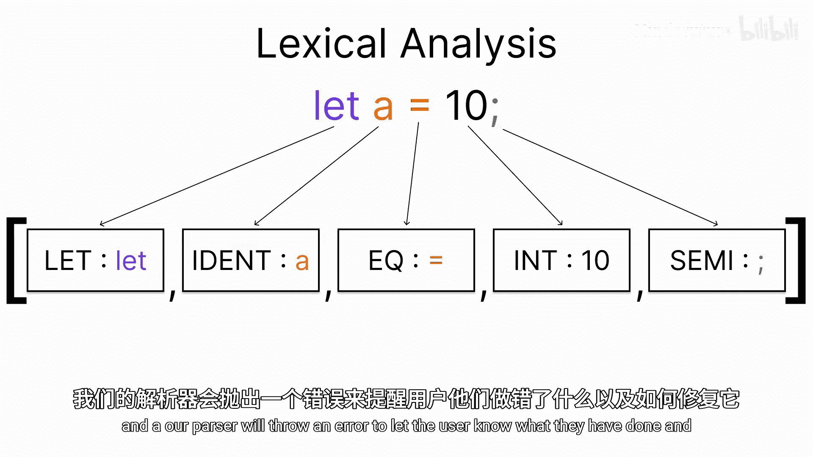
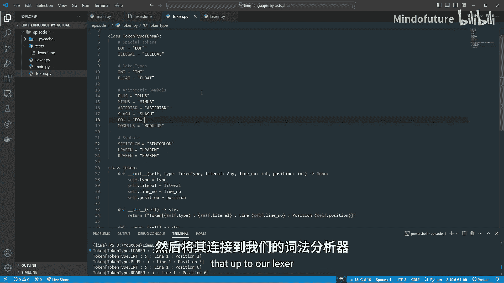

# 使用-Python-和-LLVM-创建编程语言-p01-P01-Episode-1---Introduction-+-Lexer--BV1hn5RztEt8_p1-

I welcomelcome to this brand new tutorial series。 What we're going to be doing is building our own programming language from scratch。

 utilizing Python and LLVM Light， which is a bindings library for the L L VM compiler architecture。

We're gonna be using Python just for the ease of use and more beginner friendly。 But as you can see。

 we're not just going build a。Basic toy language that every other tutorial in the world wants to do with this。

 We're going to start out by building a basically a calculator language that has statements and expressions。

 And we're going to build our language on top of that， just to fully signify how languages are built。

 And we're not going to start out the gate with variables， functions， everything else like that。

 because I know from experience。 that is a lot to take in at once。

 And we're going to go through this。 the right way。

So the first thing you're going to need is miniconda or and aconda。 Either  one。

 I prefer Minconda just has a lot less dependencies that go along with it。

This is just a Python environment manager。And。We are using Conda specifically because L L VM light installs extremely easily when you have a condoda environment。

 So I will leave this link in the description for you guys to click and download the latest miniconda version。

 If you have an older version， please do update that to the latest or uninstall that and re this one because all right。

 So the language we are building is called limeme。 It's going to be a statically typed and Jit compiled language。

 It's going to be built in Python and L L VM。

Some of the features we're going to have conditional statements。 So if， if else or else， if else。

 while four loops， all the arithmetic operators mutable and constant variables。

 we're going to have classes， class methods， properties。

 And we arere also going to have inheritance of classes。Functions， function scopes。

 as well as variables。 We're going to have import statements， built in functions。

 a basic standard library and something unique that I haven't seen really before。

 Please let me know if this exists somewhere else。But we're going to have some syntax interruptop。

 So you're going to have two different ways， two different types。

 You could honestly implement as many different types of syntax as you want。

 but they' are all going to work the exact same。 The two examples I'm going to show is we're going to have a Gen Z syntax for our language。

 and we're going to have a regular meta approved syntax for our language。

 So let's move on to our lexical analysis explanation。

Al right， let's get into our Leer class Before we hop too far into it。

 I want to explain what this class will be doing。 It's going to be doing lexical analysis。

 which is taking in human readable source code and turning that into something the parser in a computer can better process and understand。

 such as a list of tokens or a list of objects that describe these source code that we are taking in。

 So this particular piece is just a variable decoration in jascript。We start out with the let token。

 which has a token type of let， literal value of let。

Move on to the variable name or what we call the identifier in this particular case。

Moving on to equals， then 10， which is an integer。 and then the semicolon。

 And then the order of these and how they're presented will be checked by the parser to build out the abstract syntax tree。

 If stuff is out of order， such as you put the semicolon before the equals sign。

 there will be a grammar error in that。 and our parser will throw an error to let the user know what they have done and how to fix it。

So let's move on to the class and get that started。Alright， moving into the code portion。

 I just have a folder。 You can create whatever folder you want。

 I'm gonna segment these out into episodes。 So when this is just my episode 1 folder。

We're gonna C D into wherever your project is gonna to be held。And first things。 first。

 we're gonna create our miniconda environment。 So that'll be Conda create。Dash， dash， name。

Name it whatever you want。 I'm just can name it lime。

And then we're going to set our Python equals to 3。12。

 That is going be our Python version movies today。 So while this in just kind of installs and gets set up。

 Alright， now that this is done。The activation command is conda activate your E And V name。

 So Conda activate lime in my case。So this will then change from base to lime。

And that's how you know your environment。Activated and you're ready to start coding in Python if you don't already know that。

The first file we're going to do is our main file。 This is where the main our main code execution is going to start from。

And then so， we can start off with if0 square name。Equals。Underscore main， underscore。

 underscore main。 So we'll add a pass in there just so we can say it's set up。

 Next file we'll need to create is token dot pi。And this where we're going to start to create our token class。

So in our token do pi file。We need a couple imports。From Enum， import。Eam。

And then we're going to need from typing。Import any。 So the typing parts is completely optional。

 I just like to use it。 just adds a little more developer friendliness to Python programming。

 so you can signify the types Def not needed。 Just makes In sense a lot better。

So the first thing we're going to make is our token type class。Which in Python。

 this is how you create an enum。 Just create a class and inher it from enum。

And every one of our token types is going to go into this enum。 So the first。

Set of tokens are going to be special ones， special tokens。

This is the E O F token or the end of file。 We're going to have an illegal token。Basically。

 is how we throw a lexer error。The next thing。We're going to need our data types。

And the only data types we're gonna be。Concerned with right now is integers and floats。So。

 int equals int。Float equal equals float。Now， since we're starting off with the foundation of an arithmetic language。

 So it's basically a calculator language， that's all the data types we're going to need。

 And as we add more， we'll add string in here later。And any other bulloles， anything like that。

 we'll just add right here。 So the next set of tokens will be arithmetics。

These are arithmetic symbols。We have plus equals plus。Minus equals minus。As。

 you can also name this multiply， doesn't matter。That's just basically this symbol right here。

 the star。That's how we're going to signify that。 We're trying to multiply something。Slash。

 you can also do divide if you wanted to。And that's just the normal divide symbol in any other language。

 We're going to support p。 So getting the power of a number， you can square a number。

 just exponents in general。And then we'll add the modulus operator， which could。Name this percent。

 if you wanted to。 It's all up。 Everything's up to you and you're creating your own language。So last。

 but not least， we're gonna add our symbols， so。First one is going to be a semicolon。

 in this language， we're going to signify the end of statements with semicolonons。Now。

 you can omit this if you don't want to end with semicones。

 if you care about just using new lines up to you， but we for this purpose。

 we're going to use semiconons。So we'll make this semicolon。 We'll add a left parentheses。

 So L Perin and then right Perin。So now this is all the token types that we're going to need to start off with our Lexer。

 So the first thing we're going to create is the actual class for the token。

And we'll add a in it method。So what this。Constructor is going to take in when a token is created。

 It's going to take in a type， which is going to be the type of token type。

 This is where I was talking about signifying like typing annotations to your Python。

 This is definitely not needed， but the it helps a lot with In。 So I like to use it everywhere I can。

So we're gonna have tokens have a token type。 They also have a literal。 So if their literal value。

 So a number integer token， the value would be 10。If a plus token would the value be literally just the plus sign。

So we're gonna to say any here。So it can be any， it could be a string number， bullolean。

 anything like that。So we're also going to take into account the line number， which will be an int。

And the position it in， it is in the file， said the character position。

 What index is it at in the file。 I won't type this out just to save a little time。

 but it's just self thought type equal goes type， self thought literals。

 have the line number and position。The next two， we， just for debugging's sake。

 we're gonna implement to。Methods on token， which is the underscores double underscore string method。

 Whatever we put in here is what will。The string will turn into pretty much what it will print。

 So we'll make an F string。 and you can format this however you'd like。

 But I will do start off with a self dot type space。Self doubt literal。Space。

 we're going gonna do the line numbers and line self dot line number。And space， position。

And we'll do self do position。 You can format this， however you'd like。 This is just how I have it。

And now they represent。Method， Reper。If I could type。Is just going to return。

The string version of self。 That's our token class。

 That's really all we'll need to do for a long time in tokens。

 When we add some better air handling way down the line。

 we will modify this token class to give us a little more information。But the next。

Thing that we have to do now is we're going to move into our Leer class。 so we'll create a new file。

Lexer dot pi。 So we'll go into the Leer file。 Now。 There's a couple of imports that we'll need to do to set this up。

 So from。Token。Import token and token type。And then from typing， we'll import any。

So we'll create our lectureir class。In our construct， constructor or in it method。

We are going to take in our source， which is just the stringified version of whatever file we're trying to compile and run。

So this is our actual source code。 So we'll set self dot source equals source。Couple more things。

 The Leir needs a position。Field。We're gonna set that to negative one at the start。

And that we'll explain this a little bit later on into our lecture。 We have a read position。

Which is basically。1 ahead， always gonna be one ahead of the Lexer's position。

 It's just gonna keep track。 Hey， what token， what letter， what character， whatever， What is next。

So we'll move down。 We have that line number that we need to keep track of for the tokens。

 So we'll take that。One of the most important ones。

 which is the current char or the current character。This could either be a string or none。

Moll just said it as a default to none。Then at the very end of this constructor。

 we're going to call a method we're about to create called Re Char。

 And that's kind of our Lexor advanced。Function。 that's going to。Trigger our lectureor to update。

 add one to these positions in the current jar will be。Updated to the next one in the string。

 the source code， pretty much。So another thing these double underscores I'm adding in front of function names just creates a quote unquote。

 private method in Python。 So it will not show up in the Intel sense。

 Don't have to do that Just something that I like to do for kind of just makes it a little cleaner。

So we'll add our rechar method。Take in self。This won't return anything。Be like， a void method。

So the first thing is we're going check if the reposition is greater than the length。

Of the actual source code。So have self dot read position greater than equal the length of the source code。

If so， that means we are pretty much at the end of the file。 We are done。

So we're going to set our current character to none。If it's not， we're actually gonna set。

Our current character to the read position。Read position in that string。

 the index thatll set our current character。And then we need to set our position to what the read position is。

 And then we need to increment our read position plus equals 1。Now。

 this is going to be a public method that the parser will call。It's our main execution method。

The parsel will call this to grab our next token。So this does not return a list to token。

 This returns a token。So at the very start， we're gonna just。Set this initial token variable to none。

 This is what willll end up returning。 What we need to do is skip our white space。

So this will be another function。 We will。Be implementing。

So this skips all of our ignored characters。Such as new lines， we don't care about those。

 We don't care about spaces。 We don't care about tabs。

 so we're going to skip those because we don't need to read them as tokens。

So we'll move to skip white space。好き？White space。So。And none。So while the self dot current character。

Is in this list， So a space。We'll do backslash T as tab。Back slash n is a new line。 and back slash R。

 I'm not exactly sure， but it does show up。 So the first thing we're going to do this is where we're also going to keep track of our line number。

 So if the self dot current character。Is a new line？We're just gonna increment。不 got that。

We're going to increment the line number by one。And then we're gonna just gonna read another character。

From the list， and this is going to keep going until this current character is not one of these。

And once it is， we're back to our next token function。

 The next thing we're going to use is something。 This is why we needed to Python 3，10 or above。

We're using a match statement。 So it is just a switch case in Python。So self dot current characters。

 we're going match that。We're to make the case if it's a plus symbol。We're going to set our token。

Equal to this helper function we'll create in a second。 So next。Or new token， I'm sorry。

And that will be a token type。Dot plus。From Martinum that we created earlier and self dot current character will be the literal。

So now let's create this new token function。 just put it up here。So， de。Hter square square。

 new token。Self。Will take in a T T or a token type。And we'll give it a literal as well。

 which is a type of any。Mi returns back a token。So return will'll initialize a new instance of token。

 set the type to T T。The literal， to literal。The line number to our self dot line number。

 that's kept track our class。And the physician will set that door self dot position。

So that's all it's going to do just so we don't have to keep writing out in this line numbered position。

 We're just gonna have a helper function to help us out with that。So here is all we need for that。

Now， for all of these tokens。 So we need one for plus minus multiply， divide。

 P and or exponents and modulus。 So we'll create all of these easiest way to just copy。Paste。

 so that's minus multiply， divide， exponent modulus。So we'll just go one by one in here。

Multiply and divide。The power will be at the carrot symbol。And modulus is the percent。

And then we'll change all of these to their correct token types。 So asterisk。Slash。Po。Modulus。Now。

 there's two more。Specific tokens that we need to handle。 That's or three more。 Actually。

 we need our semicohen left parentheses and right parentheses。

 and then we'll handle these tokens as well。We'll add another。

 I'll just keep that was still on my clipboard。 So we'll add a left parentheses。E Perin。

We a write parentheses。Our print。Now。This for the end of file token。

 that means once this current character。Is none。 So when we set that thing to none right here。

 that is when。We need to handle a end of file token。Said talk， keep goes self dot new token。

Token type thatt end of file。And we'll just set an empty string as the literal value。Now。

 the default case in Python for match statements is the underscore。So。If none of these。

 if the current character is none of these。We're going to check numbers now， so。

If it's none of these， let's see if it's a number。 says self dot。

Another helper function we're going to make is， is digit。

And we'll pass in the self dot current character into that。

And we'll go ahead and write these out before we actually define these functions， so。

The token will equal a another helper function。Called self dot read number。

And we'll return that early。If it's not a number， we want to go ahead and do， we're basically say。

 all right， If it's none of these options， then obviously， we。

 it's an illegal token and we don't handle that。 So we need to throw a extraer error。

So we're going to set our token equal to our new token function。Token type will be illegal。

And the self dot current character will be our literal。

Now we'll go to the same level as this match statement after the match statement。

We'll go ahead and read a new character and return the token。

 So this just sets it up for the next time。 Next token is called。

 and then we return that token back out of the lecture。

 Go ahead and implement these two functions is digit。And read number。So we'll go back under here。

 def underscore score underscore score is digit。So。And we are taking in a character for this。

So we'll just name it C， H。 And this will return a boolean。 So there's some weird syntax here， but。

Return0 as a string。Is less than or equal to our character。And our character is less than equal to 9。

So if both these are true， it is a digit， if not， then。It is not a digit。

 and itll move on to our L statement， pretty much。So now that we have this implemented。

 we're going to have our read number function now。So we'll add that down here。Read number， self。

And then this won't take in anything at all。 This will return back at token。

This is where it's going to turn back our integer or float token。

 So we're going do a little bit of logic here Right now， we're gonna to start with the。

 we're going to save our start position。Self do position。We have our dot counts。

 This is just gonna keep track。 Like whether if it's a decimal， this is how many decimals it has。

And that's how we throw an error if there are too many dots in a number。

We're going to have our output string here。 We're going to set to an empty string。

Then we'll do a while self dot underscore underscore is digit。Set up cha。

 So while this is still a number。Or the self dot current character。Has equal to a period。

 So that's for our decimal。So inside this wall loop。

 we'll first check if the current character is a dot self dot current character。It goes that。

Will increment that dot count variable。Next， we'll check to see if。The dot count is greater than one。

 If it is that that is definitely not a number that we support at this time。

 So we need to pretty much just print for now， We'll print an error。Too many decimals in number。

Online。Self outline line number。Position。Self do position。And then， we will return。

Self dot new token。It'll be an illegal token。And we'll just set the literal to the source from the start position。

To the position we're currently at now。 So that'll put that whole number in where we found that extra period。

As the literal value。So moving on， if we're not， we don't have too many dots。We're gonna。Append。

Character that we currently on self do position。To the output。

We're going to read another char so that advances our position variables。

And then if the self do current chart is none。 So if we're just so happen to be at a number that's at the very end of the file。

We're going to go and break out of this loop。So once these conditions haven't been met and the while loop breaks。

 we should have an output string that builds up our number。So， if dot counts。Equals 0。

 That means this doesn't have a decimal。 So it's obviously an integer。We are going to return。

usingsing our new token function。A token type of integer。

And then we are going to convert our output string to an integer using this int function that's built in with Python。

And else。 So that means we do have a dot。We return the same thing。 New token。

 said the token type will be a float。And the float。

Function for our output to convert that to a float。 And that's our read number function。So moving on。

 I think we're ready to test this out。 So we can go back into our main dot pi file first things。

 first， let's import our Lexer。 So from Lexer import Lexer， we'll grab that class。

We're gonna set a just a temporary debug flag。Select Sir debug。Type bullolean will be true。

 That's just gonna。Gate keep our printing of and our running of the Leir for later。

First thing we're going to do is we're going read from an input file。So， with open。Will you。

 we'll put it in a test directory test slash Lexer dot line。

You can name this whatever the heck you want， whatever file extension you're doing。

As F in our code will be a string。And we'll do F dot read。

And that's going to convert everything that's in this Lexor dot line file into a string。

So with that being our source code， we'll check our debug flag。 So if we set this to true。

We can set our。Set up our Leir。 So debug Le equals。Lexer。And our source。Variable will equal our code。

 So right here， says source equals code。 And so that's funny。

So while our debug Lex dot current character is not none， just for checkings sake。

We're going to print the token。So we're going to call our next token function。

And us printing this well call our string and represent methods。

 And that's what we should see for each token。So last thing to tie this all together。

 we're gonna make a new folder。 We'll name it tests。Create a file in that folder。

 We'll name it Leer dot Lime。 Priy， we'll just do a 5 plus 5 for right now。

 We'll add a semicohen for funsies。 Did we implement a semicohen。 No， we didn't。 Okay， let's go back。

I don't know if you guys caught that beforehand， but if he did， good jump。Self dot new token。

 token type dot semicolon。 And then we'll put the current cha in there。 Allright。

 so we almost saw an error。Which I guess we should look。 So let's not implement this。

 And let's look at what an error will。Show， what an illegal token。So Python main dot pi to run this。

So we have a integer 5 on line1， position 1。Plus， and then we have another integer 5。

 And then here's our illegal token with our semicolon on line 1， position 5。 So that's right there。

So we'll go back。 We'll implement that back， run it again。 And now this turns into a semicolon。

 Everythings good。 So we'll first， we'll check everything that we have implemented。So far。

 so 5 plus 5。Times，2。-3。Driieded by 4。Exponent。69， nice。Mulus。10。Semiccollon。

 So this should be everything that we have implemented into the Leer。So left praran int plus int。

 right praran asterisk， yep， nothing illegal， nothing good。

 nothing bad has all of our literal values。 So as of right now， we have finished up our Leer。

For this first part of the series， creating our arithmetic foundation of our language。

 play around with that。 If you have any more tokens。

 you want to go ahead and add off the top of your head， go and try to implement that yourself。

 But I will see you in the next episode where we'll take care of the parser and link that up to our Leer。

