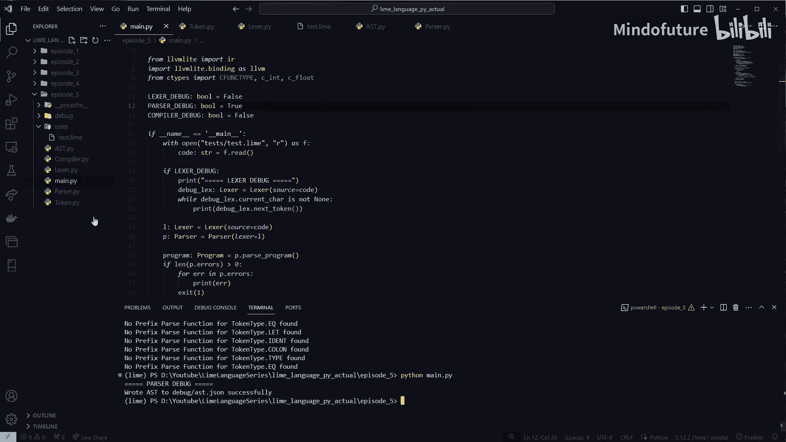
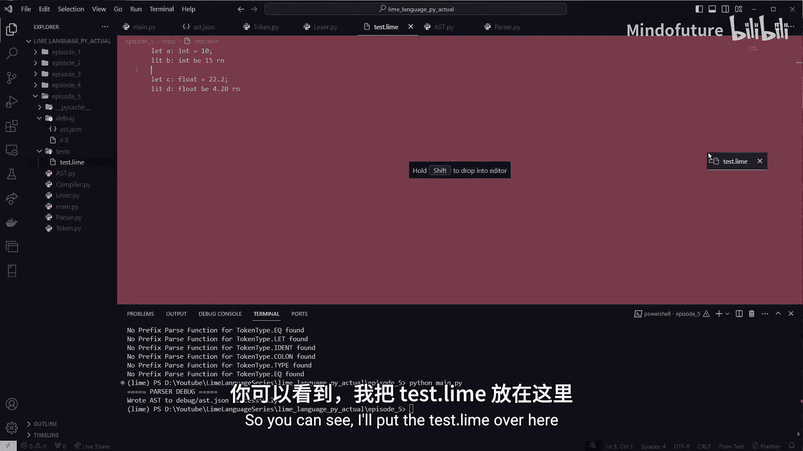
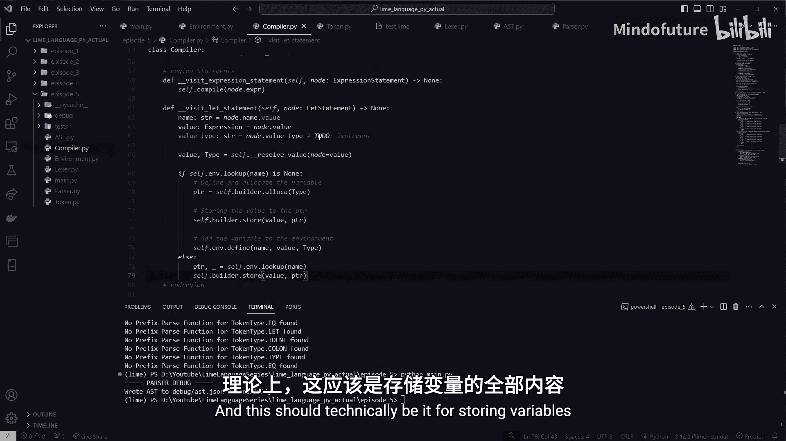
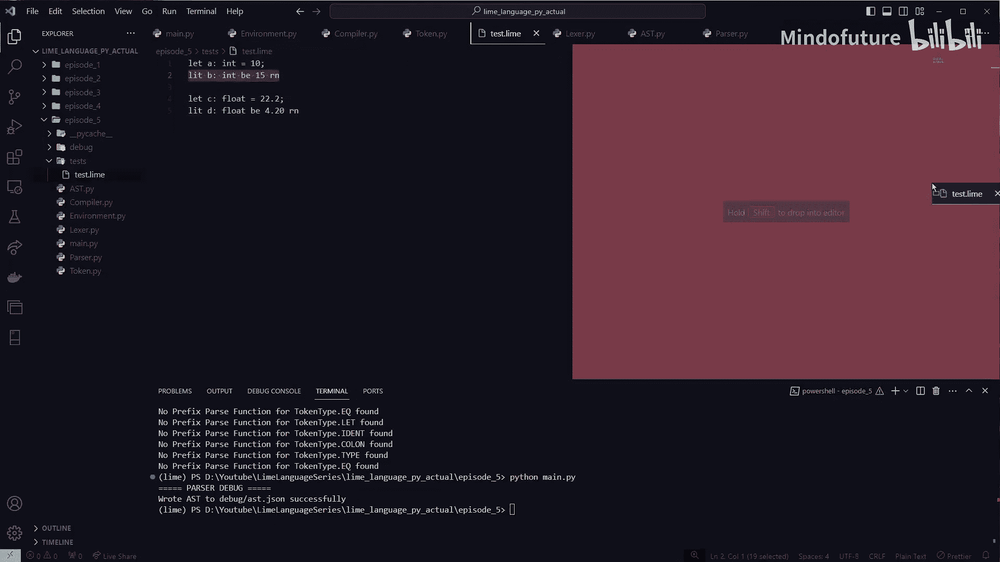
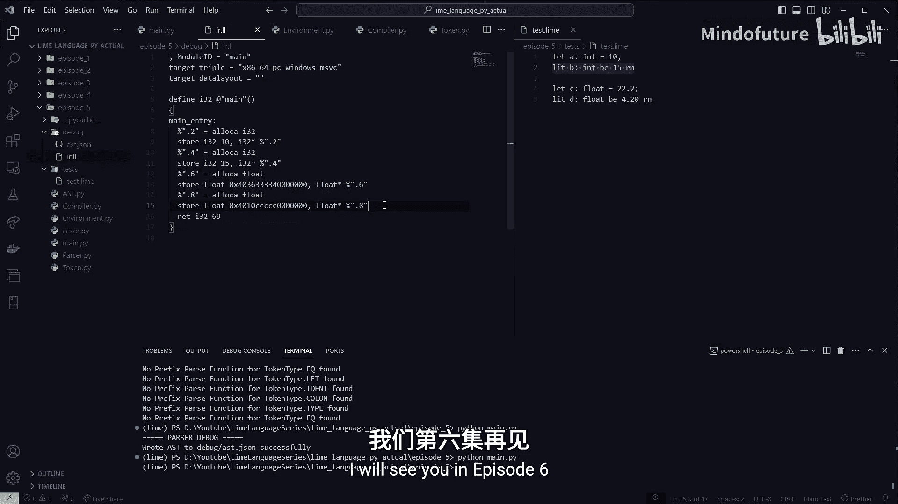

# 使用-Python-和-LLVM-创建编程语言-p05-P05-Episode-5---Variables,-Symbol-Table,-GenZ-Syntax--BV1hn5RztEt8_p5-

Welcome back to the programming language series where we're going to be build able to statically typed and giit compiled language using nothing but Python and L LVM light。

 So today， what you see on screen is what we're going to be able to compile parse and lax by the end of this video。

 This is variable declarations。 So we're going to be able to define variables using our dynamic syntax as well。

 that I mentioned at the start of this series。 So we have the first one。

 which is just a normal let statement， kind of has a little pythonic typing to it。

In a semi colonlon to signify the end of a statement。 And then we have our Gen Z syntax。

 which is lit B， ant。B 15 right now。 So lit maps to the let token， B maps to equals。

And R N right now， equal maps to the semicolon。 So you can mix and match this if you want。 So lit K。

Is an integer equals。3 run out。 so you can mix and match， have the equals in there。

 You can do everything perfect， but screw semi cones， slapping R N changes us anything you like。

 We're gonna get into that right now。 The first place we're gonna go is。I just basically。

 if you're following along exactly what I'm doing。I got rid of all the test files and just have a test do line file that we're going to be working in now。

In the main。嗯。Ma not pi file。 I just change this right here to test dot line。

And we can get straight into token。 So token up pi。

 We're going add a bunch of tokens and a couple dictionaries and one function here just to help us out。

 So let's get started for the first thing that we're going to do is we're going add the let token。

 So we're going add a new。Keywords。And we're gonna to have let equals let。 After that。

 we're going to add another section down here for typing。And we're just going to set a type token。

Type equal's type。 We need to go up to these data types。 and we're going to do an iddentt。

 This is for identifiers。 So pretty much the names of things。 So C is an identifier D， A B。Save that。

We'll go down to the semico， and we're going to do a colon for our signifying a type。

We're going to do our equals。Which will be。Make a section for assignment。Symbols。

We'll do EQ for equals。And that should be it for the tokens or the token types。

 So we'll go down below the token class， and we'll start to create our dictionaries， so。Keywords。

This will be of a type with a string key and a token type。Value。I need to。

Let me change the zoom on that。 If you guys want it zoomed in way as much as it just was。

 let me know。 But this is how I've been doing it for the rest of the series。So keywords。

 open the dictionary。 The only keyword we're going to put in here for now is the let keyword。

Token type dot let。Now， this is for up for your imaginary or your imagination。These are alt keywords。

 We're going be addict， strings and token types。So every keyword you want to map to any of your tokens。

You would place in here。 So the first 1 I want to map is lit。So token type dot let is what lit。Maps。

2。We'll do the equal sign of B。Token type dot equal。 So every time it says B。

ll every time it sees B it'll map to the equals token。And then， right now。To the semicolon。

Now add in our type keywords。 this will be a list。List of strings。We're for right now。

 all we support is floats and integers。 So we'll add those in there as well。 We're at a function now。

 look up。Ident。 so this， the Leer is gonna call this function to see if it's a keyword。

 if it's an alt keyword， or if it's a type， if it's none of those， it's an identifier。

So Identt is a string or turn back a token type。T T， token type or none。He goes keywords dot get。

I didn't。IfT T is not none。We are成Pty。And then we can copy and paste this。And do alts。Alt keywords。

 And lastly， we have our typing keywords。 So if I den't in type keywords。

Will return back that token type dot。Type。And if none of these， if it's not a keyword。

 it's not one of our Gen Z keywords， and it's not a tight keyword。We'll return back then。 alright。

 it's gotta be an identifier。Alright， now we'll head into the Lexer class at the top。

 We'll go ahead and import our look up id function。

 And we need to add a couple of things to our match statement down here in next token。

 So I don't think the parentheses will' do a case equals sign。

And this will just be a taal self dot new token。Token type dot E Q。

And then the current character will' add the colon below this。 So colon。Talk Eagles。

 self dot new token。Token type dot colon。There's self dot current character as well。 Now。

 and the default section will create an if statement up here。We'll change this middle one to an LF。

So if a new function will make。Underscore， underscores is letter。

AndPa the current character into that。We have another function that we'll make。So， literal string。

Is self dot underscore， underscore read identifier。Grab a token type。

From our look up iddent function， we'll pass in that literal。We'll set the token equal the cell。

Underter， underscore new token。T， T go C T。Then literal equals literal。And then we will return early。

That token。 Now， we need to implement the is letter and read identifier functions for the is letter function。

 I will just paste this in。 Feel free to pause and copy this。

 It's just same as kind of the is digit just with letters。 And we also include underscores in here。

 So if you don't want to include that， take this。Or section out of it。

 Now we have a read identifier function。 I will also copy and paste that in here just for the sake of time。

 This is just going save the current position while the current character is not none。And。

The character is a letter， or it's a number。We will。😔。

Read the character and just keep advancing that position。

 And then we' will return back the starting position that the function started at， and then。

To the newest position that we're at currently in the source。

 and that will return back the entire word or identifier。 All right。

 now that we have the Leir pretty much ready to go for variables。

Let's go into main dot pi really quick。 We will turn everything off。 We'll set the leer to true。

And we'll just check the。Me see the into this。We'll check to see if it works。 if Python made up by。

So we do get a bunch of parser errors， but we。Expect that。 So let's just do。 so let。Identt A。

 there's a colon， then type of integer。Equals 10， then semi。So even for here， so we have。Oh。

 I just got lost。So we have equals right here to B。We have semicohen right here to right now。

 so that's how they're being mapped。And also with the lit as well， it's also a let token。

Now we verified that we can go into our AT。It' pulling up our AS T。

We need to add two different nodes and node types。 First  one we're gonna add is the let statement。

Now we call the let statement。Next one we're going to add is for our identifiers So they're literals。

 So identifier literal。Then fire literal。 We'll start with the let statement first。

A class let statement。A statement。Get the。Not that function。 We're getting the in it。Fangsin。

It's going to take in a name。Which will be a identifier literal。 But we're gonna set。A parent。

Class is the type。 So expression。So the value will also be in expression。And then a value type。

 This is something we won't really use。Until later down the line。

 But we'll go ahead and add it just for funsies。Wed in all these， self do。Property initializations。

 things。We'll go ahead and add in our type and Json functions。 just for the sake of time。

 I'm not going type these out。But same as everything else。

 We set the type function to our let statement， and then we have just the debug Json。

Pulled out for each one of our variables or our properties on this class。

Next one we're going to do is the identifier literal。

They are the exact same thing to endangger and float。Except。The identifier。

 everything is just gonna be a string and the node type is gonna be identifier literal。

Exact same thing as float and integers。 Now， we'll move on into the parser。So in the parser。

 we want to go ahead and import what we just did。 So identify our literal。 And in our statements。

 we'll do a let statement。 There's one helper function we need to implement for we do anything else。

 and that is current token is。So deaf current token is self TT。Token type。Turns back a bull。

 And it's the exact same function as。The peak token， except we use the current tokens type。

 See if that is equal to the one that was passed in。So， doing that。

Now we can move on to the parse statement function。We'll scroll down till we find that。

 So as of right now， all we have in here is just。Basically。

 moving down into the expression statements。We're going to control X this out。

And we're going to create a match。Statement， so match self dot current token dot types。

 based on the current tokens type。I'm gonna do call other visit methods。 So token type dot let。

 which is the one we just implemented。 We want to return a self dot underscore underscore parse。

 let statement。And then， for our default case。We will just paste back in our parse expression statement。

So every， so our functions， everything else， every kind of a statement will add on to this。

A match case statement。And if it's not a normal statement， we'll move into the expressions。

So we'll move on to the parselet statement function， which I'll slap in just right under here。

 So de parselet statement self。We' to turn back a let statement。

 And we got a lot of things going on in here。 So just as a reminder。We'll put a let， a。

Integer equals 10。 So this is what we're trying to parse。

 So when we found the token type of lead up here， that is the token we're on currently。

So the let token is where the parser is at at this exact moment。

So we'll first start off with getting our let statement class initialize。

So the next token that we're looking or we're expecting to see after this let is an identifier。

 So this a。 So if。If not。Self dot underscore， expect peak oh。If I can type， expect peak。

 we're expecting an identifier。If we don't find it， we just want to return none， get out of there。

We'll go ahead and copy this for later because we're going to be doing this specific block of code。

A few times in this function。So we'll set the statement dot name now that we're at the identifier。

Token to an identifier literal。And the value will be the self dot current token dot literal。

So now that we expect peak， this function automatically advances。 The parser grabs the next token。

 So after we we' expecting an identifier after this is called， we know were add an identifier token。

 So that's where we can get that literal。So we're going to do this if statement again。

 we are now expecting a colon after the identifier。So this kind of syntax checking。After that。

 we're going to do the same executive statement after we're gonna be expecting a type。

So we expect to type token。And if we do get that type token。

 we're going to set the statement dot value type。Go to the self dot current token， do literal。

We're going to do this if statement one morere time。

 we're going to check to see if the next token in the bunch is an equals token。 If it is。

 we're going advance to the next token。 So out of away from that equals， we don't need it anymore。

 So now we're at the 10 or whatever's on this side of the equals sign。Statement dot value。

It goes self dot underscoreish for parse expression。

We'll do the precedentnce type of the lowest value。

 And Then this is where we're going to use the current token is function。

 So while not self dot underscore score or score， current token is。Took a type about semicohen。

And not same function。Current token is。The end of file。We're just gonna。

Increment the parser and garraab， the next tokens。So if this is a semicolon rack here。

 this will just break off in won't even advance。Rrittle advance， after the first time。

We just return the statement out。 That's actually it that for the parser that well need。

 so we can go back into our main dot pi file。Set the leir back to false。Said the parser to true。

Go in here， run the file。

We'll check our AS T dot Json， so you can see。I'll put the testout line over here。

 So our first one is let A equals 10。 So let。

The name is a。 The value is an integer， The value of 10， and the type is int。

 we can see even the Gen Z syntax is also working。 Same thing， value B。Is 15。Type is int。

Same thing for the floats， as well。So we have that verified that that now works。

So we can move on into a brand new file that we're going to be creating。

 which is our environment or our symbol table。So first thing， just for typing stakes。

 we're going to do from LL VM light import IR。Do a class environment。We'll do a underscore。

 underscore in Schage method。In myself。First thing I're to pass in is records。

It's gonna to be a little weird。 It's gonna to be a dictionary。A string key。

The value will be a tuple。And that twopo will be an IR value and a IR dot type。So， I。

Pretty much an LVM value in an LVM type。 We'll go ahead and initialize that to none。

Will also set a parent equal to none。 The parent is just going to be， if this environment class。

So we have the global environment。 And if we have a function that has its own environment。

That functions environments parent will be the global environment。 So we'll keep track of that here。

 That'll help with resolving variables。The last thing we're gonna to do is name。

 We won't really use it much for right now。So we'll just initialize that to global。

 And for initializing all these variables， I'll just paste these in。See you can copy this。😔。

Posit and copy that。First function we're going to define is the define method。 So deaf， define。

It's taken a。The name is string。The value is I R， not value。And we'll do an underscored type。

As an IR dot type。This will return back the string or just basically the。

 will actually will not turn back a string or turn back the value。 So I R dot value。

So in the records dictionary， add the name。We want to set that equal to value。An underscore type。

AndThen we will return the value back out of that。Next one we're going to do is the private function resolve。

So this is called internally in the environment class， rather than externally。

So'll give it a self and all it will take in as a name。 So what variable do we want to resolve。

This will return back a tuple of I dot value， I dot type。 This will have an if statement。

 So if the name is in the self dot record。 So if the name is in one of those keys。

It will just return back the self dot records。At the name， key。E if， if there's a， if that。

 if it's not in our records and we do have a parent。We want to return back。The self dot parent dot。

Resolve function。I'll just pass in the name。 So it'll just be a recursive to keep just walking up the tree。

To see if we can resolve this variable's value。Else， we'll just return none。 So if it's not there。

We can。Return an error， later on。So we'll just have the L key as our return none。Now。

 in the middle of here， we'll do a look up function。 So this how will。

See if a variable or a function is already been defined in our environment。Takeing a name。

 this will also return back that tuple I R value， I R type。

And all this will do is just call our internal resolve function。At the name。

And that is absolutely everything we need to do for the environment for right now。

So we will move on into our compiler Now that we're in our compiler。

 we're going to import from environment， I the environment class。 We need to import our。

Ft statement and our identifierary literal。 I' was just going to。

Segment the expressions onto their own line。 We'll get rid of the statement。

 So let statement now down in our literals， identify literal in our init method。

 we want to add in our environment， self dot E And V， So type environment。We'll just initialize it。

 So this will become our global environment to start with。 And as we compile down。

 this is whatever our currently compiled scope or environment is。 Now。

 we need to go down to our compile method and add in a new match case statements or node type。

Dot let statement。More visit。Let statement。We'll pass in the node。

We'll scroll down to our other statements。 Let's just right beside this visit expression statement。

Do our visit， let statement self。An taking a node， Let statement。Weon't return anything。Now。

 the first variable we need to set up is our name。 So will be a string So our no dot names。

 As we remember， this is our identifier literal。 The typings a little off。So I know for a fact。

 this will be an identifier literally every time。 So I'm just gonna to do dot value there。

So our value just gonna be a generic， any kind of expression。 So's our no do value。Our value type。

No dot value type。And we won't really use this much right now。 So we'll throw a two do flag。

And implementment。This is going to come in more into play when we're actually doing type checking。

We will call our。Resolve value function。 So we're going to get our value and our type。

Equal self dot underscore gar core resolve value。Noode equals value。

So our node will be that expression。Before we move on to the rest of this。

 we do need to get into our resolve value function。And we need to add a case for our identifiers。

So case node type。Dot identifier literal。We'll do this for In。We'll do our pointer。

And a type equals self dot E And V。Tt look up。No dot value。

So we'll look up whatever this name of the identifier is。In our environment。

 and it will return back our pointer and our type。And we're going to return our self to builder。

And we're going to load that。Variable at this specific pointer。Or value。

 And we're gonna also send in our type。 So this will return back the actual I R value。

 But this will create a load instruction as well。 Another little piece of cleanup since we're not gonna use value type quite yet。

 Let's just go ahead and get rid of it from our。Resolve value function。

So that's all we're gonna do for that。 We'll scroll back up into our let statement function。 Now。

 we're going actually start the variable part of this。 So if self dot E And V dot look up。Name。

Is none。First， we're going to do we're going to define and allocate。The variable。So PTR pointer。

 self dot builder dot L a。 So that's going allocate。This type， So more than likely an integer 32。

 like。For our example。It's going to allocate enough memory to hold that。

We're going to store the value。So we're going to store that value at the pointer。

 So self dot builder dot store。Take the value in the PR。And the variable。To the environment。

So self dot E And V dot define name。Value。And our type。Now， if this variable is already。

Been defined in our environment。 We want to do the L statement。 We'll take a pointer。

 and we don't care about the type。 So we'll set it to underscore。Self dot E And V dot lookup。Name。

When do self dot builder dot store。Value。And pointer。

And this should technically be it for storing variables。 So we'll just test it out really quick。

 I'll bring test line over here。

We'll do main dot pi。I will go ahead and turn off the parser。Debug and turn on the compiler。

So Python main dot pi， who didn't get any errors。 So we'll go into our debug and our I R。

So let's start with this first one。 Let a equals 10。 So we're going allocate9 32。We're int 32。

 we're going store the int of 10。In at the pointer of this percent。Period 2。

 which is where we allocated。And in 32 type。So for the same thing with the Gen Z， we have just 0。

4 as the variable name， we store 15。To that point4， And then the same things for these floats。

 So everything is working just as we intended， we can now store variables in our language and compile them to L L V M I R。

In our next episode， what we're gonna do is add in some。

Function abilities with user defined functions。 And we're going define our print F functions so that we can finally start running this code and getting some type of an output from it。

 So thank you guys for watching。 We have the Discord in the description。

 if you want to ask any questions， have any suggestions。E cea， etc cetera。

Thank you guys for watching。 I will see you in episode 6。

