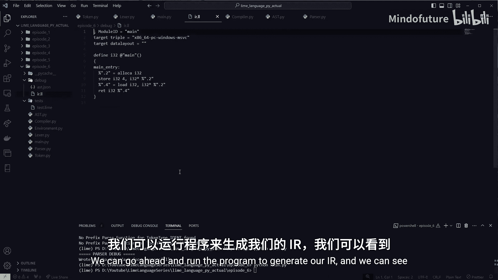
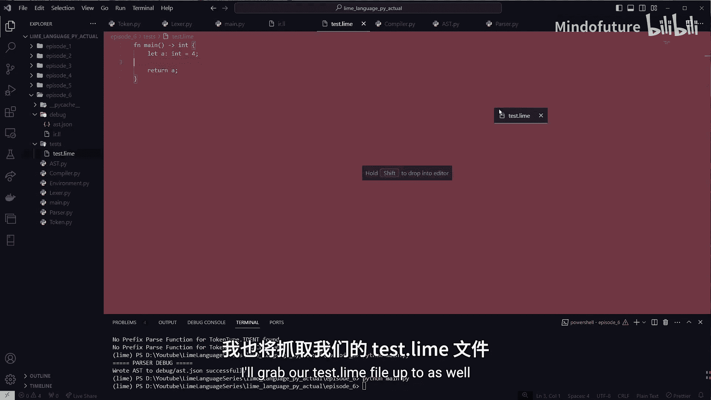
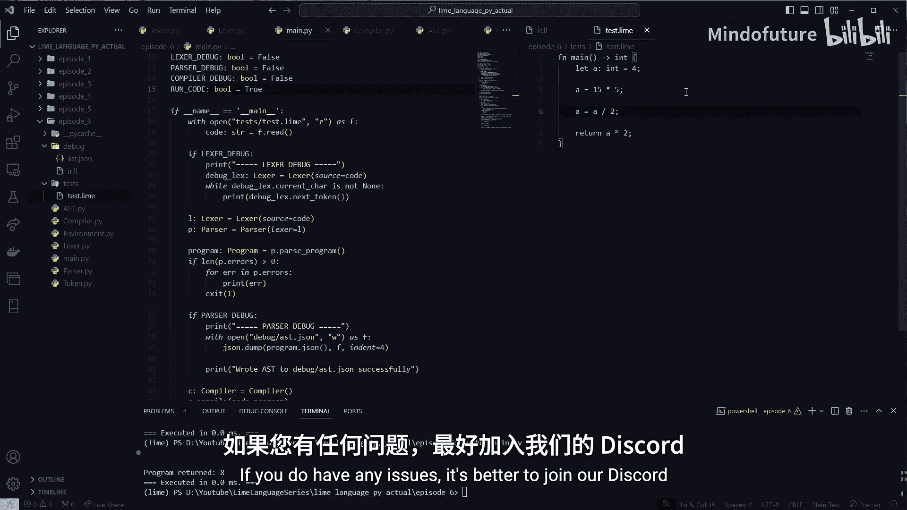

# 使用-Python-和-LLVM-创建编程语言-p06-P06-Episode-6---Function-Declarations-+-MCJIT--BV1hn5RztEt8_p6-

Welcome back to the programming language series where we're going to build a statically typed and Giit compiled language using nothing but Python and LLVM。

 Today， the main goal for this episode is to implement our first user toified function。

 which is going to be our main function。 and we're going to turn that into our entry point of our program。

In lime。 And we're going to also be running our programs。

 So we're going to be able to have what we see on the screen。 We're going compile the main function。

And we're going just for fun and games， declare a variable with a value of 4。

 And we're going to return that variable。 And we're going to be able to see that after we run the program later down the line。

 So little， we got a little bit of coding to do this。 maybe one of the longer episodes。

 But we can get right into it with our token class。 So we go to token dot Pi。

 We're going add a couple new token types。😊，First one's gonna be down here in the keywords。

 We're going do F N。 This is for our function。We're going to go down below this semicolon。 You got。

 you can put it actually anywhere you want。 But I'm just going set it here。Arrow。

 this is for our typing right here。Put it over here for right now。

So this is our typing arrow for functions。We need our left brace， and our right brace。So。

 these are are。Curly brackets right here。 And then we also need our return keyword。

 So we'll put that down here。 This is for our basically， our return statements right here。

So down in our keywords， we will add FN， map that to the token type dot Fn。We will add return。

We'll map that to our token type dot return。 And now for our。Gen Z keywords。 I do have a few。

 I'm going copy paste in for our function， return and our arrow。So for function， the Min bra。

Cause why not？ We're gonna do pause for return。 And then we're going to do this beautiful 3D thing。

 And I just saw this on the good old fourchanant Reddits。 And so we're gonna use 3D for the arrow。

Alright， this is me from future editing land of sadly， we can't do that。😔。

Beautiful 3 minus minus D without some extra fancy parsing。

And I don't feel like implementing that right now。 So I feel like S might fit our arrow。

 So we're gonna use that instead。 So please disregard the。3 minus minus D。 You know what I'm saying。

 All right。 Now we're going go to the Lexer dot pi。 we have our tokens set up。

 We need to add one helper function。 It's called peak char。 It's pretty much the same。As。

One of our peak tokens in the parser。So it's just going to peak to the next。

Character at that read position and return it back doesn't advance anything。

 Just kind of gives it back to us。 We're gonna go down to our next token function。

 We're gonna add the case for our arrow。So it's going to be slightly different since the arrow also has a minus sign at the start。

 So what we're going to do is well control X this。We'll put a little comment handle arrow。 Now。

 we're gonna use our。Newly created helper function peak char self do underscore underscore peak char。

If that the next token is equal to the greater than sign。So for the end of our arrow。

 we want to save the current character to a variable。We want to advance。The Leir。

And then we want to set this token， I'm going to paste this here。

We're gonna set the token to an arrow。And then on the literal value， we'll do our C， H。

Character plus the current one， which is now the。Arrow。Where the， greater than sign。So else。

 if it's not an arrow， we're just going to send back a minus and not increment the leor at all。

Next two things we're going to add is our left and right， curly races。So we'll go down here。

 We'll put them underneath our parentheses。 I'll just paste them in and copy these。

 and that should be it for our Leer。 so we can go to。

Main dot pi really quick and turn everything to false。We'll do it true to our Leir debug。

 but we can run Python name dot pi。So we do have a lot of parser errors。

 but we don't care about that。 We're just trying to make sure we do not have any illegals。

 So we do have our arrow parsing， which is great in our left brace and our right brace。

 So everything that we added is now coming through our return statement and our function。So perfect。

 So our lecture is pretty good so we can toggle that off and go ahead and just set our parsel debug to true for next。

And we'll move in to our A S T dot pi for the A T dot pi， the only things we're going to need。

Are three nodes。So we're going to need a block statement and a return statement and a function statement So just。

Copy these down。 pause video， copy these down。 So the function statement' gonna take this。

Go to take care of all of this。 The block statement is a new one。

It's basically the list of statements that's inside curly braces。 So later down the line。

 if statements will also have blocks。So they're just blocks of code that are signified by these curly races and the return statements。

 just as you think， just this。Return value right here。 So now we can go define these nodes。

 So the first one we are going to define in our statements is our block statement。

 I'll go ahead and copy paste this just to save some time。

All this block statement will do is take in a list of statements。 If that list is none。

 it'll just default it to an empty list。Same type variable in the same Json as before。

 you could copy this down if you need to。Next one we need to set up is our return statement。

So I'll copy paste that one。So the return statement。

 all it does is it takes in an expression for its return value。

 So that's going to be this a or it's a 5 or whatever the heck，5 times 5， whatever it is。

That's what this expression will be。 And then same for the type in Jsd functions。

 just as we normally do it。Function statement has a few more things to add。So we'll paste that in。

 and I'll get rid of this。 So our function statement takes in a list of parameters。

 We won't be dealing with parameters quite yet。 So we're just going to keep this here for now。

The next thing is are our body of the function， which is our block statement。

We're going to have the name of the function， which will end up being an identifier literal。

 just because this statement is declared above the identifier literal。

 I can't use the type pins on this。And the return type。

 we set all these variables and the type in Json。Functions are pretty much the exact same as every other A S T node。

 Now that we're finishing up in the A S T， we can save that and go into our parser。

 First thing we need to do in our parser is import everything that we just built。

So I will go up to the statements。 paste that in。 We want our function， return and block statement。

 We're gonna go down to our prefix parse functions。 We're gonna add a。Section for identifiers。

So this is our token type id， and we'll have a new function called parse identifier。

So we can go down to the parse identifier。Place down in our prefix methods。

So our region prefix methods， we can just slap this up at the top。So de parse identifier。

So in it returns an identifier literal。return， identifyentifier literal。

You value equal to the self dot current token dot literal。 And that's all that function will do。

Now we're going to go into the parse statement function。

 So we can go scroll up to our statement methods。 Here's our parse statement。

We're going to add two cases to this。We're going to add one for our function and one for our return。

So we're gonna have a parse function statement and a parse return statement here。

 We're going define all of these functions really quick before we implement them， so。

We'll scroll down to bottom of this region。 So deaf underscore underscore note parse function statement will take in a self。

 We turn back a function statement。We will do a parse。Return statement。So。

This Lord Turner return statement will pass that as well。our last function we'll define really quick。

 is parse。Block。Statement。Ts in， and it will be a block statement。

We'll also slap a pass on that as well。 First one we'll do is our block statement。

 So we'll take this out。Very。Block statement variable， which will hold our base class or A S C。

We'll increment to the next token。So wild not self dot。 current token is。Token type dot right， brace。

And not。Self dot current token。Current token is。And a file。Tokentype dot UF。Let's take。

We're going to grab a statement。Self dot underscorecor score， parse。Statement。

If statement is not none。 So if there is a statement， we're going toend that statement。

To our block statement。Will increment the parser。Then we will return back this block statement。Now。

 we'll move up to the return statement。And these two need to be defined before we can do our function statement。

 So that's why we're starting here first。So a return statement， like always， make a statement。

 and initialize the class。We're going to increment the parser。

From that return keyword to get to our next， our return value。 a statement dot return value。

Self dot underscore parse expression。And we'll just do the P lowest。Precience for that。If not。

 self dot， expect peak。So we're making sure a semicolon is on the end of that statement。

If there isn't one return none， and that will show a parser error。And then， we'll return statement。

Alright， now we can get into the fun one。So for our function statement， we'll start off the bat。

Just initializing our AS T class。What we're trying to compile just so what we or what we're trying to parse。

Is F N name， Then we have parentheses， Then we have an arrow。A type， like int。

 will have curly braces。And then a list of statements inside of this。 So for now。

 I'll just return 10 here。So this is the syntax we're trying to get。 Right now。

 we are on the FN keyword for function。So the next one we're expecting is a name or an identifier。

 So if not self dot， expect peak。Token type that Ident't。We want to return none。

We'll go ahead and copy this because we'll be using this a lot。Its the statement dot name。

Is an identifier literal。And the value is that current tokens literal。

Next thing we're looking for is parentheses。 So left Paran。Helperin。IfWe don't find that。

 it'll be none。For right now， we'll set the parameters equal to a empty list。

 and we'll slap a twodo flag on that。Then we need to do a right parentheses。

 We expect that after parameters， right now。There will be a function to grab all of these parameters and parse them out。

So for now， I'll add this in the future， we'll be removing the ifF statement and it will be replaced by this par parameters function。

Next thing we need after the right parentheses is our arrow。 So we will。Paste this in again。

We're looking for an arrow。Next thing we're looking for is our type。So， we will。

Expect the type keyword。 If it's not， we want to return none。

Will set that return type equal to the self dot current token not literal because the。The literal。

 the token right now is whatever this type is， which in our。Example is the integer。

The I N T next thing we're expecting is a left brace to start our block statement。

 So we'll paste that in again， left brace。Now， we need to parse our body outs。

 self dot underscore underscorener score， parse。Block statement。

And now we want a return statement after that。 So now we can go back into main dot pi。

 make sure the parser debug is on。And we can go ahead and run our file。And check out our AS T。t JO。

So we do have our function main。 We have a block statement in our body。Return type was integer。

We have a let statement in here。A equals 4。Thenhan a return statement that's returning that identifier of a。

So the function statements parsing correctly。 The return statement also is as well。

 and the block statement is as well。 So that's perfect。So we can now move on to our compiler pi。

First thing we'll do is just import everything we just made。 So block statement。

 function statement and return statement。 We need to go to our compile method and add all three of these。

Nots into the。Case statements。 I'll paste these in just for the sake of time。

So we're going to have a function statement， which has its own visit method。

 B statement has its own visit in return。 That has its own visit。

 So the first thing we're going to implement is our block statement first。

So we'll go into our statements region。Deaf is blocked statement， self node。

 which will be a block statement。And won't return anything。 And this is a really easy one。

 So for statement in no dot statements。We want to compile self dot compile that statement。

 That's all the block statement does。 So Now we're going to visit our return statement next。

Deaf underscore underscore visit return statement。Self， no will be a return statement。

I won't return anything。So we're going to take that value out of the node so that return value。

We want to get a the O L V M value and type。Of this expression。

 So we'll use our resolve value function and pass in our。Expression into that。And now， we're gonna。

Invoke the return instruction， which is if self dot builder dot R。

And will'll pass in that value as what we want to return。That's it for the return statement。 Now。

 we can move into the more fun。Function statement。So de underscore underscore visit function statement itself。

Noode function statement。Make that return， none。So we're going to take the name。

 which will be a string。 grab that from that our name identifier。In our function。Notode。

We'll grab our body， which is a block statement。From the node dot body。Grab the Params list。

 which is a list of identifier literals。Pras， but right now， we， that's not implemented。

 So it's gonna be an empty list。 I'm gonna add a few more。' gonna paste these in for the sake time。

 So parameters names。This will not be used until later。

 I'm just going to keep it in here just so we don't forget。

Forram types also won't be used until later。And the return type just takes this node return type from the function statement and gets the correct。

LLVM type from our type mapping。 So now we need to take。

 we need to build up our LLVM function type and function。

So the function type will take in our return type， which is an integer in this case in our parameterm types。

 which should just be an empty list。We're going to build our actual LVM function。

Pass it in our module， our function type， and then the name of that function。So in this case。

 that would be main。We're going to make a block。The type I R dot block。

We'll take our function and append that block to it。We'll name it。 name， underscore entry。

 says our entry block。We're going to send， we're going to save our previous or our current builder right now to a variable so we can come back to it。

We're gonna set our。Compilrss builder to a new I R builder。With the entry point of our block。

That we just created。We're going to take our previous environment。save that to a variable。

Now we're going to set a new environment for this function。So self dot E And V equals environment。

And the parent will be our current environment that we have right now。

We're going to define this function in our environment。 So define。The name。A function。

 and the return type。So that's going to define our main function within our environments。

 We can't name anything else， main。We are going to compile our body or our block statement。

 We're gonna now， after that function's been compiled。

 we need to reset back to our previous scope or our previous environment。

 So self dot E And V equals previous E And V。We want to take this defined。Function call right here。

And do it again on our environment that way， in our global environment， we now have that main。

Function in our scope as well。 So we can now call that later down the line or make sure nobody else names another function called main。

 And the last thing for this is to do a reset our builder back to our previous builder。

Which is our more of our global scope。And as we define functions within functions， within functions。

This will just recursively build， go down the chain of environments and scopes。

 So now that we have this function statement， we can go up to our visit program。

And get rid of all of this。Fake main function creation。 So all this。

 everything except this four statement and node statements can go away。

 So this is all our visit program will do。 It's pretty much exactly the same door our block statement function。

And then we have one extra bug fix that I noticed。 We need to go to our visit Let statement in our if statement right here。

 At the very last， we put value here。When this really needs to be our pointer。

 because this is our new allocation instead of just the value up here。

 So we need to change this value to pointer。And that is absolutely it for our compiler。

So now we can go into our compiler or our main dot pi file。

We can set this Leor or this parser to false。 We can set the compiler to true。

 We can go ahead and run the program to generate our IR， and we can see。

I'll grab our test dot line file up too as well。 Alright so。

We have our main function that we defined here。We allocated an integer， and we storing4 into that。

 We're loading for， and then we're returning whatever is in 04， which is whatevers in 0。2。

 which should be 4。So that is completely it for compiling functions。

 but now we'll get into the actual。Let's actually run this program with an MC C Gt compiler。

 So for this， I'm going to add a run code flag。We'll set that to true， as well。

Sa the compiler debu default since we know that's running。We can go down here。In our。

At the very bottom， we can do if run code。 There's three initialization steps we need to do。

We need to make sure we have our LL VM imported。 We need to make sure we have these C types imported。

Is one last import when import time is just for your execution time。 We'll see you later。

In this if run code block， we want to initialize three things。 So L L VM dot initialize。

 We want to initialize the native target and the ASSM printer。 We need a try accept block now。

Format all this。So we're going to try to parse the LL VM。

 This is just the stringified version of our module， which is everything in our IR file。

So we're going to parse that to assembly， and we're going to verify it。

If that raises some type of exception， we'll print that and we'll break out We raise it The next line of code。

 We need to set our target machine。We'll get rid of that。

When you set our target machine from our default triple， we'll create that target machine。

When now we need our L L VM engine。So the engine we are going to use is the MC Jt compiler。

 so we'll create that。Passing L VM IR parsed and the target machine。

 and then we'll finalize the engine object。 Now we'll get to our entry point of the function。

 So the function address， we're going to look for our main function。

So if there is not a main function， this will not run because it will not be able to find this。

 So we're going get our main function where it。What address that's at。

We're going to create a new C function type。That's returning an integer。

And we're going to give it our function address of entry。So that's now our C function。

 So this is where we'll add in our time functions。 So we'll do our S T for start time。

We're going to call this C function in Python。And whatever this returns is what our entire program is returning。

 So we'll save that to a result。And finally， I just have a print statement here。

 just as something nice to see when I run this code。

 It's just gonna show what the program returned and how long it took to execute。

 And that'll help a lot when we try to。😊，Benchmark this language with some manle bra sets or Fibonacci sequence or something like that。

So now that we have this， we make sure this run code is true。

 We should be able to Python main dot pi。And we have officially ran our first lime program。

 So all this does。His returns。A， which is 4。 so we can do a times 2。 So we're expecting 8。

This programme returned 8。So， now that we have。😔，Functions implemented。

 We have returned statements implemented， block statements implemented。

And we have the ability to run our program through an MC C Gt compiler。

 So now you can do a lot of arithmetic operations。 Unfortunately。

 cannot call functions yet reassigned variables。And if statements， we got a lot of stuff to do。

 So we'll move on to our next episode in episode 7， we're going to take on variable reassignment。

 So we're going be able to take， let's say， let a equals 4。

 and then we're gonna be able to set a equal to 15 times 5。And what get said， a equals a divided by2。

We'll be able to reassign variables since we don't have constants yet。So that's it for this episode。

 Thank you guys for watching。 If you have are having any issues， you have any suggestions， comments。

 concerns， drop them in the comments section below。 If you do have any issues。

 it's better to join our discord that link will me in the description。

 And I will see you in episode 7。

