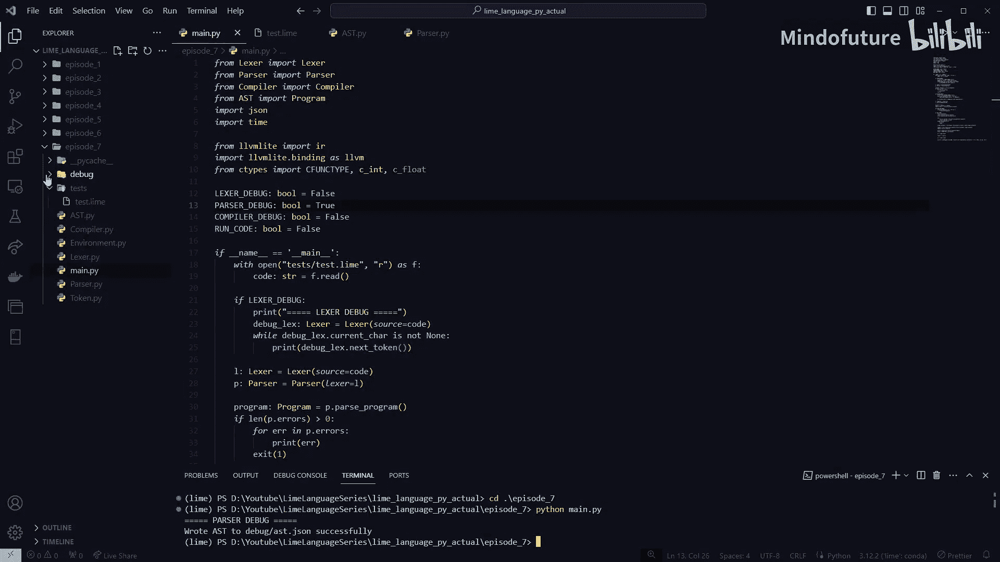
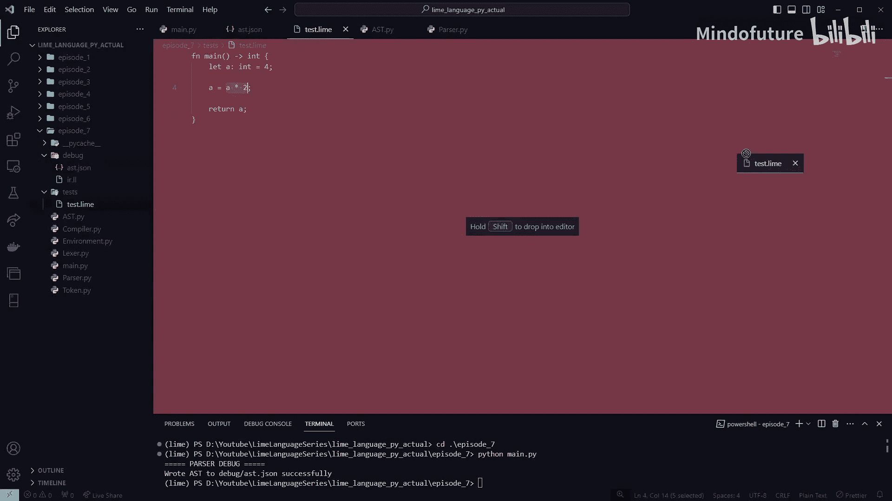
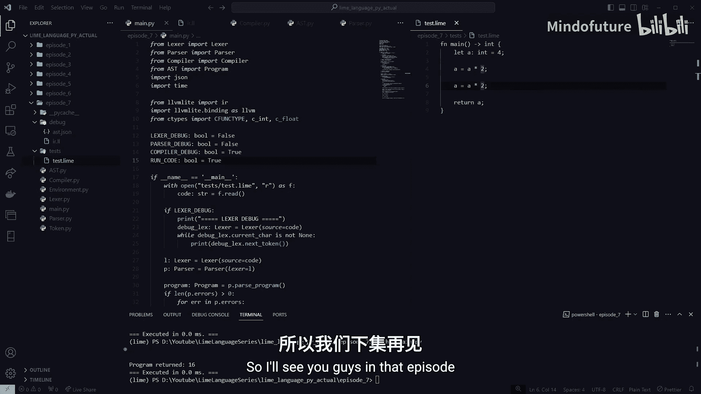

# 使用-Python-和-LLVM-创建编程语言-p07-P07-Episode-7---Variable-Re-Assignment--BV1hn5RztEt8_p7-

All right。 Wel back to the programming language series where we're going to be making a statically typed in Jit compiled language。

 using nothing but Python and L L VM。 Last time we went through the user defined functions。

 We implemented our main function， and we。Finally， decided to run our program。So this time。

 we're going to go into something a little more simple into a variable reassignment。

 So this is the chunk of code we're going to be compiling and running today。

We just have a main function。 We have our let statement initializing a to 4。

 and then we're going to reassign that a variable to  four times 2。 which should be 8。

 And then we're expecting to return the number 8 for this program。

 So that's where we'll get started off。 And this is we， where we should end as well。

So down in the A S T dot pi will be our first stop。

 We're going to add a new node type called the assign statement。 So a statement。Sign statement。

Orgon spell。I'm going to go down to our the bottom of our statements and create that class for the sake of time。

 I'm going to paste this in and you guys can pause the video。And copy this down。 Basically。

 a sign statement is going to take an identifier。Which I just have expression。

 because as I've done in the past， I cannot use the identifier literal because that is declared down here。

And it just makes more sense for literals to be down there。 So I refuse to move it。

But the identifier literal。 And then it has a right value。

 which is just the right side of the equal sign。 And that's an any kind of an expression。

 And just same as always type in Json。 So have that copy down and we'll move on into our parser。

 moving into our parser。 Let me save this。 In our parser。

 We're going to first import the assigned statement。So， sign statement。

We're going to go down to our parse statement function In our parse statement function。

 we are going to have an if statement at the very start， self dot current token dot type。

If that type is an identifier。And the peak token， says the token is。

Is equal to the equals token dot E Q。We want to not even go to this match statement。

 We'll just go straight to self dot。Under score underscore parse。Assignment。Statement。

So if the current token is an identifier and the next token is an equal sign， we know， of course。

 we're going to be an add an assignment statement。 so let's jump to that。

So moving down into the assignment statement， we'll just scroll all the way down here。

Deaf parse assignment statement taken as self。 This will return。In a sign statement。

First thing we're gonna need is just a statement variable that's gonna initialize our A T node for a sign statement。

We're going to set that identifier。Equal to a value。Self dot current token dot literal。

 We're going to use self dot next token a few times。 The first one's going to skip the ident token。

 The second one's going to skip the equal sine token because we don't。 we already know it's there。

 We don't need to do anything with it。We're going to set the statement dot right value。

 We're going to parse the expression。So use our parse expression function with the lowest precedence type。

 just to start。We're going to advance the parser again， with next token。

And then we're gonna return these statement back out。

 So that's actually everything we need for the parser for reassignment。

 So we'll go back into the main dot pi file。We'll change that false。 and we'll go to parser。 debug。

 turn that debug flagged to true。Do Python main dot pi。 We'll get There we go。So we've got some AST。

So we got an AsT。 Json， so we'll go into this and just kind of check it out。

 put test that line over here。

So first thing we have is a function statement。The name of it is main。

 We got all that body block statement。 We have our let statement， and then we have our new node。

 which is our assigned statement。The identifier is a。The right value is an infi expression。

 such as a times 2。 So this AS T checks out。 everything's looking good。So we'll close out of that。

 close out of the AST。We'll set this back to false。 Just go ahead and set compiler to true for later。

use that is where we're heading into next， which is our compiler dot pi。

 First thing we're going to do is import our new sign statement at the very bottom of this in function。

 we're just gonna， I'm going to paste in an errors list。

So it's just gonna keep track of errors temporarily。 They're going to be strings。 Eventually。

 we'll have an episode that goes a lot more of a deep dive to make these errors actually do something helpful。

For now， this list will do。Then we're going to add a in our compile statement。

 we're going to add our case node type dot assigned statement。

And that's just gonna be a underscore underscore visit， assign sign statement。

Pretty similar to every other feature that we are adding。 It's kind of。

I'm hoping you guys are seeing the kind of method we're going through。

 We're moving all the way from our token class all the way up to the compiler。

 So should be starting to make a little more sense now， before our visit， assigned signed statement。

I'm just going to copy this right here and scroll down。To the end of our statements。

Make a new function。 Visit a sign statement。So。The node will be of type assign。Won't return anything。

 So the name。We're going gonna to have a name variable。 We our strings。

 So we're going to grab that identifier value from the node dot ident dot value。

 We're going to grab the actual expression value from node dot right value。

We're going to compile that expression and resolve its value。

 So self dot underscore underscore score resolve value。We'll pass in that expression note。

 So we're going to have。 the last things are if statement。 So if self dot E And V dot lookup。

 So we're going to look up the name of this variable。If that doesn't exist。

We're going append an error to the list。If it does exist like we want。

 we're going set pointer and then underscore just because we don't care about the type that comes back。

Self do E and V dot lookup。We're going to look up that name。And we're going to use our builder。

 self top builder。 We're going to do a store instruction。

We're going to store this value to this pointer。 So we're going to store this new value to the pointer of our variable。

 which in this case will be a。We're going to store whatever8 times 2 is to。

The same memory location that a is in。 So that pretty much makes a equal to a times 2。

 Now that that's implemented， we're good to go back into main dot pi。

 Make sure that compiler flag is set to true。We'll do Python main dot pi。We'll go into our IR code。

 Take a look。So we'll grab our test line as well so we can see them side by side。

 So we got our main function。We're going to load。That value， that integer value from a。

 Then we're going to multiply that value by 2。And we're going to store that back into a。

We're going to load it again， and then we're going to return whatever a is。 that variable back out。

 So this I R is looking good so we can set our run code flag to true and kind of investigate what this brings us back。

 So Python main dot pi program our gram has returned 8。 So that's perfect。 So we can go even further。

 So a equals a times 2 again。So 4 times 2 is 8， like we got before。

 So this should give us back 8 times 2， which is 16。🎼And it does perfect。

 So this is variable reassignment implemented。 If you have any questions， comments， concerns。

 have another feature you guys want to see or see the schedule of this series。

 please join the discord。 The link is down below。 Anything else you guys want to see Just leave in the comment section or hit me up on discord。

 The next episode on the schedule is implementing if statements our conditional operators and booleions into our language。

 So I'm excited to get that out。 So I'll see you guys in that episode。😊。

