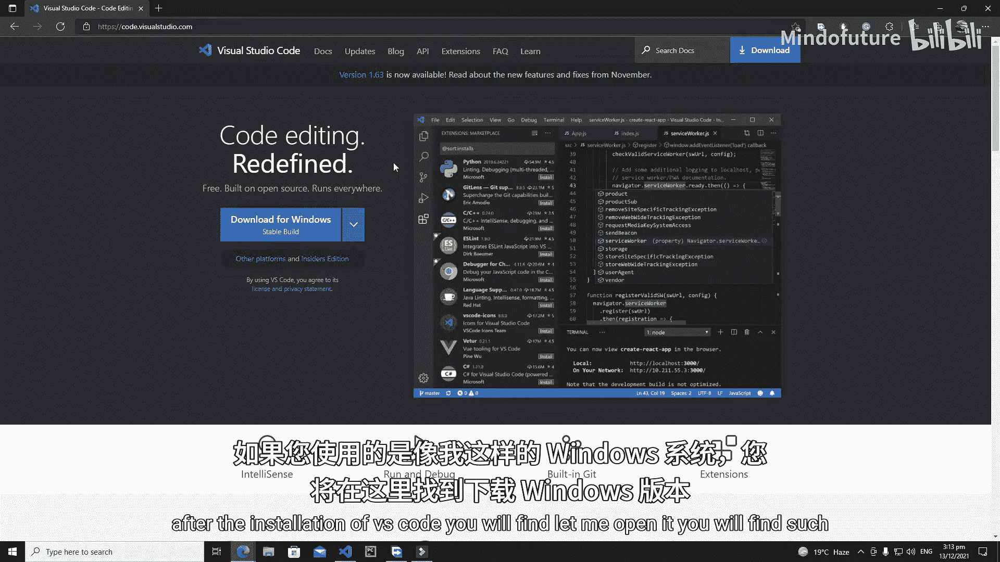
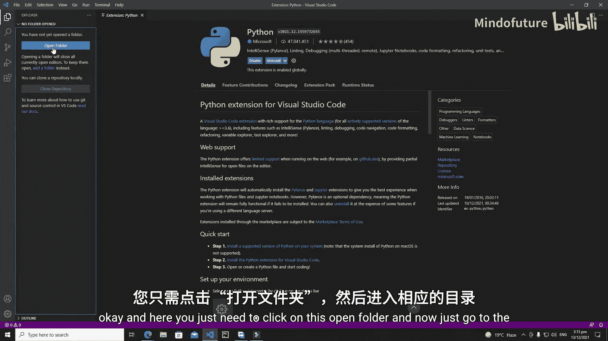
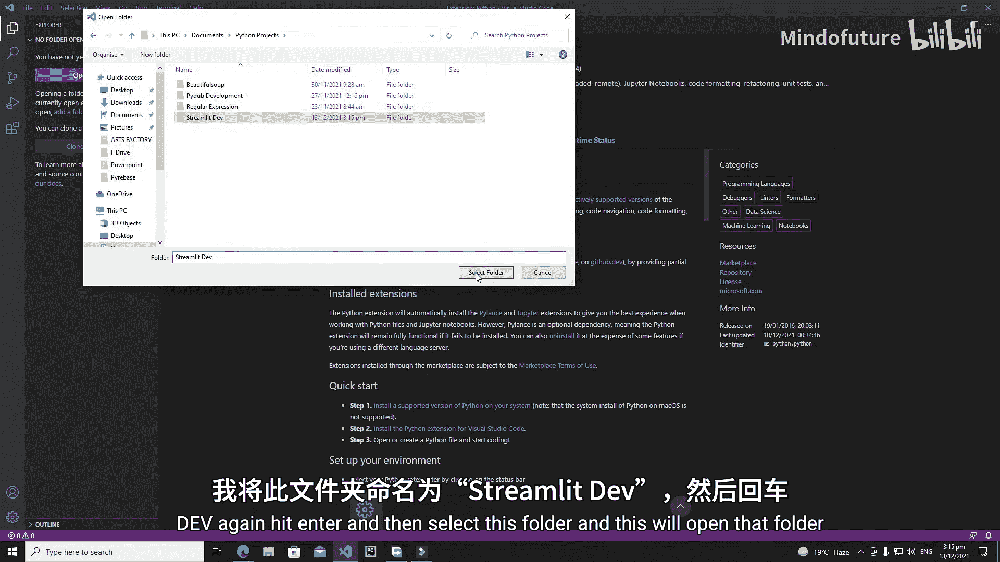
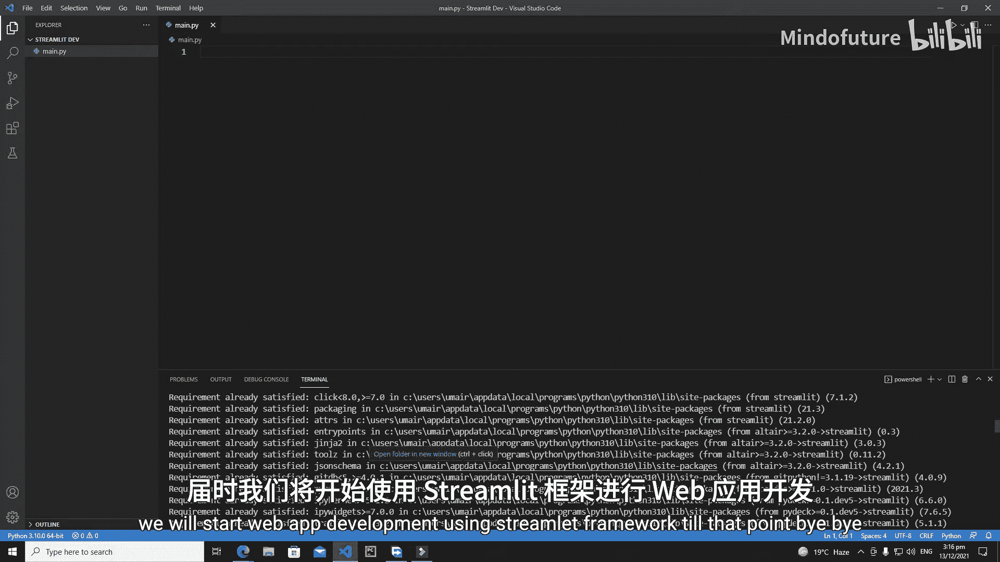

# Python-Streamlit-完全教程-p02-P02-Setting-Up-the-Environment-for-Streamlit---Complete-Streamlit-Python-Course--BV1yHVhz1EUD_p2-

Hi everyone in this tutorial we will prepare our environment for streamlet development So first thing that you need is an IDE for streamlet development and in this case I will use viasco so viaCO I think is a perfect library for developing web applications so if you have viasco already then just skip this tutorial but if you don't have then follow the instruction so first of all you just need to go to this website and that is Scott dovisualstudio co and here if you are using Windows like me then you will find here download for Windows but if you are using Mac or Linux then just select any of the option from the dropdown menu so after downloading viaCO then you just need to double click on the setup hit next next next and this will install your viaSco So after the installation of viaco you will find let me open it you will find this type of interface。

So the first thing that you need to do is you just need to install a Python extension so just go to the extension so just click on this okay and here you just need to type Pyt on Python hit enter and this will show you all Python extensions okay and you need to download and install this one which is Python by Microsoft okay so here you can see this small tick and here it is written Microsoft so you need to install this Python extension because this Python extension has a lot of features like LinkIn debugging Inense and much more okay so you can read these things and there are very helpful very very helpful during Python development so this was the first extension that you need to install and after the installation of Python extension you need to create a folder where you will save all of your files okay so just click on this Exper okay and here you just need to。

Click on this open folder and now just go to the directory where you need to create a folder for streamlit development and I will go to my documents and inside the Python projects I will create a new folder and I will say SR EM streamlit the EV organ hit enter and then select this folder and this will open that folder and yes I trust the author Okay so here it has opened my this streamlit dev folder successfully in the Expr and now you need to create a Python file So you just need to click on this file icon can hit it and here you just need to give a name to your your file along with its extension and I will call it likeN man do Py O hit enter and this will create a Python file for us。

We can code our patent applications using VS code and then after the installation or preparing environment you just need to install streamlit library or framework and for this purpose you just need to go to this terminal hit to this new terminal and here you just need to type PIP sorry P INS AW install ST or EAM stream LIT and hit In and this will install the streamlet okay and as you can see I have already installed it so that's why I'm getting this requirement already satisfied so after the installation of streamamlet I will see in the next tutorial well we will start web app development using streamlit framework till that point bye bye。

