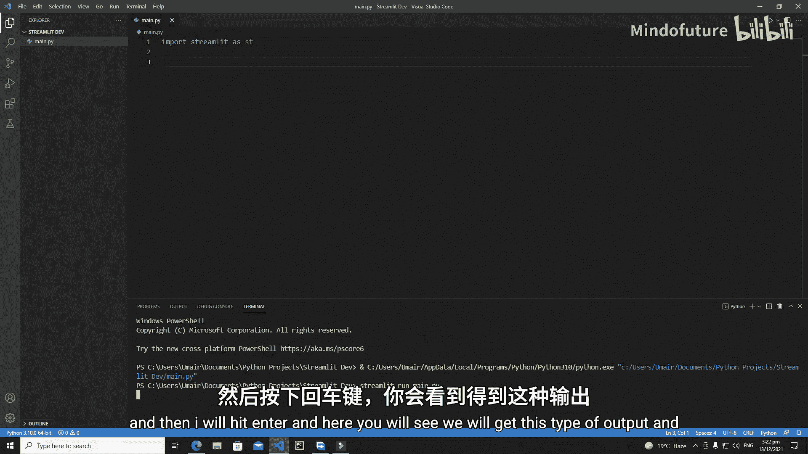
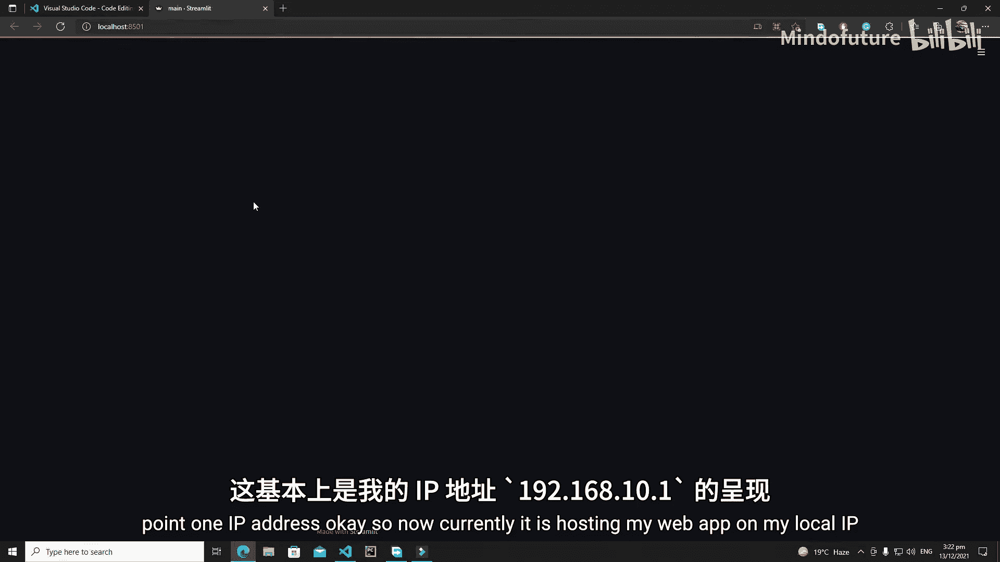
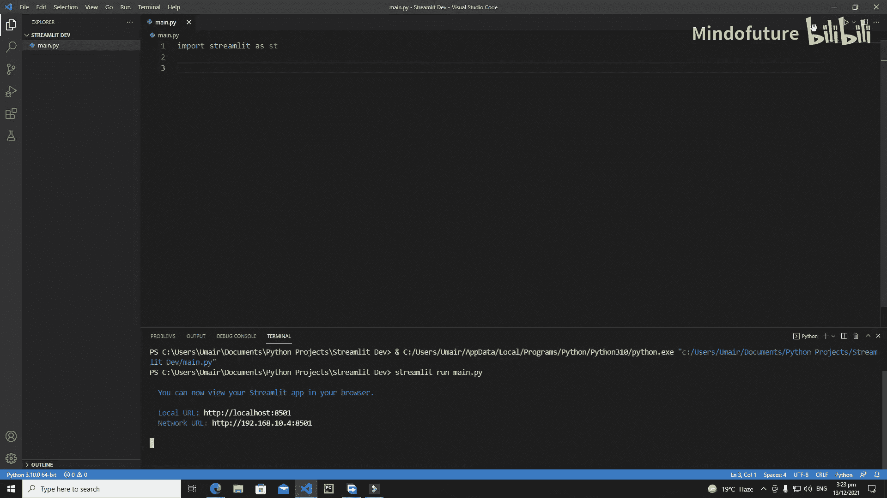
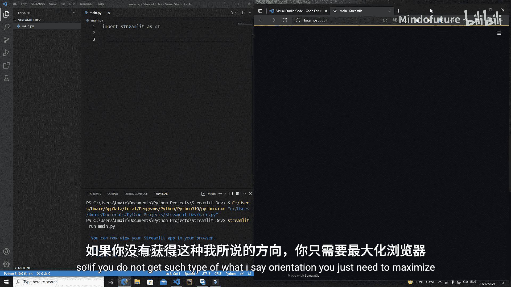
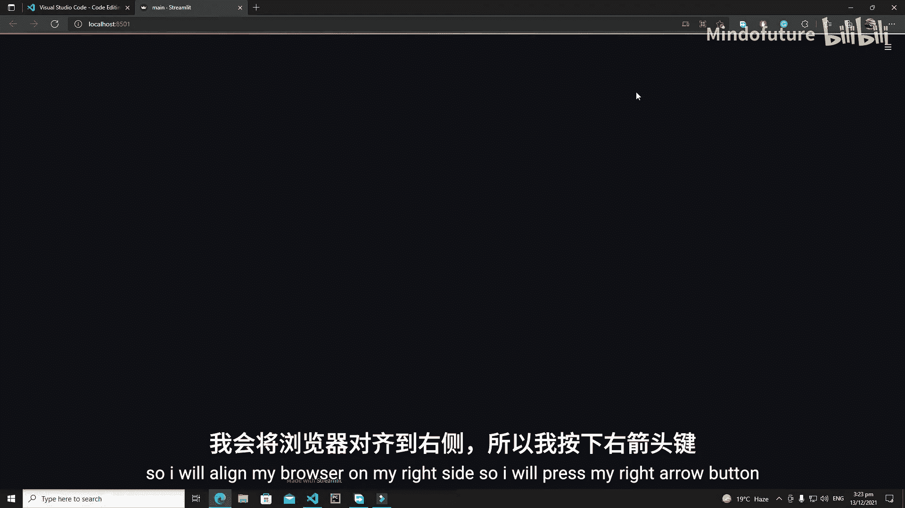
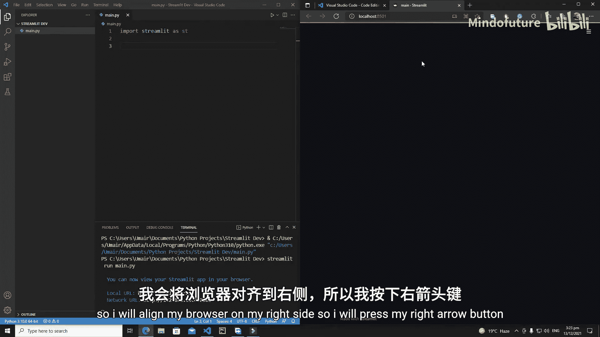
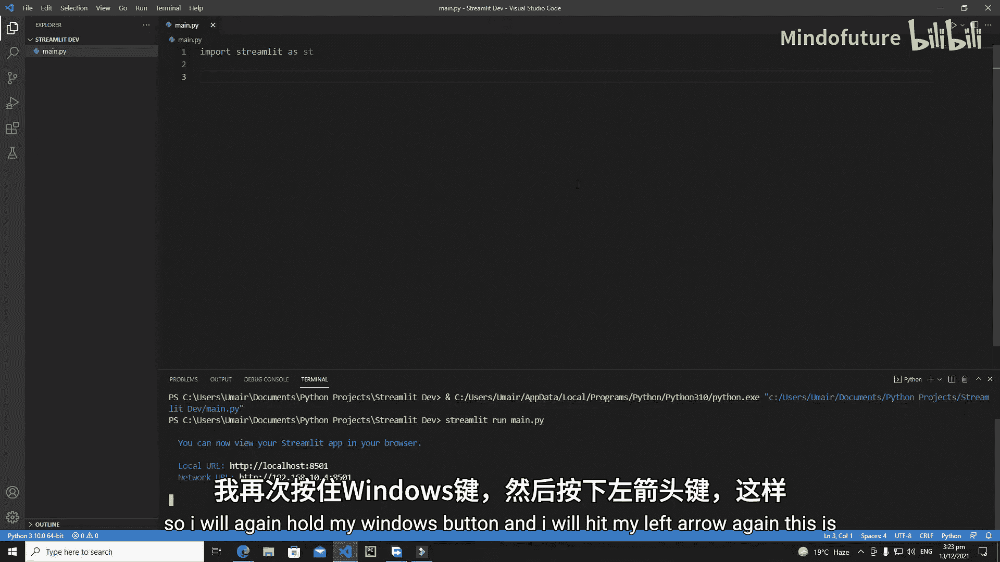
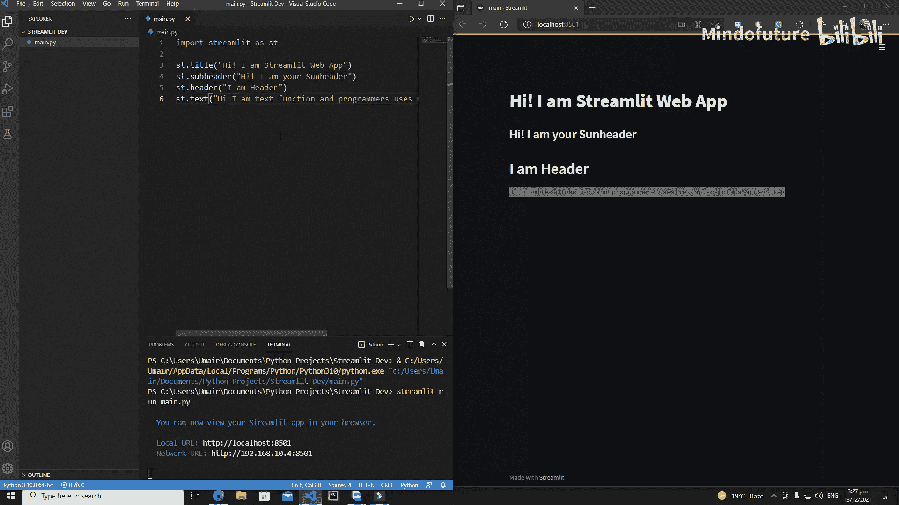

# Python-Streamlit-完全教程-p03-P03-Basic-Text-Elements-of-Streamlit---Complete-Streamlit-Python-Course---Stream--BV1yHVhz1EUD_p3-

Hi everyone in this tutorial we will start the actual development of Web apps in streaml and first of all。

 you just need to import your streamlet okay and here I just need to write IMP or import S or EL itT streamlit and I will import it as S okay so most of programmer here use SL but I use here S because yeah streamlit or S so it totally depends upon you but the convention is to use SL and I really recommend to you that you should use SL but I will use S so after importing this streamlet let's save it and let's run it and see what we will get so just click on the run and here you will see one thing and that is nothing okay so we got nothing and the reason is that in order to run every streamlit application。

Instead of clicking on this run button， you need to type a line in the terminal and that is SDR E M LIT streamlit。

 then you need to write R you N here and then you need to type your file name in which you will develop your web application and in this case my file name is this man do P okay so I will write hereI and man do P and then I will hit enter and here you will see we will get this type of output and yeah now I have this streamlit application and it is hosted on this local host and this is the port port number and this is basically a representation of my 192。

16 to that。10。1 IP address okay so now currently it is hosting my web app on my local IP address and if I open my this via code here you will see that。

Local URL is this and my network URL is this okay so this is how streamlit application work So I think that it will be better if I decrease the size of my Vs code as well and if I decrease the size of my browser as well so if you do not get such type of what I say orientation。

 you just need to maximize the browser and just hold on your windows button and just use your arrow key where you want to align your browser or your any other window so I will align my browser on my right side so I will press my right arrow button and if I again maximize this and I will align my this Vs code on my left side so I will again hold my Windows button and I will hit my leftarrow this is how you can put two windows side by side so I think now we will get a better output so。

Let me close this Vi code as well。 Okay， so we are now successfully importing this streamlit。

 This means that everything is working fine and first of all I will just create a simple title on my this streamlit web application okay so I will write here ST dot T IT title okay and here you need to define your body and in this case the body of the title is a string okay and I will say hi。

I am SREM streamlit。Web app okay and just save it okay here you will see that source file changed。

 Okay you can rerun it or you can press this always read okay so I will go with always return hit this always return and this is what our title will look like okay so this is our cool title I am streamlit application and I have created this cool title with the help of a single line which is purely written in Python and that is S dot title Okay so this is how you can develop your web application using streamlet okay and now let's create maybe a subheading or a text O or let's go with a subheading first O or S dot S UVD or subheader and I will write here hi。

I am your subheader。 Okay， S you B H E D E， I am your subheader。 save it。

 and it will return it automatically， and yeah， this is my subheader。 Hi， I am your subheader。

 So this is our subheader。 And now let's go with I think I should explain header as well So right here。

 S D dot H E A D header。 Okay， and I will say I am H E D I am header， save it。

 and this will return automatically， and yeah， this is my output， which is I am header。

 So this is there is a minor difference between this subheader and this header。 Okay。

 and now if you want to write a simple text。 Okay， you just need to write S D dot T X D text。 Okay。

 and this is just like a paragraph tag in H T Ml。 So if you are a little bit familiar with with。

H TM L， so this dot text function act lies like a paragraph tag。 Okay， so I will say hi。

 I am text function A you N C T Internet function and PR， R， O， G。

 R AW your programmer US E S uses uses me。In place。Of B， A， R， A， G， R， A， B， H， paragraph， T。

 A G tag， save it。And yeah， hi， I am text function and programmers uses me in place of paragraph text。

 So this is how this dot text function work。 Okay， and I hope that you have enjoyed this a short or a very basic tutorial regarding streamlit development。

 and I will see you in the next tutorial where we will discuss some further functions and methods of streamlit。

 and I will see you in that tutorial till that point， bye bye。

