# Python-Streamlit-完全教程-p04-P04-Some-More-Text-Elements-Of-Streamlit---Complete-Streamlit-Python-Course---St--BV1yHVhz1EUD_p4-

Hi everyone in this tutorial， we will talk about some more streamlight functions。 So first of all。

 I will discuss markdown functions。 So I just need to write here S dot M or W and markeddown。

 So what is markeddown So if you want to apply the hml text property on your text。

 then you should use this markdown function。 Okay so for example。

 if I want to write a bold text okay so the markdown for my bold text is these double stars okay so double stars I will say hello h hello okay hello。

 and then I will also put my double stars okay and then I will say world now if I run it you will see that this hello will be bold and then this world will be normal so let me run it upon the terminal new terminal and here。

We will write R stream L I T R U N M AI N Man dot PY hit enterter， and this will start。

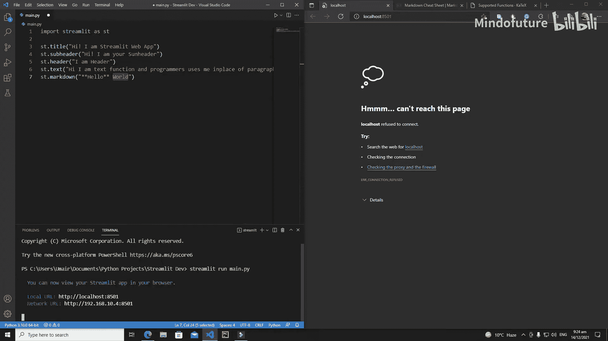

And okay， and I just need to refresh it okay， so it has opened a new local host for us。

 and yeah I just need to save it first and then I need to rerun it okay so rerun it and yeah this is my hello world so as you can see that my this hello is the bold while my this world is in normal format so this is how marked down work and now for example。

 if I want to make this word ital I just need to put a single star here in the beginning and a single star here at the end of the world just save it always rerun okay and yeah this is my world now it is in ital okay so this is a list of all markeddown So you can write h1 heading using the hash like for example。

 if I want to convert my this hello world to to an h1 heading so I just need to remove this star。

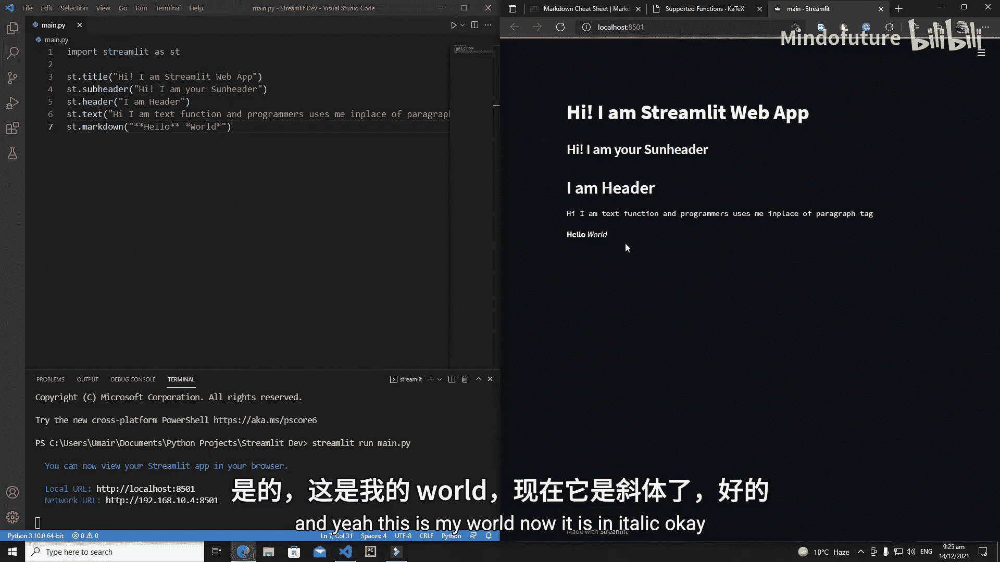

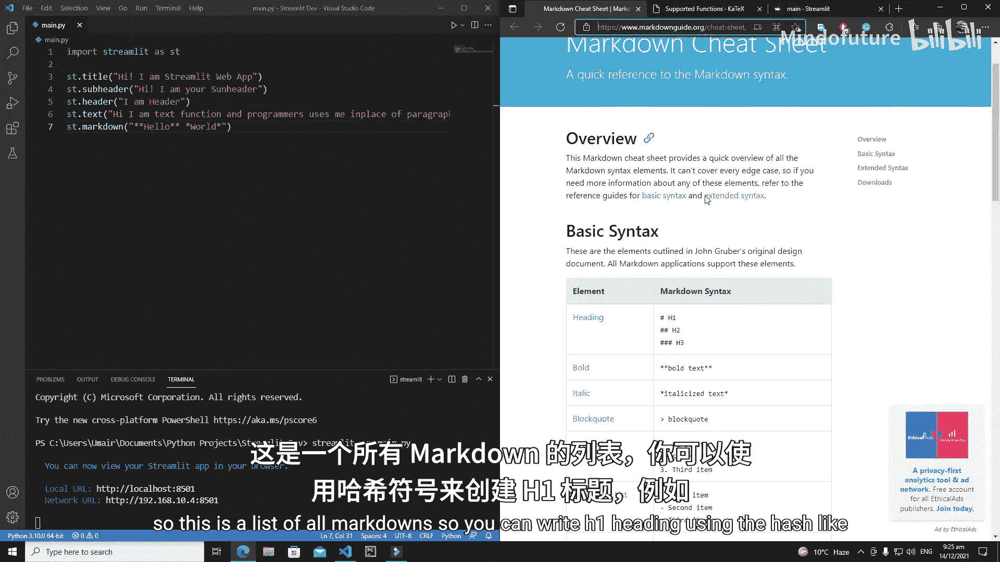

And I just need to put this number sign。 If I save it。 Okay， sorry， just give a space， save it。

 so now this line is basically written in my H1 tag of Hml。 Okay。

 so there are a bunch of markdowns okay， so these are the headings， this are the ball theic block。

 okay， so in order to write a block， you just need to put this sign。 Okay， so if I put it right here。

 Okay， just put it， save it。 and open it， okay， and yeah this is my block code。 Okay。

 so and yeah we have here some list says well， this is an ordered list， this is an unauored list。

 Okay， this is code。 okay， so if you write， if you want to add a code in your website。

 you should use these signs here。 Okay， and this is the horizontal rule。 Okay。

 so if I write here this。

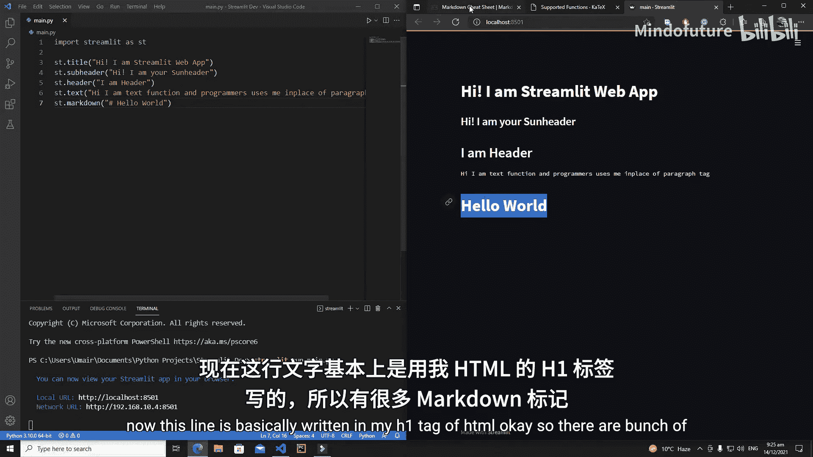

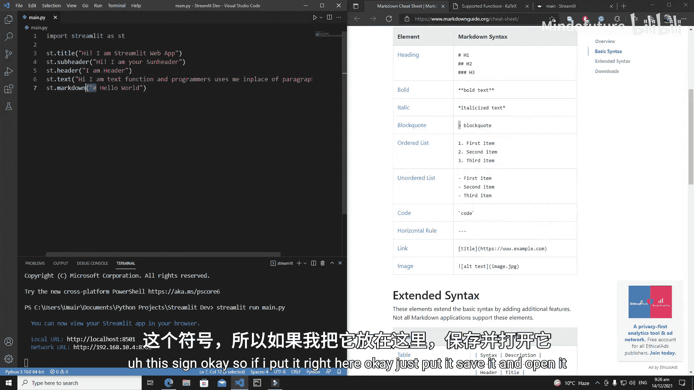

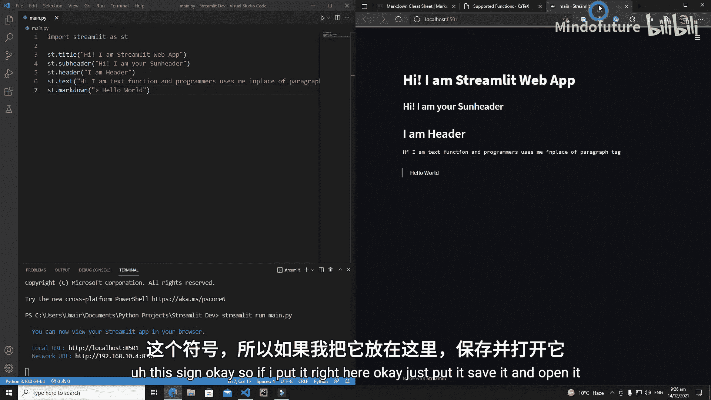

3 dashes。 Okay， and if I save it， if I come to this。 and yeah， this is my horizontal rule。

 So as you can see， we have a cool rule here as well。 and you can insert images。

 you can insert links using this type of format。 like for example。

 if I want to add Google dot com link so I just need to write here just remove it。

 my text will be Google， okay， and I just need to add my link here。 Okay， so just right here， H Ttps。

 then these www dot Gw Google dot com save it。 Okay and let's rerun it。 and yeah as you can see。

 we have this Google。 So if I click on it， it will open Google dot com for us。 And yeah。

 this is our Google dot com。 so this is how you can add different types of markdown。

 So you can add tables these are code blockss。 okay。

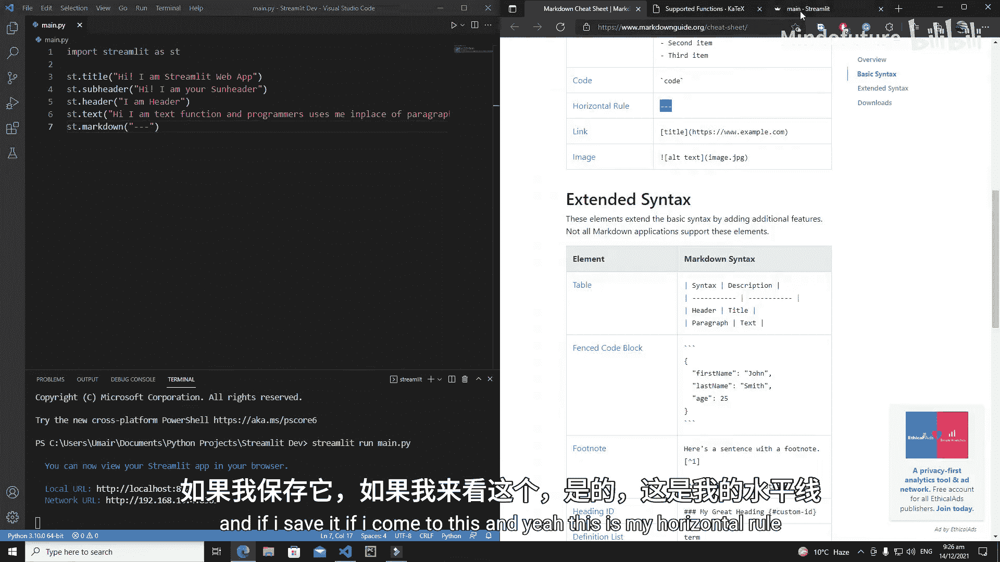

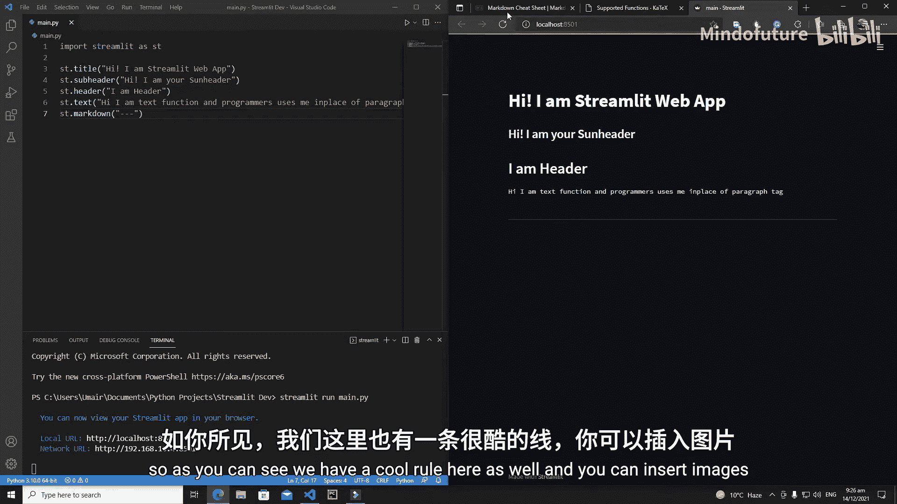

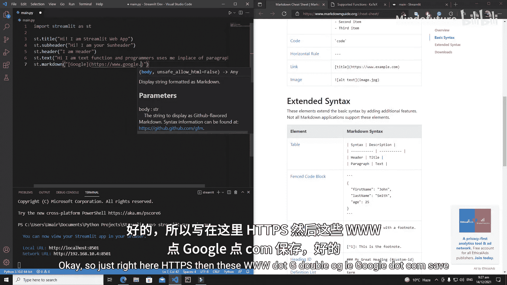

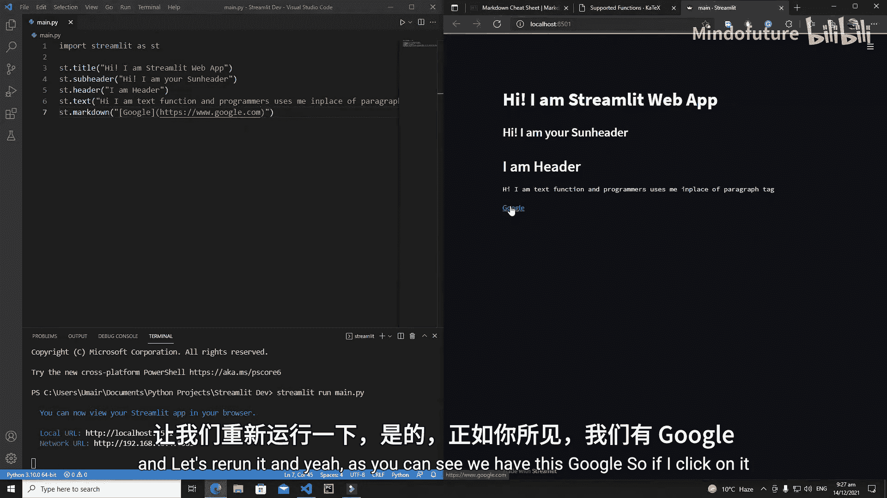

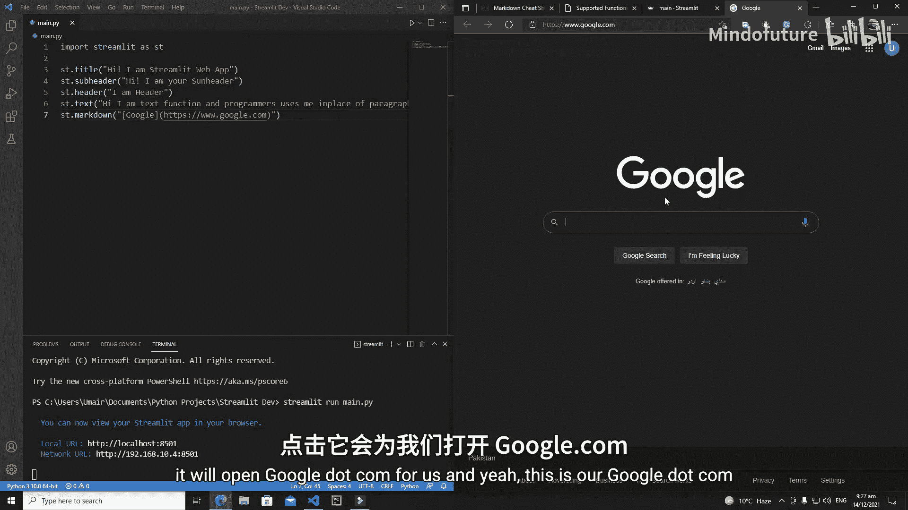

There are a bunch of things， so I will give a link of this website down below and you can go through all these examples using this ST dot markdown function of stream data okay so I hope that you have understood this mark down and now let's talk about captions so you can even add captions to your page as well So let me write here do R mark D orW mark down and let me put a horizontal line okay and then I will write S dot C P on dot caption okay and I will say hi I am。

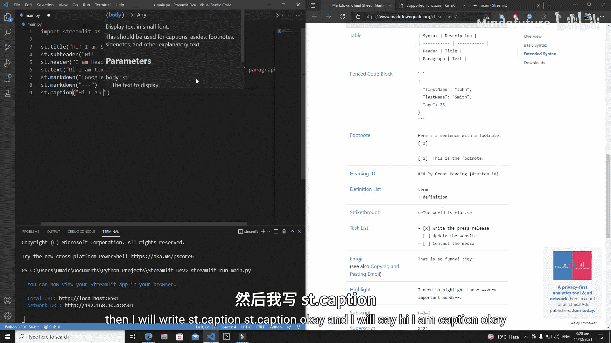

Caption okay caption save it。 just go to man and yeah I am caption。

 Okay so this is how you can add captions and you can even add latex as well okay。

 so latex function basically allow us to add a mathematical formulas or mathematical stuff in our website Okay so if I remove this thing like for example。

 if I write latex， okay if I want to insert here a matrixs。

 okay so I just simply need to write here this double courses。

 okay and make sure that you should write here okay so I want Python interpreter to treat this string as a raw string so now once I have this raw string。

 I just need to write the pattern and for example， if I want to put a parentheses in the beginning and in the end and inside the parentheses。

 I want to write mymatic。I just need to write first here this sign okay and then I will write P E G I and begin okay and in the beginning。

 I will put these parentheses okay and inside these parentheses I will write my actual parentheses okay so this this line doesn't display parentheses on our website okay so inside these parentheses I will actually write my parentheses and that is I think P T XP matrix or parentheses matrix okay and then I need to have a and B on the first row okay and then I will have a blank line and then I will have C and D on the next line okay and then in the end I will also put my this P matrix as well okay so I will write slash and then this parentheses and I will say P T XP matrix save it。

Okay， so we got here。 and， sorry， not this comma。 just to remove it and save it。And yeah。

 this is mymatics and this is how you can write mathematical expressions in your web app okay and I have the latex here as well okay so this website just go to this website which just get text do org and I will give a link of this website down below as well and there are a bunch of latex okay so for example if you want to write this type of a you just need to type this line okay if you want to write this you just need to type this line okay and there are a bunch of accent okay and the limiters here as well like if I want to put these bracket hits okay so you just need to write this thing okay and there are a bunch of things so you can go through all of these things and I will give a link of these down below as well okay and now the next thing that we need to discuss here is JN function okay so what is JN function So JN function basically allow。

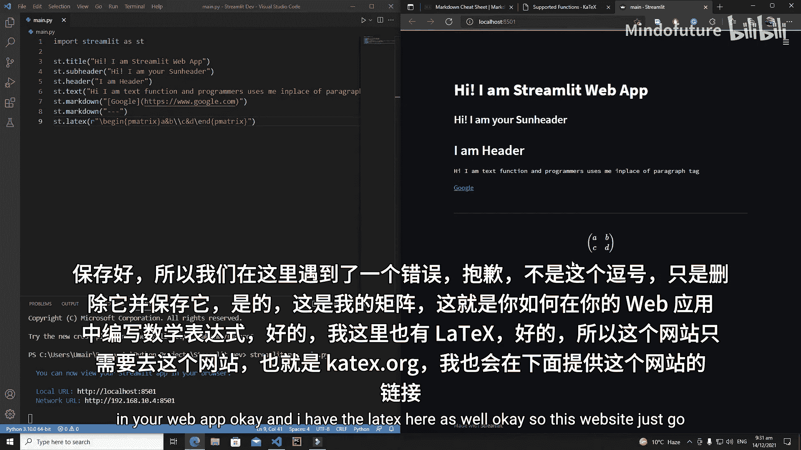

To add a JsN code in our web application， so I just need to first of all let's create a JN code here okay so JS or n is equals to and I will create JN x like a diary okay so I will create a diary here and I will say a then this column and I will assign values to this a and I will save1 comma 2 comma 3 and then I will put comma then D okay this is the key then I need to write here the value which will be45。

6 okay just now I just need to write here S dota JSO and JN and here I just need to pass JSO and JN save it and just go to this man P and this is how our JsN function looks like okay so we have this Exper here okay。

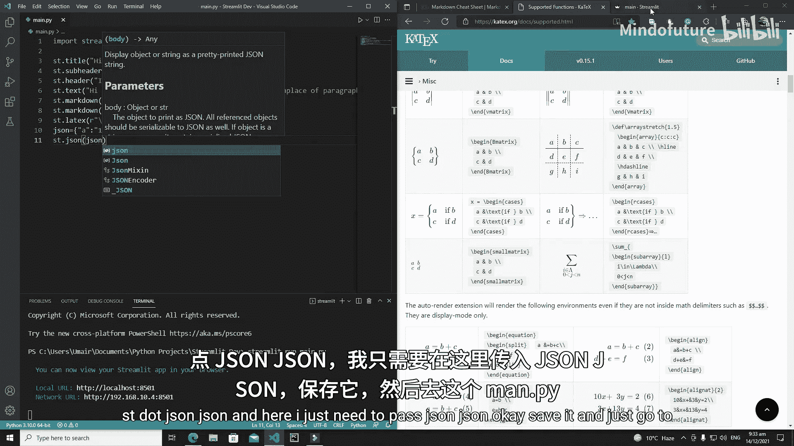

This is my key and this is the value Okay， this is my next key and this is my next value。

 Okay so this is how you can put j data in your web app okay and now the last thing that I will discuss in this tutorial is dot co function So dot co function basically allow us to display coding in our web app okay so if I write here S dot c orD code okay and now let's create a simple Python code here。

 so I will write CD code is equal to and I will say like PRI and T print。Print。

 and then I will say sorry， print H， E， W， L or W， hellello， W， O， R， L D word。 Okay。

 and I will create， sorry， I will create a function here。 D F D。 F you N C T， okay。

 and I will return R E T， U R and return0， nothing。 just now let's copy this code。 Okay。

 copy it and paste it here。 save it。 sorry。Close， not like this。Control the set。

Okay code and then I just need to write your code okay just save it and rerun it and yeah this is our output okay so as you can see we have print then dev and return and this code function basically takes one more extra argument and that is language of your programming language okay so like for example。

 this coding is written in Python language so I will say Ngu sorry Ngu A language is equals to then P Y T join Python save it and rerun it。

And yeah this is how it will look like。 okay， so it creates a minor difference。 Okay。

 this is how you can embed according in your web app。

 so I hope that you have enjoyed this tutorial and in the next tutorial we will see something new till that point bye bye。

😊。

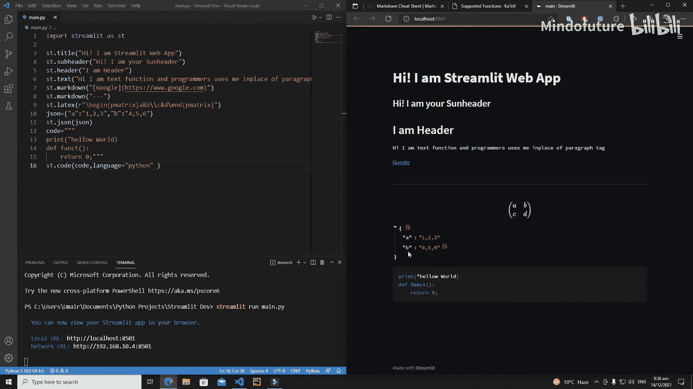