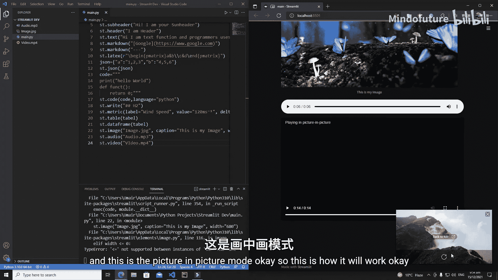
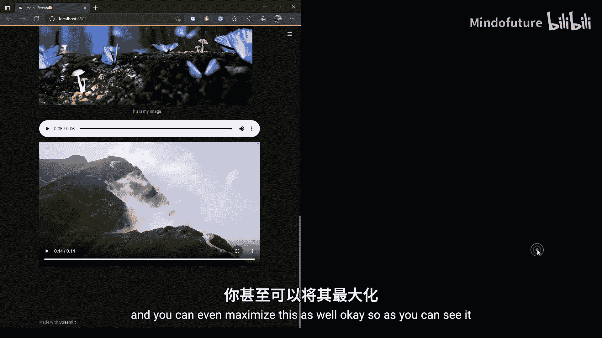
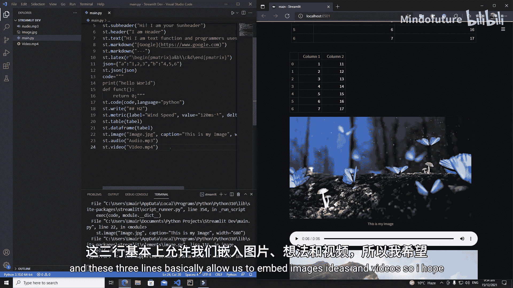

# Python-Streamlit-完全教程-p06-P06-Media-Widgets-of-Streamlit---Complete-Streamlit-Python-Course---Streamlit-Tu--BV1yHVhz1EUD_p6-

Hi， everyone in this tutorial， we will learn how to embed ideals images and different types of videos in your streamlit web application。

 So as you can see on my left side， I have imported my audio file and its format is MP3 I have imported my JP image and I have an MP4 video and in this tutorial。

 we will learn how to embed these three different things in your web app using streamlit。

 So embedding images， Is and videos is a very easy task in streamlit。 for example。

 you just need to write here S do IM image and then hit enter and then inside the image you can define bunch of properties caption and then the width of your image then the channels。

 the color channels basically okay and then the output format so first of all。

 let's define the image okay and that is。My image dot JP G， I M， A G image dot JP G， Okay， save it。

 Okay， and in the terminal， let's write S T， R E， A M stream， L I D， R U and run D， A T A not datata。

 it's M A I N Man dot P， Y and hit enter。And this will open a local host for us and just call and yeah this is our image okay。

 So as you can see， we have an image here and how simple it is to embed an image in a streamlet web app now let's add a caption to this image as well like I will say this is my I image save it okay always return and as you can see we have a caption and this is my image and you can also define the width for the image as well like if I said W IDt width is equals to I will go with like 680 okay save it and return so we got an error okay so it shouldn't be a stream okay so just remove this and let's save it and okay so there is no major difference between the image but yeah you can also。

Find the width for your image as well。 Okay， and now let's talk about embedding ideals。 Okay。

 so in order to embed an idea in stream that web app， you just need to write S dot I okay。

 hit enter and then your I file name And in this case， my idea file is this idea dot MP3。

 So just right here A you D your idea dotmp3。 Okay， save it and this will rerun it okay。

 and yeah here is my idea。 okay， so if I run this idea you can even listen to this idea。Yeah。

And yeah this is my idea。 So we have here three dots。 So if you click on it。

 you can even download this idea， you can change the speed of this idea okay and it is so much easy to embed such type of medias in the streamlit web and now thats stuck about the final thing and that is embedding a video So you just need to write here S dot V ID or video okay and then you need to define your video file name and in this case my video file name is this video dotmp4 save it okay and yeah this is my video so if I run my video as you can see we have a very cool output on our streamlit web app okay so here we have three dots as well。

 So if you click on this you can download it you can change the speed and this is the picture in picture model。

So this is how it will work okay and you can even maximize this as well okay so as you can see it we have maximized the whole window of the video okay so let's minimize it for now and these three lines basically allow a stream but images。

 I and videos so I hope that you have enjoyed this tutorial and in the next tutorial we will see something new till that point bye bye。

