# Python-Streamlit-完全教程-p08-P08-Basic-Interactive-Widgets-of-Streamlit---Complete-Streamlit-Python-Course----BV1yHVhz1EUD_p8-

Hi everyone in this tutorial， we will talk about some interactive widgets of streamlets。

 So first of all， we will see the checkbox and then we will study all other interactive elements。

 So first of all， let me write here S do C checkbox now this checkbox have bunch of properties and we can pass different types of arguments to this checkbox like the label of the checkbox a very basic property and then we can pass the default value of the checkbox as you know about checkbox checkbox has only two steps。

 the true or default So the default state of the checkbox is false So with the help of this value property as you can see here with the help of this value property we can change the default state of the checkbox and then we can pass the onchan or callback events of the。

box， okay and we can also assign a unique key or identifier for this checkbox in order to distinguish between this checkbox and all other checkbox on the same web app。

 Okay so first of all let's pass a label argument here and I will say C checkbox。

 okay so this will be the label， you can assign any type of label。

 this is just a name so if I save it and it always urine and here you can see we have a checkbox。

 okay and this is the level Okay and now if I pass here the value property and we value is equals to so default value is false。

 That's why this checkbox is unchecked。 but if I say value is equal to true then you will see that we will have a tick here and yeah this is our tick and this is how checkbox or now this checkbox return us this value as well okay。

I say SD T T state is equals to checkbox。 Okay， And then if I say if my SD TT state is true， Okay。

 and then I will say S T dot。W RI T right high okay。Hi， and if else， if this status is false。

 so we will do nothing， okay， so just pass it P As pass。 Okay， save it and yeah hi。

 because my this checkbox is check， So if I uncheck it has gone。 okay。

 and if I again check it hi okay， so this is how checkbox work And now let's talk about some other arguments of checkbox and it's callback。

 Okay， so the one important property of this checkbox is this on check， so okay on check property。

 Okay， so if I say on the score check， so this sorry， what I did， okay。

 so on the score check is equal to this。 okay， and this this checkbox basically call this property。

 When someone changes this state of this checkbox。 okay if it is true if we make it false。

 then this checkbox will call this on call back。 and if it is。If we make it true。

 then it will call this onchan callback。 Okay， and now we need to define here the callback function。

 and let's create a callback function here， de， and I will say C H A N G change。 Okay。

 and I will go with simple stuff here and I will just print a message。 Okay。

 print and that will be C， H N GD changed。 Okay， C H。

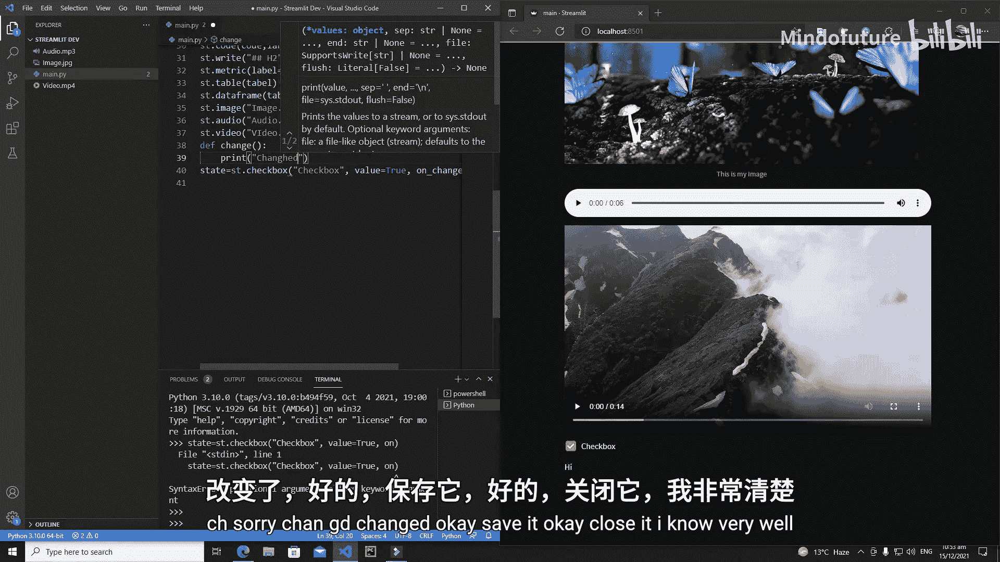

Okay， sorry， C H I N。 GD change。 O， save it。 Okay， close it。 I know very well。 we have an error。

 Okay， don't make me。

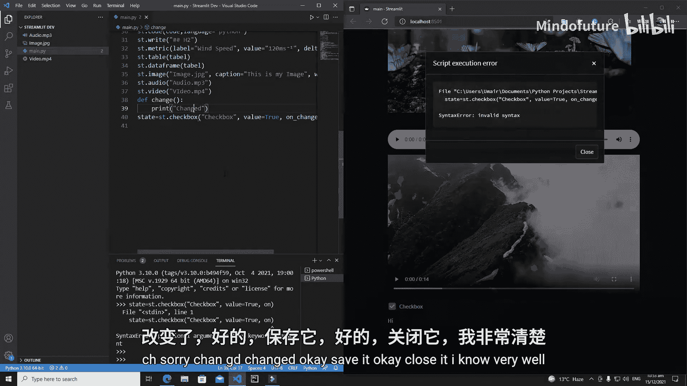

Okay， so here I just need to type the name of my call back and in this case the name is changed。

 okay， save it now and let's alreadyrun it okay， and if whenever I sorry just close this power shell okay。

Okay， so if I uncheck it。 Okay， so sorry， we just need to delete it。 Let's rerun it。

 S D R E M stream， S D， R， E， A M stream， L， I D， R U， N， M A I， N Man dot P， Y， Okay， hit enter。

 Okay done。

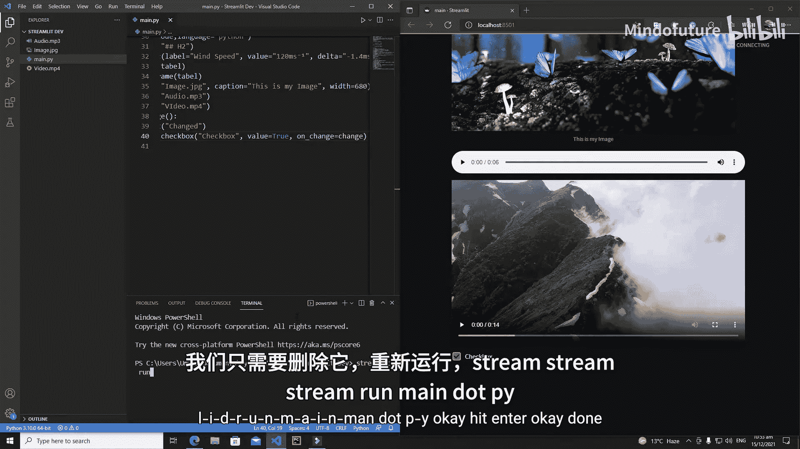

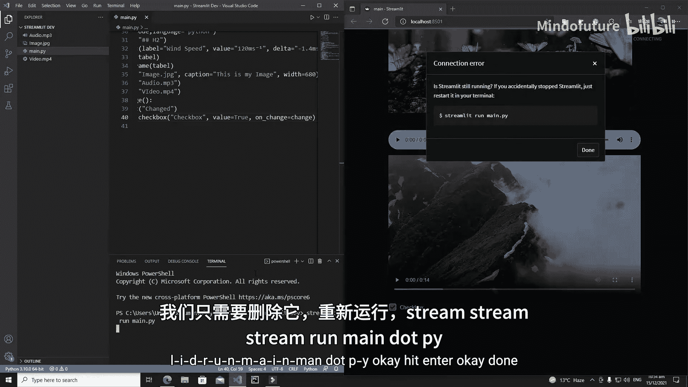

Okay， yes， here is my output。 Okay， so let's uncheck it。 Okay。

 so changed and then let's check it changed。 Okay so this is how this unchan property work。

 Okay and now let's talk about the another feature of this checkbox and that is the key or the I or the identifier of this checkbox。

 So if I write here K Y key is equals to let's assign a unique key and that will be CK or checker okay so it's cool。

 And now what I'm thinking that with the help of this key， I will access this checkbox。

 Okay and then I will print this set of this checkbox and I will do this whole process inside this function。

 Okay so just remove this thing and now instead of change I will print here this set of my this checkbox and for this purpose you just need to write here S do Ss Iu and session and then dot。

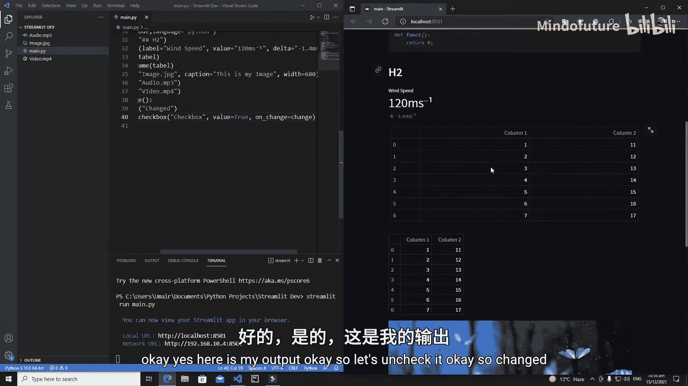

Then your widget key okay and in this case， my widget key is CE CK your checker okay let me make sure it's checker CK your checker okay and let's save it and now always rerun and here if I uncheck it false okay so and if I again check it through and if I again uncheck it false。

 So this is how this callbacks and this key work okay and this session that work okay so I hope that you have understood almost each and everything about checkbox is okay and now let's talk about the radio button。

 So radio buttons are very， very easy and the cool wget of streamlet okay so we just need to write here our I underscore BT and radio button is equals to S do R radio okay now this radio wget also take。

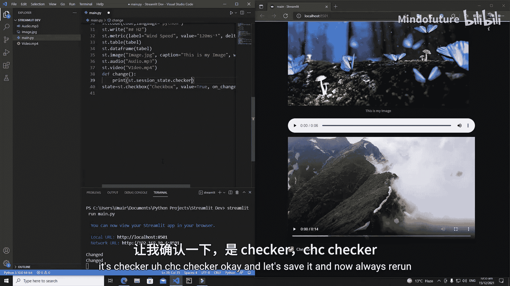

So many arguments okay， and I will not go through all these arguments because if you work on streamnet you will automatically understand all of these arguments。

 but I will discuss some of the important arguments and the first one is the label for your radio button and in this case I will say like in which。

C， O U and T R in which country do U L IV do you live O， So this is like a question。 A level O。

 so in which country do you live and then I will type my options and now in this case the options of radio buttons should be a tubal O。

 So I will write here or PRu an options is equals to this will be tuil and I will pass a tuple and I will say US then put comma。

 then UK okay， then put comma and then I will say see and Canada and let's save it okay。

 and yeah we have a level here okay， then we have the US UK and Canada okay and you can also print the option of this checkbox of this radio button as well O So if I write here。

PR I and print。Print what I need to print。 I need to print already are your radio buttons Okay and save it and here as you can see US okay so if I select UK。

 you will see here UK and here is my UK and if I select Canada here' is my Canada so this is how this radio button work And again this radio button also supports these on change and this key property okay you can assign any call back to this radio button and you can assign a unique identify to this button as well and just play with with these interactive widgets you can create very。

 very cool and interactive web app using these interactive streamlit widgets okay and now let's talk about the buttons and I hope that you know very well about buttons and no website or no web application can run properly without buttons so now just write。

LBT and button is equal to SD D dot V， U， W D and button， sorry。

B UWT on button okay and then this button also has a bunch of properties like levels and then we have an other new property inside this button and that is on click okay so whenever someone clicks on this button this property automatically execute the callback function Okay so just right here a label for the button and I will say C ICka click me okay click me and then what okay so then I will also assign on click event to this button as well okay so on underscore CI on click is equals to and in this case let's create a function for this button and say B and underscore C I BT and click B IientT print okay I will print a simple line like B UWT on button C I KD button。

Clicked okay and I will assign this call back， copy it and paste it here okay and let's save it and okay so here we have this button and whenever I click on this okay so button clicked and we also get this Canada option and the reason is that whenever we click on some interactive widgets that interactive wget basically rerun the whole Web app coding and that's why we are getting this type of output and in order to avoid these type of problems and errors we will use forms and containers and we will talk about forms in the upcoming tutorial don't worry if you face such type of error but for now just make sure that you should understand the logic of these interactive widget so I hope that you have understood how the button works okay and then we have select。

boxes and multiple select boxes。 Okay， so select boxes basically allow us to select a single thing。

 Okay， why the multiple select boxes allow us to select multiple objects or things。 Okay。

 so let's go with the select box first。 Okay， so S E。

 L E T select is equals to I will say S T dot S E， L E T select box。 Okay。

 and then this and decide the select inside the select box。 I need to pass my label。 Okay。

 and I will say the what。Is sorry， What is your F A V or U R， I D， What is your favorite car， Maybe。

 okay， What is your favorite car， And then we need to pass the options as well。 Okay。

 or P D I on options is equal to and you can pass an array or a Tple。 Okay。

 so I will go with tuple and I will say like A U D I O D， Okay。

 and then we my second option will be B M W Okay， and。

My third option will be F E W R E R right I don't know whether this filling is correct or not。

 but yeah， this is what I pronounce it。 Okay， so just save it and yeah we have this checkbox select box basically and this is my label。

 what is your favorite card and by default it has selected our first option that is Audi and if I click on it。

 you can select VMW you can even select Ferrari Okay and you can also print this set of or the selection as well okay。

 so if I write here sorry if I write here print。

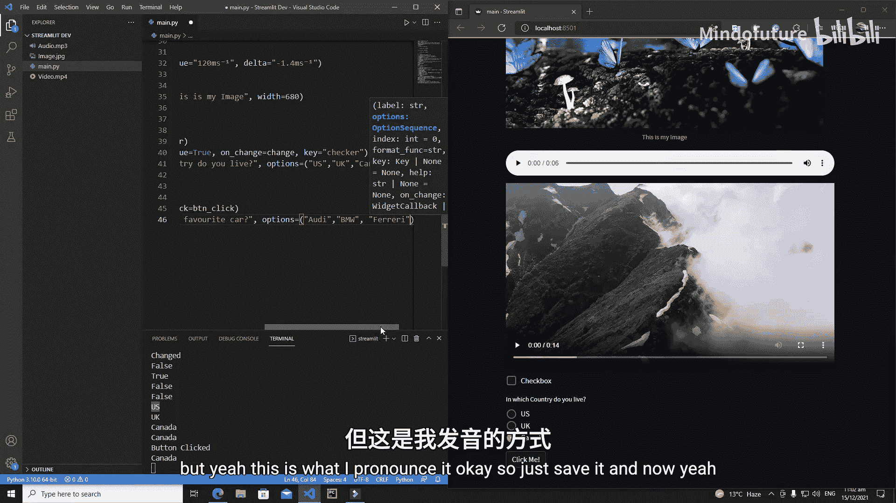

P，R I print， S， E， L E C select， Okay， and for now， let me commentend this part。 Okay。

 let me comment this radio button， sorry。Wride your button okay。

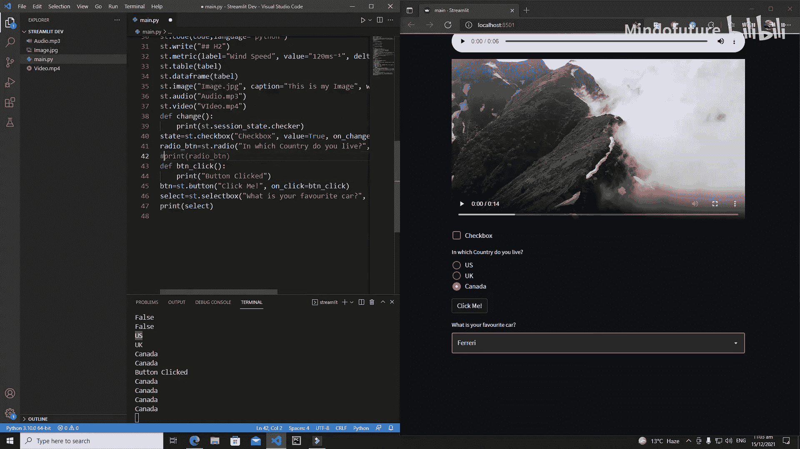

Read your button。 Okay， save it and rerun it redrun it and okay。

 so we have selected here Adi by default。 and as you can see， we have audio here。

 And if I select Ferrari versus Ferri here。 And if I select BMW you will see here BMW。

 So this is how the select box now final thing which I will discuss in this tutorial is the multiple select box。

 Okay， M I will write here M U LT I multi underscore S E L is multiselect is equals to S D dot I think M LT and multiselect and I will I also need to pass here a label and the options。

 Okay and as you can see we have on change property here as well and you can assign a special type of kit to this multi selectlect widget as。

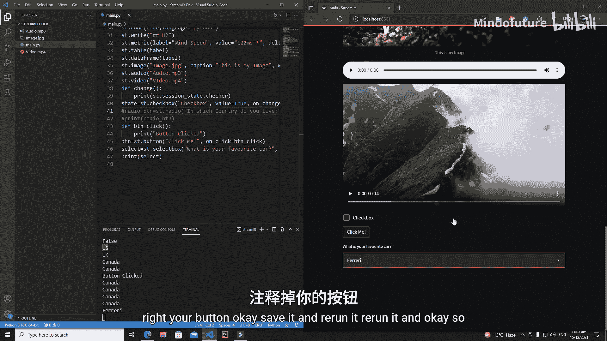

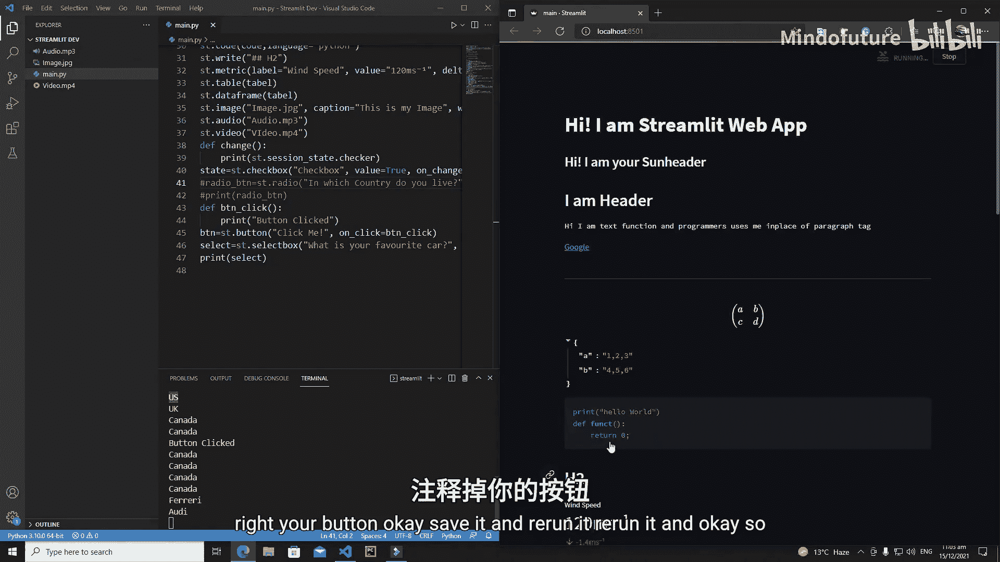

Okay， and just play with all these things because I hope that now you know very well about these functions。

 Okay， so let's assign a label to this。 and I will say what is。

Your F A V or your R I T favourite GP U or I will say what is your favorite， tech brand。

 Okay tech B R N D， what is your favorite tech brand， Okay。

 and I will pass my options or PD U options is equals to and Okay， so again， just close this thing。

 Okay， okay， so options and inside this options， I will say M IC R or S or FD Microsoft， okay。

 and then I will say A WPL E Apple， I will say M S on Amazon。Then or our aL Or。 Okay， the save it。

 I think it's enough。 and let's rerun it okay。

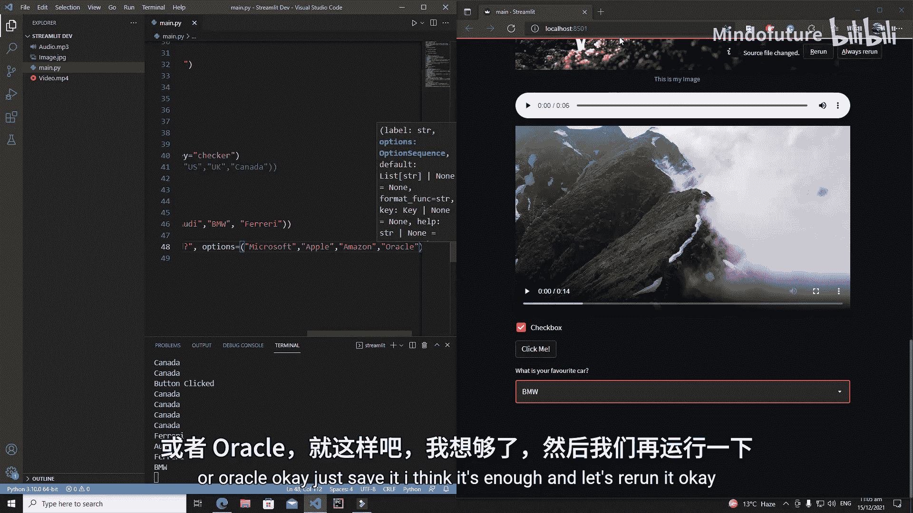

And okay， so what is your favorite tech brand。 Okay， choose an option。 You can choose an option。

 You can even select multiple options here。 like my favorite one is Microsoft and then my favorite one is this oracle so as you can see you can select multiple option you can remove these options as well and you can print these options on your terminal on or on this web app as well so if I write here PRri and print or not print I think I should print them on this web app so just write here do w dottri and then I will say M T multiselect save it and now I rerun and so currently list is empty so if I choose Microsoft as you can see we have Microsoft here and if I select Amazon as you can see on the second number。

 we have Amazon。And you can remove these two options with one click using this little cross icon okay。

 so if I click on it， again we have an empty list O。

 so I hope that you have enjoyed this tutorial and you have understood some of the basic interactive vis of streamlit and in the next tutorial we will see something new to that point to bye by。

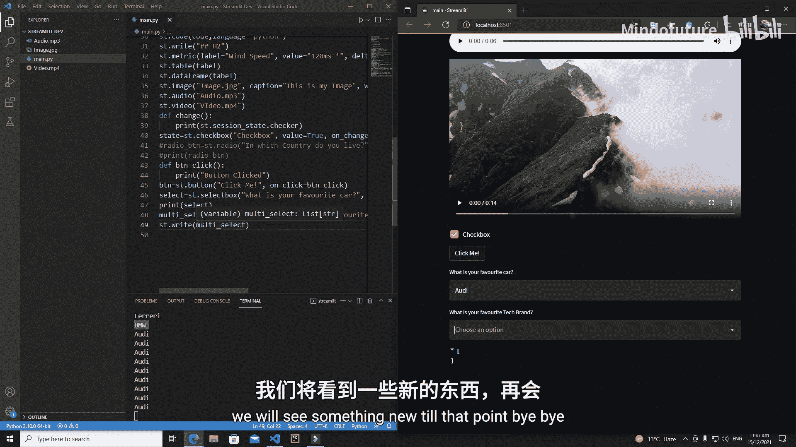