# Python-Streamlit-完全教程-p09-P09-File-Uploader-Widget-of-Streamlit---Complete-Streamlit-Python-Course---Strea--BV1yHVhz1EUD_p9-

Hi everyone in this tutorial we will learn how to upload files to your web app using Stamlight framework。

 so first of all， let me run this application new terminal O Stamlate Men Piva hit enter and this will open a new local host okay。

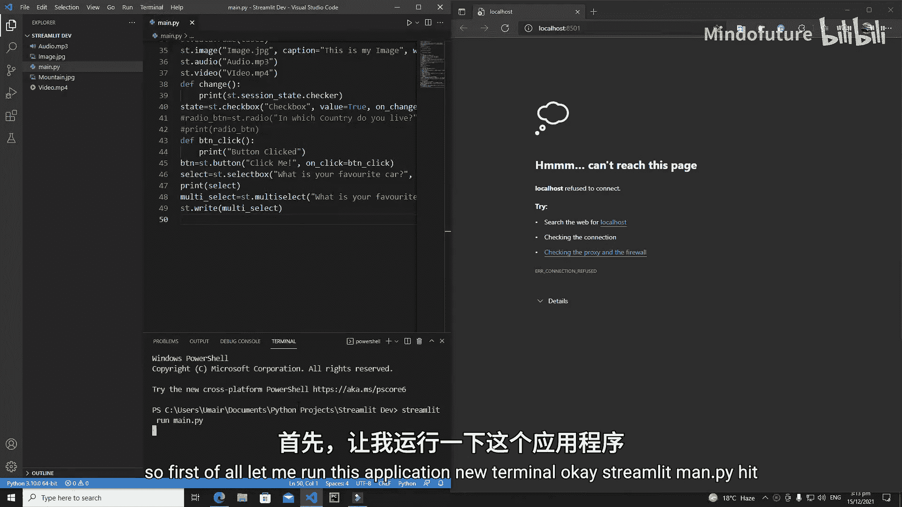

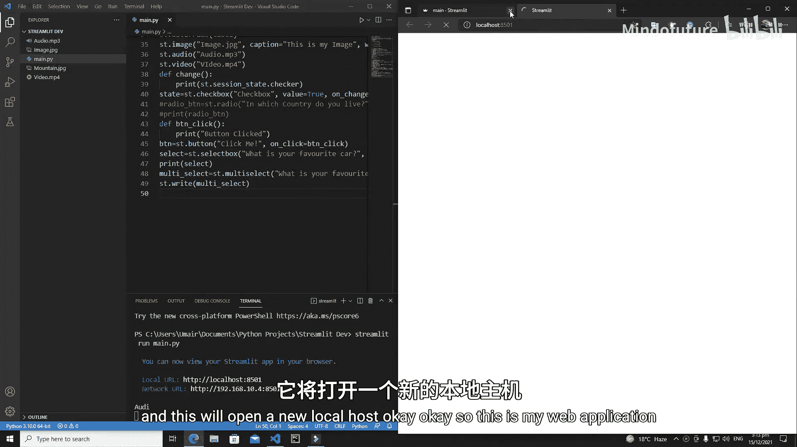

Okay， so this is my web application and first of all。

 I think that I need to clean this web application。 So let's remove some stuff。 Okay。

 like let's remove these lines， Okay， this I am these data frames， Okay。

 just save it and let's refresh it and how now how it is looking now okay。

 so I think it's much little bit cleaner Okay， but let's remove everything okay。

 but just leave the title okay， and inside the title， I will say UL orDI and you uploading FS files。

 Okay， and then I will set a mark down S dotmer mark now and I will draw here online Okay。

 just draw online here， save it refresh it。

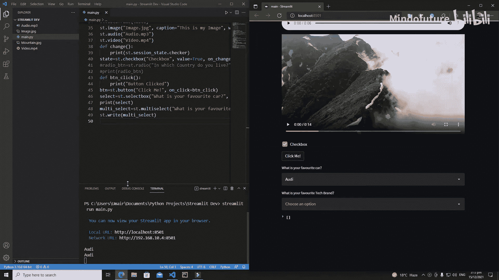

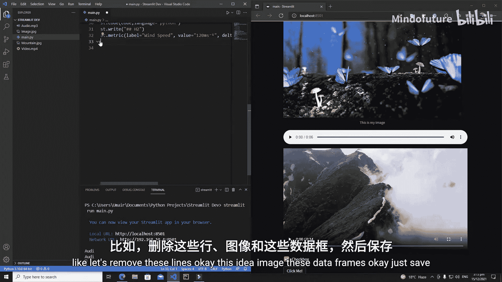

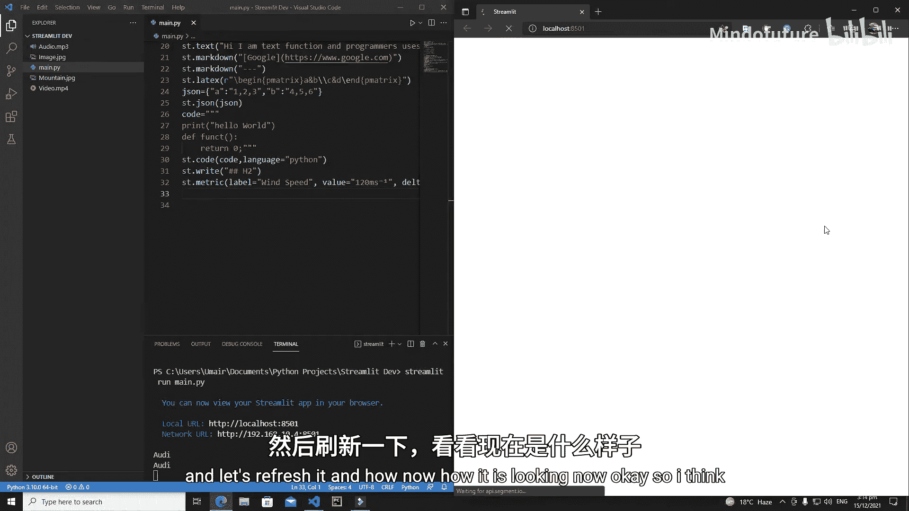

Okay， so uploading files and this is my line。 Okay， and now let's upload some files。 So for example。

 if I want to upload the images to my webb application and I need to display those images as well Okay。

 so first of all I need to upload it。 So just right here S dot file uploader okay and then inside of file uploader。

 we can pass different types of properties。 Okay so as you can see here， first of all。

 we will have a label okay， and in this case， my label will be like please。

You Poid upload an IMG E IMG please upload an image okay and then we need to define the type okay and in this case the type basically represents the extension of our file to avoid any type of errors okay and in this case as you can see here our type can be a string okay or it can be a list of string okay like for example when it comes to uploading images and image extension can be dot PG or the its extension can be JPg or JPEG okay so it totally depends upon the type of the image or the extension of the image So we need to pass here the list of all those possible extensions okay so let's create a list okay and first of all the possible extension is this PNng then we will have JPG okay and。

Think it's enough okay， so you can research for different images extension and I'll pass them all of these extensions as list here。

 Okay， and now I will save my this image in this imG image variable okay and first of all I will check that if my this IM image is not and I need none okay so first of all I will check if it is not none and if it is really not none then I need to display my that image so I will write here S dot imG image。

 and then I will pass my image here as well okay， and let's save it and let's rerun this application okay okay so please upload an image。

 This is our title。 Okay this thing and then we need to you can actually drag or drop file here or you can browse files So I will browse my files okay click on this and here。

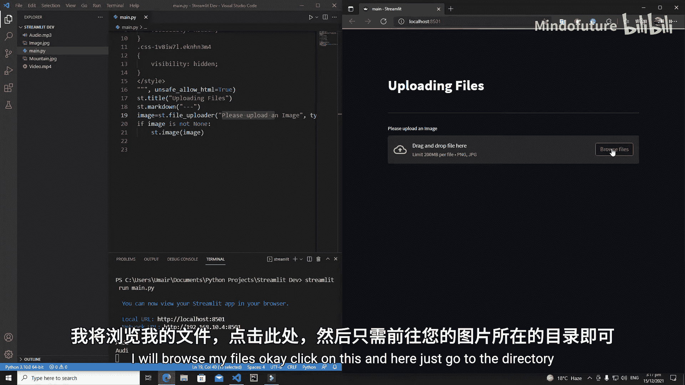

Just go to the directory where you have your images okay and as you can see I am in documents。

 Python projects and then in streamlet development folder and let's select this mountain and as you can see the extension of my this mountain if I go to the properties and I think in details it should be okay so here you can see that the file name is mountain or JPEG so it's a JPG version and let's cancel it and let's select it and just open it and this will open this image as you can see here we have the image and now it is displaying our image as well okay so this line is basically responsible for this uploader okay and while this section is responsible for displaying our image and you can even remove the image as well so if I remove this image what are you expecting fill this image remain on our web。

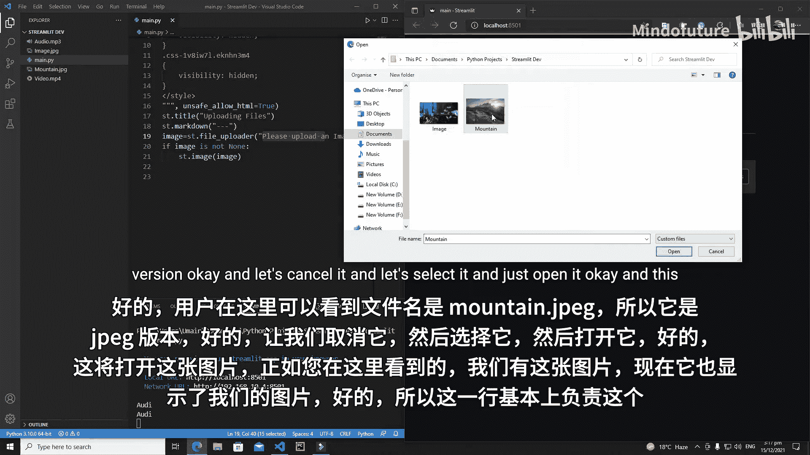

Or this streamlit will remove it。 So let's see let's remove it。 and yeah our image has gone。 Okay。

 so this is how you can upload images for example， if I want to upload my this video dotmp3 I just need to type my the extensions。

 my possible extensions here and my possible extension in case with videos is this MP MP4 okay but it's a single extension so I just need to remove these square brackets okay just save it now and let's read on it。

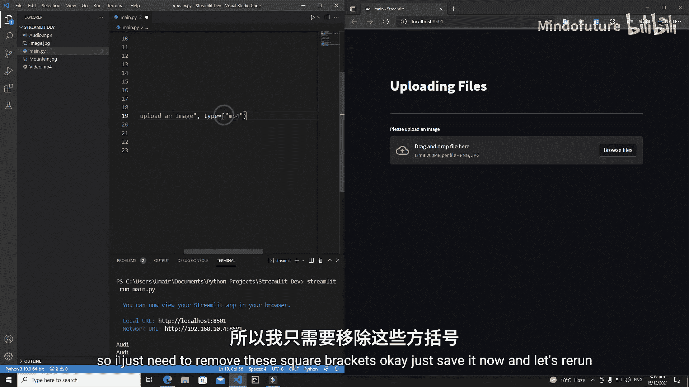

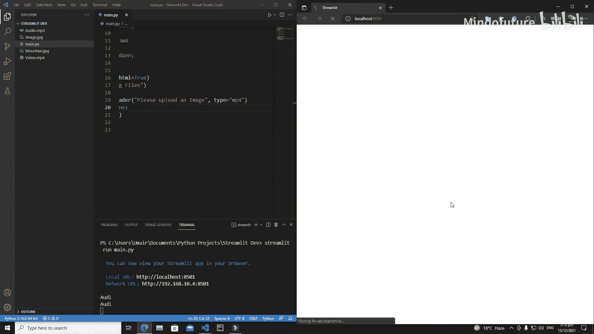

And here， please upload an image So it's not an image。 It is basically representing a video now。

 Okay， and just click on this browse files。 Okay， and as you can see， now it is omitting my image。

 Okay， and it is just displaying only those contents having dot MP4 extension。 Okay。

 so just select this video up on it and this will open， okay。

 so we got an error and this is because now we are actually embedding a video with this image function。

 So just replace this image with the video V ID video Okay， just save it and let's read on it。

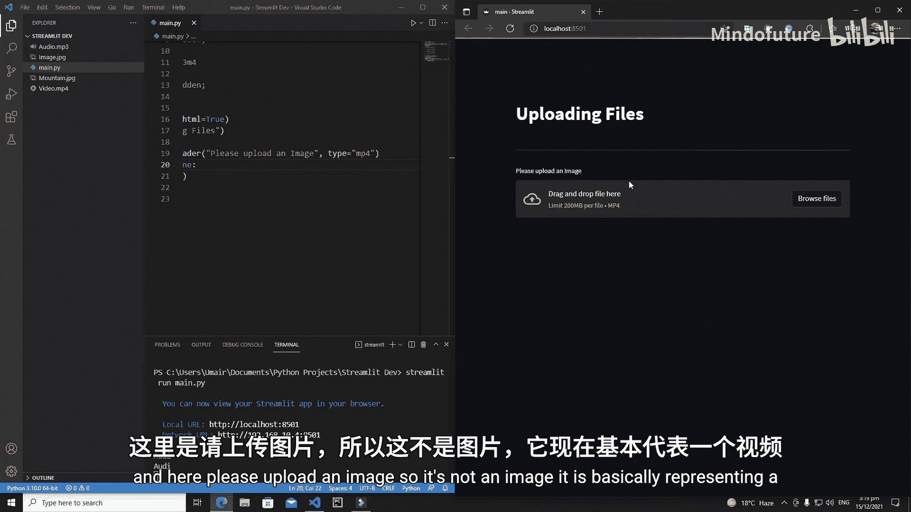

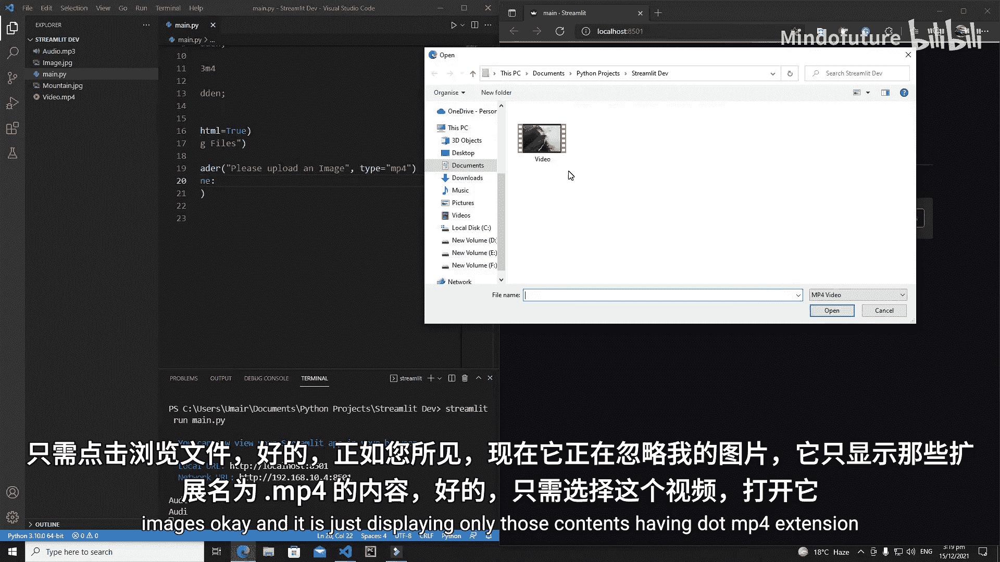

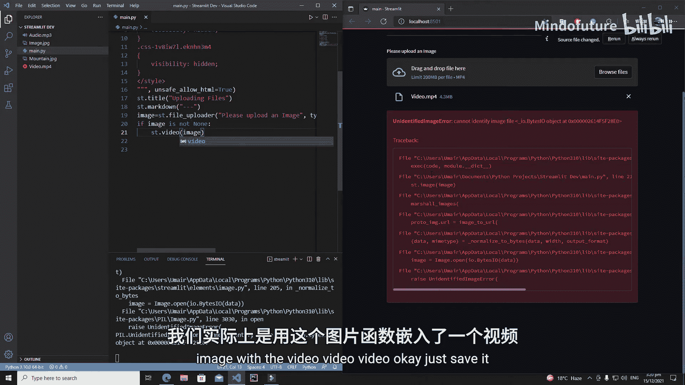

Browse okay video open okay and yeah this is our video you can play。

 you can play with this video okay and if I again remove it yeah our video has gone okay so this is how you can upload files different types of files so you can even upload multiple files as well like for example if I want to upload multiple images then here you just need to make one property to true and that is accept multiple files okay it's a boolean and the default values files so we will make it through in order to upload multiple files or in order to select multiple files and then upload multiple files okay so just right hereWCP accept multiple files is equals to TR true just save it and let me change this video to image again okay I am a G image save it now okay and now here we will select multiple files。

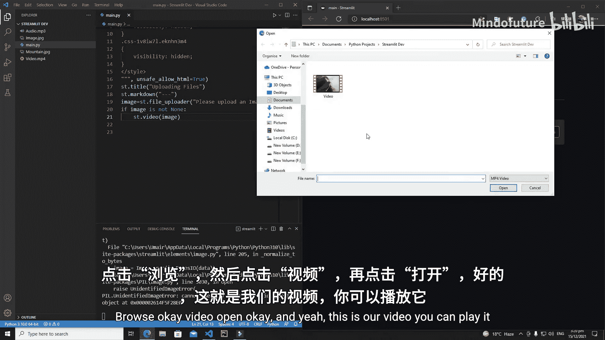

So I will sell all of my flag inside images， okay， and then I will fast check that if my images is not empty or it is not none。

 okay， and then I need to loop through each image okay。

 so I will write for I am AG image in I sorry I am AGS image okay。

 and then I will display my image here， okay， save it and now let's rerun it。

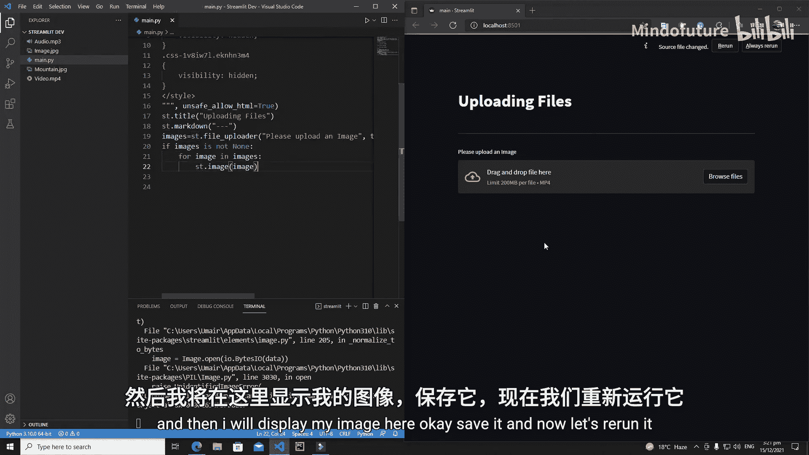

And browse files。 Okay sorry if we need to change the extension， the type。

 Okay and again I will pass a list here okay， and that will be Png okay and then JPG J E JPG or JPG sorry just save it and let's rerun this application select okay and now I can select multiple files So image1 hold control or I think command key on Mac okay and then select this mountain okay and as you can see we have selected two items and now then click on this open okay and this will open over two files and as you can see this is my image1 and this is my image to so this is how you can upload multiple files to your web application using streamlet file uploader function So I hope that you have enjoyed this tutorial and in the next tutorial we will see something new till that。

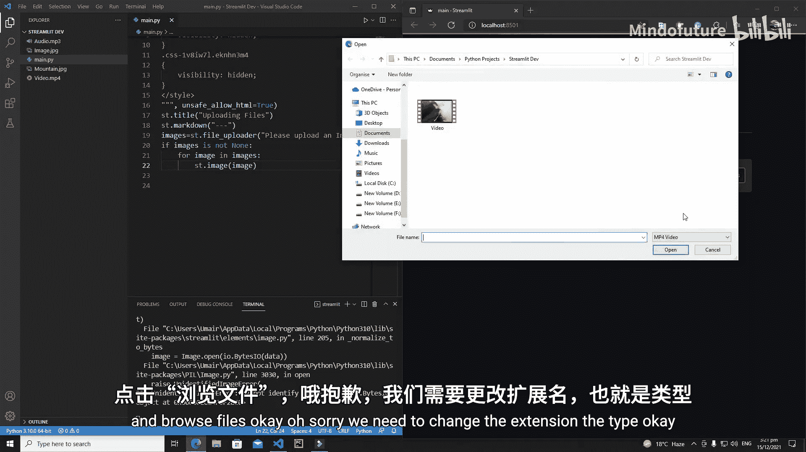

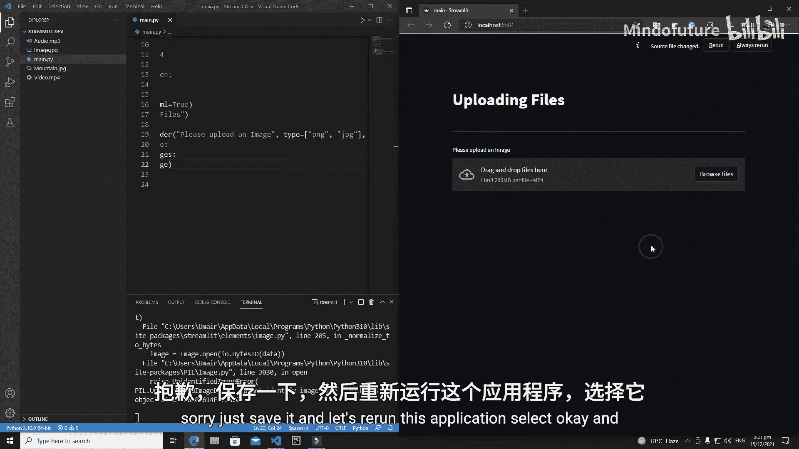

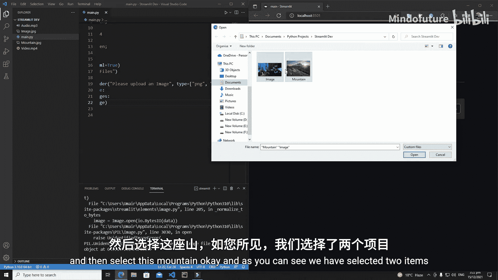

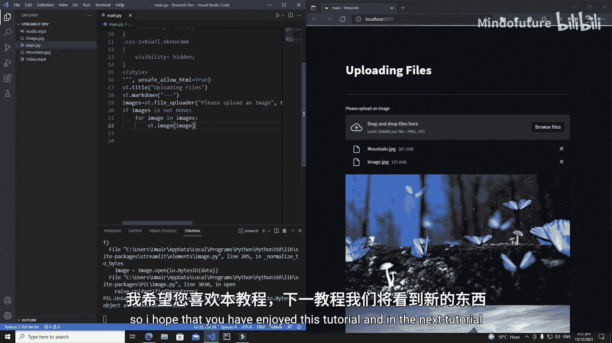

in bye bye。