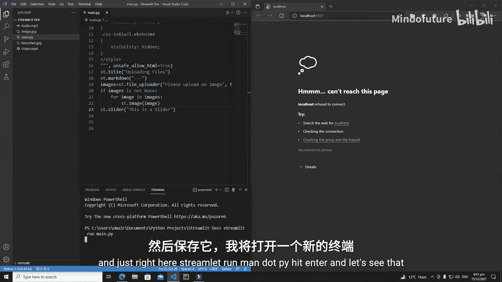
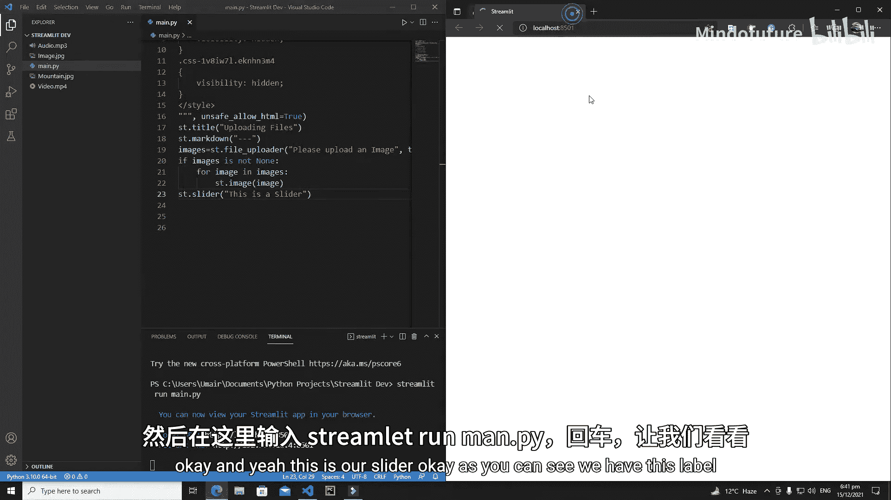
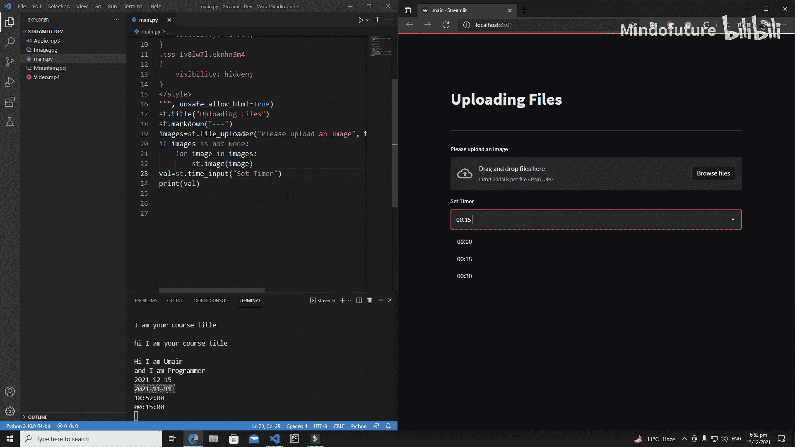

# Python-Streamlit-完全教程-p10-P10-Some-More-Interactive-Widgets---Complete-Streamlit-Python-Course---Streamlit--BV1yHVhz1EUD_p10-

Hi everyone in this tutorial we further talk about interactive widgets of streamamlit and first of all。

 we will talk about a slider， which is one of the most important widget of not only streamlit but of every other framework of Python and it's very important to discuss this one so previously we were talking about file uploaders and in this tutorial we will further talk about some more widget first of all let's create a slider here I will say S do slID or slider we have two options slider and select slider and there is a difference between slider and select slider and I have a homework and that is I will explain slider it's your homework see how select slider work and what is the difference between slider and select slider so a slider and then inside the slider we have a bunch of properties and first of all。

We have label okay and then we can define the minimum and maximum value of our slider okay and then we have a value property which basically represents our default value of this slider okay and then we have steps and formats and there are a bunch of properties and let's give a label to this slider okay this is basically a heading of our slider and I will call it like this is sorry this is SL idea or this is a slider okay a simple heading okay and then we you can define minimum and minimum and maximum value but I will not go with this values for now okay and just save it and I will open a new terminal and just right here streamlet run man P hit enterter and let's s okay and yeah this is our slider okay as you can see we have this level we have a slider。

So the maximum minimum property basically represents by this value and the maximum property represents my this value while the value represents the actual value on this slider okay and in this case。

 the value is 48 okay so this slider basically returns us this value as well so if I save my V value in this value variable and let's print the value of this V save it Ill value run and as you can see our value is 48 here because our slider is on 48 so if I move this slider to something like 715 you can see we have 15 here and if I remove it to 94 we have 97 first and then 94 okay so this is how the slider work and let's define minimum value of like minimum value of 50 and then maximum value of maybe like。

1，50， okay， and then the the value should be like something around maybe 70。 Okay， And let's save it。

 And yeah， as you can see now， the minimum value is 50。 and the maximum value is 1，50。

 And our slider is on 70。 And as you can see here， we have 70， okay。

So I hope that you have understood how slider work and again this slider has a callback property as well and that is I think on change okay so yeah here we have this onchan property okay I hope you know very well about this onchan property because in the previous tutorial we have talked about this onchan property okay so now let's discuss the next what I say the next interactiveor widget okay so I will remove by this slider for now okay and the next interactiveor widget which we will discuss in this tutorial is the text input okay so it's very very important to get input from the user and text inputs widgets are one of the most commonly used widget for this purpose okay so just right here text okay so we have here text area and text input so you can consider this text input as if you want the user to enter the title of。

okay so a short type of input okay and for that case we use this text input。

 but if you want to get a descriptive input from the user like a paragraph or a whole essay okay for doing a text mining and text analysis operation then you should use the text area okay so we will see both of them in this tutorial。

 So first of all let's discuss text input and will so the text or the heading for my this will be like E and your your maybe C orRC course enter your course title okay and you can define we have again bunch of properties like you can define the maximum number of correctors you can define the default string or the default text for your text input and I will discuss them in this tutorial as well so let's save it for now and let's see。

Okay so here we have this level okay which is enter your course title and you can enter the course title like I am your course title okay so it's an awesome line but yeah I am your course title so here you can see that we have a hint here as well which is this press enter to apply So if I hit enter as you can see。

 we have here the output I am your course title okay and now let's define the max maximum corrector for this as well max corrector is equal to and make sure that you should type here and in value okay so otherwise you will get an error like for example I want to get only 60 correctors okay so let's save it and yeah here as you can see we have0 out of 60 so I will write here sorry I am your。

C U RSC course， the IT the course title and as you can see here。

 we have 25 out of 60 Okay so this is how you can define the maximum corrector and yeah here we have the output as well which is I am your course title okay so I hope that you have understood this text input field as well and now let's talk about the text area field which I have mentioned that it allow us to get a descriptive input from the user okay so just right here text area okay and then let's suppose I want to get the course description from the user So I will write here CSC course。

 the SC I P T on course description and again you can define maximum correctors any call back so on change property it also supports on change property so if you want to call something on every change okay so let's save it and yeah。

Here we have this course description and now the area of this field is quite bigger than our previous text input field。

 Okay， so you can write here your whole essay or the whole description of the course okay。

 and there is a difference between the text input field and then this text area and that is let's suppose if I write here hi。

I am U am A Omer okay and if I want to write a new line on the next line Okay。

 so I just need to press inter okay and my cursor is now on the next line because in order to move the text from this text area field to the back and you need to press control key for less inter key So I don't know whether it should work on Mac along with the command and then enter。

 So just see if you are using Mac O then see here you will get the hint according to your OS okay so hi O I am O and I will say and sorry and I am PR G programmer and in order to submit this thing I just need to hold my control key and then I need to hit enter and yeah here is my output and that is I am Omer and I am a programmer。

 Okay so this is how this a text。Fiel work and the last two things which I will discuss in this tutorial is the debt input okay and the time input。

 So if you want to get debt input from the user， you just need to type here D underscore I input and I will say E your you an enter your registration so if you have such type of application where you you want the user registration debt okay so you can use this debt input so let's save it and yeah here we have this enter your registration so you can select any debt from this dropdown menu you can even click on this you can select the month so if you want to get the previous one month you can use thesearrows and here we have this debt so if I select this as you can see we have this debt here so if you want to get。

Time input from the user like if you are planning to create alarm clock okay or something like timer okay so in that scenario this time input field really help you okay because it allow us to fetch time from the user okay so I will say Ts like SCT set TER set timer7 okay Kenya here we have this 1852 which is the current time okay so you can select 15 seconds okay you can select 30 seconds you can select any time here okay so I hope that you have enjoyed this short tutorial and in the next tutorial we will see something new about streamlit and I will see in that tutorial till that point bye bye。

