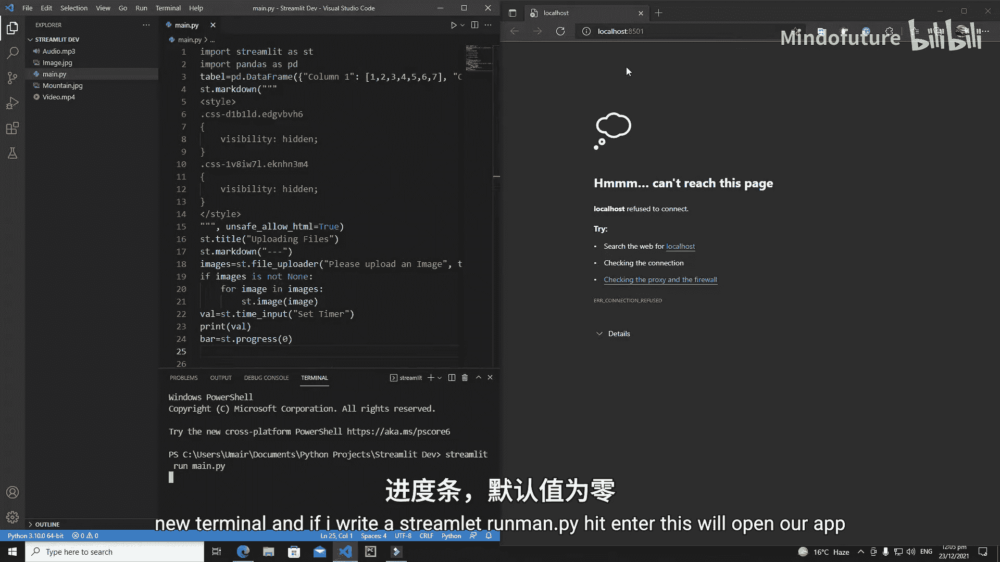
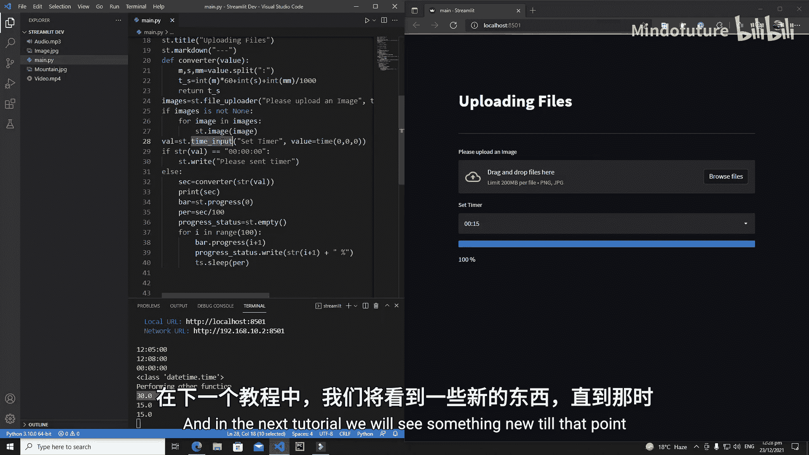

# Python-Streamlit-完全教程-p11-P11-Timer-App-With-Progress-Bar---Complete-Streamlit-Python-Course---Streamlit-T--BV1yHVhz1EUD_p11-

Hi everyone in this tutorial we will talk about progress bars so I hope that you have an idea about how progress bar looks like but yeah first of all I will just give demo of how progress bars looks like and then we will do some what I say complicated work regarding progress bar so first of all let's create here a simple progress bar so I will create first bar here okay and then I will increment values in the progress property of the progress bar okay so just right here S do progress progress and by the default value of this progress bar will be0 okay and this line will basically create progress bar okay and now if I save it and if you open a new terminal and if I write streamlet Py hit enter this will。

Open our app here。 Okay so。Here is our app。 and as you can see， we have here a progress bar。

 but currently the progress is 0 because we have set its value to 0。 okay。

 and now let's increment this value。 Okay， so I will write here for I in N range maybe 10 okay so let me mention you here that this progress text values from 0 to 100 okay and and those values should be in teachers okay。

 no lot and nothing else。 Okay， so I will complete the progress of this progress bar in 10 steps okay so that's why I'm writing here range 10 okay so just put column here okay and now I will say B R board or PR G R ES progress okay and every time I will use the value of I and I will multiply that value with 10 okay so if my I is 0 then this means that our progress will be0。

But if my eye is one， then our progress will be 10% and if my I is2。

 then our progress will be 20% and so on But here let me mention you that the value of I will start from0 and it will go to9 and that's why we will get an error or not an error but a weird output so in order to solve this problem we just need to add one in this i value okay and then we need to multiply that value at 10 okay and I hope that this will solve our problem okay and I will also wet for some time period because if I run it you will see that we will get a 100% output because we are not we and this function the CPU will calculate this function so quickly okay so we need to wet for some time period and for this purpose I will use a time module okay so just import IMP or the import the IME time okay and now that's。

Right here T IM time dot S l wピ sleep。 sorry S lWピ sleep。 Okay， I will sleep for one second Do。

 So let's save it。 Let's read on it and see。Okay， it's good， good， good， excellent。

 It's working very， very well。 Okay， and this is how a progress bar works。 Okay。

 yeah complete it Okay， so I hope that you have understood how this progress bar works okay and now here I am thinking that I will ask user to enter time okay here using this timer and then I will complete the progress of this progress bar using that time period。

 okay， and for this purpose first of all the default value of our this timer will be 00 Okay。

 so I need to set a value here as well， okay， so I will write value value so value is the builtin property which allow us to set the default value of our time input widget okay。

 so just right here value okay now make sure that this value should your that time object okay and it means that in order。

To set the value， we can't write here like 00 or maybe something else。 Okay。

 we can't write here integers。 we can't write here strings。 Okay。

 so the only solution for this is to use a that time object okay and I need to set time period for this value property and for this purpose。

 I need to import my dead time module and from that that time module I need to import my time okay so I will write here from D time okay from that time sorry from that time I import time。

 okay okay， so now here we have this time and here we have this time as well。

 And if I run it you will see here and error So how to solve this problem So the solution is very simple I will import this time as my T S okay so time second and here I will change this time from time。

To TS now you will not get any any type of error and here in the value， I will say that time。Okay。

 time， okay， And then inside this time。 I need to pass my hours and then minutes and then seconds。

 Okay， so my hours will be 0， then my minutes will be 0 as well。 Okay， and then my seconds will be 0。

 or you can pass a milliseconds microseconds as well。 but I will not go in that much detail。 Okay。

 so this is how you can set the default value of this time input。 So if I run it。And yeah，00。

 we are getting 0，0。 Okay， so it's cool。 Now the user need to select any time period。 Okay。

 so this is my 15 seconds，30 seconds。 Okay， so I need to complete this the progress of this progress bar in that time period so I will use this value okay and first of all。

 I will check that if my well is empty or if my well is basically is 00，0。

 then I need to ask user to enter time period， after entering time period。

 I will start my other function。 Okay， so but first of all， before I done this type of operation。

 let's see the data type of this value Okay， so let's print here print t Y P type V value let's save it and let's rerun it。

😊，Okay， so as you can see here， the data type of this value is this。 Okay。

 and now in order to check for this type of value， I first need to convert this value to a string variable okay and then I can check it with a string value。

 Okay so just remove this line。 Okay， and I will write here if my STR， okay。

 I need to convert my this value to string value is 0，0， then 0，0， and then 00。 Okay。

 so if my value is sorry double equals to this type of value。 Okay。

 and the default value will be this type because we are mentioning here，0，0，0。

0 Okay so this will be the format and if this is true。

 I need to write S do wr right here right okay and I will say please set D IM here please set timer okay。

And else， ELSE else， I will say， maybe I will print a message。Performing other function。 Okay。

 the R or RM A performing other。Function okay， so I will later perform another function and let's rerun it Okay。

 please set time timer okay， let's set a timer to maybe 15 seconds Okay， and okay。

 so perform other function Okay so this is how you can process this thing。

 but as you can see here we are now getting these two bars okay and the reason is that first of all it will run this part and then it will run this parts And that way we are getting this type of output。

 but don't worry we will solve it in a bit later Okay so。Now inside this L。

 I will perform my other functions okay so I will remove this part okay and let's make this part inside this L this for function as well this thing then this thing okay so it's cool and let's indent it as okay so first of all if user selects a timer I just need to convert my hours and minutes and seconds to seconds value as well okay because this time dot sleep basically takes value in seconds so I need to convert this value to seconds as well and for this purpose I will create a separate function so let's create here a function that will convert my values from dead time objects to seconds okay so let's type here your enV。

T your converter， okay and this function will take L U E value Okay and I will pass my this value as a string and first of all I need to extract my hours then I need to extract my minutes and then I need to extract my seconds so I will write here H M and seconds is equals to and I will say this value via L E value dot S I split so I make sure that you should pass your values inside this function as string because this split function will never split your values if you do not pass values in form of a string and okay so I hope that you have understood and now I need to pass a special type of symbol for splitting and that symbol in this case will be my dis column because as you。

See here we have column here column here as well。 Okay， so this is my hours， minutes and seconds。

 Okay， but let me mention you here that we in this set timer， we just have this minutes。

 then this seconds minute seconds So we doesn't have any hours and we doesn't have any milliseconds Okay so here let me make let me clear your concept that this split function will basically give minutes inside this h variable。

 Okay and then second inside this minute variable and then milliseconds inside this S So I just need to make a correct naming for this thing as well Okay so this will be my minute this will be my seconds and this will be my milliseconds Okay so now I hope that this will make a So whenever we split values of this well variable we will hold our minutes inside this our second sorry seconds。

this and milliseconds inside this okay and then I will convert minutes and secondsd and milliseconds to seconds okay and I will hold my all values inside this Ts variable which is total secondsd okay so I just need to first convert my this minute to integer value because currently our this minute will be a string okay so just convert it to integer okay and then I will multiply it with 60 because in a single minute we have 60 secondsconds okay and then I will add my integer I will add my this seconds to this value and then I will add my this milliseconds to it as well okay so I will write here and then milliseconds okay in a one second we have 1000 milliseconds okay so we need to divide this value with 1000 okay so this is just a basic math okay and then I。

Need to return this T S variable。 Okay， so return T underscore S。 Okay， let's save it。 Okay。

 so now this is the function， which will convert my this value to seconds value。 Okay， and now here。

 first of all， I just need to pass my this value to this function。 Okay。

 so I will write here's your n V out your converter。 Okay， and I will pass my this value as a string。

 Okay， so string this value。 Okay， as you can see here。

 this function will return this T underscore S。 Okay， sorry T and then small S， okay。

 so T underscore S。 So I need to I will store that value to inside this SEC variable。

 Second variable。 Okay， and then I will set my bar to 0。 and I will say for I in pro in range。

 And here instead instead of 10， I will say in range 100。

And here you just need to understand the logic that now I need to divide my these seconds into 100 parts in order to increment equally in this progress value each loop okay and for this purpose we just need to divide this seconds by 100 okay and this will give us what I say a percentage value okay so let's right here par is equals to Se divided by 100 okay we need to divide this seconds with 100 okay in order to get 100 parts equal parts of this seconds okay and then I will say that bar progress I just need to remove this multiply 100 okay so every time I will increment in this progress with one okay and now for the Ts do sleep I will just sleep for this person second。

Okay， so just right here P person Okay and now we are basically what we are doing here is that we are completing the progress of this progress bar in this time period。

 okay so if a user enters 15 seconds we will complete the progress of this progress bar in 15 seconds if user enter 100 seconds。

 we will complete the progress of this progress bar in 100 seconds and this process will goes on okay so I hope that the logic is a little bit tricky but I hope that you will understand it when you will write this code by your on self okay so now let's run this thing so let's read on it and first of all I will say please set time and I need to complete the progress in 15 seconds so let's select 15 seconds Okay so now our progress。

Bar will complete the progress in 15 seconds， okay。

Cool locus our progress bar has completed the progress in 15 seconds okay and if I print here these seconds you will see that we will get 15 seconds output as well locus of 15 seconds and let's read on it。

😊，Okay， so here you will see that if I select 30 seconds， you will see here 30， okay。

 so as you can see we have 30 here and now our progress bar will complete its progress in 30 seconds。

Okay， so it is taking so much time because we have set our timer to 30，30 seconds， okay？

But I hope that you have understood this thing so this function will convert our values from minute secondsds and milliseconds to seconds okay and then we are actually setting or creating our progress bar here we are incrementing in our progress bar and here we are this is our vet time period so this is basically responsible for completing the progress of our progress bar in certain time period which we will get from our user using this time underscore inputwiget So I hope that you have understood how this progress bar works on how to set timer and here in the last I will also I just need to print the percentage of my this progress bar here down here as well and for this purpose I just need to use ST do wIt write function。

And I will just print the value of I。 okay， and along with a person that sign。 Okay， so this person。

 But yeah， again， this I is an integer。 So you will get an error。

 So we need to convert this integer to a string Okay， so just write here， S D R。 Okay。

 and let's save it and let's rerun it and set the timer to 15 seconds。 Okay。

 so we are getting very weird outputs， let's stop it。 Okay， so every time this function loops。

 it creates S dotri widget again and again， okay， and I do not want this type of output。

 in order to solve this type of problem。 we have an other builtin widget of string it。

 And that is known as empty wget。 Okay， so first we need to create an empty widget。

 And then I need to change the value of that empty widget okay， so here。

I will write PRRO GR ES progress underscore underscore S A US progress status is equal to S dot E dot impity Okay and this will be my empty widget first and then instead of this S I will say PR GR ES progress status Okay do't write and then I need to write my values okay so let's save it and I also need to implement the i value here as well。

 So let's save it and now let's rerun it and you will get your required output。

 So let's set 15 seconds。 And yeah this is what I was talking about okay so 2023。

230 okay so cool we are getting our required output。

 So I hope that in this tutorial we have understood each and everything。

 So we have covered what I said three basic concept。

 So one is the concept of progress bar other one is the concept of this。

Widget and the second one is the concept of these， this function and this value。 Okay。

 so which is the property of this timer score input widget。

 So I hope that you have enjoyed this tutorial。 and in the next tutorial。

 we will see something new till that point， bye bye。😊。

