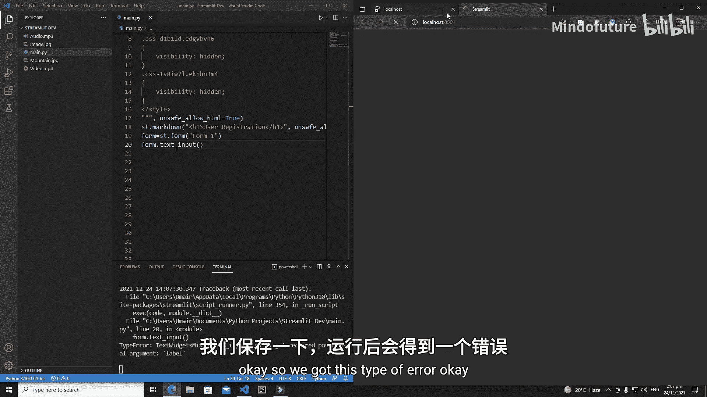
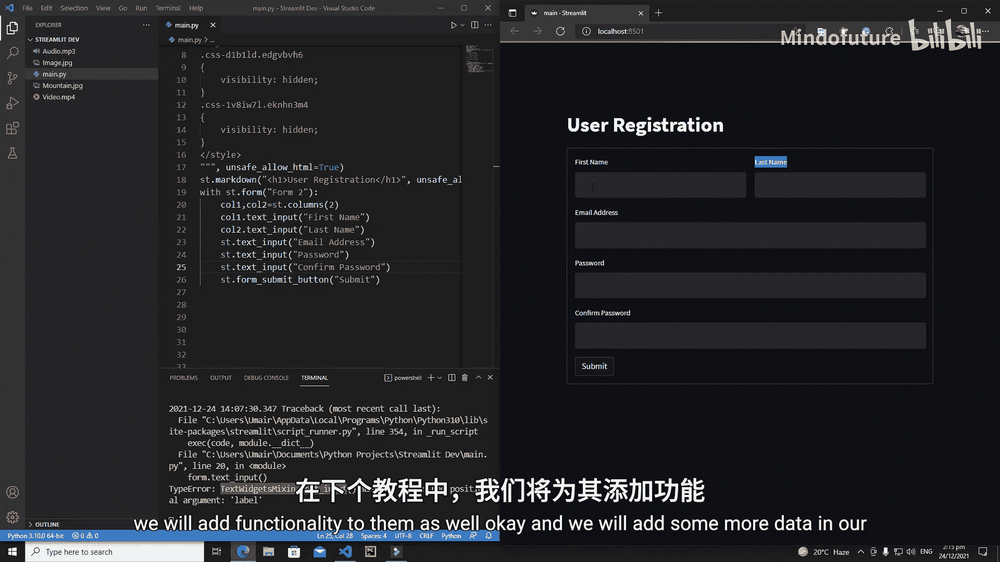

# Python-Streamlit-完全教程-p12-P12-Streamlit-Forms-I---Complete-Streamlit-Python-Course---Streamlit-Tutorial-12--BV1yHVhz1EUD_p12-

Hi everyone in this tutorial， we will talk about two different widgets of streamlit。

 One is the form widget and the other one is the columns widget。

 So the form widget basically allow us to create forms in streamlit application。

 And I hope that you know very well what are forms okay so whenever you want to register a user。

 you need to create a registration form and whenever you want to sign in or something like that。

 you need to create that particular form okay and now columns widget basically allow us to lay out our streamlit app and it basically divides our the screen into columns so that we can put different widgets in different columns separately so we will combine this to widgets and we will create user registration form in streamlit。

 So first of all。Think I should remove these lines。 Okay， so just remove them。

 I need to remove it as well。 Okay， and here in the S D dot title， I will remove this S dot title。

 and I will just try to mark down here or S dot M R D or WN mark down and this will be my let's go with H1 tag here Okay。

 let's slash h1 Okay and inside this H1 I will say user R E G I S D R T I or and user registration。

 Okay and here I will say you an S and allow hMl T are U true Okay it's cool this will be my what I say the H1 tag and now let's create a form here。

 So the streamlet basically provide us two different methods to create a form。

First method is that we will first create an object of our streamlight form。 Okay。

 and then with the help of the dot operator， we can add widgets to that object。

 let's see how it works。 So just create a form object and I will say do form form and then I need to give a name to this form。

 Okay， so in this case， the key of the form is a mandatory and if you do not try it here a key for your form。

 you will get an， so I will say R form1， so this will be my form1 and let's save it and if I say S R stream I and run I dot P before I run it let's add something to this form as well so let's add an input text so。

Of writing here like S D dot T， X D text input。 Okay， I will write here F or R form dot text input。

 Okay， so I need to make this text input widget inside this form。 Okay。

 so that's why I'm writing here like this。 okay， now。

 you can define properties to this text input as well， but I will not go with them for now。 Okay。

 so let's save it。 And if I run it。 You will find an error here。 Okay。

 I will tell you why we are getting this error。Okay， so we got this type of error okay， which says。

 okay， so text input missing one required argument。

 okay sorry so we need to define here the label for our text input okay like F the first and first name。

 let's save it I wasn't expecting this error so let's always rerun it Okay so I was expecting this error which says missing submit button。

 Okay， so whenever you create a form， you need to create a submit button for that form as well otherwise you will get this error。

 So now how we can create a submit button for this form， the process is very simple。

 you just need to writeM form dotM form underscore S MIT submit underscore B or and button okay and here you need to define a label for your button and I will say SUB MIT submit。

Let's save it。 And yeah， this is what I was talking about。 Now。

 this is our submit button for this form。 And as you can see we have here this text input。

 okay and this is the boundary of our form okay so I hope that you have got an idea how a form looks like in streamlit web and this was the first method okay and now let's talk about the second method of the form creation in streamlit as well okay and that is with the help of with keyword okay so with the help of with keyword you can create a form in streamlit as well okay like if I said wDT with S do4M form okay and I need to define key for this form and I will say4 form maybe form2 here in this case。

 okay and now inside this block anything you will defined will be inside this form okay so like for example。

 if I want to create。A text input in this form as well I will I just need to write here S dot TxD text input okay now in this case I will not use the object of this form because I'm using this width okay and now this part is inside this so the streamlit will create my this text input inside this form okay so we have S dot text input I need to define a label and I will sayD first and name okay so if I save it here you will get an error again okay okay so we got an error again and that is we have missing submit button okay so we need to create a submit button in this case as well now the creation of submit button in this case is also a simple process just right here S do form underscore submit button and I will say SB MIT submit let's save it and yeah this is my submit button so I hope。

You have understood both methods of creating forms in streamlit application and now let's talk about columns so columns basically allow us to divide our streamlit app screen in columns okay and now in many many user registration forms you have noticed that on our left side we have first name okay and then in front of this first name the registration form ask for last name as well okay and now in order to obtain that feature we need to split this form into two pieces or into two columns and we can done this process with the help of columns widget of streamlight okay so let's create a columns widget here okay so I will say SD do C or LumMMS columns okay and then I need to define my number of columns okay and want I want to divide my this form in two。

so I will write here two。 Okay and now this S dot columns basically return us number of columns as well like if you write here to。

 this will return us two columns if you write here3， this will return us three columns。

 So now in this case， it will return us two column。

 So I will save my column1 in this call one variable and then C 2 equals2 okay so I will have my column1 in this variable and I will have my column2 in this variable。

 Okay and now now if you write this line outside the form。

 So then this column widget will divide your whole streamlit web app into two different columns。

 Okay so let's come to our actual project。 And that is I need to create my this first form input widget on my left side and then my last name text input widget on my right side so here instead of now writing S do。

The widget name。 I will write here， see L1 column 1 dot text input okay and if I save it here。

 you will see the difference。 And yeah， this is the difference。 Okay， so now about this first name。

 this text input is on my left side and now in front of this first name let's create an other text input as well。

 okay in this case， I will use C call2 okay and I will say dot tx text text underscore the score I and P input okay and I will say last and last name let's save it and yeah this is what I was talking about now we have this first name we have this last name here okay and now beneath these two lines we have like email address and then we have password and then we have confirm password area as well。

 Okay so let's create those inputs as well。 Okay so now here。Will not use this column 1 and column 2。

 Okay， so I will just simply use my S dot T X D text form input。 Okay。

 and I will say N TR enter or not maybe just email address E A D or ES email address。 let's save it。

 and yeah we have here our email address。 Okay， and now let's create a password and a confirm password section as well。

 Okay， so let's write here S D dot T X D text input。 Okay， and say password P A S W R D password。

 Okay， and let's copy this line。 Okay， let's copy it copy and paste it here。 Okay。

 and let's say confirm passwords and I confirm password。 Okay， let's save it。

 and yeah we have email address。 We have password and confirm password。

So this is how forms work and this is how these columns work and now in the next tutorial we will add functionality to them as well okay and we will add some more data in our this form and I will see you in that tutorial till that point bye bye。

