# Python-Streamlit-完全教程-p13-P13-Streamlit-Form-II---Complete-Streamlit-Python-Course---Streamlit-Tutorial-13--BV1yHVhz1EUD_p13-

Hi everyone in this tutorial we will add some more features to our form。

 but before I start editing my form， I think that I should align this user registration in the center and for this purpose as you can see here we have used markdowns So if we have used markdown。

 then this means that it will allow us to play with the htM and and CSS okay so I will use a CSS styling property and that is a text align basically okay so I will write here S style is equals to and then these single courses now inside these single courses。

 I will write Txt text dashigg and text align and then I will put these columns and then I will say CN to your center and then this semicolon now let's save it and yeah we have aligned this user registration in the center。

The screen。 Okay and now let's come to the form。 So now inside the form。

 I need to add three more text inputs， okay， and I will divide my this form again into three different columns and I will ask for dead of birth from the user Okay and for this purpose my one text input will represent the dead。

 the other one will represent the month then the other one will represent the ear。 Okay。

 so let's divide this form into three more columns。 okay。

 and I will say like okay De then O NH month， okay， and then y E y E E okay。

 so these are my three variables which will hold columns okay and let's write here S dot C or L columns。

 Okay， and let's divide our form into three columns。 Okay， now inside this De column I will write。

t TX text text underscore IN P text input and I will say D Y there Okay so I will ask user to enterde here okay and then I will say M O N TH month dot TX text underscore I N P input okay I will say M O N TH month okay and then I will say what year yeah Y E E dot TXT text underscore I N P input okay and I will say Y E R E let's save it and yeah here we we have our output button yeah as you can see here。

 our submit button is above over this data okay so let's cut it Okay cut and let's past it here let's save it and yeah now it is looking good okay so this is how you can create a form and now。

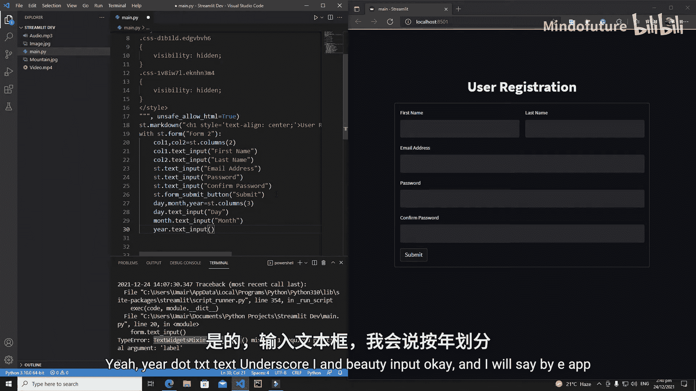

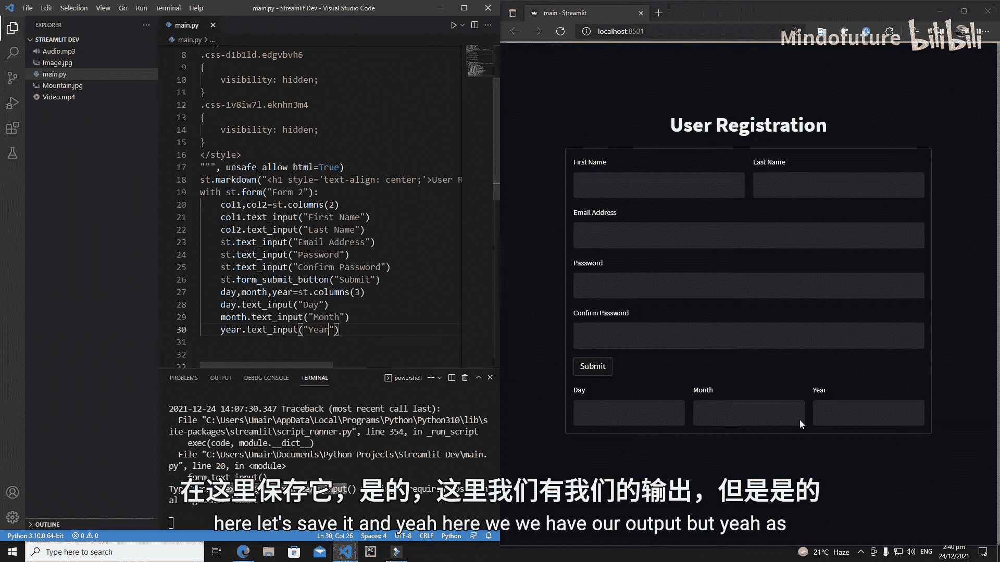

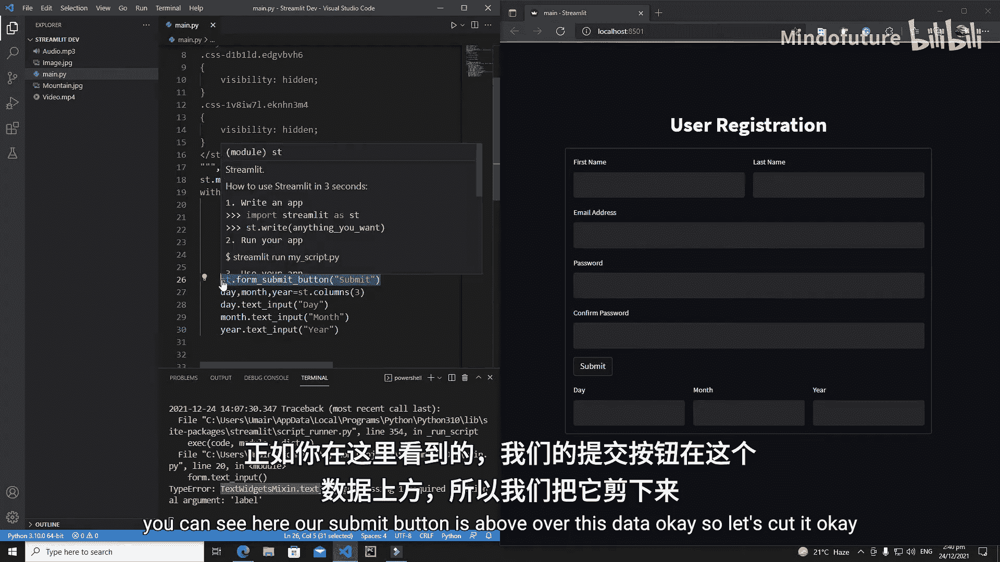

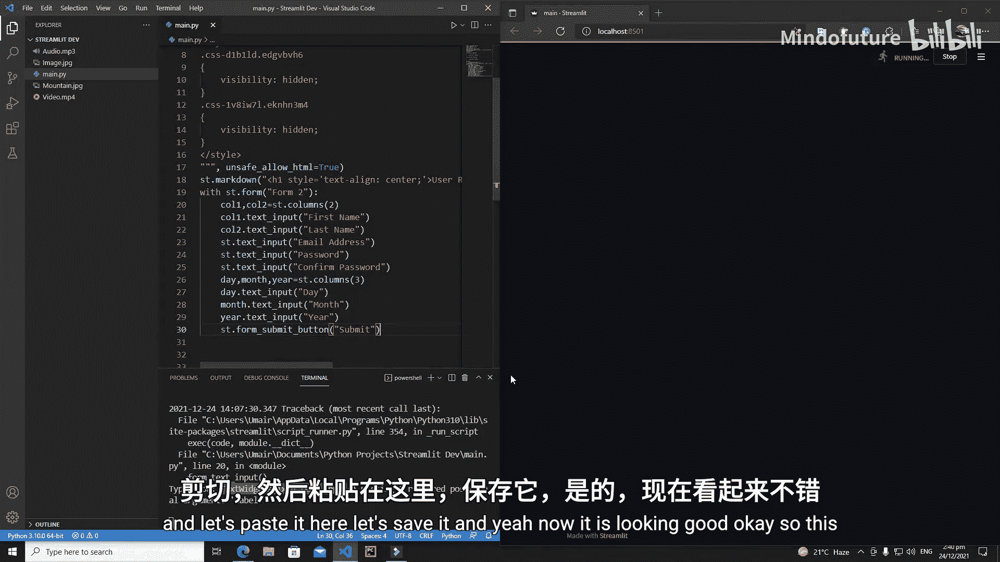

Let's add functionality to this as well。 Okay， so I will save the first name inside my underscore and name variable。

 Okay and I will save my last name in this underscore an name variable is equals to okay and you can assign your email address here this password and confirm password yeah now I think that it's easy process for you and just do this by your own self and I will just play with this first name and the last name Okay and whenever a user clicks on this submit button。

 I will check that and I will actually first save the state of my submit button as well I will say S underscore is equals to this and I will say that if S underscore state is equals to true so if someone clicks on this submit button first of all。

 I will check that if he has。T information in this first name， text input。

 And if he has entered information in this last name， text input widt。 Okay。

 so I will say that if my F underscore and name equals to empty okay and I will also check for last name as well L underscore name W equals to empty。

 So if our these two fields are empty I will print here a warning message。

 So now the streamlit also provide us some built in messages as well， Okay。

 so I will print here a warning message， we have a success message as well。

 we have an error message as well。 Okay， so in this case。

 I will go with a warning message and I will say S T dot W R N IH warning okay now the text of my warning will be P L E。

 please fill。

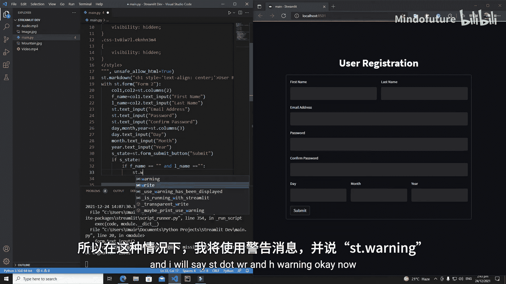

Oh the above F Ie LD S fields。 Okay， please fill above fields。 Okay， small left。 let's okay， so。

 and I will also put here an L statement as well。 Okay else if user has entered the first name。

 last name and and everything else。 I will print a sex message。 Okay。

 so I will write here S D do S U W C W S sexes。 okay。

 and I will say S U B M I W TD submitted S U W C， E W S F U W successfully let's save it okay。

 and first of all， I I just click on the submit。

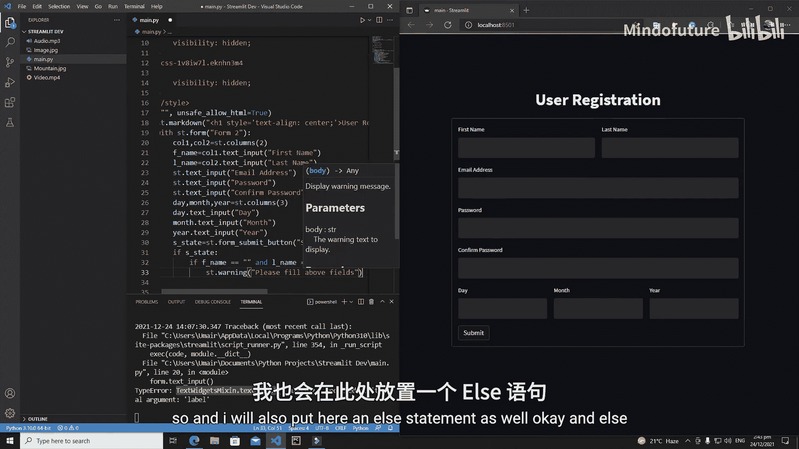

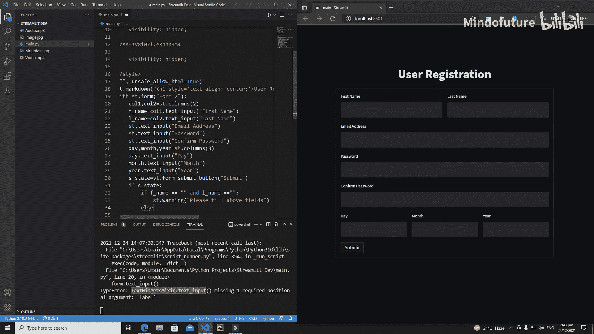

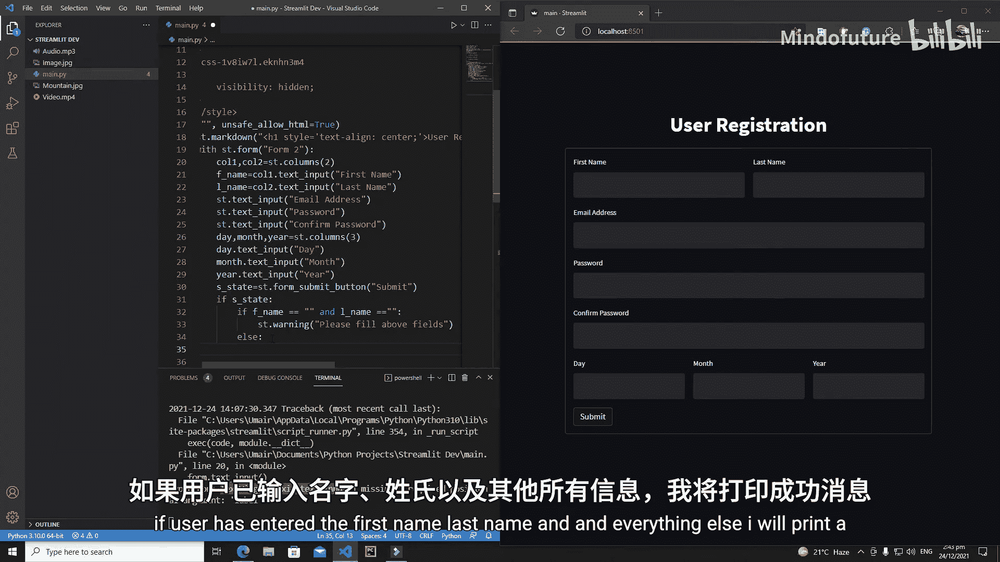

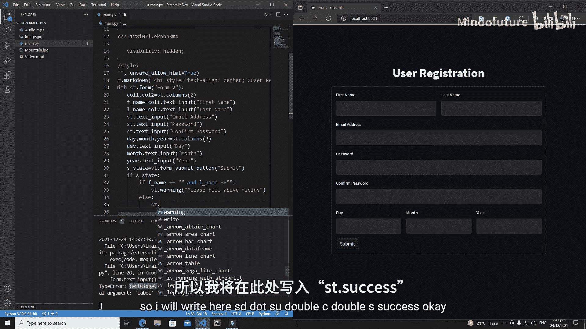

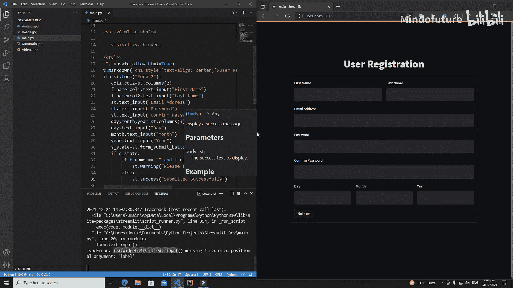

Okay， so we got this evolving message which says please fill above fields okay and now let's fill the above fields and my first name is like a on okay and minus last name will be what I see maybe picture or quite very weird but yeah and let's click on the submit and yeah submit it successfully okay so this is how you can do this process and now let me mention you one more property of this form and that is if I put comma here。

 you can see that we have clear underscore score on or score submit okay so whenever a user clicks on this submit button it will submit the information to the database but it will clear all the information entered on the registration form as you can see here we have the name here as well after submission we have one last name as well after submission。

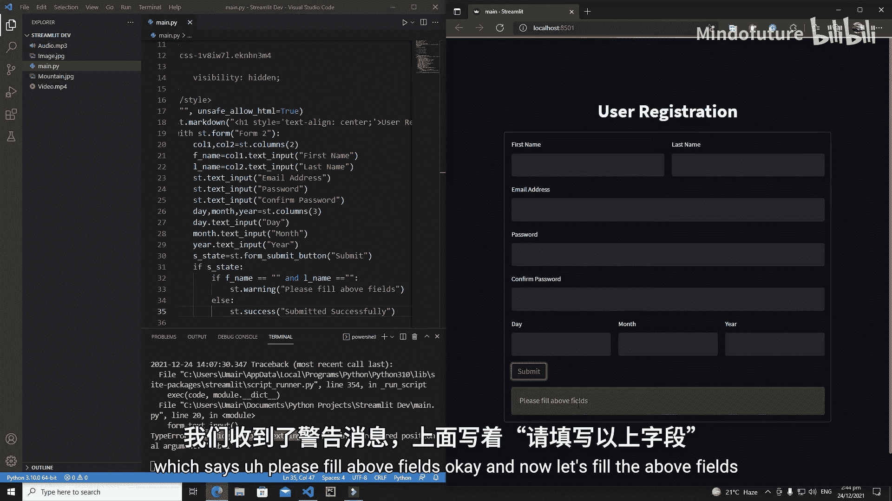

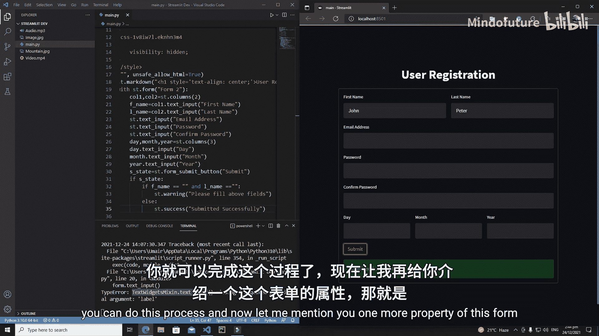

But I warned that whenever user clicks on the submit button。

 I need to clear my information from my form。 Okay， and for this purpose。

 you need to make this clear underscore on underscore submit property to true。

 Okay so right here the are you true。 Okay， let's save it。 Okay， and now let's read on it。

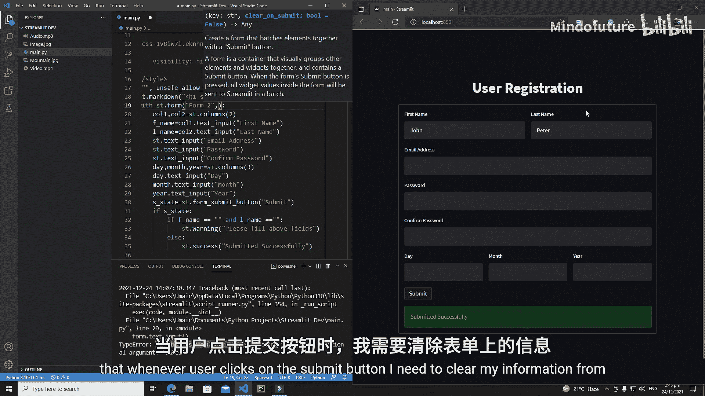

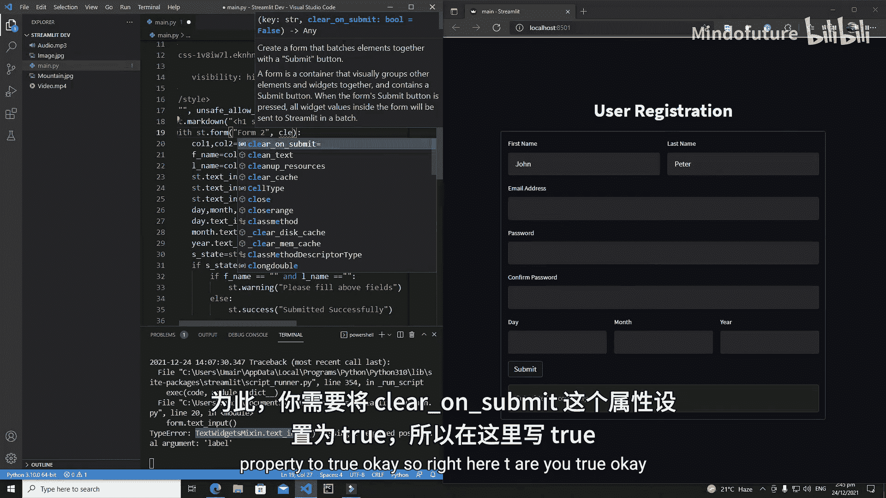

Okay， so my first name maybe P to your Peter and then or H and John okay and now let's submit it and yeah everything's gone Okay so this is how you can play with formss and you can play with columns and I hope that you have enjoyed this tutorial and in the next tutorial we will see something new till that point bye bye。

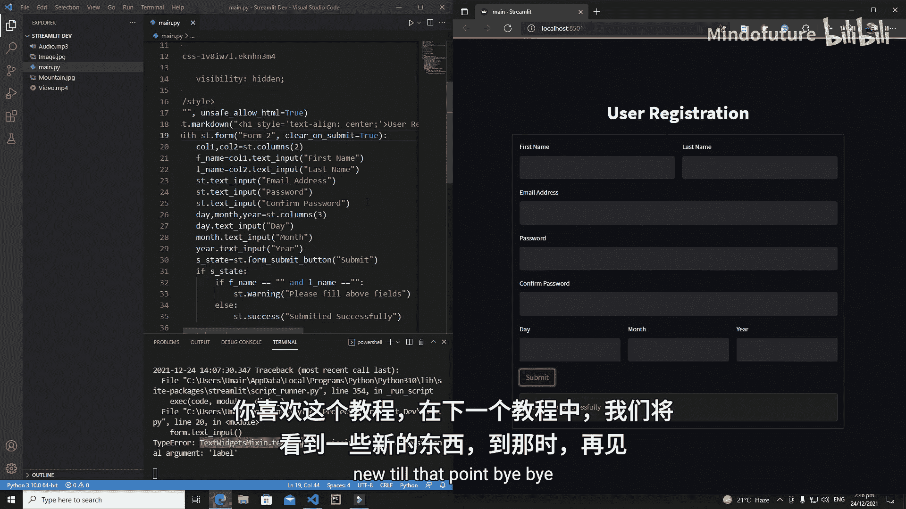