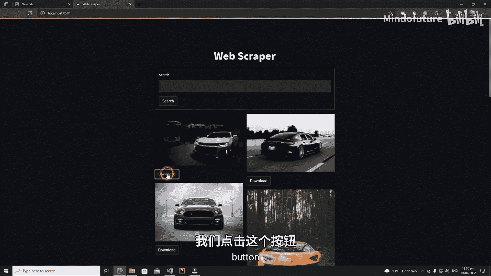
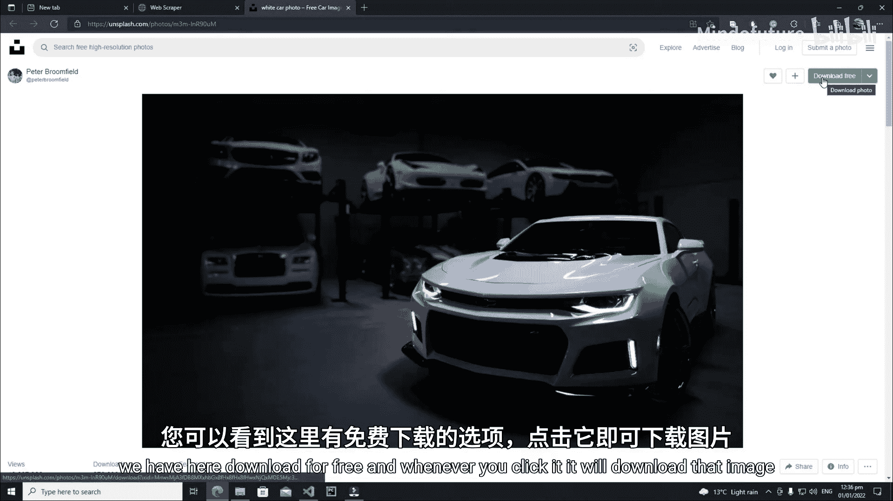
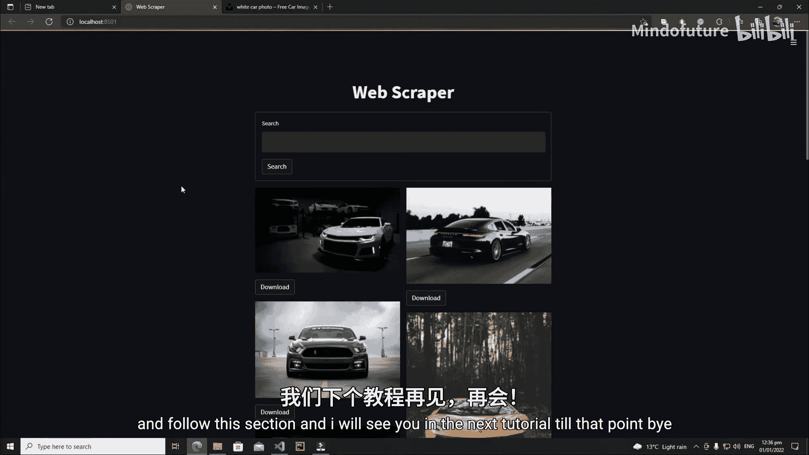

# Python-Streamlit-完全教程-p15-P15-Streamlit-Web-Scraper-Introduction---Complete-Streamlit-Python-Course--BV1yHVhz1EUD_p15-

Hi everyone in this section， we will build a webcrapper app in streamlit。 So as you can see。

 this is our webcrapper and it has a fcon and a title。

 and this is my search bar so here I need to enter a keyword and best on that keyword it will show up those related image okay so let's right here a keyword like C cars and hit this search button okay and now this will show up our cars image okay and as you can see we have a car image here。

 a car image here okay and everything is perfect and whenever you click on the download button beneath each image。

 it will redirect you to the download page of that image So let's click on this button and yeah this is the download page of that car image as you can see we have here download for free and whenever you click it it will download that image So I hope that you have enjoyed this intro。

And if you want to develop this application， then stick with us and follow this section and I will see you in the next tutorial till that point bye bye。

