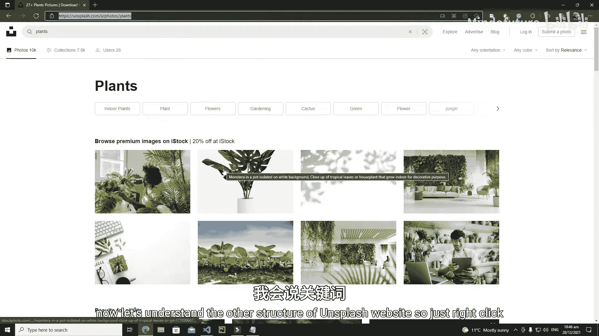
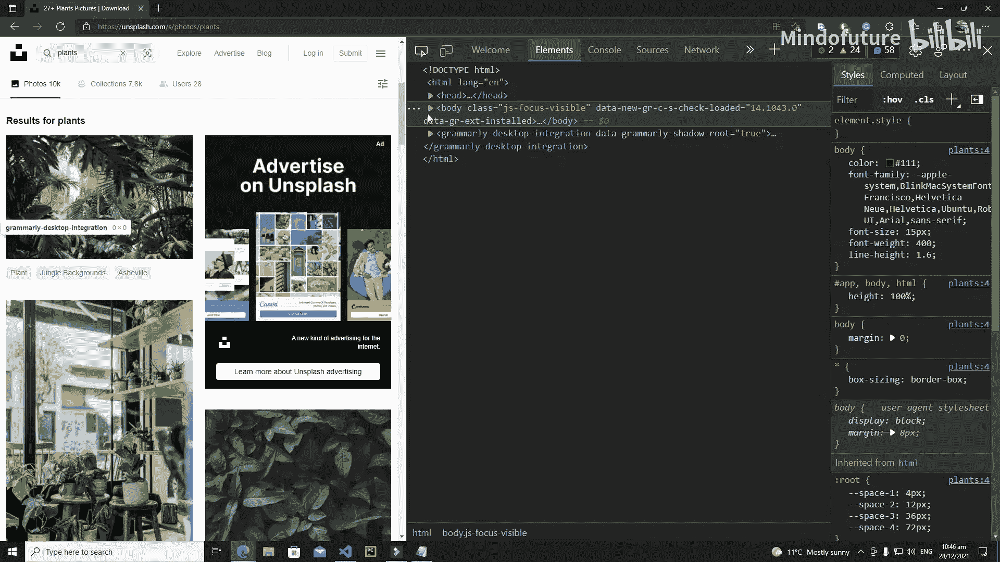
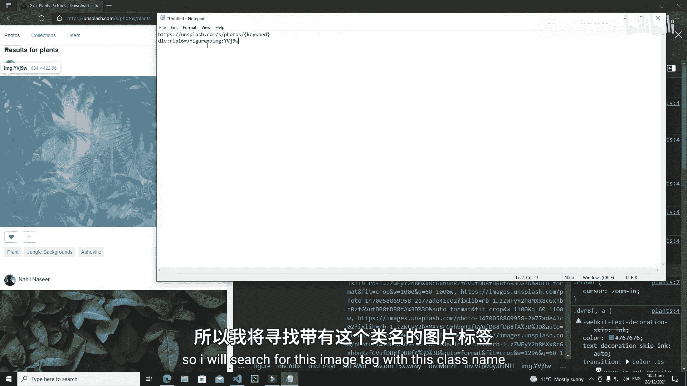
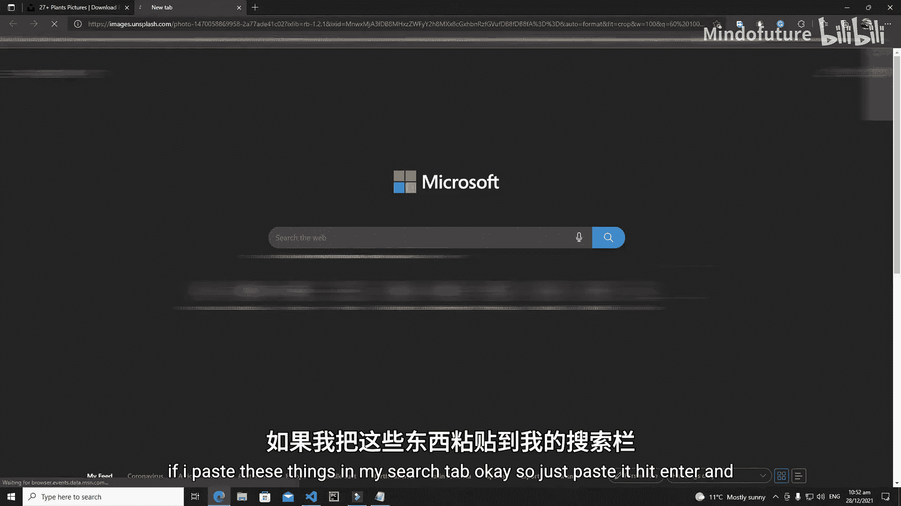
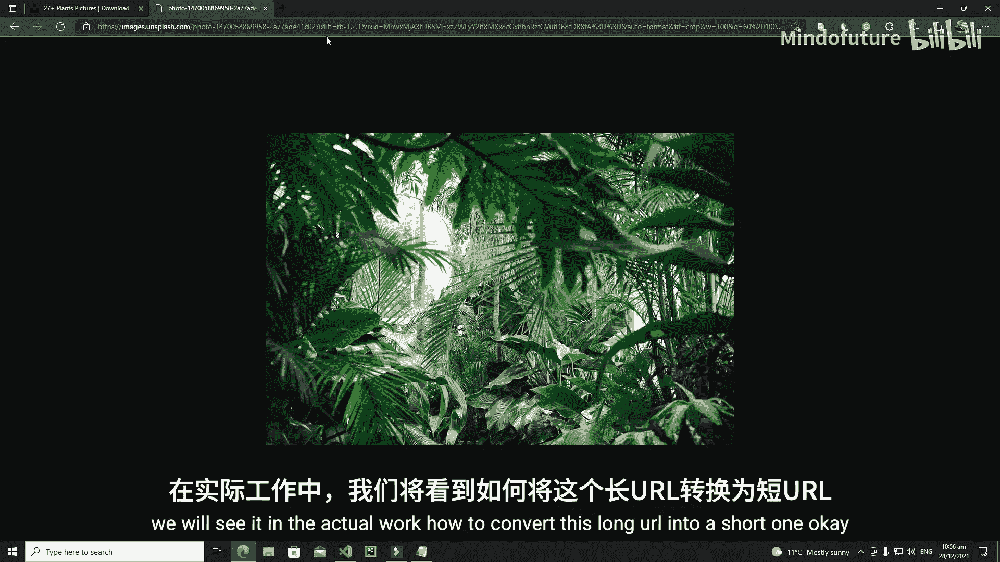
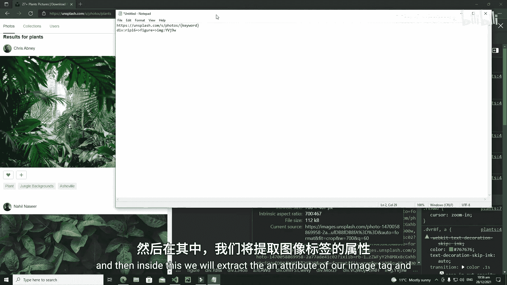

# Python-Streamlit-完全教程-p16-P16-Streamlit-Web-Scraper---Targeted-Website-Structure----Complete-Streamlit-Pyt--BV1yHVhz1EUD_p16-

Hi everyone in this tutorial we will start the development of our webcrapper in streamamlit and we will use we will actually scrap a real world website and that is unsplash so I hope that you know very well about unsplash so unsp is a free website which provides us thousands of royal free images and it's a great website so here you can find different types of images and we will scrap this website and we will scrap images from this website and we will display those images on our streamlit web app and in this tutorial we will basically understand the structure of our targeted website so it's very important to understand the structure and how our targeted website works before we actually scrap it so let's start from the URL of this website and that is unsplash。

com。we will observe what are the changes which will occur in our this URL whenever we search something like。

 for example， if I search for trees， okay the wS trees so what will be the change in our URL okay so let's set enter and observe it okay so I found a change and that is this is our demand okay so unsp dot co okay so then we have this S then we have this photos So I think that this photo is basically representing my one of the filter okay so yeah here in the unsplash we have three filters。

 one is the photos okay other one is the collections and the other one is the users okay so I hope that this photos is basically a representation of our this photos filter okay so if I click on collections and yeah we are true so this collection is an other filter but we are concerned with this photo filter okay so I will just go back to our photo。

Filter okay， so this is our photos filter Okay and this is our actual keyword Okay so we will also ask user in our application to enter a keyword and I will replace this part of our URL with our keyword of the user Okay so let's type here another keyword instead of searching a keyword here let's search a keyword here like for example。

 if I search for plans so let's write here P P NtS plans Okay hit enter。😊。

And now we have plant images， so I hope that you have understood how this URL of these unsplash words and first of all。

 this is our filter okay and this is our keyword so I will replace this part so just copy this URL okay copy it and just open a notpa and let's record these steps Okay so first of all we will play with the URL okay and here I will replace this thing with our targeted keyword okay so I will say E Yw the keyword okay so here I will past my related keyword okay and now let's understand the other structure of unsplash website So just right click okay inspect element and this will open the hl and CSS coding of this website So first of all let's start from this body okay so we have this body and then if I open it we have here this。

Vision， okay， and then inside this division， we have another division。 Okay。

 and here we have another。 just come to this。 Okay， so this is our search for route。 and inside this。

 we have further one to 3，4 division。 Okay so okay， so this is responsible for this part。

 This is for this， this is okay， so this is our actual results。 Okay and now okay。

 so this our concern is with this div。 Okay， so just open this okay， now inside this div。

 we have another division just open this one， just open this one。 Okay。

 and now here we have other division。 Okay， so it's a great。

 This means that we have some sort of responsiveness in this website as well okay。

 so let's open it open this。 Okay， so here we have two rows。 Okay。

 so this division is responsible for our this row。 Okay， and this division is responsible。

For our this row and it's a grid， this means that these classes or these divisions will be responsive and the number of division inside this division depends on the screen。

 So for example， if I think that if I increase the size of the window。

 the number of division inside this division will also increase。 Okay。

 so let's see the output let's increase it in order to get three rows。 Okay， let's increase it okay。

Okay， so yeah， we got three rows。 Okay， and now let's check the number of division。 Okay。

 so just open this class and just open this and yeah， now we have three rows。 So this is my row 1。

 this is my row 2 and this is my row3。 Okay so first of all。

 we will search for this division with this class name and this will basically hold over number of rows。

 Okay， so let me right here just to copy this sorry， lets copy this class name， copy it。

 And now here I will say that I will search for rows。 Okay。

 I will search for division with this class name。 Okay， sorry， not division with this class name。

 Okay， and after searching for division with this class name let's open this division。 Okay。

 so now inside this division， we have figures。 Okay。

 so now this figure number one is a representation of over this image Okay and this figure is a representation of our second。

imageage and so on and so forth。 Okay， so I will search inside this division。

 I will search for this figure tag。 Okay， so F I G U are figure tag。 Okay。

 and this figure tag is unique and we doesn't need any kind of a class reference。 Okay。

 so inside this figure， if I open this figure。 Okay， so now inside this figure。

 we have another division。 Okay， so just open this division。 and now inside this division。

 we have further two division。 So this division is responsible for the keywords。 Okay。

 but I do not have any concerns with the keyword。 So I will open this division。 Okay。

 now inside this division， we have another division。 Okay。

 so if I increase the size so that it may visible to you。 Okay， so here。Okay， so where we were。Okay。

 so just open this one， this one， sorry I' am repeating these steps。

 but yeah okay so this is our figure， open it， this division then this division and now inside this division we have further two division so this division is responsible for the author namem while this anchor tag is responsible for the URL of this image on our unsplash website okay so this is basically the URL of this image okay so if I hover on it as you can see http unsplash dot co slash photos and then this thing okay so this is our URL and we will see it in the upcoming tutorial is okay and now I need to access the actual image okay so let's open this anchor inside this we have another division so inside here we have another division just open it just open this one and here we have our actual image tag okay。

What is the yeah， so this is basically the URL of our this image。 So I will inside the figures。

 I will search for this image tag。 Okay， so figure。

 I will search for this Ig tag with the class name。 So what is the class name of this image。

 Okay so this is the class name just copy this class name。 Okay， and paste it here。

 So I will search for this image tag with this class name and inside this image tag with this class name。

 I have a builtin property。 Okay， and that is this source set。 Okay。

 so source set is basically responsible for this source of our actual image Okay。

 so if I copy this source。 Okay， so just copy it And if I paste these things in my search tag。 Okay。

 so just paste it hit enter and we will get our required image on。

display and yeah this is our output。 Okay so this image and this image are similar。

 Okay and I think that it's good to use this source set。

 and I think that we should use we should use this long URL and we will see it in the actual work how to convert this long URL into a short one so don't worry about this thing we will see it。

 but we have extracted our actual URL I hope that you have understood the structure of this unsplash website so first of all we will use this URL for searching our keyword on unsp and then we will search for this division with this name and inside this we will search for figures and inside figures we will search for image tag with this class name and then inside this we will extract an attribute of our image tag and that is this source set and with the help of source set we will get access to our。

okay and in the next tutorial we will start building our web scrapper and I will see you in that tutorial till that point bye bye。

