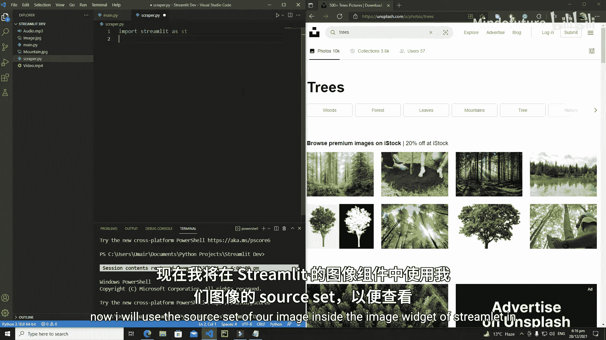
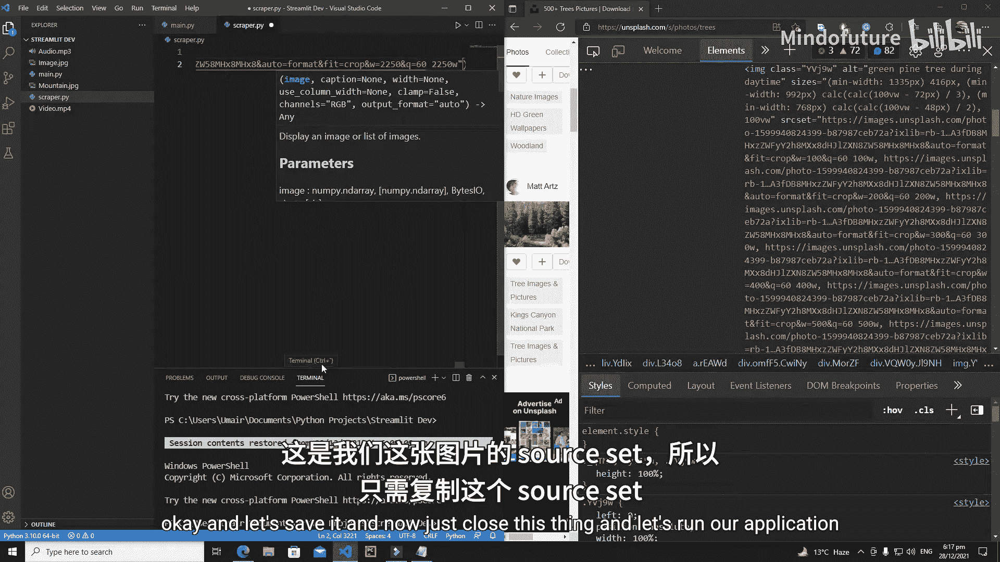
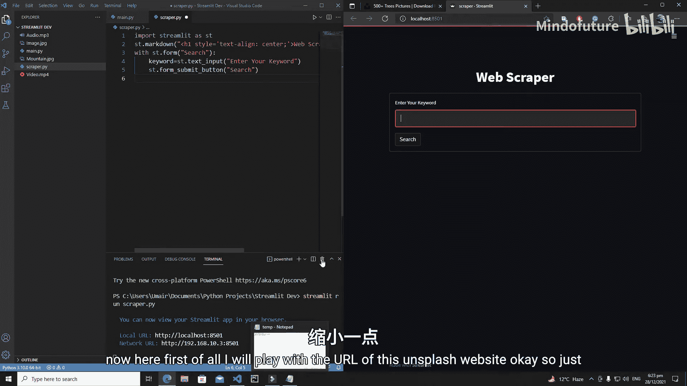
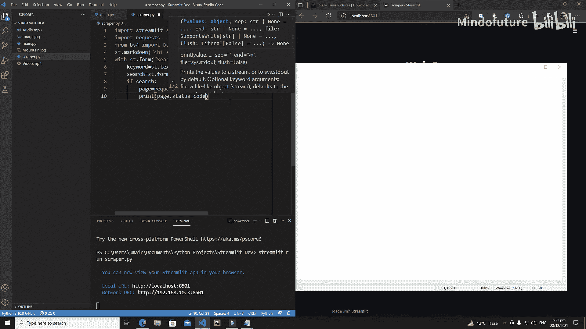
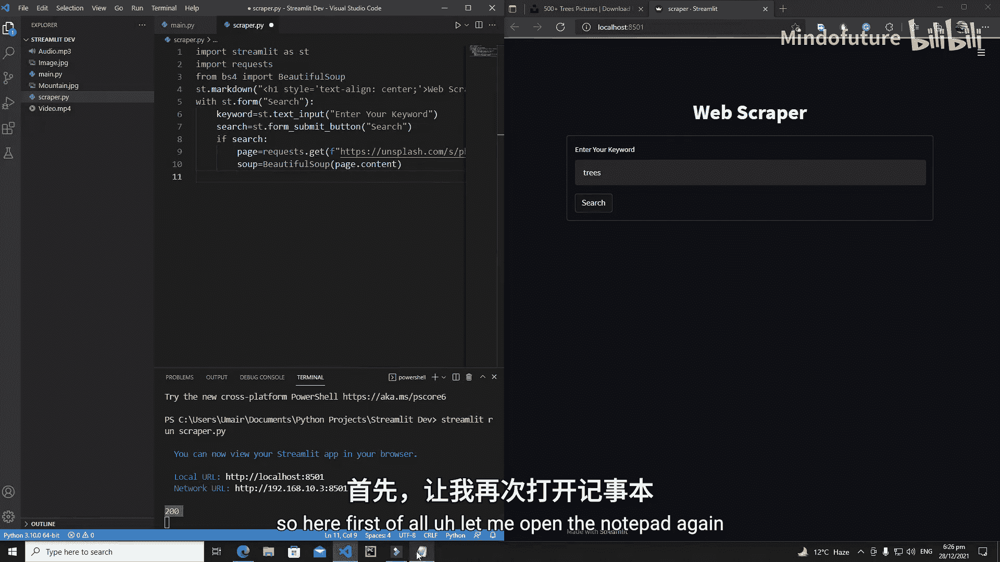
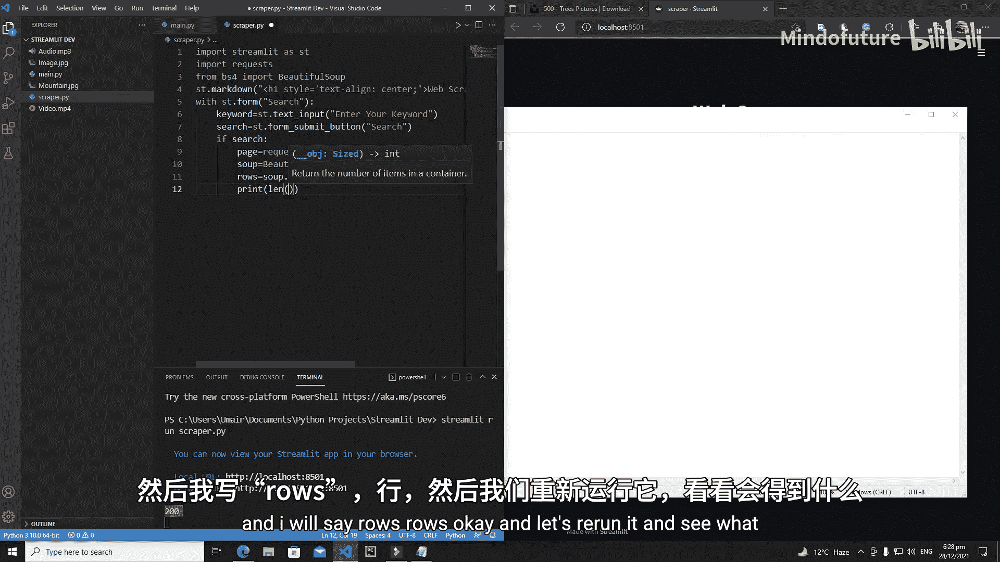
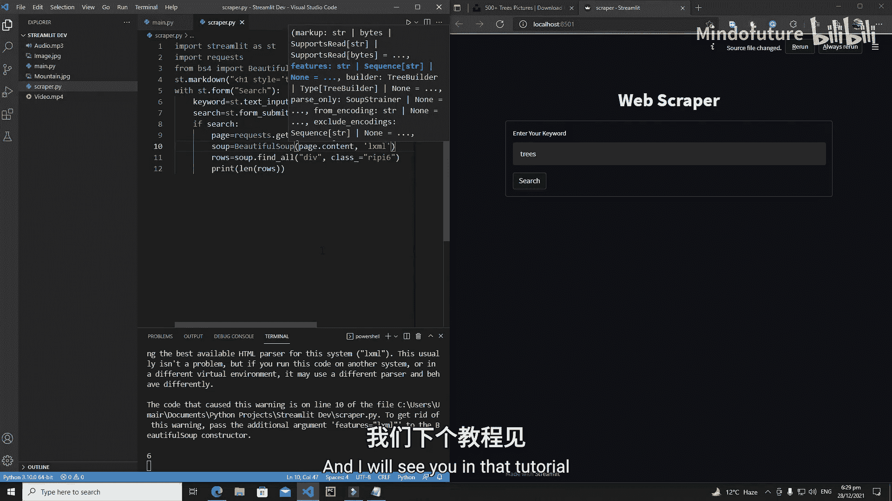

# Python-Streamlit-完全教程-p17-P17-Streamlit-Web-Scraper---Preparing-HTML-Soup---Complete-Streamlit-Python-Cour--BV1yHVhz1EUD_p17-

🎼Hi everyone， in this tutorial， we will start the coding of our webcraper in streamlit。

 So first of all， let's create here a new file。 Okay。

 let's give it an name like WP or maybe S RP or scrapper dot Py okay hit enter。 Okay。

 so first of all， we need to import our streamlit okay。

 so just right here IMP or the import SREM streamlit S S O so it's cool And now I will use the source set of our image inside the image widget of streamlit in order to see whether everything is working fine or not okay。

 so let's extract the source set of this image okay。

🎼So here is the source set of our this image so just copy this source set okay copy it and first of all I will say S dot imG image okay and just past the source set here okay and let's save it and now just close this thing and let's run our application okay so just right here S REM stream let stream it and now in this case our script is scrapper do py okay it's not our man dopyy okay so we need to write here areuN SRA P scrapper do py okay not sorry scrapper do Py hit enter and this will open this will open our scraper do py script okay。

And yeah， here is our application。 and yeah， this is our image。 Okay， so cool。

 we are extracting a correct source set。 Okay， and now with the help of this link。

 I will display my images on our webcrapper application and now I think that this link is quite long so let's convert this link into a smaller link Okay so let's do some experiments on this link so let me maximize this thing Okay okay so first of all。

 this is the domain Okay sorry okay okay so this is the domain okay and then this is the photo and everything else what I'm thinking that okay so this is basically our photo number Okay and what if I remove all other things from this link okay and then let's see what we will get on our output so just remove these alphabets okay。

These things just remove them till this question mark， okay， and let's save it again， okay。

 and now let's rerun the application and see what we will get。Okay。

 so we got our image again and this means that this part of our link is responsible for the actual image okay and we will extract this part from our source set okay and we will do this process when we will scrap those source set links okay and I will show you how you can extract this part but for now just remove this line okay so this was just an experiment to see whether everything is working fine or not so first of all in our application we will have a heading okay so just right here S do mK markdown okay and I will go with the H1 tags here okay so just right here H1 okay and then I need to close these H1 tags as well okay and I will say unsafehtml to T are you true okay and now inside this H1 tag I will say like a WEB web。

SE A webcrapper okay and I will center it so just right here S YL style is equals to and then I will say TXD text align。

 then C your center so this will align this text to the center of the screen and now after this heading I will create a form and inside that form I will have two items1 will be our text input widget which will ask user to enter the keyword and then I will have a submit button as well so let's create a form here So just right here and then S do form form and let's give a key to this form and I will say like maybe search and now inside this form I will have two widget so first I will have the S do TX text input widget which will ask user to enter the keyword and here。

I will say like S EC at search okay so search basically represents you need to enter here a keyword okay and I will save the input in the keyword variable。

 So just write to your E keyword is equals to this thing and then I will have a submit button as so just write to your do form underscore submit button I will say S ERC search Okay and here I think I should remove this search okay instead of the search。

 I will write your enter your maybe your keyword Okay enter your keyword just remove this Z let's save it and let's save it and yeah let's check the output on the screen so just refresh it。

And yeah this is our heading webcraper， enter your keyword and here the user will enter the keyword and whenever user clicks on this search。

 we will do all other stuff okay so let me make this side by side okay just make it smaller okay so now here first of all I will apply with the URL of this unsped website okay so just open your notpa okay so previously we have saved some data so。

This is the URL okay and this is the part which I will replace with the key。

 Okay so just copy this little part okay， copy it， but before I play with the URL。

 I need to import my scrapper my beautiful soup I need to import request library as well So just right here I to importD request and then I will save from B4 okay I to import via UT beautiful soup S or not maybe S okay so just import beautiful soup as it is okay and now first of all I will send a request to this URL okay so just copy this part copy it and here first of all I will say that sorry I will save the state of this button so I will sayRC search is equal to this whenever user clicks on the。

And then I will do my all other stuff okay so I will say if SeRC it search is equals to truth so this means that if user clicks on on the button。

 I need to send a request to my targeted URL okay so just right here our EUS request Gt get and then here I will pass a formatted string okay and the reason is that we need to replace this part with our keyword。

 which user will enter here okay so this is our keyword okay and I will replace this part with our keyword and I will send our request and for now let's print status quo of this request as well so just write here page is equals to this and then let's right here P printg page do SDus status quo so let's check first whether this website is scrapable or not okay。

So just save it okay and let's rerun this thing again rerun it and here let's write any type of keyword Okay so maybe I will search for the RWS trees okay and just click this button okay and let's wait for our status quo and 200 So this means that we are successfully getting information from our this unsplash website okay so it's cool and you have completed your step number one and that was to send get request to your targeted website okay so after sending the get request I need to get the content of that web page as well okay so I will create a soup of that web page content so just write here So UP soup is equals to be a UT beautiful soup okay and then I need to pass my content inside this beautiful soup okay and I will say。

You page。 ctN page。 contenttent， and this page。t content basically returns us all the HTML coding of this web page okay？

And once we have the patchch content now I am able to search for particular tags for particular classes and everything else okay so now here first of all。

 let me open the notpa again and first of all I will search for the division tag with this class name okay and if you remember this part represents our number of rows okay or if I say our number of columns of the images okay so first of all I will search for division tag with this class name okay so let me right here RWS rows is equals to SoOUP soup dot find all I will use the all function instead of using the so we will have multiple division tags with the same class name okay so if you use here find then it will extract the first one but if you use find all it will extract all the rows so just right here find all and then first of all we need to define。

Here the taggum and in this case our tagg name is dev okay and then we need to define the our class name here as also class underscore is equals to and then your class name so let me open the notpa again just copy this class name copy it okay and the paste it here okay and for now I will just print my number of rows okay or my the length of my rows okay so just right here print okay El length okay sorry not to length El length okay and I will say our OWS rows okay and let's rerun it and see what we will get okay so just right here to RWS3 is okay。

😊。

And let's sweat。 So we got6。 currently， we have six rows。 Okay。

 and here you are getting this error as well。 And the reason is that we need to actually define the parsel for this beautiful suit as well。

 Okay and in this case， I will go with al Xl parsel and its it's it's a great parsel。 Okay。

 so personally I love Ll。 Okay， so just write here X Ml L Ml Okay。

 and I hope that it's enough for this tutorial。 and in the next tutorial。

 we will search for all other tags and divisions and we will extract our information as well。

 and I will see you in that tutorial till that point bye bye。😊。

