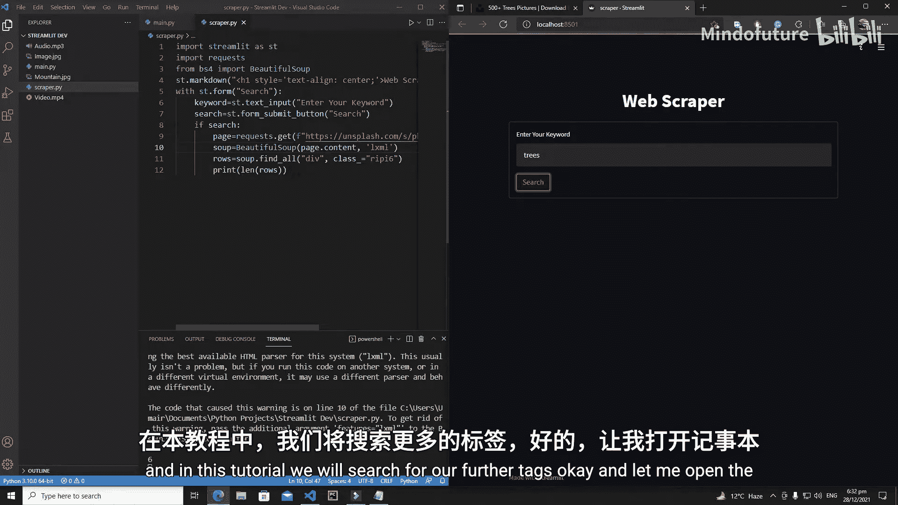
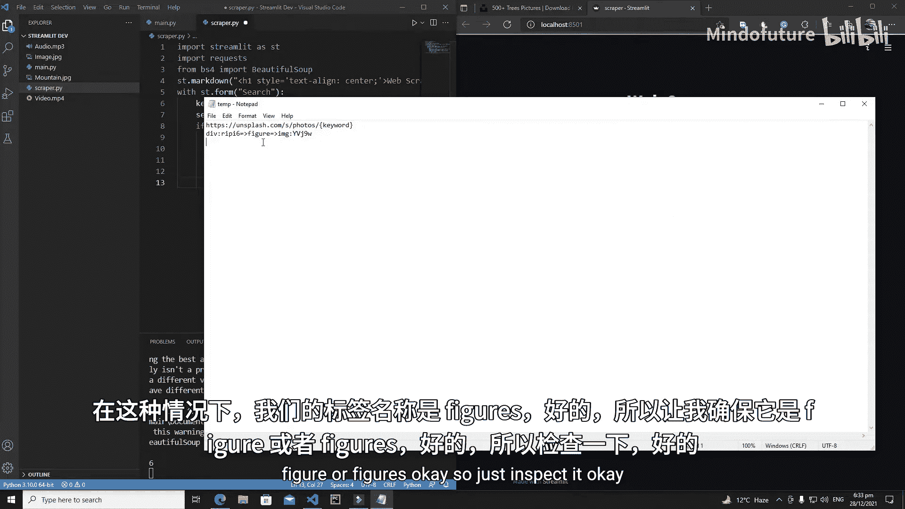
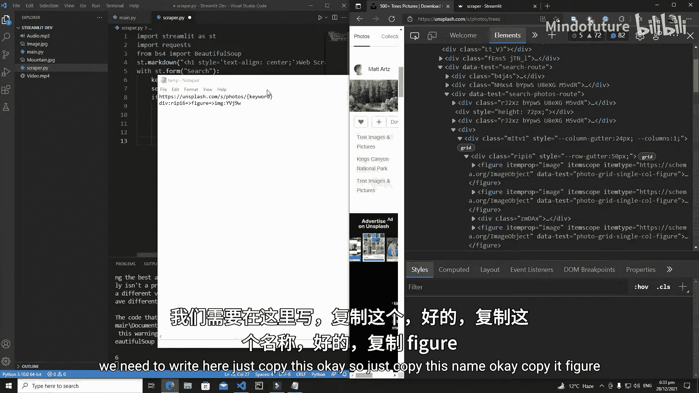
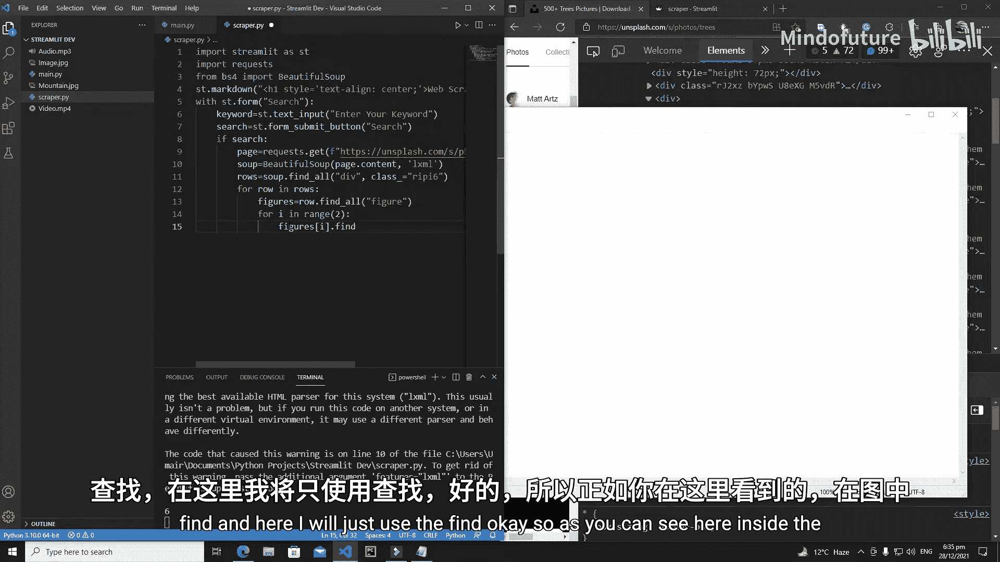
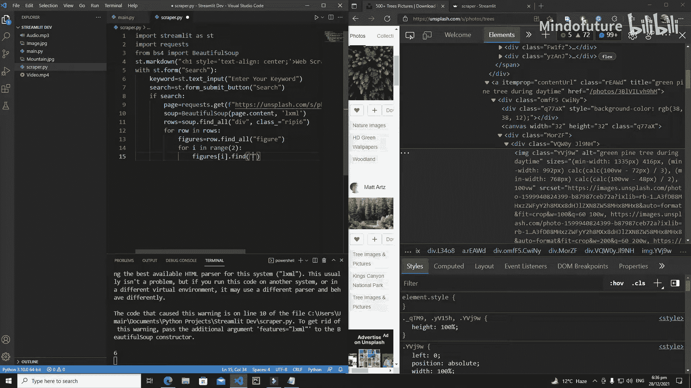
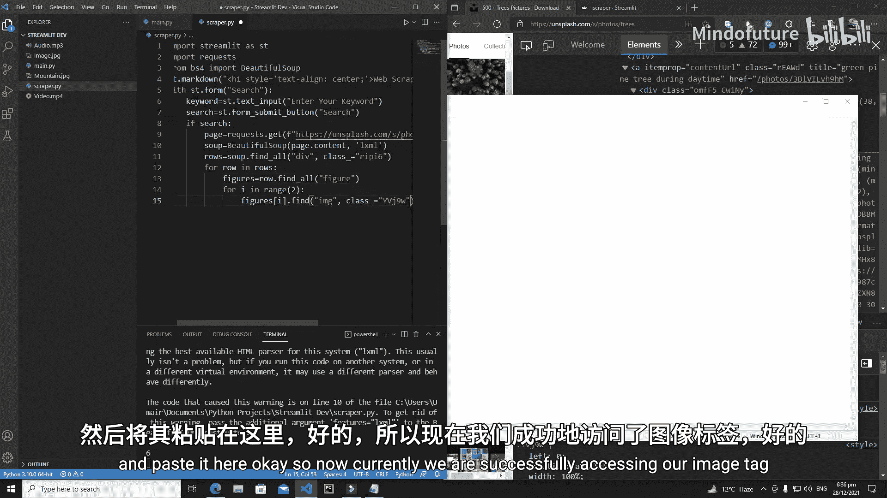
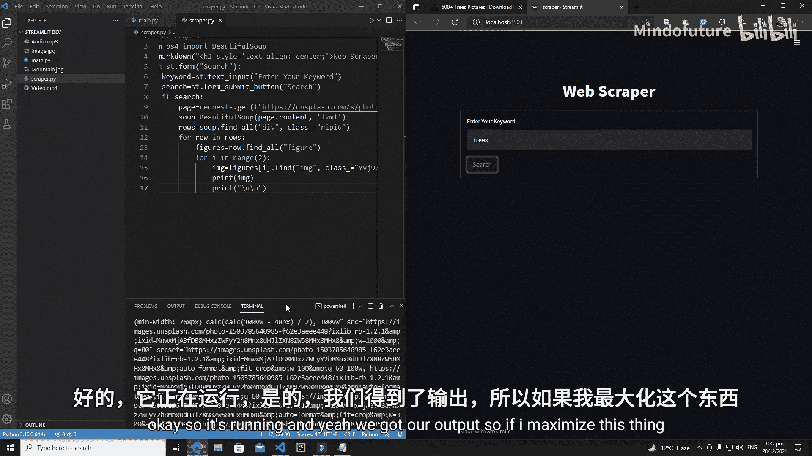
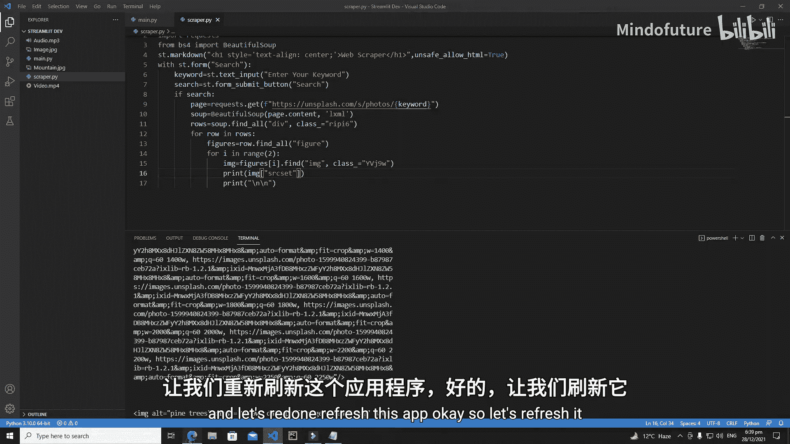
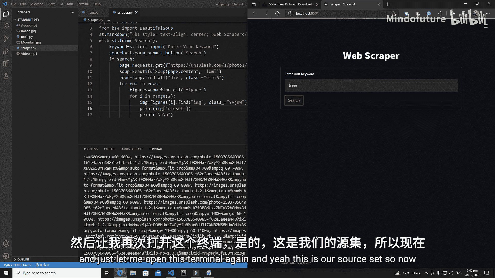

# Python-Streamlit-完全教程-p18-P18-Streamlit-Web-Scraper---Extracting-Image-URL---Complete-Streamlit-Python-Cou--BV1yHVhz1EUD_p18-

Hi everyone in this tutorial， we will continue the development of our webcrapper and in this tutorial we will search for our further tags okay and let me open the notad and currently we are accessing these division tags and now inside this division tags I will search for the figure so just right here let me remove this line for now and here first of all I will loop through each row so in each row we have multiple figures and for this purpose I will use a for loop and I will say for raw in R OWS rows and first of all now instead of writing here soup dot find all I will say RW row dot find R O or raw dot find underscore AWL find all and first of all we need to define our tag name and in this case。

🎼Our tag name is this figures。 Okay， so let me make sure that it is figure or figures。 Okay。

 so just inspect it， okay。

🎼Okay so yeah it's figure okay so we need to write here just copy this okay so just copy this name okay copy it figure and just paste it here okay and it's a unique tech name so we doesn't need any class reference to this okay so and I will save these information in my FG are figures key okay so now this will also return us a list of figures okay so as you can see here we have multiple figure okay so in each row we have multiple figure so I need to loop through each figure and I think that it will become very very difficult for our scrapper to scrap each and every image in each and every row so I will just extract the first two images of each row okay so I will instead of looping through each figure I will send like a4 I in RNGE sorry R。

And G E4 I in range， maybe two， okay， and this will extract the first two figures。 Okay。

 and now inside the figures， I will search， let me open the notpa。 Okay， so inside the figure。

 I will search for this image tag， okay with this class name。 so here I will write F G is figures。

 Okay， and then I need to define my I value。 Okay， so I value dot， I will say dot f I unde not sorry。

 find and here I will just use defined。 okay， so as you can see here inside the figures。

 we have only one image tag。 Okay， so if I open this division which one is responsible for our image。

 Okay， so let me inspect it again。 Okay， so now as you can see here inside our figure tag this is our figure tag。

 we have only one image tag。

So I will just use here find method instead of using find dial okay so I will say find okay and then I need to define my tag name and that is image okay and then I need to define my class name as well okay so here the class name is again optional okay so inside the figure we only have one image tag so if you doesn't define here the class name everything will work fine okay but for good practices I will define my class name again here okay and in this case my class name is this so just copy it and paste it here okay so now currently we are successfully accessing our image tag okay and for now I will just print the content of my this image tag okay so just right here print okay and I will save it first in this IG tag okay so image tag okay and then I will save image tag printed okay and I will also print a blank line。

As a locus， so just straight to here slash and slash and okay， in order to get a visible output okay。

 so let's save it and just close this again， come to scrapper， just refresh it。

And let's search for maybe TRWS3 is， okay， and let's search it and see what we will get。

Okay so it's running and yeah we got our output so if I maximize this thing。

 if I open the terminal a little bit as you can see here we have our information of this image tag okay so this is our image tag we have everything every attribute of this image tag okay so here we will access now our source set attribute of this image tag okay and now here instead of printing all the attributes of our image tag I will just print the sourceet attribute okay so just search for the sourceet name okay and yeah here is our source set or it is a SRC SET okay so let's write here Src SET sourceet okay so let's save it again okay and let's read and refresh this okay。

Let's refresh it。And let's give our key， okay， or TrWS3， okay。

 let's search it and let's sweat for this scrapping and just let me open this terminal again。

And yeah this is our source set so now currently we are just accessing our source set okay so it's a very long source set okay。

 very very long and now in the next tutorial I will actually break this source set into parts okay in order to extract only this part okay and we will do this process in the next tutorial and I will see you in that tutorial till that point bye bye。

