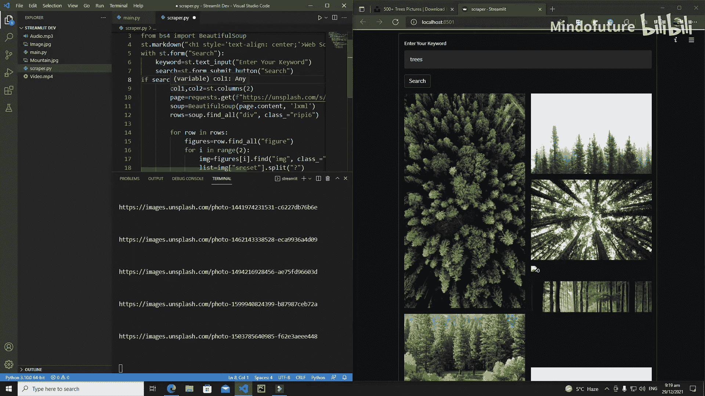
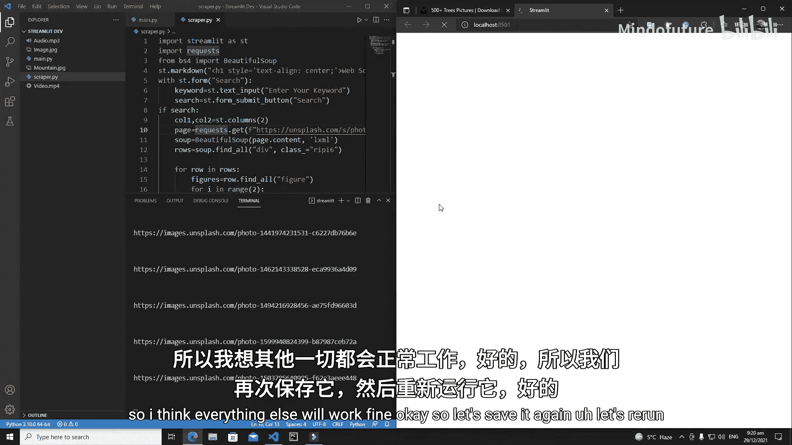
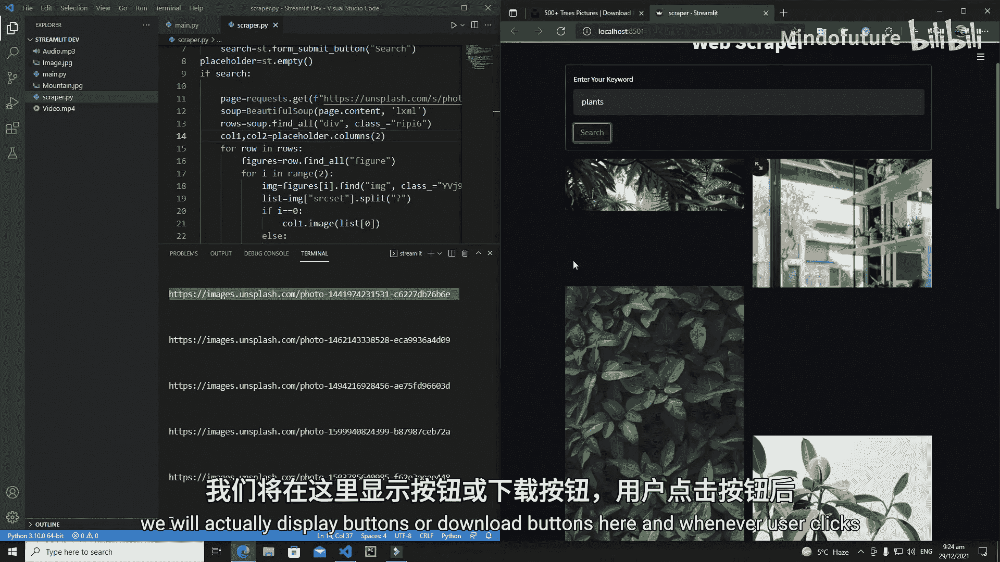
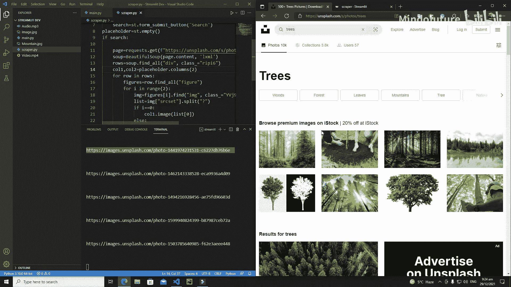

# Python-Streamlit-完全教程-p19-P19-Streamlit-Web-Scraper---Displaying-Scraped-Images---Complete-Streamlit-Pytho--BV1yHVhz1EUD_p19-

Hi everyone， in this tutorial， we will continue our development and first of all。

 we will extract over this part of the URL from this sourceet URL okay so we need to extract till this point Okay so this is the actual part which is responsible for displaying images。

 Okay so let's start its extraction and here we are printing our source set in the terminal and if you observe this link inside this link So if so okay so here is my link and inside this link。

 we have the demand name okay and then the photo address and after the photo address。

 we have this question mark okay so I will basically split my this URL based on the question mark okay and then I will extract my this first part Okay so this will be the logic so。

Let me write here， I will split it based on the question mark okay so I will write here dot spite split okay and then I need to define my symbol okay and in this case my symbol is this question mark okay and if I save it and if I rerun this thing。

Rerun it and let's enter a keyword， maybe T RWS3， search it again， okay。

 it's running and if I open my terminal again。🤢，Okay so we are now getting our information in form of a list okay。

 so this is my list okay， as you can see here， we have the square brackets here and then the square brackets here okay and this is the list of my one of the URL and here as you can see in the first part we are getting the actual link of the image okay and now if I want to print this link I just need to type here for example。

 let's save this list in a list variable okay first LISD list is equal to this okay。

 and then I will print PRr printISD list and inside this list I will print my element with index0。

 which is the first element okay so let's save it again and let's read it and search a keyword like the RWS3 trees hit search okay and let's vet。

And if I come down here yeah， now we are extracting the actual URL of the images okay so this is my URL of first image。

 this is the URL of the second image and so on and so forth okay so currently we have1，2，3，45，6。

7 at I think8 or9 URLs okay and now I will display my image on this streamlit web app as well now the process is very simple okay so we will pass this value to our streamlit image wget okay so let me remove this line for now and let's write here S do I am AG image okay and then I need to pass myT list and0 okay and let me remove this thing and here what Im thinking that I need to split my this whole window into two columns。

Okay， and then I will display my images on those columns。

 okay so let's create here two columns Okay so I will create my columns here okay so not here I think about this thing okay and I will say C or L U MN or not maybe C or L call1。

 then C or L call2 is zs to S dot C or L U MNs columns and then I need to split my this whole window into two columns so just by c2 okay。

 and here instead of writing here st dot image okay I will say C or L call1 dot。

 but I will check that if my I okay so I double equals to0 okay which is the first iteration I will display my image on my first column okay else I will display my image on the second column okay so L C or。

2 dot IM G image okay， and then ID list， then zero。 Okay， let's save it okay。

 and let's rerun it and see what we will get okay so let's write here T R W3 okay search it and let's s and yeah we got our required output but currently as you can see it is inside our this form okay so where is our form okay。

 so here we have our form and in order to solve this kind of a problem we just need to move this if search out of this width okay。

 so let's move it out。 okay， and let's move this part out as well okay so I think it's shift back tab okay and then I need to okay so I think everything elsewhere will work fine okay so let's save it again let's rerun it。

And just search like a TRWS3。 Okay， hit search。 Yeah， now we are getting over required output。

 So as you can see， this is my image1 Okay， this is my column1。 This is my column 2 image1。

 these are all other images okay， so as you can see we are actually getting over required output。

 and I hope that you have enjoyed till that point。 and now let's search for an other keyword like let's type here P A and T S plants as well。

 let's search it。Ring。Okay， so we are not getting our plants images。

 We are still getting our trees images。 so how to solve this problem So the solution is very。

 very simple。 first of all we need to create an empty widget or an empty plus holder here and then we need to divide that plus holder into two columns and that will actually solve our problem Okay so let's create here a plus holder so here I will say PSE plus H or LD or plus holder sorry P plus holder is equal to S dot E so we need to create an empty wget of this plus holder first okay and then I will say plus holder dot columns so I will write here PSE holder do columns okay and let's save it and。

Then let's rerun it again and just enter your keyword。 Okay， maybe TRWS trees。 Okay， let's search it。

 Okay， so these are all my trees。 Okay， and now let's search for other keyword。

 maybe PN just plants again。 Let's search it。 Okay， so we are still not getting our required output。

 Okay， so we just need to move this line， just cut it and we just need to past this line here。 Okay。

 just paste it here。 Okay， let's save it， and then now I hope that everything will work fine。 Okay。

 so just search for T RWS trees。 Okay， search。And okay， so we are getting our three images。

 let's search for PA NTS plants， Okay， search。And yeah， these are my plant images。 Okay。

 so now we are getting of required output。 Okay， so first of all。

 you need to create an empty plus holder。 Okay， and then after sending the request to the to the targeted URL。

 you need to then create two columns of that empty place holder。

 and then you need to do all other stuff。 Okay， so I hope that you have understood this logic。

 And I hope that you have understood how to split the URL into smaller URL Okay and in the next tutorial。

 we will actually display buttons or download buttons here。 And whenever user clicks on that button。

 we need to redirect the user to the download page of the unsplash website of that image。 Okay。

 and we will do that process in the next tutorial。 and I will see you in that tutorial till that point。

 bye bye。

