# Python-Streamlit-完全教程-p20-P20-Streamlit-Web-Scraper---Image-Download-Button---Complete-Streamlit-Python-Co--BV1yHVhz1EUD_p20-

Hi everyone in this tutorial we will add download buttons to each image Okay so first of all here I am adding my image to the column and along with the image I need to add a download button for each and every image in that column as well okay so let's add a download button so just right here youll call one dot B Uwto and button okay and here first of all。

 let's define a label for the button and in this case that will be like D orW and allow download okay and then I need to save the state of the button as well okay so I will save the state inside this BTN variable okay and here I will say that if my BT and is through that if user clicks on this BTN I will do my other process but for now just print a message like BWT。

PR ESD button pressed okay and I will do the same process for column number two as well okay so just copy these lines paste it here and just from one to two okay so I will add the button in this column as well okay and let's save it okay and let's rerun our application and see what we will get okay so here I am expecting an error okay so I will get an error and I will explain why we are getting this error okay so just search for a keyword like NTS plants okay let's search it。

And okay， so this is the error which I was talking about and that is duplicate widget ID Okay。

 so there are multiple identical S button widget with the same generated key Okay so this is the error and the error is that we are actually creating duplicated buttons in this whole application Okay so in order to avoid duplicated widgets。

 we need to assign a unique key to each and every button okay and for this purpose we just need to type  here k by key is equals to and then we need to make sure that every button gets a unique key okay and for this purpose I am thinking that I will convert the index of my row into string okay and I will convert i value into string as well okay then I will add them so if my row is0。

 then my I will be0 or1 okay so。K of my button will be 00 in the first case。 then 0，1， then1，0。

 then1，1 okay and then we will get a unique keys for each and every button。

 okay and for this purpose， as you can see here that in the rows we are actually getting the information of each and every row okay we are not getting the index okay so in order to get the index of this row instead of simply writing here for row in rows。

 I will write here enumerate okay so for raw in E anderate enumerate rows okay so now what is this enumerate function So enumerate function basically return us to value Okay one is the index of that value and other one is the actual value Okay so we will save our actual value in our row variable。

 but we will save the index of our row inside this。

I and Dx index variable okay and this is how everything will work okay so we will I save the index in this index well variable and the actual value inside this raw variable and you need to use this enumerate function here okay and now。

😊，Inside this key， I will say that T is equals to STR string okay。 and then first of all。

 I need to pass my index。 Okay， and then I need to add my this index with the STR value of I Okay。

 so this is how we will create a unique key for each and every button so let's save it okay。

 and let's rerun it again and I hope that we will not get any kind of error in this case。 Okay。

 so let's search for plants。 Okay， just hit search okay， and yeah。

 no we are not getting any kind of error。 Okay， so we are still getting here。 that is a duplicate。

 Okay， so we are creating1，2，3 buttons correctly。 but yeah， we are still getting error。

And the reason is that we need to define here the key as well for this button okay。

 so let's copy this line okay， just copy this line and paste it here okay so just put comma。

 paste it here， let's save it okay and let's rerun it and I hope that everything will work fine okay。

 so let's search for P and plans okay， search it and that。

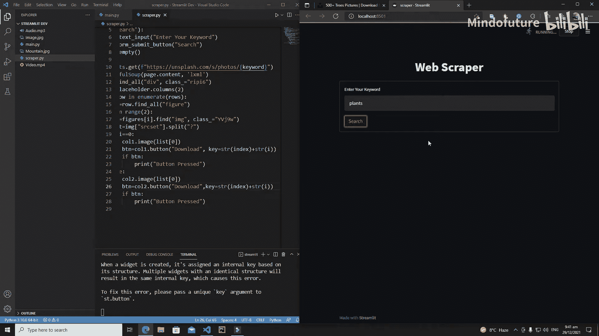

Okay， so now we are successfully creating our buttons okay so this is my download button for this image。

 this is the download button for this image， this is the download button of this image and everything else is working fine now whenever user clicks on this button I'm thinking that I will redirect the user to the download page of that image on the unsplash website so whenever user clicks a download button I will redirect the user to this page okay which is this link okay and then here you can see that our user can download this image for free and for this purpose we need to scrap this website a little bit more okay so in the previous video where we were understanding the structure of the unsplash I have told you about the anchor tag as well okay so if I right click on the image if I click on the inspect。

Here， okay sorry， let's again right click inspect Okay Okay。

 so here you can see that we have an anchor to anchor tag here。 okay。

 and inside this anchor tag we have an attribute with the name HR or hyperre okay and the value of this hyperre is this okay slash photos and this is the photo number so if I combine this hyper reference with the demand name of the website I can access the actual download page of the image。

 Okay， like for example， let me open here on notpa okay。

 and the demand of this website is this unsplash dot com slash S okay so just to copy this line okay copy it and if I paste it here okay and if I copy this hyperre if I copy this hyper。

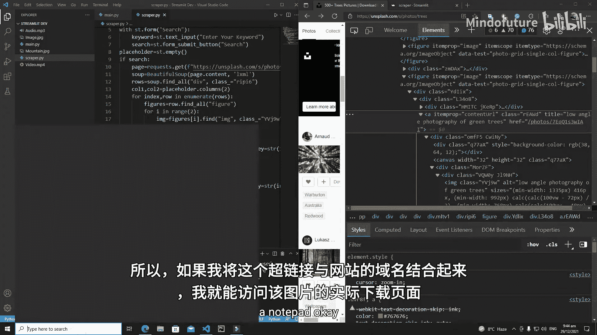

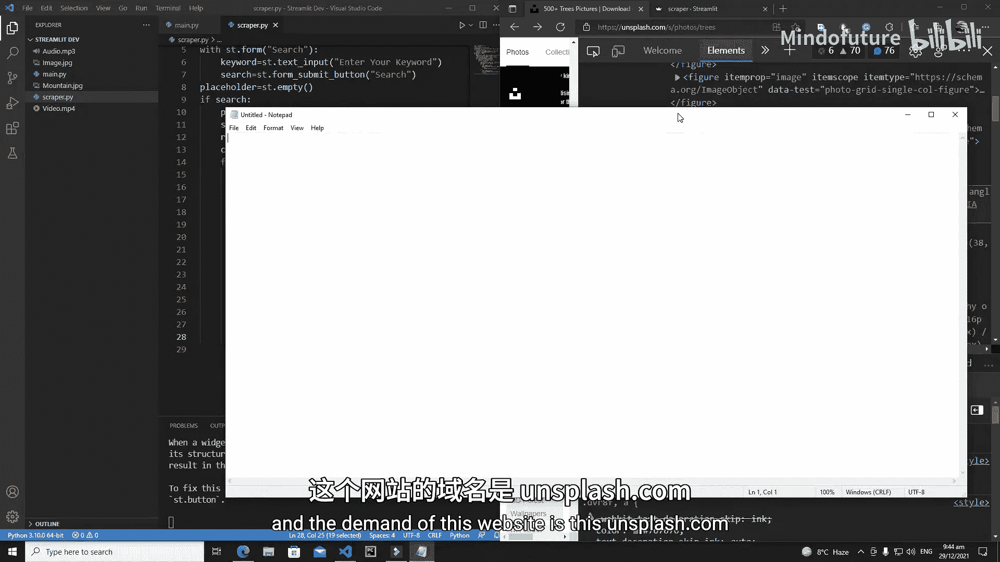

Okay so I'm unable to copy， but yeah whenever you click on this it redirects you to the download page okay so I will extract this hyper reference and I will combine this hyper reference with this URL okay and we can get our required download page okay so let's do this process don't save and here this anchor is also inside the figure tag so here is my figure okay image is equals to this and here I will search for an other tag I will say like N our anchor is equals to this and then FGR figures then I okay then I will say find and I will past my tag name here and I think I doesn't need the class name here because inside the figures we have only one anchor tag okay。

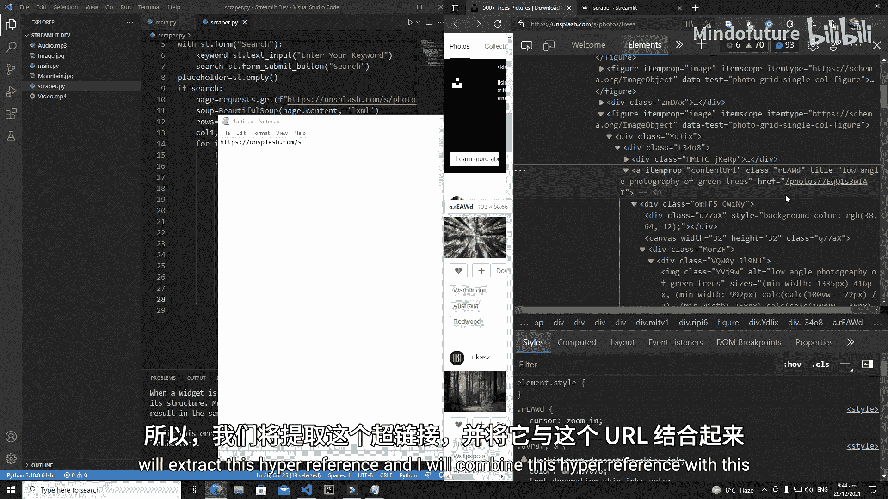

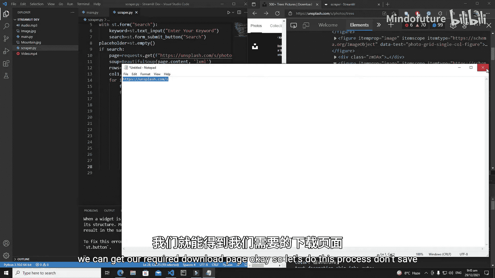

AndLet me search it。 Yeah， of course we have only one n tag okay。

 so we doesn't need any kind of class reference。 Okay， so after accessing the anchor tag。

 we need to access the hyper reference attribute of this tag okay。

 so for now I will just print the hyper reference of this n tag okay。

 so just right here N H or anchor， Okay， and then I will print a HR E F， okay hyper reference。

 Okay and let's save it。And just to close this for now， okay。

 just close it and let's again type streamlit scrapper。pyy。

 hit enter okay and just close this for now as well， this will open a new window for us。And yeah。

 this is our webcraper so let's type TWS3s okay search it and yeah we are getting our required output okay so as you can see here we have this thing we have this we have this and here we are getting these two weird things okay and I think that in order to avoid this kind of thing I need to give a class reference to this anchor tag as well okay so let's copy the class name of this anchor tag okay because it is extracting some other anchor tags as well okay so just inspect it inspect and where is my anchor tag okay so this is my anchor tag this is the class name just copy it and just type here AWS class underscore is equals to this thing okay。

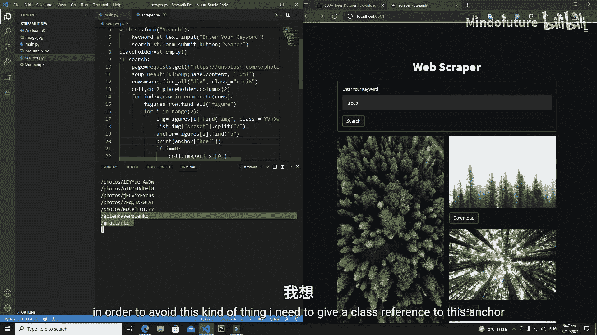

Let's save it And now once I have the image URLls， I need to combine these image URLls with the domain name and whenever user presses this button。

 I need to open that page in a new tab and for this purpose we need an other module that we need to import and that is web browser okay so web browser is basically a builtin module of Python okay so we just need to type here I import WB web browser okay and with the help of web browser。

 we can open a new tab okay so here instead of just printing the message we will say that WB web browser dot or an open underscore new tab and I need to define here the URL So first of all I will combine my unsp this thing Okay so this part just copy it。

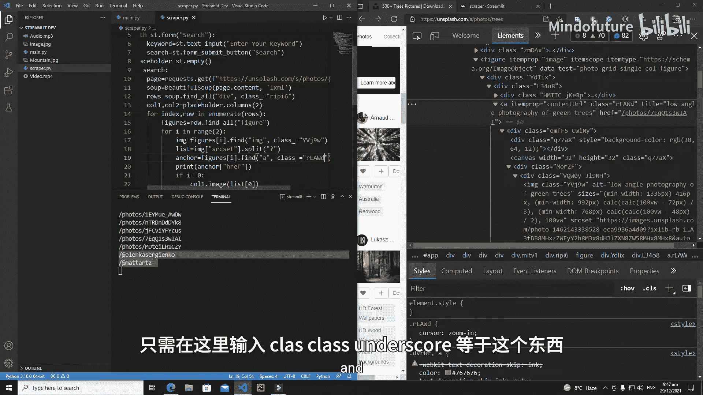

I need to combine this part with image URL okay and my currently the image URL will be this okay anchor hyper referenceence okay so just copy this line as well and paste it here okay。

 I need to open this whole URL in a new tab okay and just copy this whole line。

 copy it and paste it here as well okay so let's paste it and let's save it and let's rerun our application。

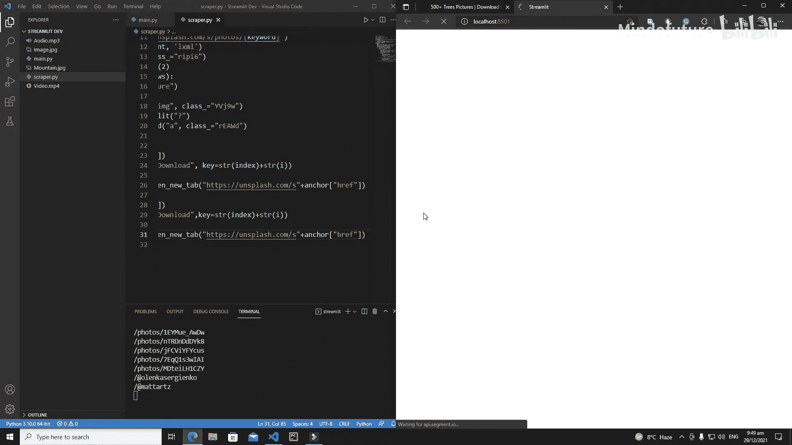

Just search for PA NTS Plan Okay， hit this search okay running。🤢，And okay， okay。

 so these are my images。 So let's click on this download。

Okay so it is not opening our web browser okay and let's check why it is not working and here the reason why we are not getting a required output is that here we are actually saying that if my search is true and this search is basically relative to our this submit button of the form so whenever user clicks on the submit button of the form then we need to process each and everything and I think this is a bug for now okay and here instead of writing like this if user clicks on the submit button then I need to perform my other operation I will search for the keyword okay I will say that if my keyword is not empty okay so if user has entered something in the keyword then I need to process my all other stuff okay so here I need to write a K EYW or or the keyword is equals to this thing okay。

And I think that this will solve our problem， okay。

 so let's refresh it again and let's type here P NTS plans， okay， let's click this search， okay。

Search running and these are my images okay， now let's click on the download download Okay， so yeah。

 this is opening our URL okay so it's good it's very。

 very cool okay so but currently again we are not getting the download page Okay。

 so let's solve this problem as well okay and here let's do some research on the unsped website again okay。

 so let's click on this inspect element Okay， In inspect okay and here we have our anchor and whenever I click on this in anchor I am getting this output okay which is from unsplash dot co photos and this thing Okay so we need to remove this S okay and because of this S we。

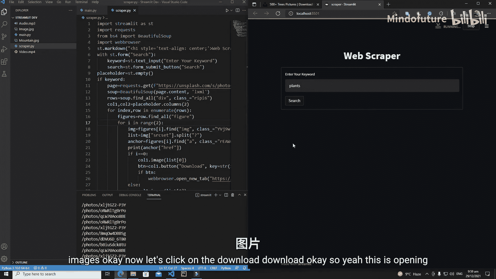

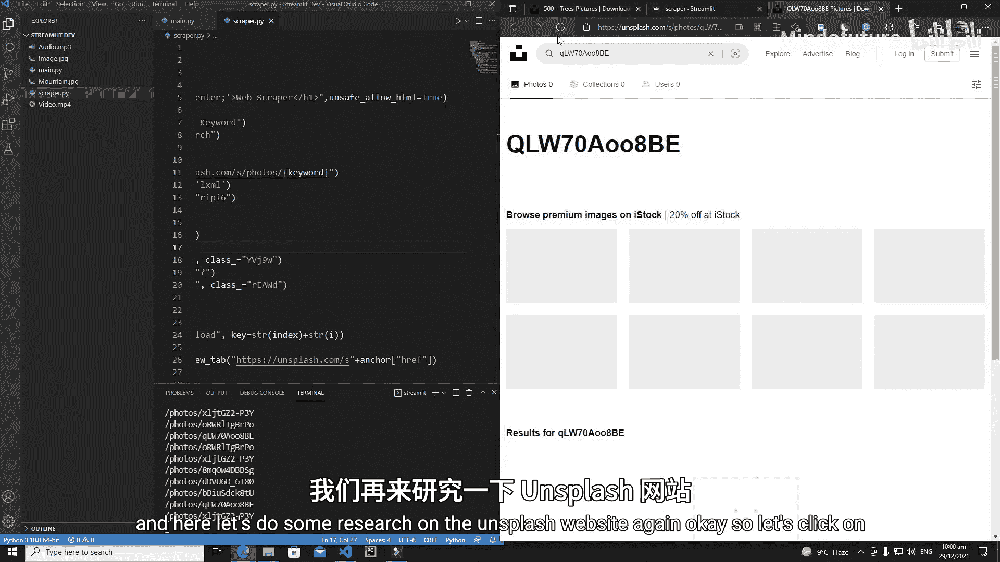

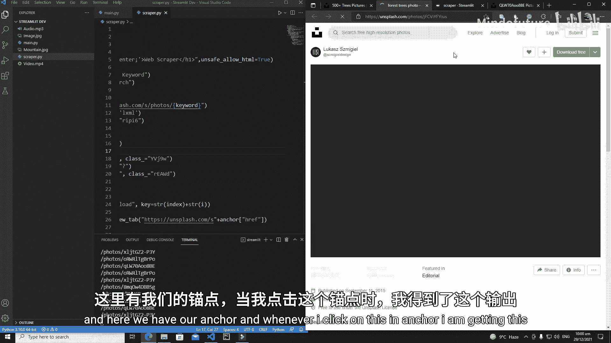

Getting a wrong output okay。 So let's remove this as okay， and let's remove this slash as well。

 let's save it again。 Okay， and just close this and let's rerun it。And here let's enter the keyword。

 PA N TS Plan， okay， let's search， and here we have our output， so let's again click on the download。

Running and yeah， this is our download Okay， so yeah cool we are getting our download page Okay so this is how you can add this download button and in this tutorial we have solved a bunch of bugs in our this web scrapper and in the next tutorial we will see something new regarding our web scrapper and I will see you in that tutorial till that point bye bye。

😊。

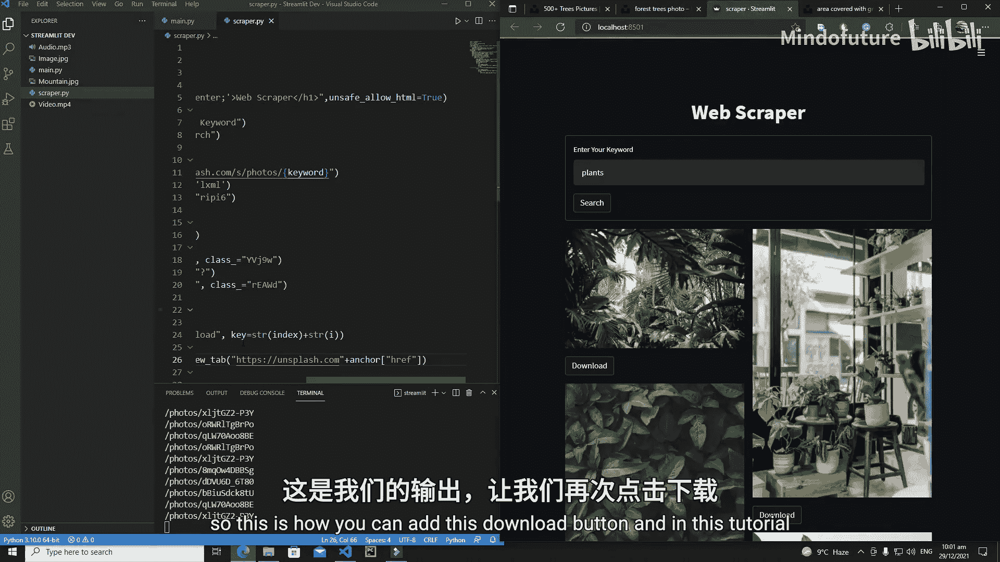