# Python-Streamlit-完全教程-p21-P21-Streamlit-Web-Scraper---Page-Configuration---Complete-Streamlit-Python-Cours--BV1yHVhz1EUD_p21-

Hi everyone in this tutorial， we will configure our streamlit Web app。

 So if you go to the official documentation of streamlit here。

 you will find a property with the name set underscore page underscore config So this property basically allow us to configure our page like if you want to change the title of the page if you want to change the Fcon or the page icon。

 you can change them with the help of this property So if I run my application let me run it Okay so right here the streamlet or U and run and then SC or scrapper dot P hit enter okay and currently if you focus on the title of our web page So the title is scrapper okay so scrapper dot streamlet okay so this is the title and。

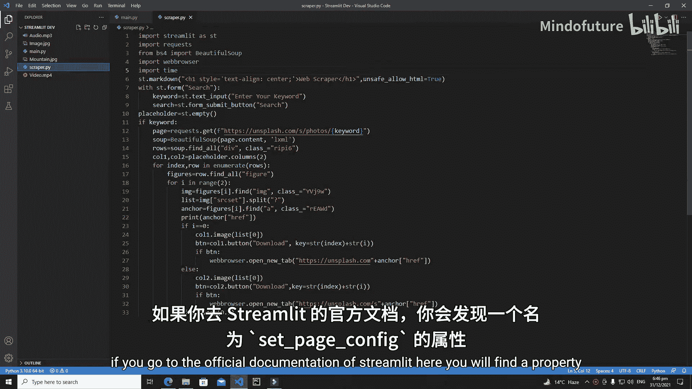

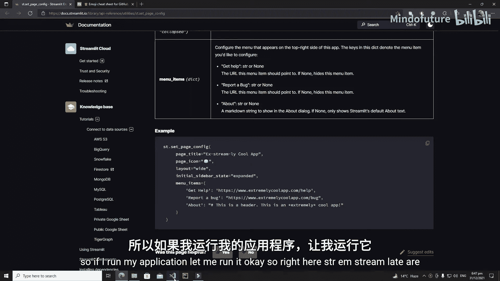

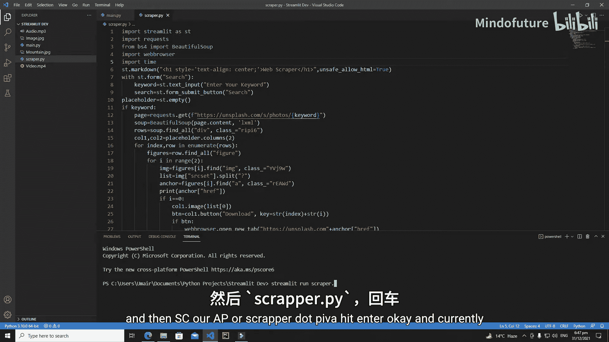

Fbitcon is streamlit logo okay so if you want to change these two things then you need to use this property and inside this property。

 you need to pass these arguments okay so let's change the page configuration first of all here one thing that you need to remember is that you are this set page configuration properties should be on the top of all other functions and properties of streamlet so here I will write S do S set underscore P page underscore C and set underscore page config and then inside this page config I need to pass my properties okay so here as you can see we can pass page title page icon then lay out and then the initial sidebar and finally you can pass menu items okay so let's change the title of the。

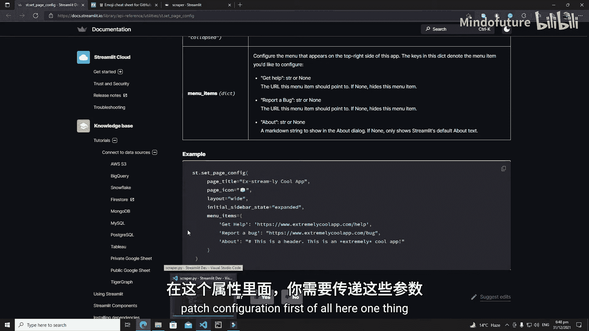

P first， so just write to your page title is equals to。

 and I will give a title like a web SC R A P or webcrapper。

 Okay and if I save it and if I rerun my application。

 you will see here that we will have web scrap yeah this is our webcra and now let's change this icon okay So just right here put comma。

 then P page icon is equals to so now here you can write the name of the icon or you can past the icon itself。

 Okay so if you go to this website， which is I think web fx do com。

 So I will give the link down below here you will find bunch of emojis and different types ofs so as you can see here we have pupil and these are all the pupil icon for example。

 if I want to use this emoji as my favoritecon then I just need to copy this name and just paste it here。

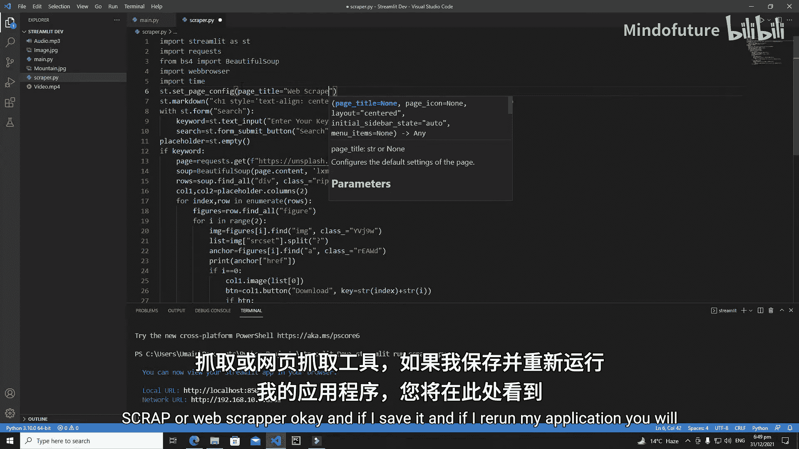

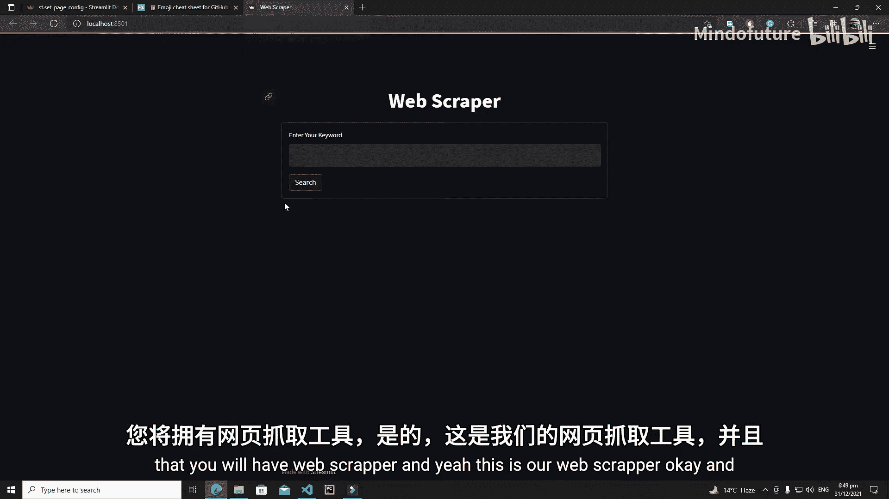

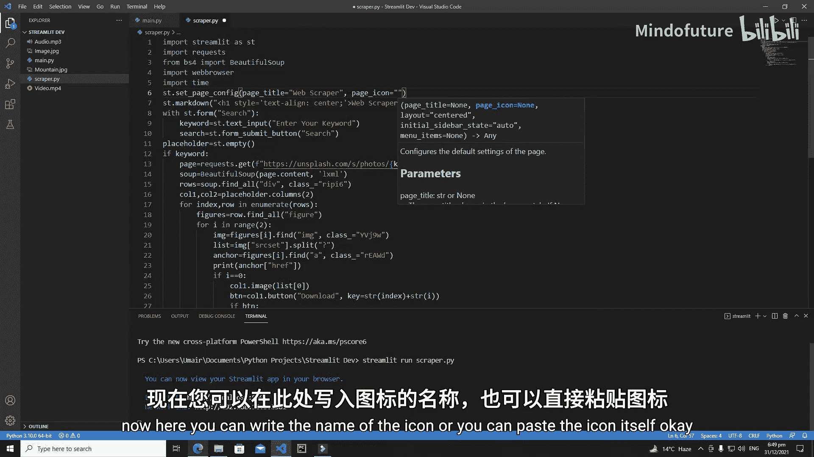

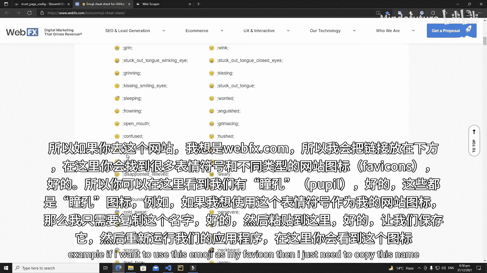

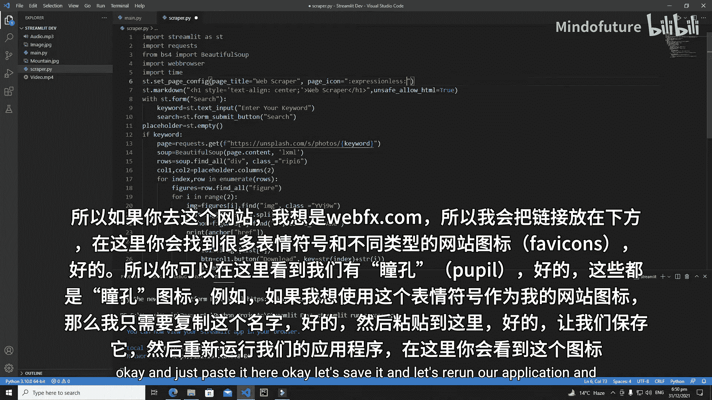

Let's save it and let's read our application。 And here you will see the icon。 And yeah。

 this is my icon。 Okay， so if I search for a word icon like okay， so。😊。

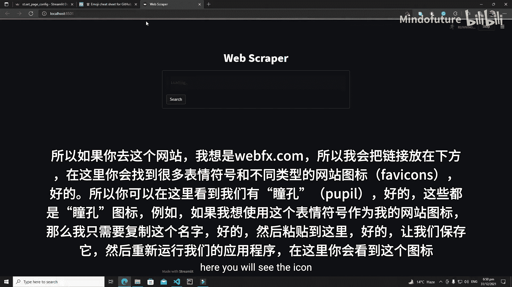

I think it's a great fcon for our web app， okay， so just copy it okay and now let's paste it here。

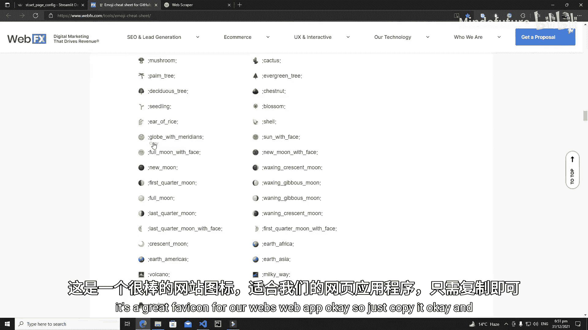

Pasestte it。 Let's save it and let's rerun our web scrap for， okay。

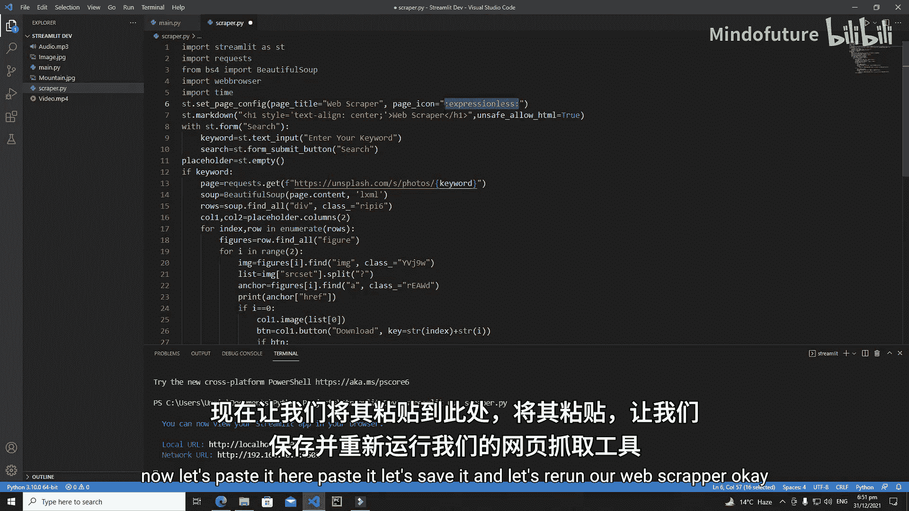

And yeah， this is our web icon okay and you can have some other properties in this as well Okay like you can change the layout so the default layout of our streamlet web app is centered okay so if I copy this layout okay so just copy this line copy and paste it here just put comma paste it here and now you will see that we will have a wide layout okay so as you can see currently everything is centered okay so if I readrun it。

 you will see a wide okay and yeah this is our output okay so this is how layout work okay and then we have initial sidebar state okay so currently our application doesn't have any sidebar So just create a sidebar and just play with this property and then we have menu items okay so these menu items basically represents the menus in our hamburger okay so these are the get help property okay and report。

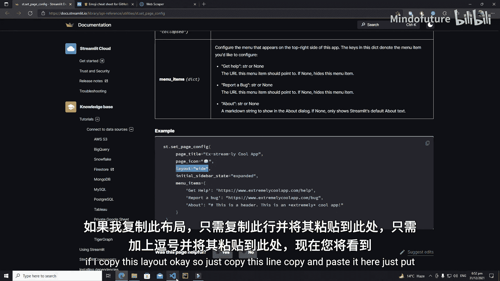

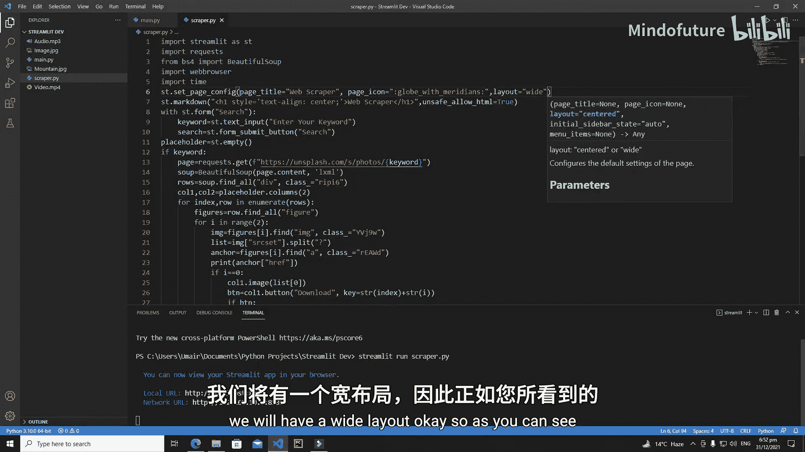

About okay as you can see here， we have these properties get help report above okay about and for these properties you can set your custom URLs or your custom text okay as you can see here for the about attribute we have this value okay so this text so this is how this set page configuration work and this is how you can configure your web app I hope that you have enjoyed this tutorial and in the next tutorial we will see something new till that point bye bye。

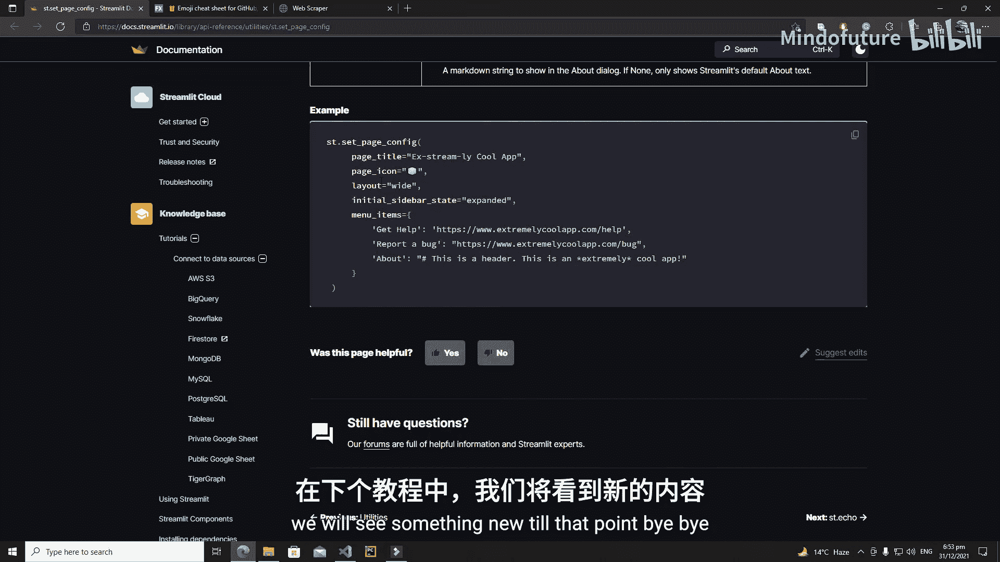