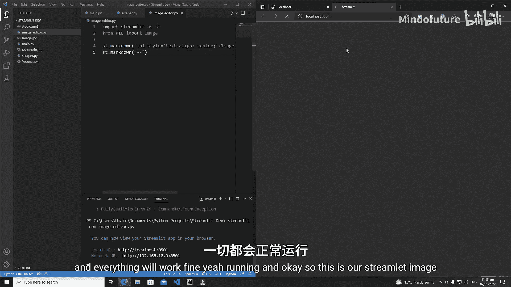
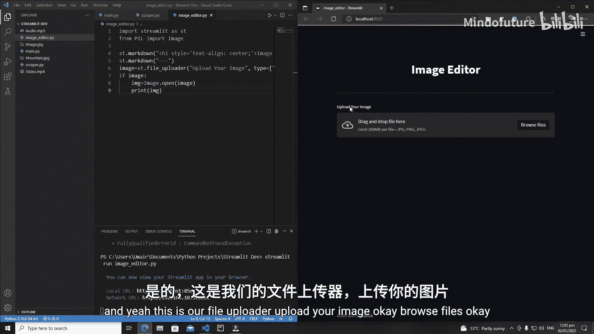
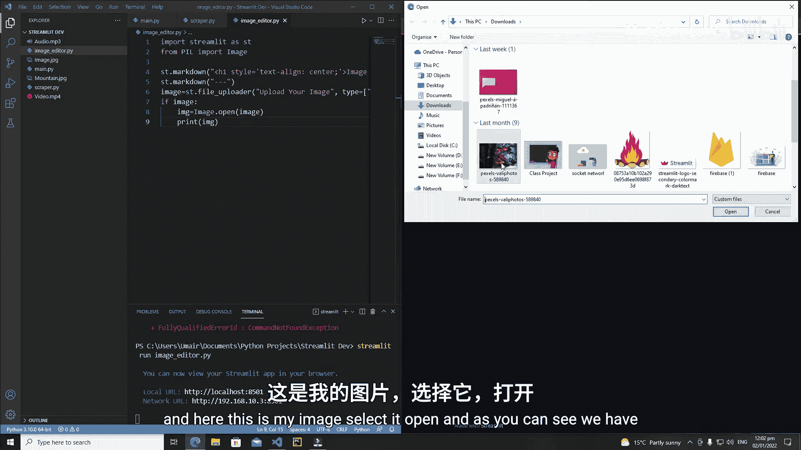
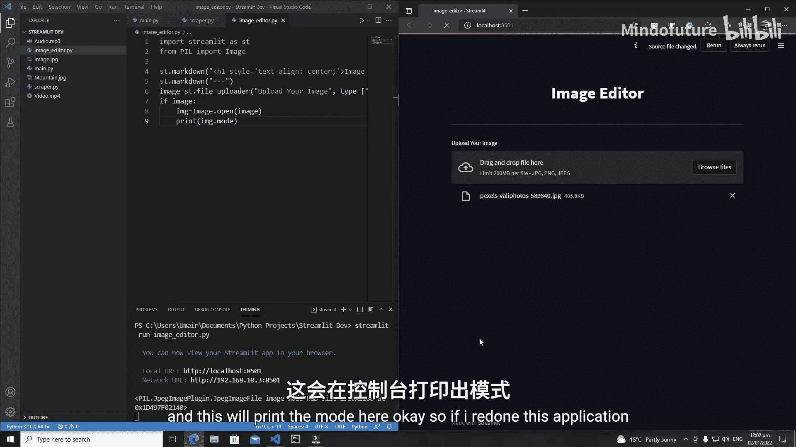
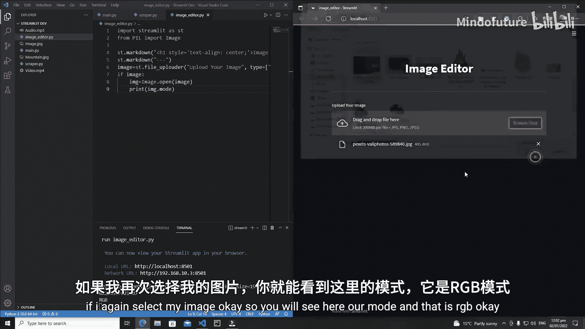
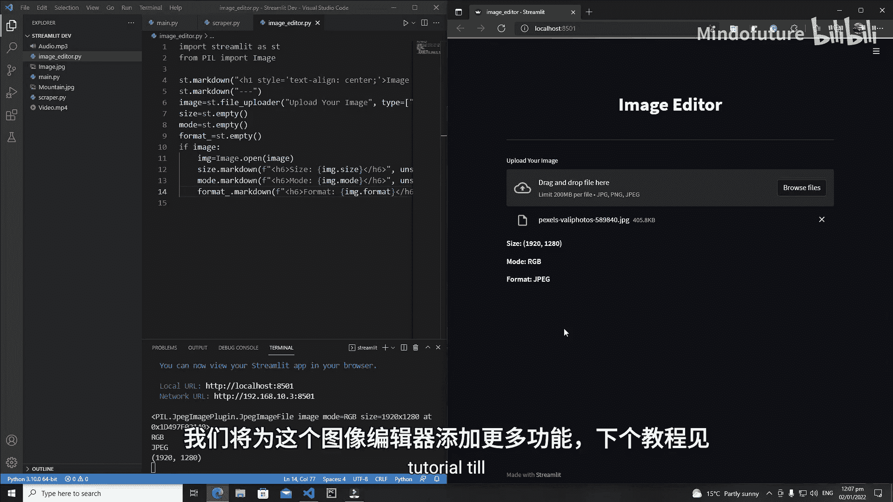

# Python-Streamlit-完全教程-p22-P22-Streamlit-Image-Editor---Complete-Streamlit-Python-Course---Tutorial-1--BV1yHVhz1EUD_p22-

Hi everyone in this tutorial we will start making our basic image editor in streamamlit。

 so first of all， let's create here a new Paton file okay and I will name it like I amG image underscore E ITR editor do Pfi okay so hit enter and this will be my file and now first of all we need to import streamlit So just right here I or R import SRE streamlit as SD and then we need to import an other library which will allow us to edit our image and that is P okay so make sure that you should have pillow and otherwise if you don't have pillow just go to the terminal new terminal and right here P I develop install P develop pillow hit enter and this will install your pillow but as you can see my。

Ament is already satisfied。 Okay， so I do not need to install pillow。

 So here you need to write from P I N。 So pill is basically a representation of pillow。

 If it stands for Python image library， I think。 So okay， so from pill import。

IM AG so we need to import image module in order to play with the image。

 Okay and these are two things which you need to import first Okay and then after importing these two things。

 I should create first a title for my application so just right here S do mark down and this will be my h1 tag so h1 then just close this h1 tag slash h1 and then just right here unsafe allow htl to T are you true sorry true and then inside this H1 tag。

 I will say IM image E D ITR editor and I will make it in the center of the screen so just right here style is equals to and then right here T X text land and your center and this semi。

Okay so this will create a markdown in the center of the screen Okay and after creating a markdown。

 we need to have， I think we should draw a line as well so just write here S do markdown again and then you need to put this dashes so just save it and now here you need to write S R E streamlet are you un run then I am A G image underscore score E D ITR editor dot P hit enter Okay sorry we got an error Okay so we need to change this spelling so streamlit。

 we need to give a space before run let's hit inter now and everything will work fine running and so this is our streamlit image editor but we have dashes So put another dash here as well sorry they not。

On this one let's save it again， let's reload it。 And yeah， now we have a line here。 Okay。

 and beneath this line， I think I should create a file uploader widget in order to upload images Okay so just right here S dot file uploader and I will say U P already upload your I images。

 Okay， or maybe upload your images okay and then in the type I will pass my all possible formats of images Okay so I think first should be JPG okay and then we have P andG images then we have JPE G images。

 So just research on these formats and pass your all possible images formats here okay and after this file uploader。

saveve my uploaded file inside this IMG image variable。

 Okay so this image variable will actually hold my image。 Okay， and after doing this step。

 now it's time to play with pillow so here I'm importing my image module of pillow I will pass my this image to this module。

 Okay so just right here I image。 Okay and then inside this image module。

 I need to open my this image as an editable image for pillow。 Okay。

 so just right here dot operator and then you need to write here open okay so I need to open this image。

 so just write your image and then I will save that open image inside this IG variable。

 But first before I do this step， I need to right here and if statement and that will be first of all。

 I will check that。This I amG image is not empty。 okay this means that if user has successfully selected an image。

 then I need to perform this step。 Okay and for now just print Ig IMg okay so you will get a weird output but yeah let's print something on the screen okay and now let's rerun this application okay image and yeah this is our file uploader。

 upload your image okay browse files。 okay and here this is my image selected open and as you can see。

 we have now upload pillow object okay so this thing okay and this is the mod okay。

 this is the size and this is the address of that object okay so this is a memory address and now first of all。

 if you don't know about pillows so pillow is a very。

 very easy library of pattern which allow us to play with images and for example， if I want to。

Print the mod of this image。 Okay， so you just need to write IM G dot M D mod。 Okay。

 and this will print the mod here。 Okay， so if I written this application。

 if I again select my image Okay so you will see here over more than that is RGB okay。

 and if you want to print something like a format。 or R format of your image。 Okay。

 you can do this as well， just reload this thing browse file， okay， select your file。

 open it and yeah， my format is JP E G okay， so it's cool。

 And now if you want to print the size of your image or the dimensions。

 you can do this as well just right here as I said the size。

 and this will print the size of the image， so reload browse file okay， and select it open it。

 Okay and yeah this is the size of our image Okay， so 1920。

1280 okay and now here I'm thinking that instead of printing the mod format and size on this terminal。

 I think that I should print them on this streamlet web app okay so let's print them。

 So here before I actually do this process I need to create three empty plus holders。

 Okay so each place holder will hold my one of the image property。

 so for example my plus holder one will hold my mod of the image。

 the second will hold the size and the third will hold the format Okay so let's create here three empty plus holders okay so first of all I will have size is equals to st dot E andpt or empty so this will be my plus holder one which will hold the size。

 then we have the mod is equals to ST do empty okay so this will hold the mod and then we will have for our M form。

But format is a reserved giver so just right here underscore is equals to S dot emPT empty okay and this will hold my format okay and now after opening the image I will say S IZ size do I will use mark down here again okayKDW and mark down okay and then it will be my at6 tag okay so at6 okay and then we need to close this at6 tag as well okay and this will be my formatted string so just right here F and inside this at6 tag I will write S IZ size okay and then I need to put these brackets and then I will say IMg dot SZ size okay it cool and now I will do the same process for my modern than format okay so M orD mod do MK D DW。

Mardown okay， this will be again my formatted string okay and it will be at6 as well Okay so just right here at6 then we need to close this at6 okay at6 and then I will say MD mod okay and then it IMg dot MOD mod okay and I need to create my third markdown okay that will be my format format underscore dotKd or W and markdown okay and this will be my formatted string again okay then at6。

Then close this thing， close at6， and then I will say f orR M format Okay。

 and then these parentheses Ig dot F or R M format Okay and we need to write here unF allow Hml and F is una underscore sorry A or W allow underscore hml is equal to are you true Okay and just copy this thing and past it here and then past it here。

 Okay， let's save it and I hope everything will work okay so let's refresh this thing again and browse file select the file open it and yeah。

 we have our information。 So our size is this our mod is this and our format is this Okay so it's cool and this is how you can come。

tail of its streamlight in order to get awesome output。

 So I hope that you have enjoyed this tutorial and in the next tutorial。

 we will add some more features to our this image editor。

 and I will see in that tutorial till that point， bye bye。😊。

