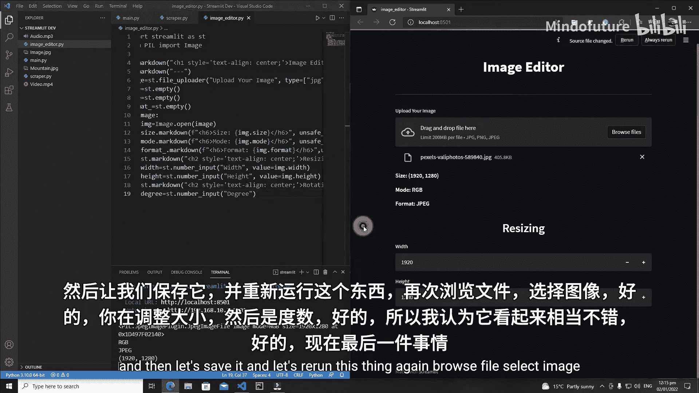
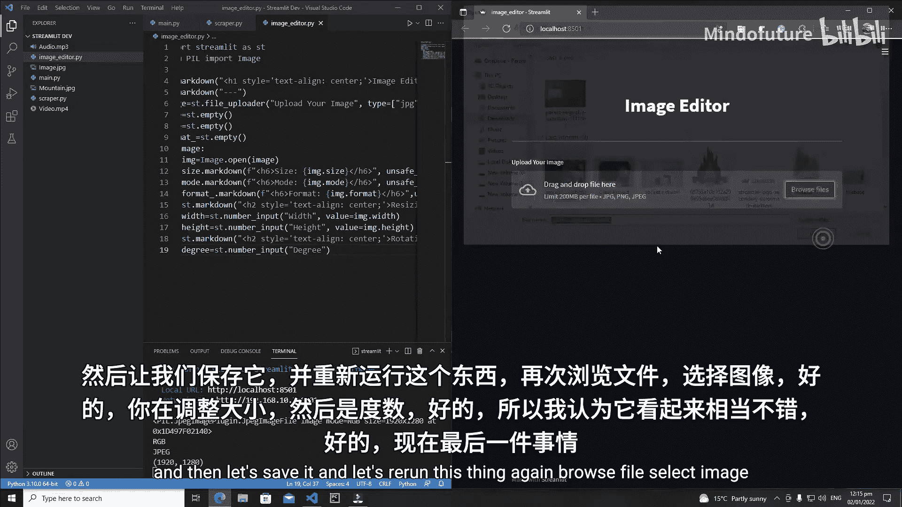
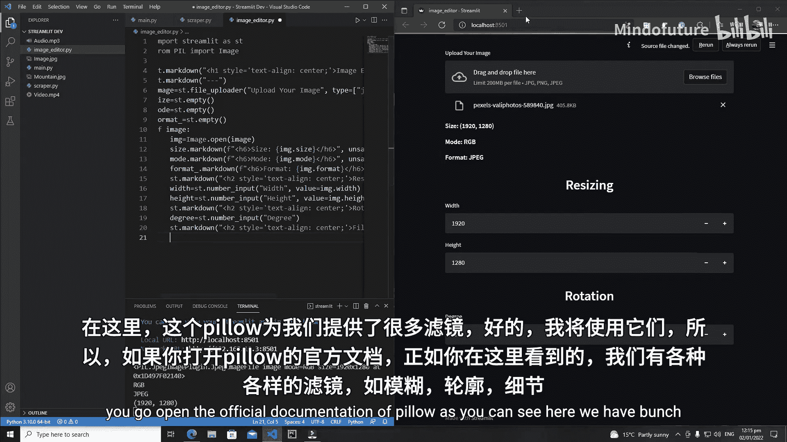
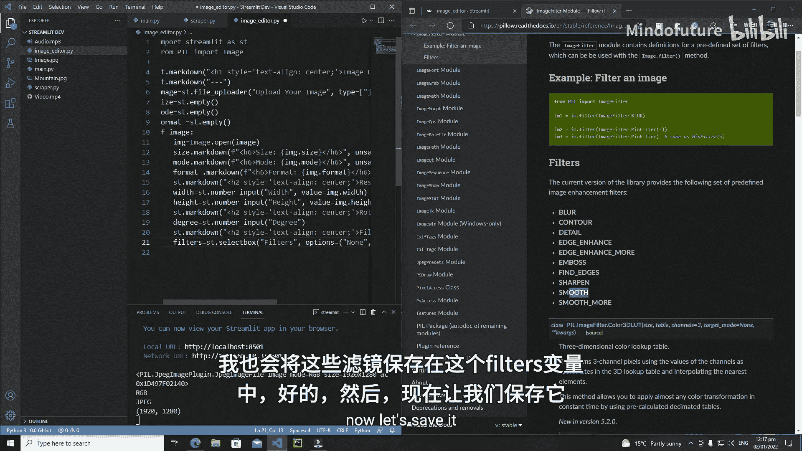
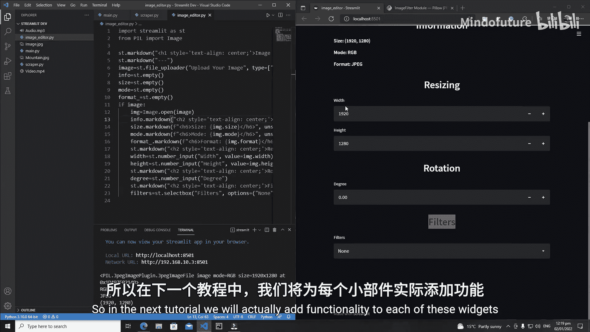

# Python-Streamlit-完全教程-p23-P23-Streamlit-Image-Editor---Complete-Streamlit-Python-Course---Tutorial-2--BV1yHVhz1EUD_p23-

Hi everyone in this tutorial， we will add resizing rotation and filters to our image editor。

 so let's start the lecture and first of all I need to I am thinking that I will write here heading for my resizing and I will use a mark down again so just right here H do sorry mark down okay and I think I should use maybe H2 tags so just right here H2 and just close H2 tags here sorry close them and inside these h2 tags I will write IZ IH resizing and I will say unsa allow hml to T you true and I will make this thing in this center as well。

So just write this part。 Just copy this part。 Okay， not， sorry， till that point。 Okay。

 so just copy it， copy and paste it here， okay。Let's save it， let's refresh it。

And before I browse it， okay， so let's add some more features to it。 and then we will browse it。

 Okay， so after adding a markdown， I need to ask user to enter the width and height of the image。

 so I will save my W I D TH width inside this width variable。 Okay， and I will say S dot N NR。

 So I will use here a number input because I want to get numbers from the user。 Okay。

 so I will use here a number input and I will say WI D TH width， okay。

 and let's do this process for height as well height is equals to S dot N U NR number input。 Okay。

 and then I will say H E I GH T height and let's save it And now let's rerun this thing and see how it looks like now。

So just select the file open and yeah this is my resizing heading and this is the width and height so user can enter width and height。

 but here I am thinking that instead of00 I need to print the actual width and height of the image and then with the help of this plus n minus a user can reduce and increase the size of the image so here again I will use another property of number widget that is v value is equals to with the help of pillow I can get the width and height of the image separately as well So as you can see here we are getting a tu but I can get the separate width and the separate height as well so just right here Ig wdtH width and this will return a width for us and I will do the same process here as well value is。

Eals to IM G dot H EIgHT high token now， let's save it and let's refresh this thing。Browse files。

 select the file open it。 And yeah now as you can see， we have 1920 and then 1280。 Okay。

 so I think now it is looking quite better。 Okay， and let's add rotation feature here as well Okay so just copy this markdown。

 Okay， just copy this one， copy it and paste it here and instead of resizing。

 I will say R O T A T I on rotation。 Okay， and in the rotation。

 I will also ask user to enter numbers。 Okay， so I will use this S input widget。 Okay。

 so just copy it paste it here， okay， but here I will use D E G R W degree variable。 Okay。

 because I want user to enter numbers in form of degrees， okay or something like。That okay。 And here。

 instead of writing a level width， I will say D， E， G，RW degrees。 Okay。

 and I will remove this part as well。 Okay， and then let's save it and let's rerun this thing again。

 browserow file。

Select image。 Okay， and you are resizing and then degrees。 Okay， so I think it's looking quite good。

 Okay， and now final thing which I need to add here is the filters。 Okay， so just right here again。

 this markdown。 Okay， so just copy this line， copy it and paste it here， and instead of rotation。

 I will say I Lt filters。 Okay， just save it。 and here this pillow， provide us a bunch of filters。

 Okay， and I will use them。 So if you go open the official documentation of pillow。

 As you can see here， we have bunch of filters like blur contour detail enhance and much more。

 so I will use this blur。 And then I think this contour detail in both as well then smooth filter。

 Okay， I will use here a select box fidgeget of。

Streamlet okay， so just right here， S D dot S E L select box。 Okay。

 and then I will say F I L T F I L T or filters。 Okay。

 and then inside the options P T I U options I will pass my filters name Okay， so like first of all。

 I will have a none filter。 Okay， so if user doesn't want to apply any kind of filter。

 he can select this none Okay， and then I will have the L U R blur filter。 Okay。

 and then I will have D E T I detail filter， and then I will have maybe E M B orbo filter and then I will have like S M double O smooth filter。

 Okay， I think it's enough。 You can use all of them。 But for now， I think it's enough。 Okay。

 and I will also save my。Filters inside this F I L T filters variable。 Okay。

 and now let's save it and let's refresh this thing and see how it is looking now。 browse file。

 select image open it rotation， resizing rotation and filters。

 Okay and these are my filters none below detail and Bo smooth。 Okay， I think it's good。

 and here one thing that is weird for me is this thing。 Okay。

 I think I should right here heading for them as well， Okay。

 so if I let's let's let's create here and other empty plus holder。 Okay。

 right here and I I NF info is equal to S dot E P T empty。 Okay。

 and now below this thing and about these markdowns， I will say I NF info dot and let's copy these。

Mark down。 Okay， so just let's copy this one， copy it and paste it here。 And instead of resizing。

 I will say I and F or R M I an information， Let's save it and let's rerun this thing and browse file select file open it。

 And yeah， now I think it's looking quite good。 Okay， so information， then this is the information。

 then we have resizing feature， rotation feature and then filters feature。 So in the next tutorial。

 we will actually add functionality to each of these widgets。

 And I will see you in that tutorial till that point bye bye。

