# Python-Streamlit-完全教程-p24-P24-Streamlit-Image-Editor---Complete-Streamlit-Python-Course---Tutorial-3--BV1yHVhz1EUD_p24-

Hi， everyone in this tutorial， we will add functionality to each of these widgets。 Okay。

 so let's first of all， I think that whenever user changes any of these properties。

 I will have a submit button here as well and whenever user clicks on that submit button。

 I need to display my edited image on this stream web app okay。

 so just right so let's create here a button Okay so just right here S do be U doublet on button。

 Okay， and the label for this button will be like SB MIT submit okay and I will also save the set of this button。

 So just right here S underscore B and is equal to submit button。

 Okay and I will check that if my S underscore Bt and is true。

 this means that if user clicks on this button， I need to process each and everything。

So first of all， I need to apply my resizing and my rotation properties on the image okay so here okay so here I will not use this image variable because we are playing in pillow with the image using this image variable okay so here I will write I amg dot and then I will first of all I will resize my image So just right here R I that resize okay and then inside theize we need to pass the width and height in form of a tuple okay so just create a tuple here and now as you can see this width and height basically holds our reized image width and height okay so we need to pass here width first okay so WI D TH width okay and then H EI GHT height okay and then I need to apply my rotation property on this image as well okay。

I will put a dot and then I will say R O T Tu and rotate okay， so not rotation rotate Okay。

 and then I need to pass my angles。 okay and where is my degree Okay。

 so this degree variable basically holds my angle okay so just right here D E G R W degree Okay and I will save this image in this E D IT edited variable Okay and here for now just display this edited image okay so just right here S dot I am AG image Okay and then pass your ED IT edited okay so let's save it and again。

 let's rerun this thing browse file。

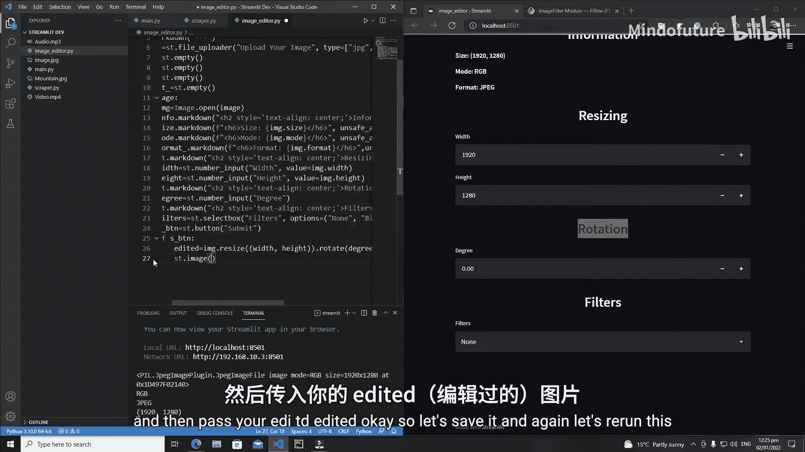

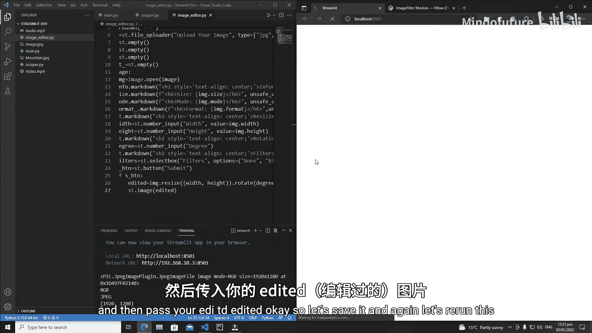

Select the file open it。 And here I think instead of changing the width and height。

 I will change the rotation Okay， so like， for example。

 if I want to rotate my this image on an angle of like 1，80 degree。 Okay， so we will have a re image。

 Okay， so just click on the submit。

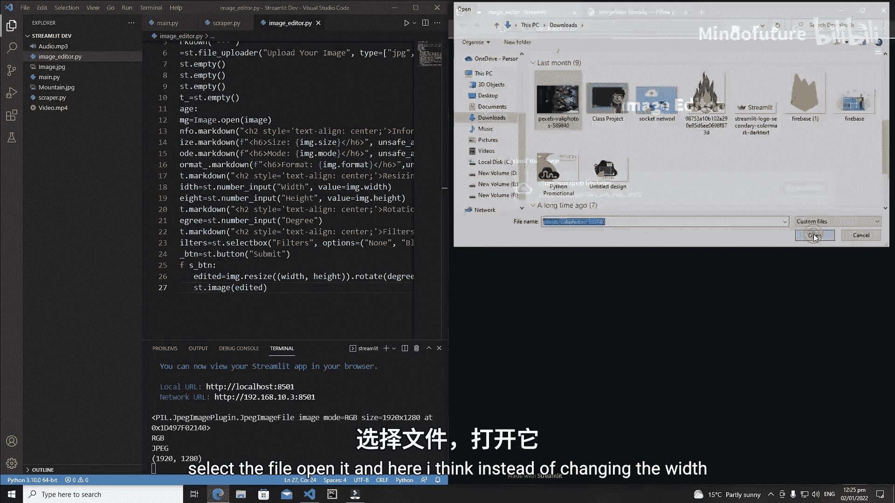

And yeah， our image has been rotated in 180 degree angle。 okay。

 so I hope that you have enjoyed it and it's working cool。

 So now let's change the w okay so like for example。

 if I change the V to 100 okay and if I again click on this submit okay and yeah this is the W okay so now our width has been changed。

 Okay， so everything is working fine。 and now let's add functionality to this filters as well。

 Okay so here first of all， I will check that if my this filter is none。

 then I need to do nothing okay， but if user has selected any of the filter。

 then I need to apply that filter on my edited image as well Okay so here， first of all。

 I will check that if my FLtrs filters is not equals to。😊，N or any none。 Okay。

 so if user has selected something。 And here I need to pass this nu in form of a string because select box return everything in form of a string。

 Okay， and that's why we need to write none in in this format。 Okay。

 and if my this filter is not equals to none， this means that if user has selected some filters。

 then I need to play with the filter。 So I need to apply my filter on this edited image。 Okay。

 so just right here， E D I T， the edited image。 sorry， sorry， E D I T， the edited image。🤢，Dot okay。

 and then inside this pillow， we have an other module with the name image filters。 Okay。

 so we need to import that as well。 Okay， so just right here。

 F R O M from P I L pill dot I M H image F I L T filters I to import everything。 Okay。

 so just put this star。 So we need to import each and every filter。 Okay。

 and here I will say edited image dot F I LtR。 then I need to pass my filter name。 Okay。

 and here we will pass our filter name based on the selection of the user。 Okay， so first of all。

 after checking this part， I will again check that if my user has entered F I L T filters double equals to maybe B。

L you are blur first。 Okay， so if user has selected blur， then I need to apply my blur filter。 Okay。

 so just write here B L U R blur。 Okay， and else if F I， L T R filters is equal double equals to。

 And what is my second third option， that is detail。 Okay， so if user has selected D， E， T， A。

 I L detail， Okay， then I need to apply my detail filter Okay， so E， D， I T， E， D， sorry E， D。

 I T D edited dot F I， L T R filter。 Okay， and then I will say the， E， T， T A， I L detail filter。

 Okay， and I will again check E L， I， F， else， if O， F I， L T R filters。ELS E L， okay， else。

 I will apply my smooth filter。 Okay， so just write to here ED I it it did。

tfiLtR filter and then I need to write here as M double O it smooth Okay so let's save it but here I also need to save the image after applying filters okay so just save edited image again in a variable and I will say FLT filter filter and then FLTD filter is equals to this okay just copy this name。

 copy it paste it here is equals to and paste it here is equals to and now when here I need to remove this part okay so just control X cut it and paste it here okay and now here one thing that you need to keep in mind that we are actually checking that if user has selected any filter。

 we need to apply that filter but if someone doesn't select。filter。

 and if he just plays with the rotation and resizing then we need to we do not need to apply any kind of filter。

 So here I will say that my Fi LtRD filtered image is equals to edited image first okay and then if user wants to apply some kind of filters。

 he can apply it and then we will update the value of this filtered variable and finally I just need to display my this filtered image Okay so just right here instead of edit it。

 I will say FLT alreadyD filtered image Okay and let's save it and now let's rerun this thing and browse file browse any kind of file。

 okay select this one upon it and yeah information resizing and now for example。

 let's apply this blur filter without changing their size and rotation Okay and now let's submit it。

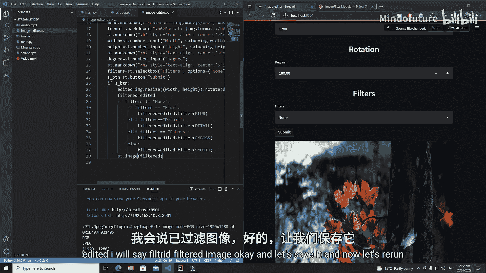

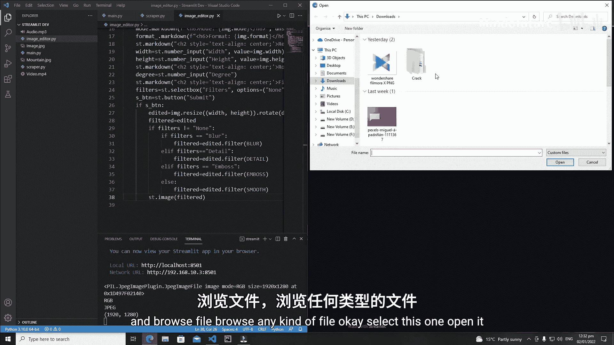

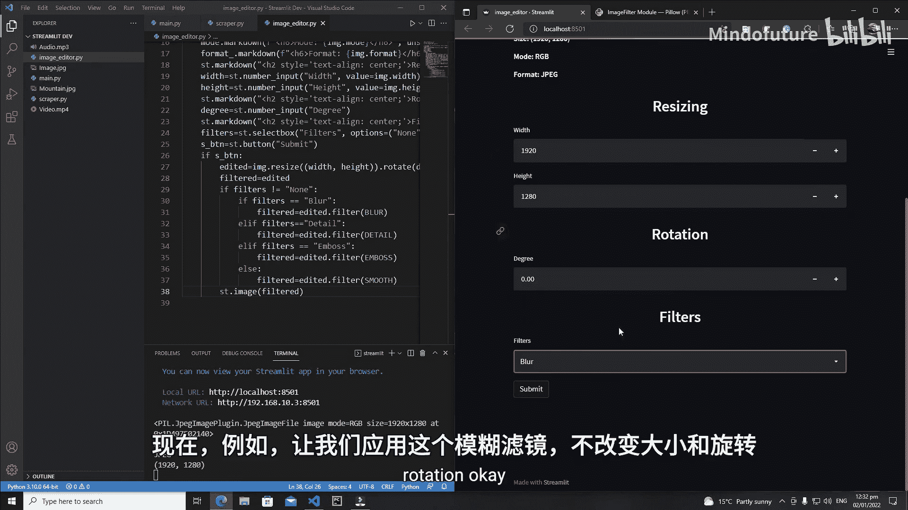

And yeah， if I maximize this thing， our image has been blurred。 Okay， so just maximize it。

 And as you can see， we have now a blurred image。 Okay， so it's called every filter is working fine。

 So if I select this inbo filter， okay， and if I change the degrees to maybe like 90， okay。

 90 and if I change the height and width。 So let's interchange the height and width。

 So 1280 and then 1920， okay， and let's submit it。

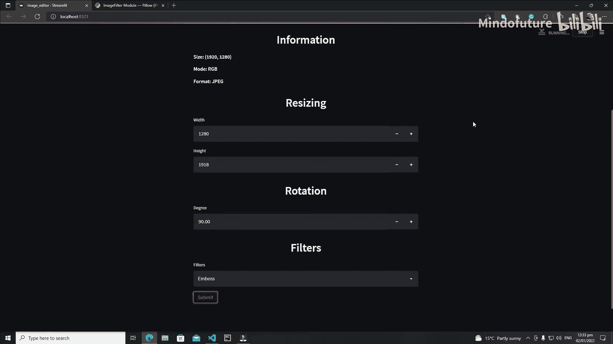

And yeah we have an inboss image okay， as you can see our image has been embossed。

 but yeah we have a weird output and this is what this inboss filter does Okay。

 so let's create a smooth filter and just click on the submit。😊。

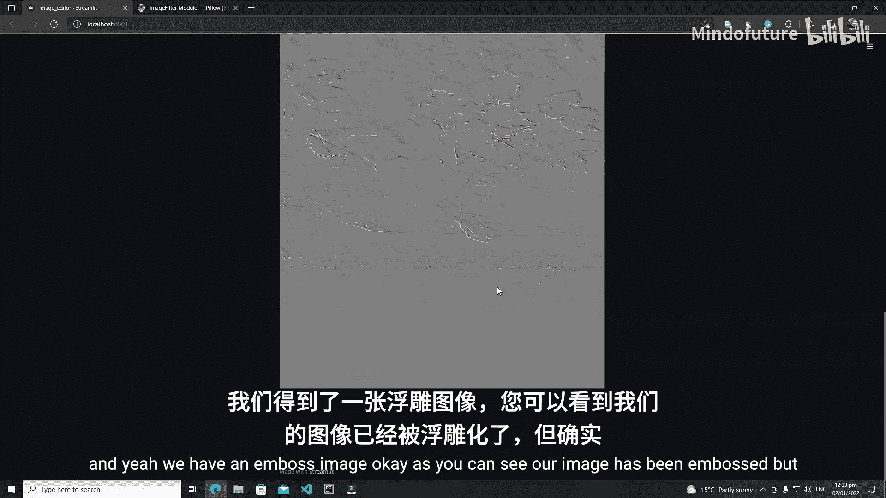

And yeah now we have a smooth image but yeah again it is not smooth because we have changed the rotation and the and height okay but yeah we have a smooth image again。

 this is how this smooth filter work I hope that you have enjoyed this tutorial and in the next tutorial we will see something new till that point bye bye。

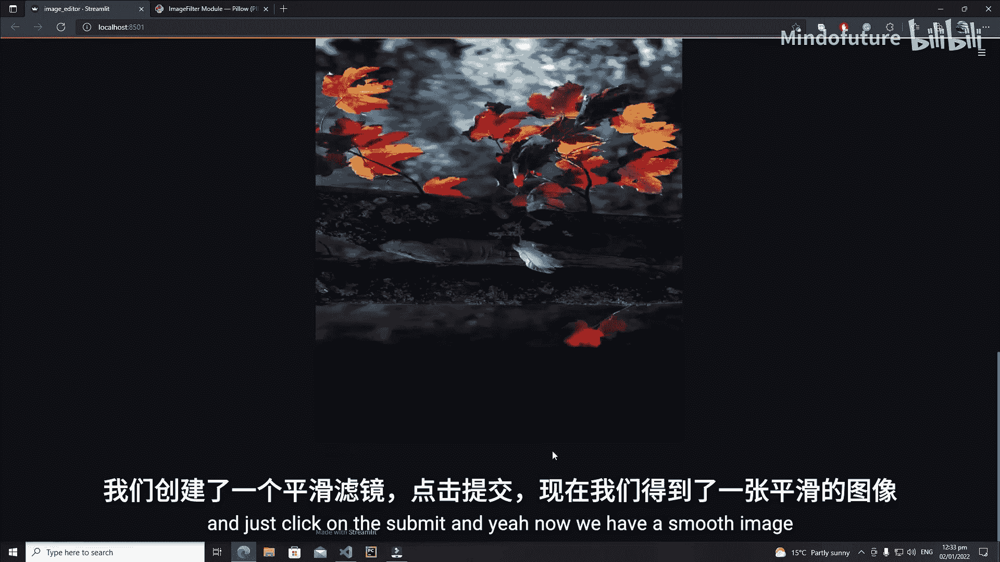

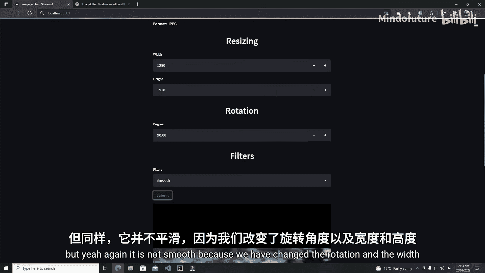

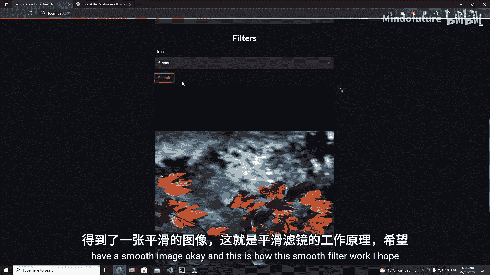

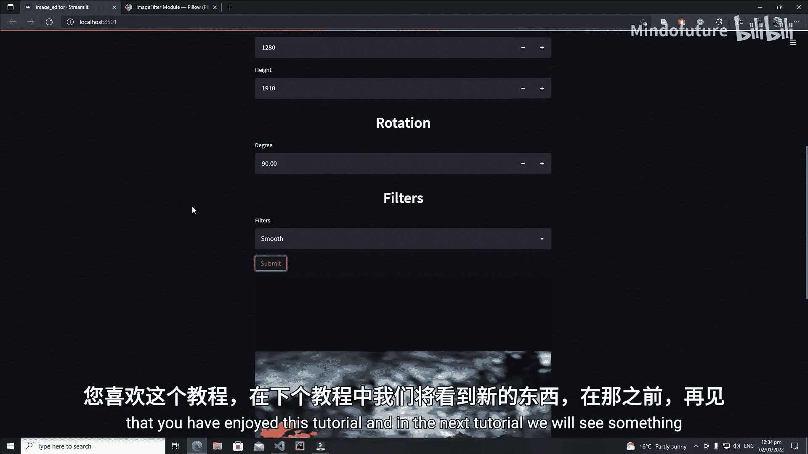