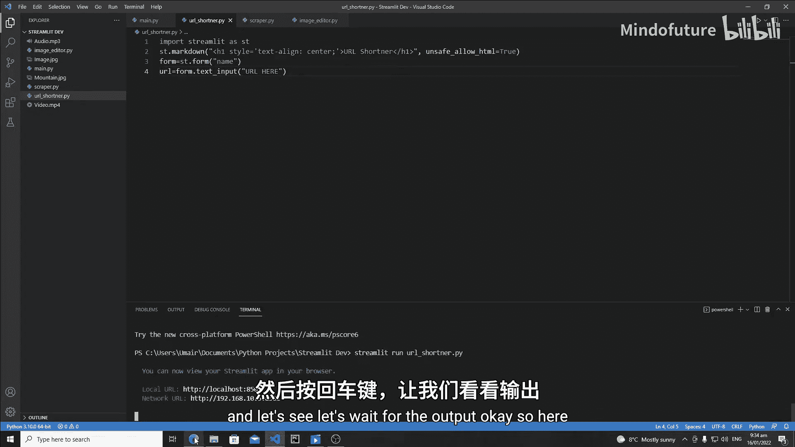
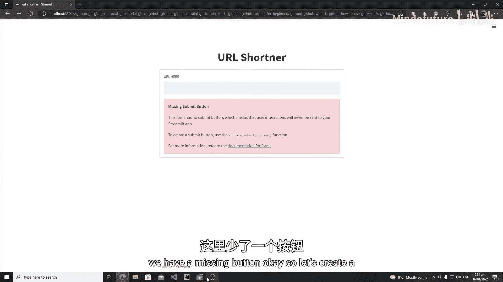
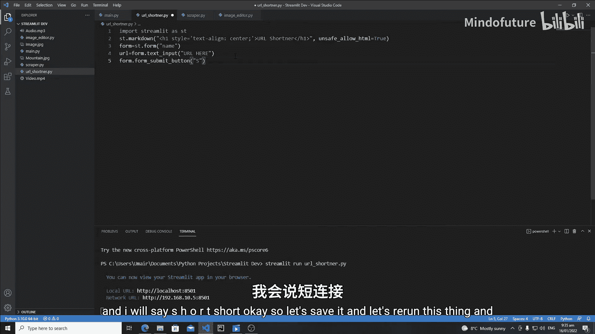
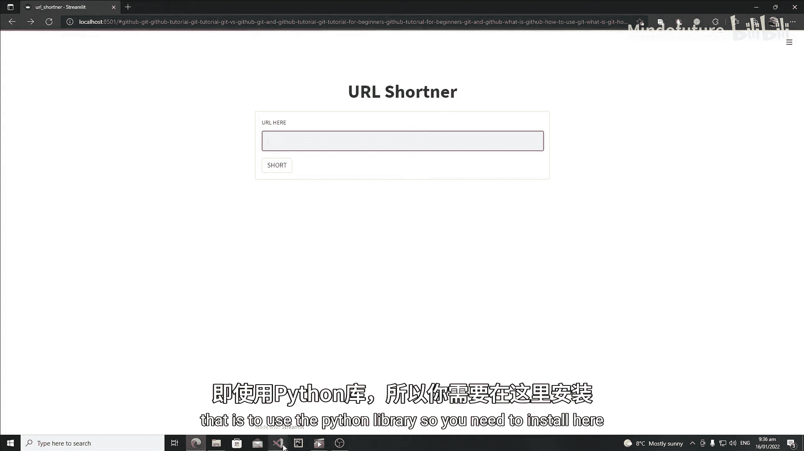
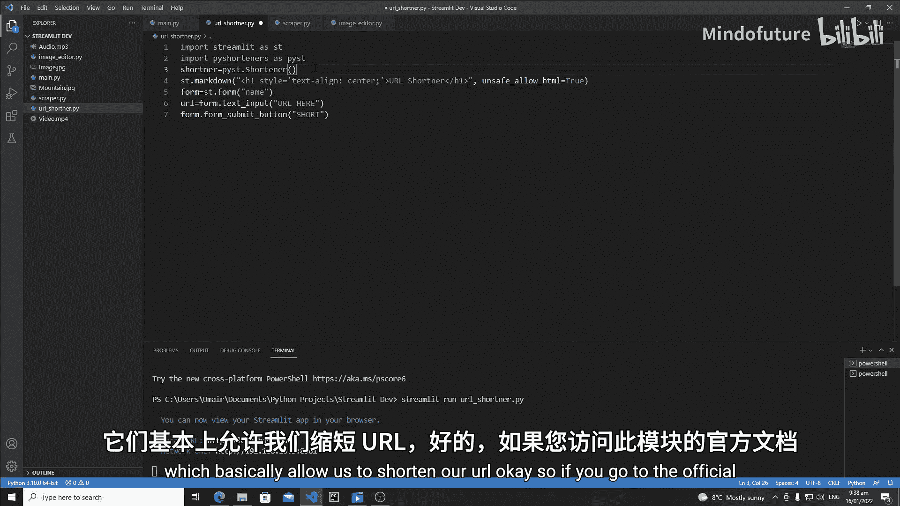
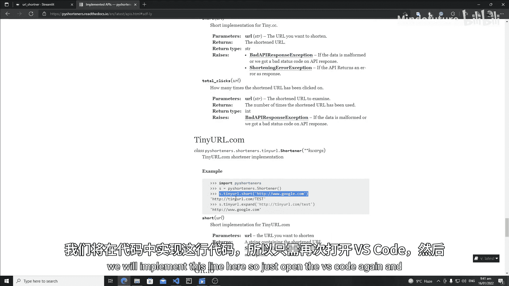
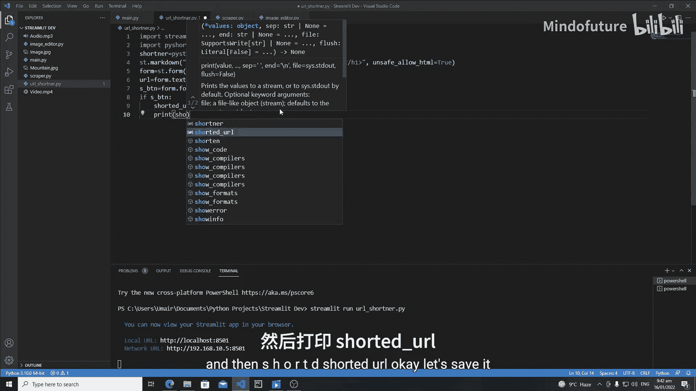
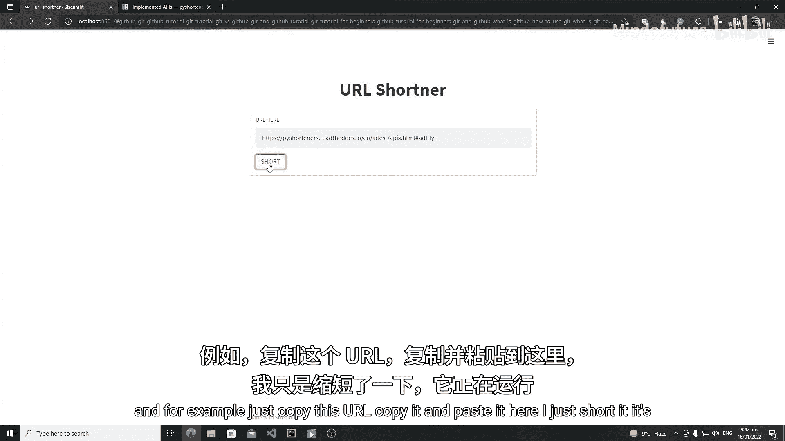
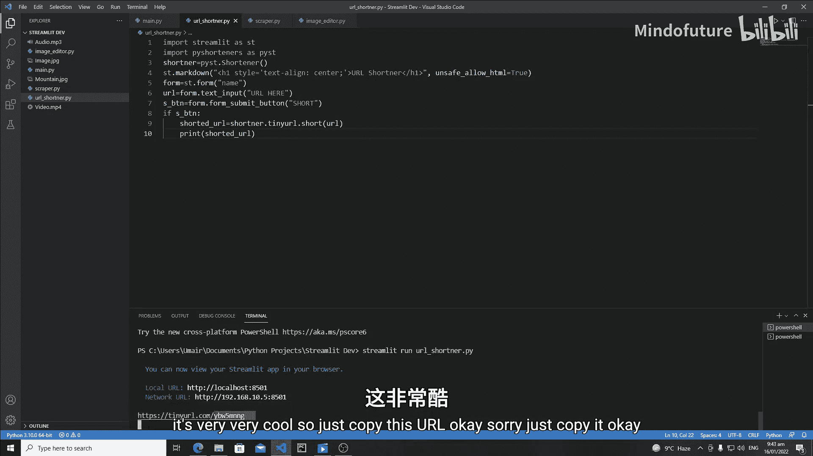
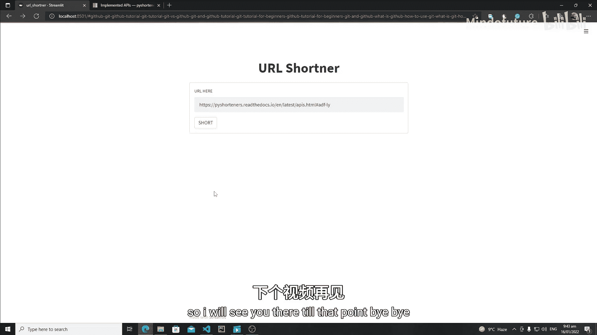

# Python-Streamlit-完全教程-p25-P25-Streamlit-URL-Shortener---Complete-Streamlit-Python-Course---Tutorial-1--BV1yHVhz1EUD_p25-

Hi everyone in this tutorial we will start making our URL shortener app in Python using Stlit library。

 So first of all， let's create here a new separate file So just click on this file I can give an to your file and in this case I will go with like URL underscoret and your shortener Pva and then hit enter and this will create a simple Python file So first of all we need to import our streamlet So just right here I or import S E streamlet as S and now let's create a basic interface for our URL shortener so I will create a title first or maybe a markdown so just right here S doK mark down and then you need to pass here your tags or every data so I will go with H1 tag so just close your H1。

And here I will write URL S H O R T N E URL shortener。

 okay and let's change this styling okay so style is equal to and then T E XT text IG and align okay and I will make it center and I think okay so here you just need to write unsafe allow hml to T you true Okay this will create a URL shortener title。

 something like that Okay and we need this thing I will have a form Okay so here I hope that you know very well how to create form So we have two different methods to create forms but in this case I will not go with the width keyword form okay because there are some issues with that form for this application so you can try it okay and then you will obviously find those error by your on cell。

Okay， so I will create here the form object first okay and then I will use that object so just right here maybe FOM form is equal to S dot F and form okay and then give a keyword okay so like maybe something like an name okay and then I will say FM form dot T E XT text underscore IN PT text input and here I will save URL URL H E sorry H ER URL here okay and I will take input from the user and I will save that in this URL variable okay so let's save it and now let's type here S R EM streamlet R U and run URL underscore S or and E shortener do P sorry the PY and hit enter and let's see let's。

For the output。Okay， so here we have a missing button。 Okay， so let's create a submit button here。

 So just right here， FM form dot FM form underscore S U B， MI I T submit。

 underscore V U double T on button and I will say S H or T short。 Okay。

 so let's save it and let's rerun this thing and see。

And yeah here we have URL here。 This is our text input okay and this is our submit button so user need to enter here URL and then whenever user clicks on this short button we need to short that URL So for this purpose I need an other Patyon library or another Python package which will allow me to short the URL and there are a bunch of methods to short the URL so the first method is that you can scrap the Bealy website or@ flyly website and with the help of that scrapping you can actually short that particular URL but I think it's a long process and Python has a library which allow us to short the URL so I will go with the second method and that is to use the Python library so you need to install here and other library so just open a new terminal and here you need to write PIP paper。

S install and then the library which you will need is P S H O R T P short E N E R S shorteners okay so then hit enter and this is the library which you will need and as you can see I have already installed this library so after installation of this library if you are using VS code then obviously you need to restart your VS code。

 but I have already installed So I do not need to restart my VS code so let's go to the previous terminal and here you need to import your pi short library so the name is quite big so just right here I import by S O E E shorteners and I will import it as PS so I hope that this S and sorry let me right here and this pi will not confuse you so it is basically。

Python shortener， and this is streamlit。 Okay， so it's quite weird。 but yeah， this is what it is。

 So here inside this pi shortener module， we have a class known as shorteners。

 So this shortener class basically allow us to shortens the URL。

 So we need to actually instantiate that class first before we could we can use the functions which are inside that class。

 So just right here， S O N N okay shortener sorry not here just right here S N shortener is equals to P do S O shortener。

 Okay so this is my class so first of all， we need to instantiate it。

 now inside this class we have a bunch of functions which basically allow us to shorten our URL。

 Okay so if you go to the official documentation of。

This module here you will find that we have a bunch of methods and APIs which can be used to shorten the URL so here we haveedflyly the documentation is very simple you just need to click on the API and this will show the interface like this and it will tell you how to use that API you need to have an API key okay which you will get by signing in on the official website and then you can request them and they will send you the API okay and then you need to have a user ID and then they do and same case with this Bealy you need to have API here and this doesn't require any kind of API okay and this also doesn't require any kind of API and this I think okay so it also require an API and here there are a bunch of options but the best option which I will use in this。

ial is using this where is my tiny URL， so I will use this API tiny URL API。

 which doesn't require any kind of API and it's free and easy to use okay and the process is very straightforward first of all you need to instant share that class and then this is the line which will allow us to short the URL So we will implement this line here so just open the again and now here first of all I will save the state of my button inside this S underscore BtN variable and I will check that if S underscore VtN is true that this means that if someone has clicked on this button I need to implement all other functions so first of all we need to short the URL so I will sayt shorted underscore URL is equal to and then I will saytN here short。

Okay， so this shortener basically it refers to this shortener class。 Okay。

 so shortener dot T I NY tiny URL dot S H O R T short。 Okay， and then inside this rounded brackets。

 I need to pass my actual URL。 and in this case， my actual URL will be this。 Okay。

 so I am getting it from the user so just right here URL。 Okay， and for now。

 now just print this shorted URL。 So just right here print and then S H O R T the shorted URL。 Okay。

 let's save it and just come to the application， let's refresh it okay。

And for example， just copy this URL， copy it and paste it here， just short it。

 it's running and just open the terminal。 and yeah here is our shorted URL。 So it's very very cool。

 So just copy this URL。 Okay， sorry just copy it Okay， and just paste it in a new tab。

And yeah， this is our word URL so as you can see our URL is working 100% fine okay and I hope that you have enjoyed this tutorial and in the next tutorial we will actually display our URL here which is quite an easy process but we will do an other new thing and that is we will create here a copy button and whenever user clicks on that copy button we need to copy the shorted URL to the clipboard and we will do this process in the next tutorial so I will see you there till that point bye bye。

