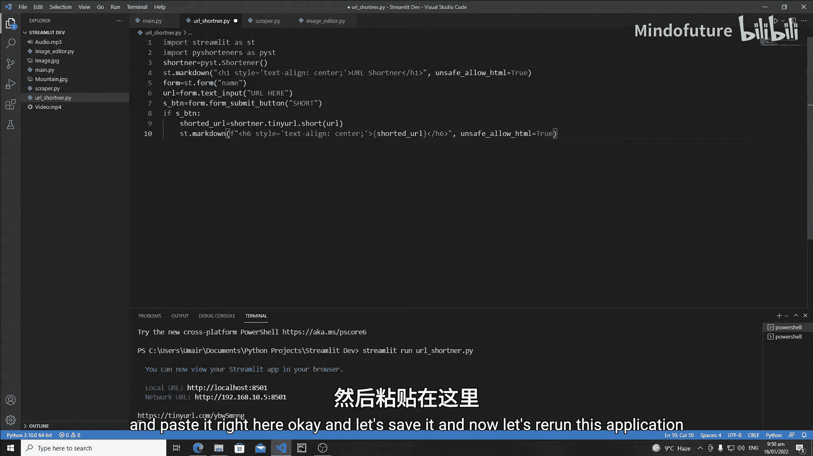
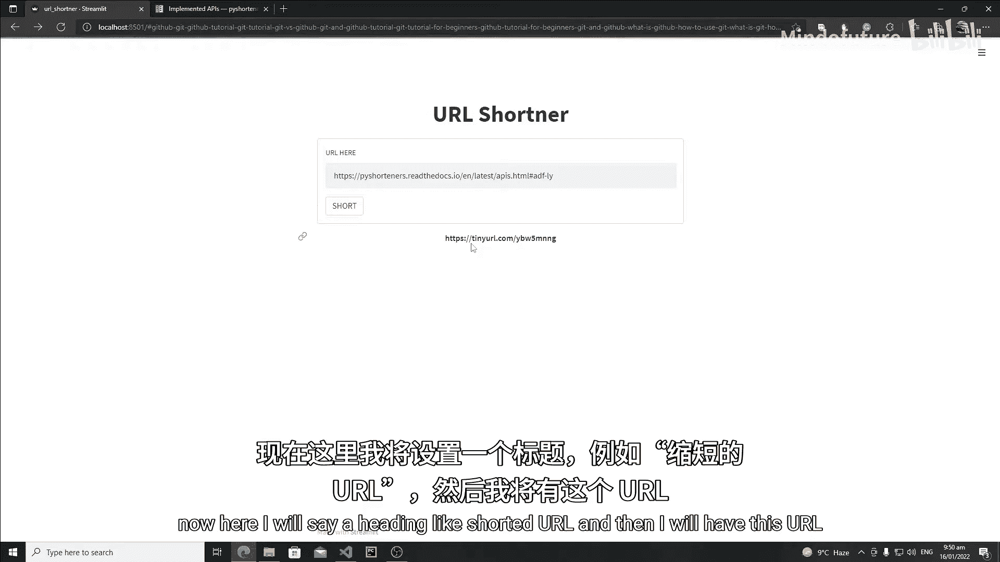
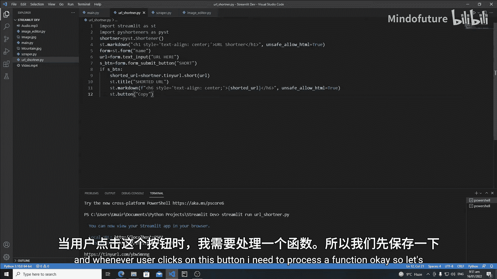
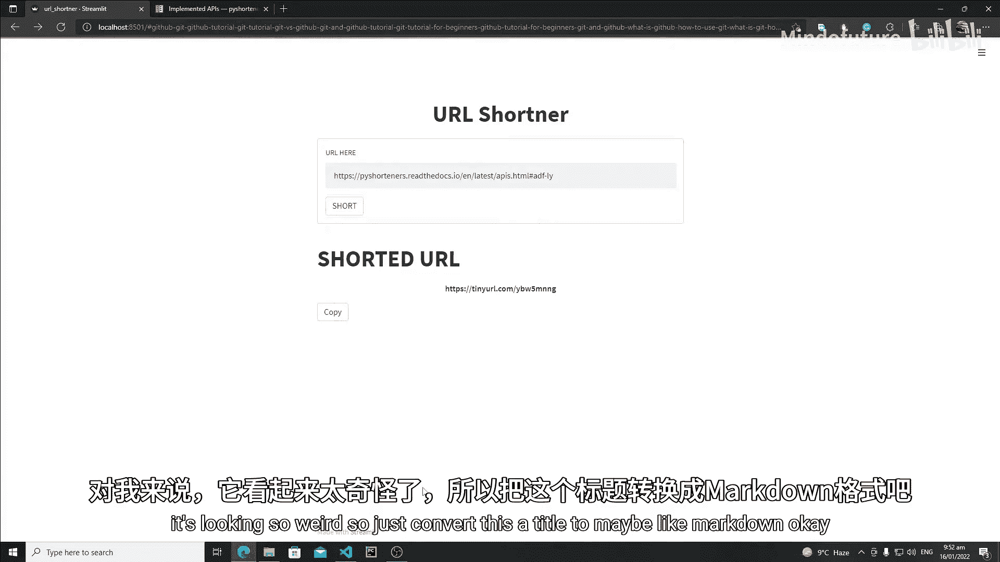
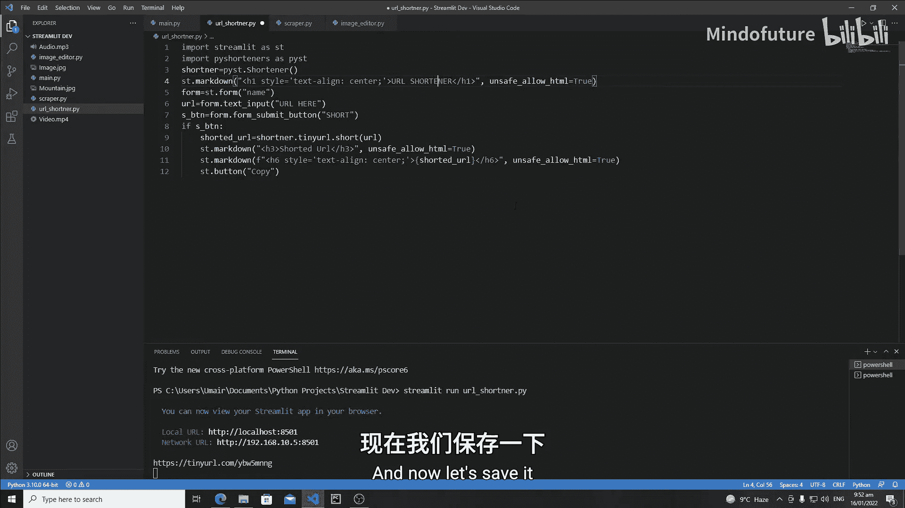
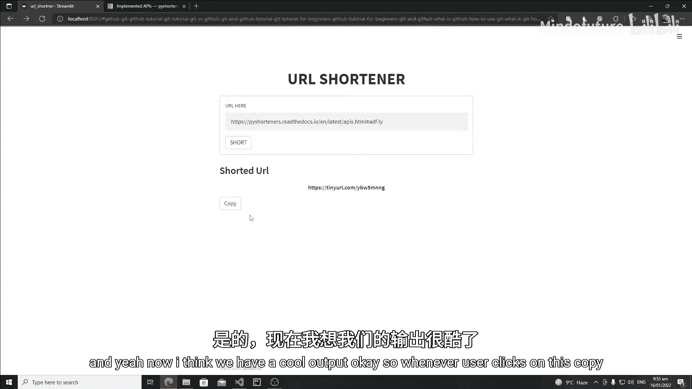
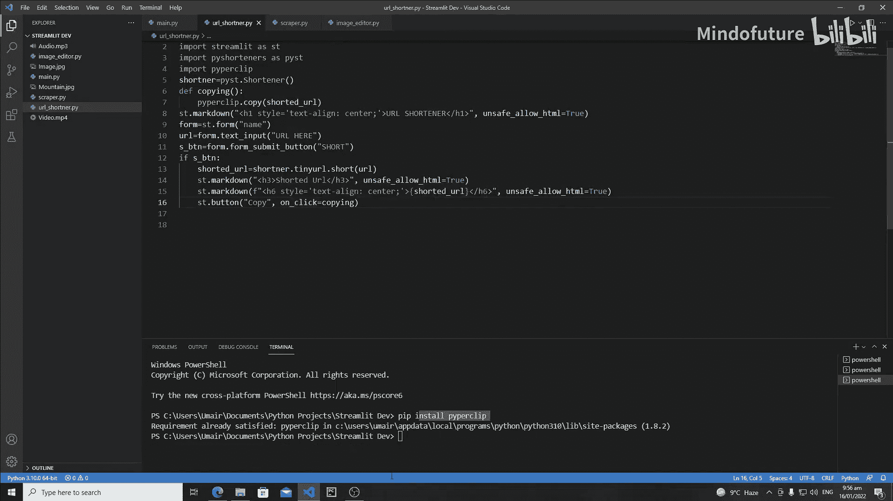
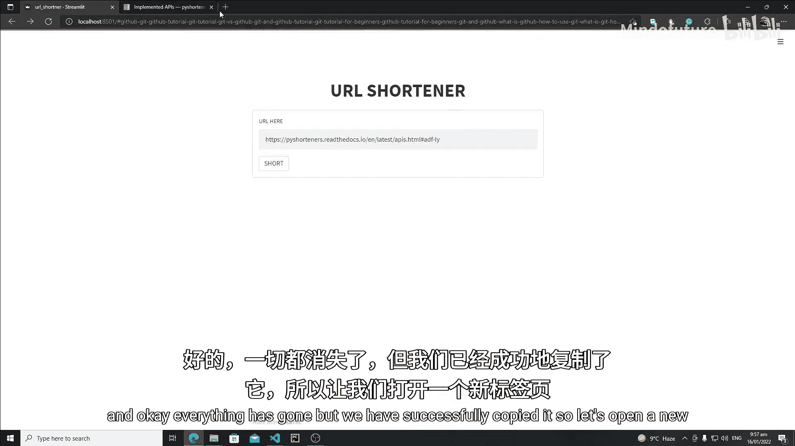
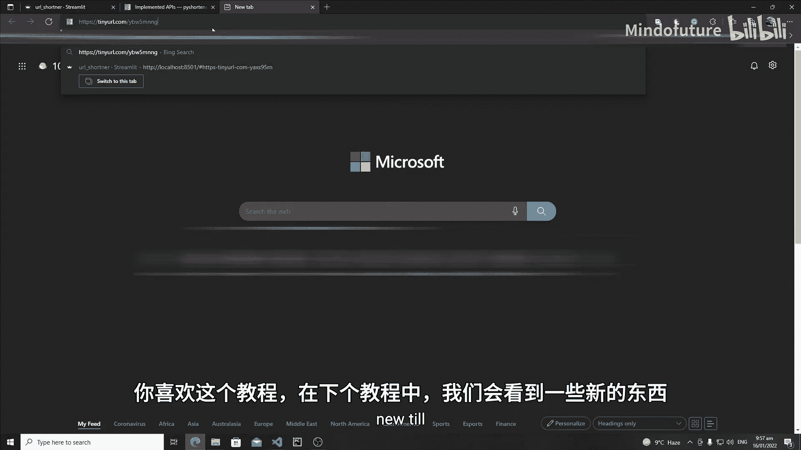

# Python-Streamlit-完全教程-p26-P26-Streamlit-URL-Shortener---Complete-Streamlit-Python-Course---Tutorial-2--BV1yHVhz1EUD_p26-

Hi everyone in this tutorial we will continue our development of our URL shortener application and in this lecture we will see two things first is to create a copy button and then we need to copy our information or our shortage URL to the clipbo so let's start this process and first of all I need to display this shortage URL on our streamlet to a app so just remove this print here okay and here I will use a markdown so just write here S do MK markdown okay and sorry RK mark down and this will be my formatted string because I need to place this shortage URL okay so just write here these parenthe is and write S orRTD shortage URL and I will say unsafe HTMLl to true because I will put this URL in。

at six headings。 So just right here at 6， Okay and here at 6 as well at 6， Okay， but in this case。

 we need to close it。 So put this slash and I will style this heading as well。

 So just copy this Okay line this line。 just copy it and paste it right here。 Okay。

 and let's save it and now let's rerun this application and just copy this URL， paste it right here。

 Just short it。

And yeah this is my shorted URL okay so it's very， very cool and now here I will say heading like a shorted URL and then I will have this URL and beneath this URL I will have a copy button so let's do this process so before this line I will say do markdown and not markdown I think here I will use the ITL title and I will say StD shorted URL okay and I will make it capital as wellt shorted URL and then I will create a button so S do UtN button and here I will say C or Py copy and I will save the state of button as well and I will say underscore BT and maybe okay something like that but I think I do not need to save the state of。

This button in this case， Okay， because I will use the property of this button。

 which is on click O and whenever user clicks on this button I need to process a function。 Okay。

 so let's save it for now and I just rerun this application。

let's say past the URL。 click on short。And a shorted URL and this is my shorted URL and this is the copy button I hope that these two things are not looking weird。

 but I think I will make it smaller actually for me it's looking so weird。

 so just convert this title to maybe like MRK markdown okay and here I will use H3 tag okay so just right here H3 and then close。

And here I will convert these small letters to capital letters。 Okay， so S， H， O， R T N E are short。

 No， okay， maybe E here。 Okay， shortener。 And now let's save it。

 And now let's rerun this application。 And I hope that it will not look weird in this case。

 Let's paste it here。 Just short it。

And yeah now I think we have a cool output okay so whenever user clicks on this copy button we need to copy the URL okay so just write here property and that is under the score click okay and here we need to define a function so about this thing let's create a function so write here dev and then I will say COP inNG copying okay and here I will also use an other library of Python and that is P per clip okay so it's a very weird name but yeah this is the library name so let's open a new terminal and right here PIP IN STWL install and then PyPR and see LIP pipe per clip hit enter and as you can see requirement already satisfied I have already installed it so after installation of this library。

You need to restart your VScor again okay and after restarting it。

 you need to import this library So right here， import by per clip okay and now with the help of this pipe per clip。

 we will actually copy our information okay so inside this function I will say by Vr per clip pipeper clip dot copy okay and now here we need to write a text that we need to copy and obviously in this case we need to copy this shorter URL okay so just to copy this name copy it and paste it right here okay let's save it and now on the on click I need to call this function copying okay so here you will be thinking that okay so we are doing everything like this but we can do that process like this as well if I save the start of the button inside this variable and if I check that if c underscorecor PN is true this means the user has clicked on this button。

Then we need to copy it so here let me mention you one thing that whenever user clicks on buttons or radio buttons or any intractable widget in streamlit this streamlit will start processing each and everything from the top okay and in this case whenever our streamlit application comes to this part it will stop its processing because this is a form and here we need to click on this button on this form submit button before it executes it so in this case our streamlit application will never reach this point and that's why our application will not copy our shortage URL to the clipper so in order to avoid this type of error you need to use this onclick attribute or property of this button so this onclick basically allow us to execute this function before streamlit trigger each and everything so that's why I'm not saving。

The start of this button I'm directly using the property of this button and this is how everything will work。

 So let's save it and now let's rerun this thing。 Okay rerun it and here you need to paste this copy it and paste your URL just click on this short and now let's copy it copy it and okay everything has gone but we have successfully copied it so let's open a new tab and now whenever I right click and whenever I past it as you can see we have this tiny URL okay so we are successfully copying the short URL using pipe or click module of Python so I hope that you have enjoyed this tutorial and in the next tutorial we will see something new till that point bye bye。

