# Python-Streamlit-完全教程-p27-P27-Streamlit-Audio-to-Text-Converter-Web-App---Complete-Streamlit-Python-Course--BV1yHVhz1EUD_p27-

Hi everyone in this tutorial we will start making our ID to text converter in Python using Streamlit library but before we actually start its development there are a few steps that you need to follow in order to develop this application so first of all we need to ask user to upload the I file and we will do this process with the help of streamlit file uploader widget then we need to split that I file into small chunks and the reason is that we will use Google as our translator because we will not develop that much efficient machine learning system that will translate our I to text so we will use Google and there is a limitation and that is you can't upload any idea which is longer than one minute so we need to split that big idea into small chunks in order to use the Google for translation then in step number three we need to export that chunks。

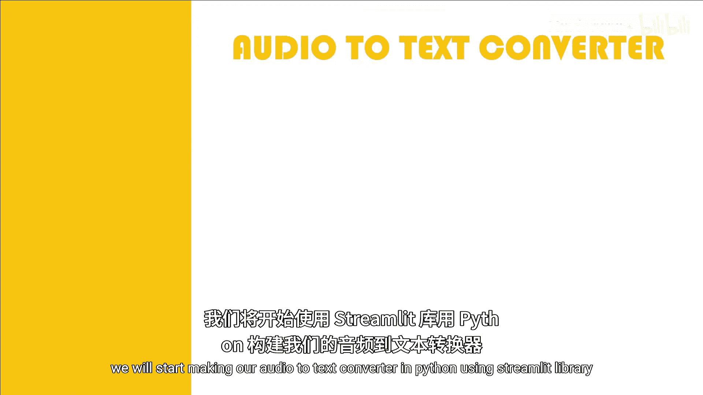

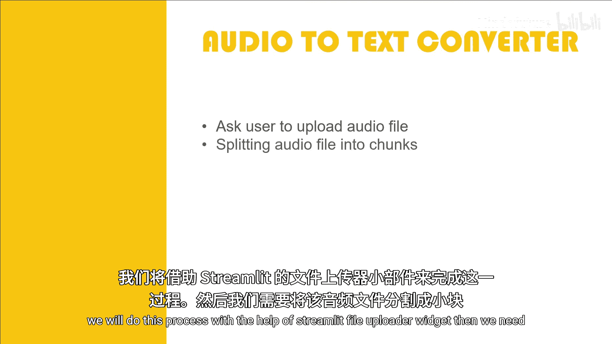

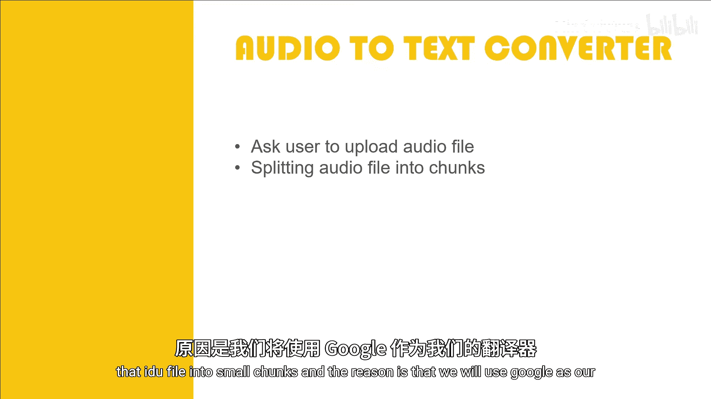

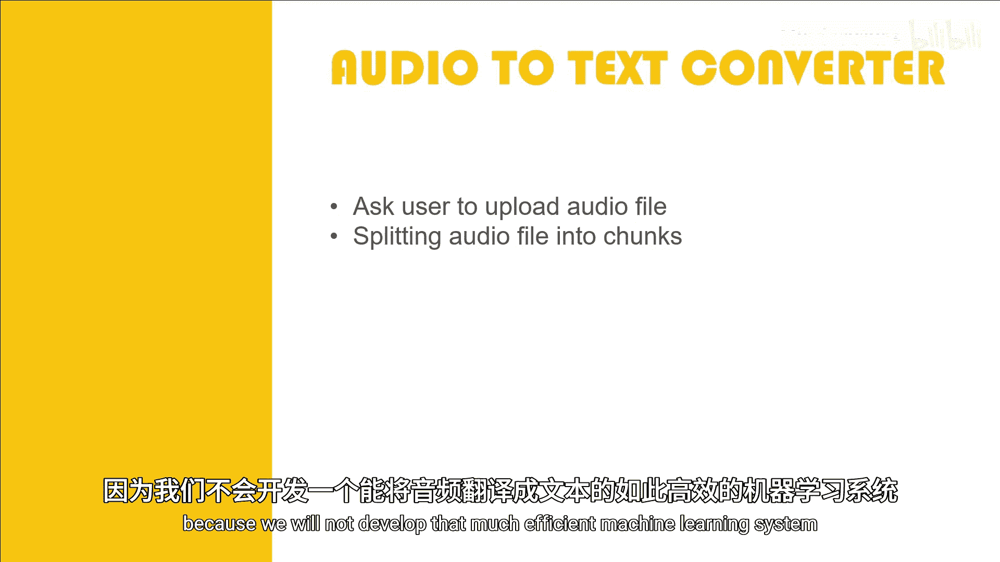

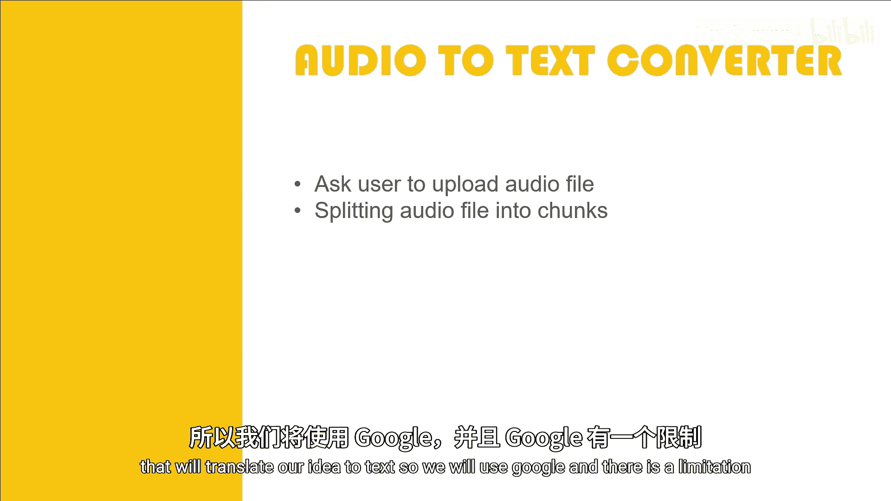

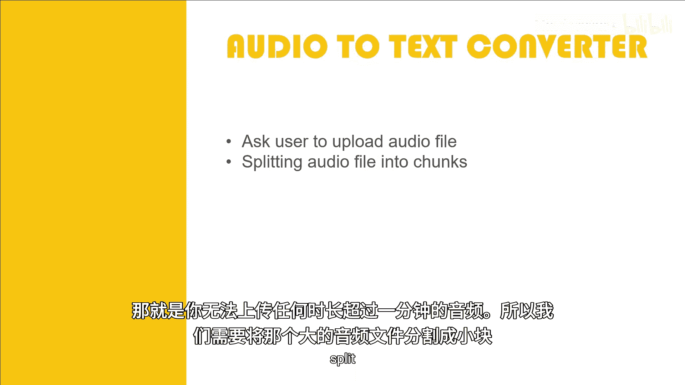

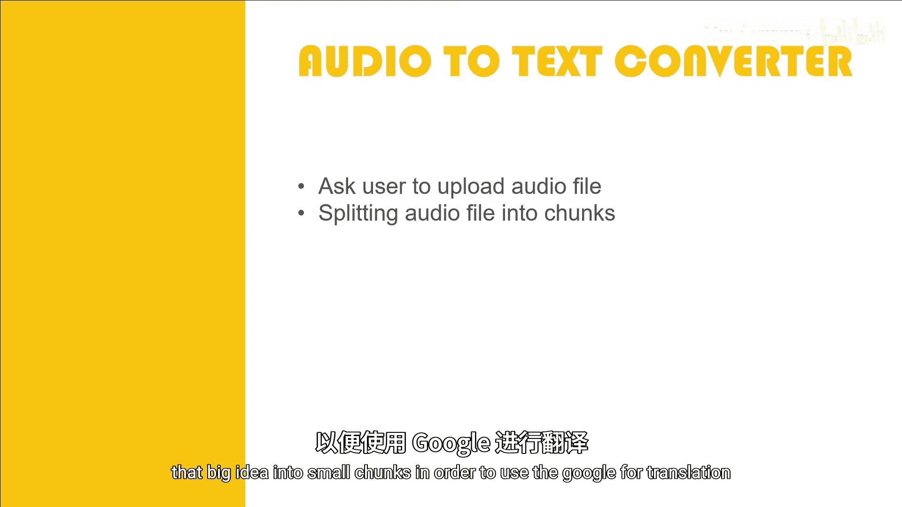

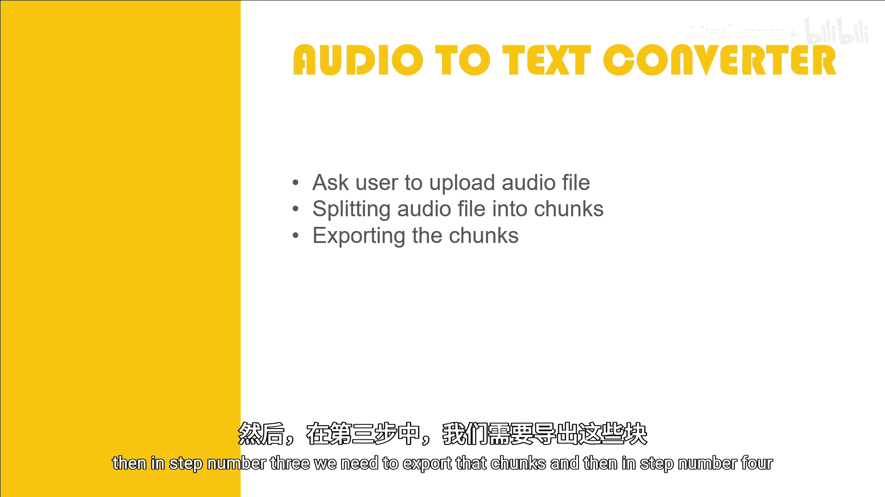

AndThen in step number four， we need to open that chunks as our source and these two steps might confuse you that first of all。

 we are exporting and then we are reopening or reimporting So are we doing this process so I will answer you when we will start its development then in step number five we will send our small chunks one by one to Google for translation and then in the final and sixth step we need to display our result。

 which is our text on this screen So these are six steps that you need to follow in order to develop this application and I hope that you have understood each and everything and from the next tutorial we will start its development so I will see you there till that point bye bye。

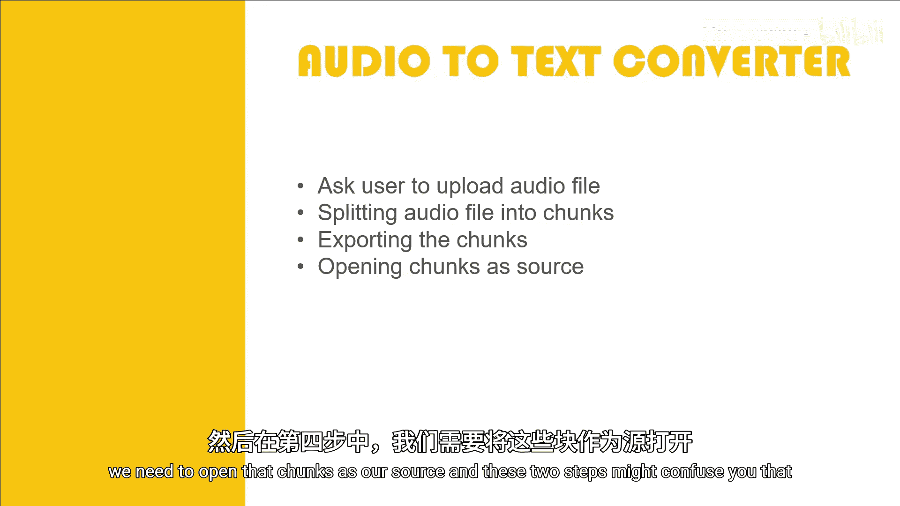

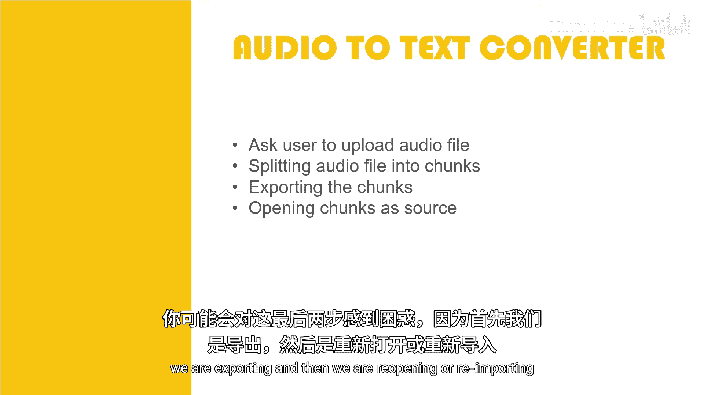

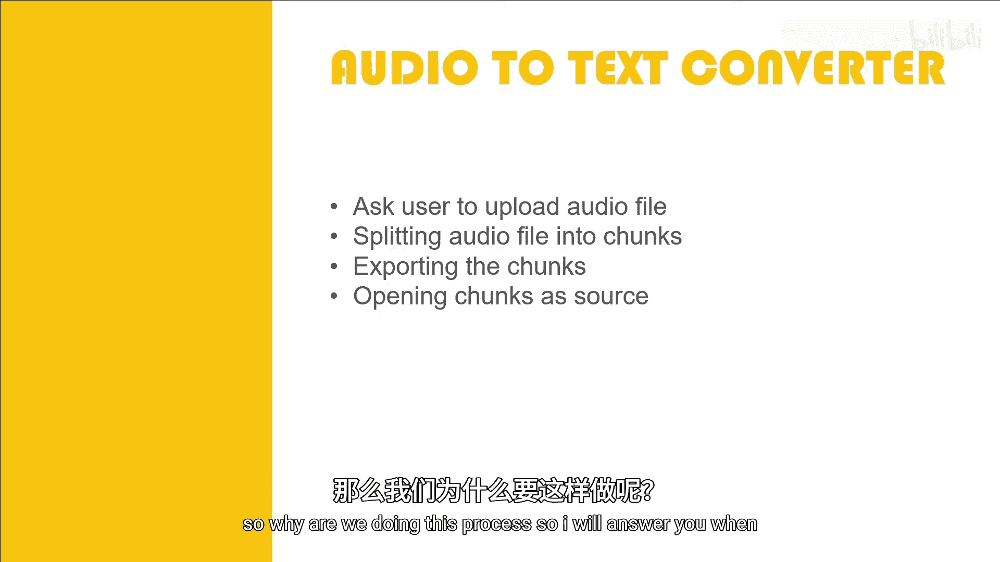

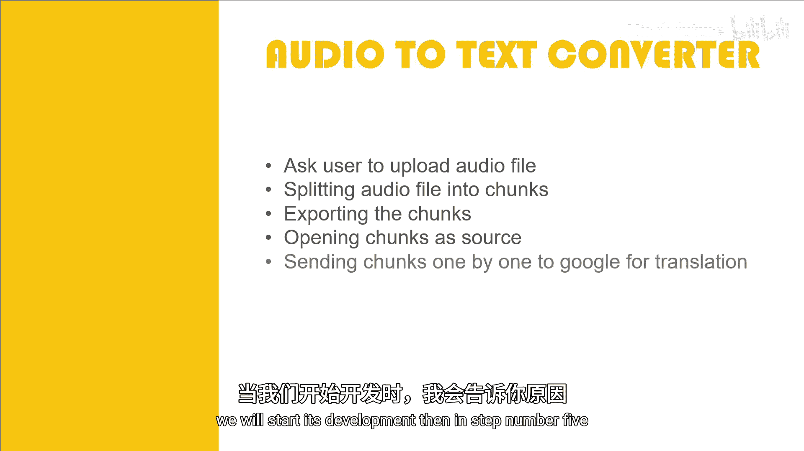

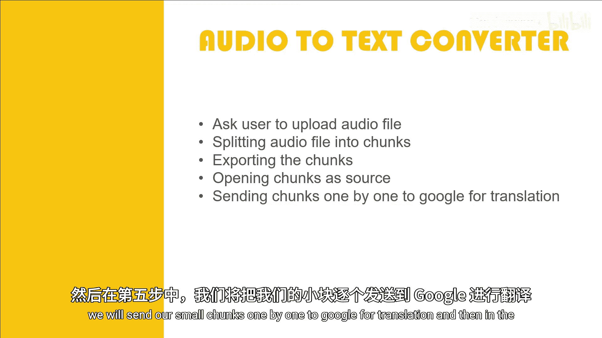

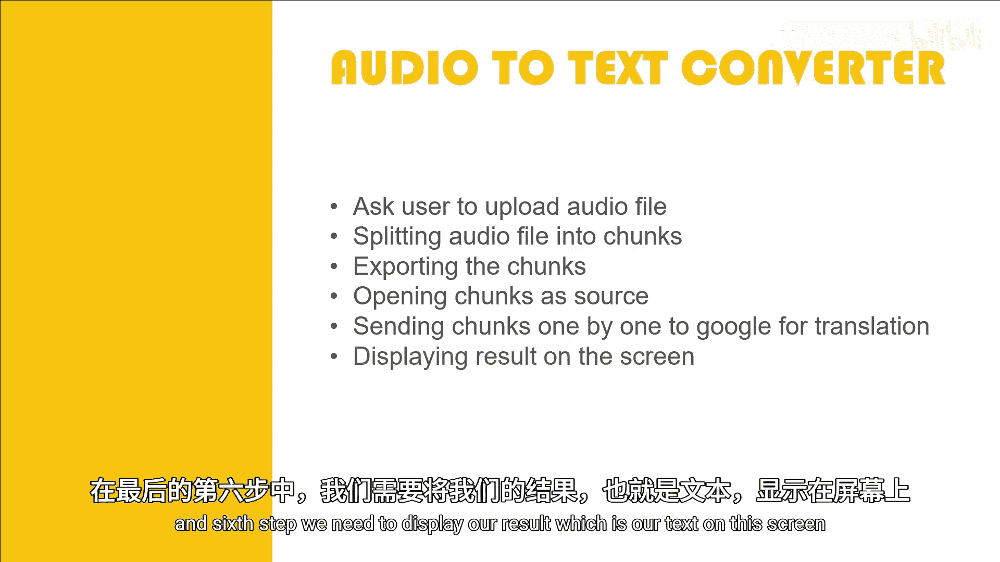

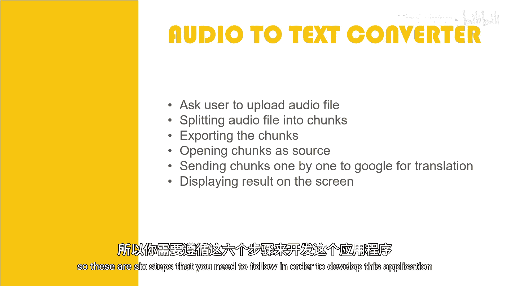

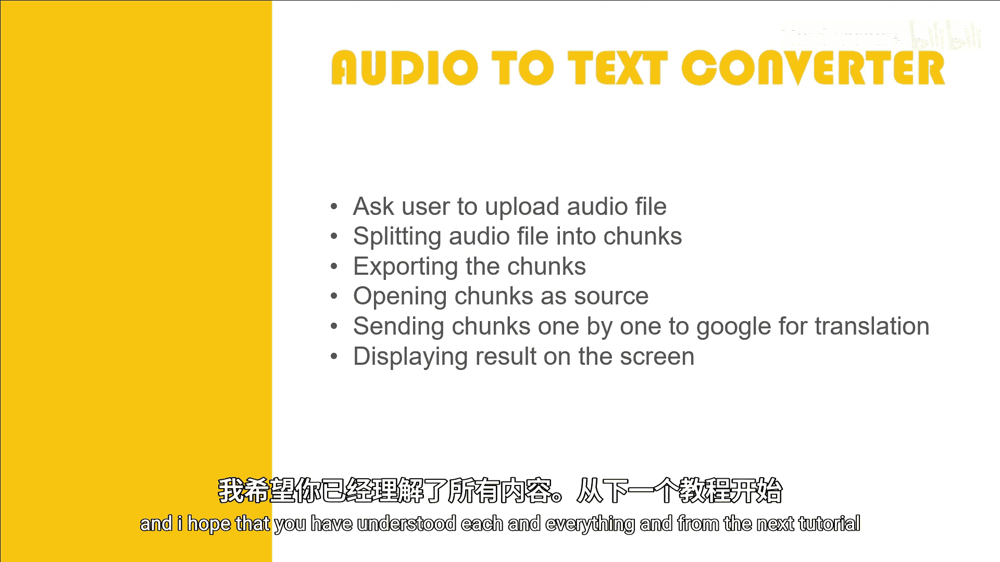

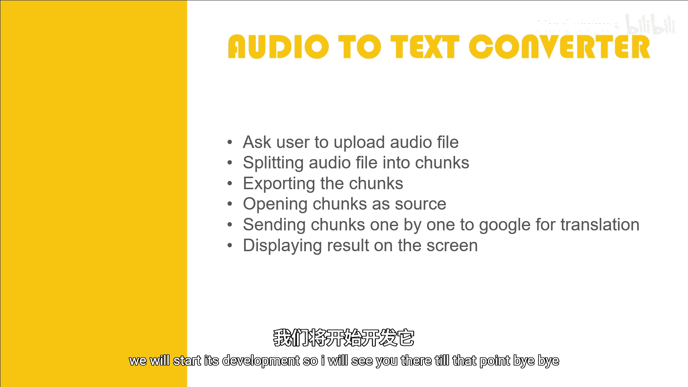