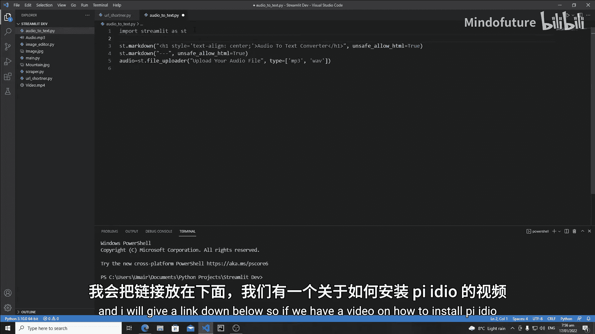
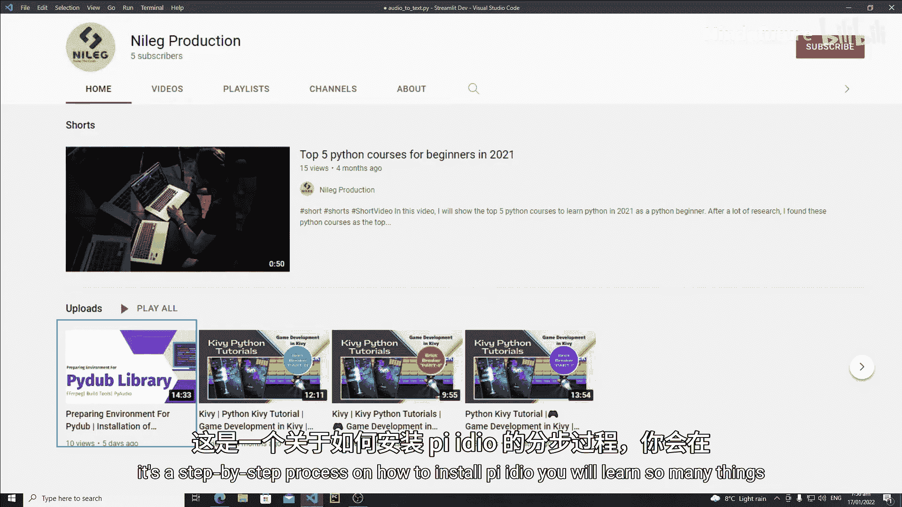
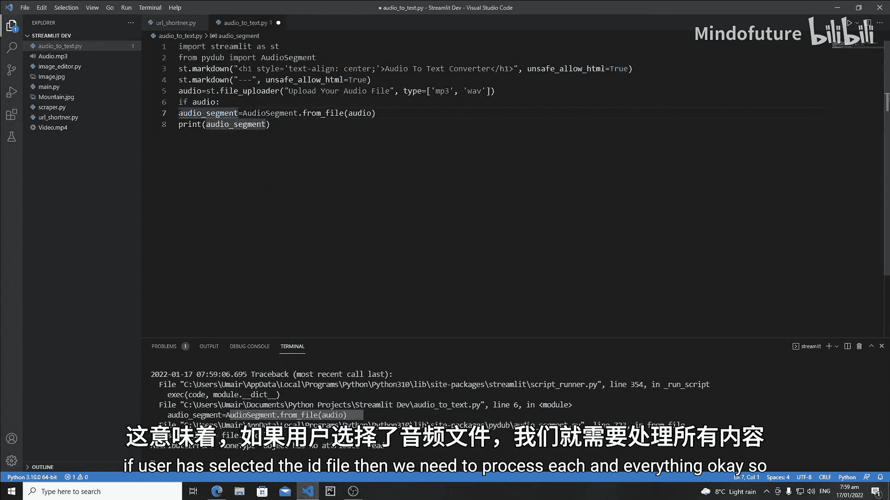
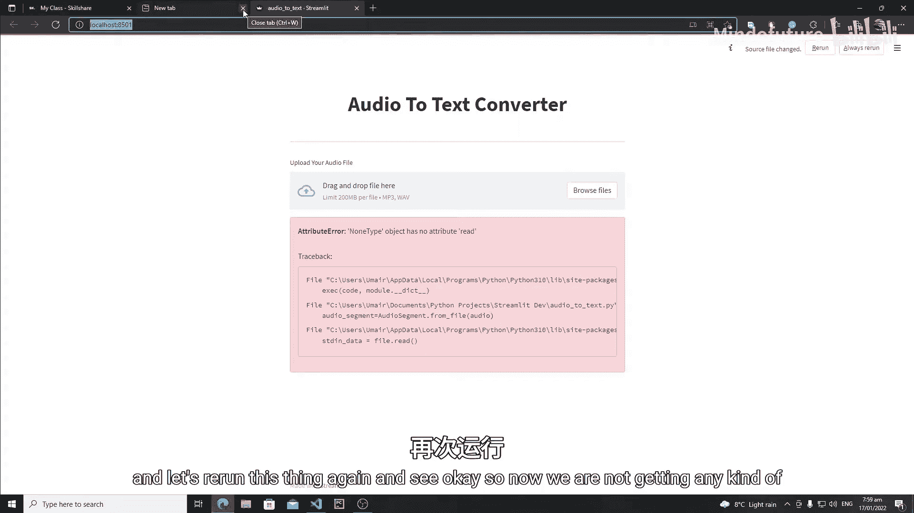
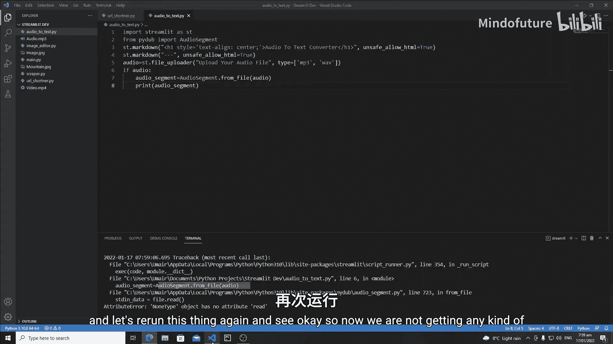
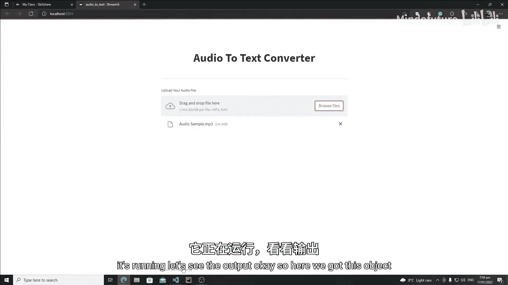
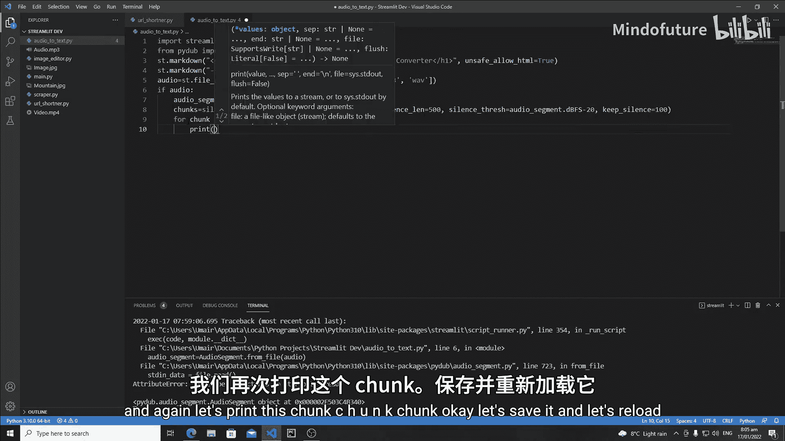
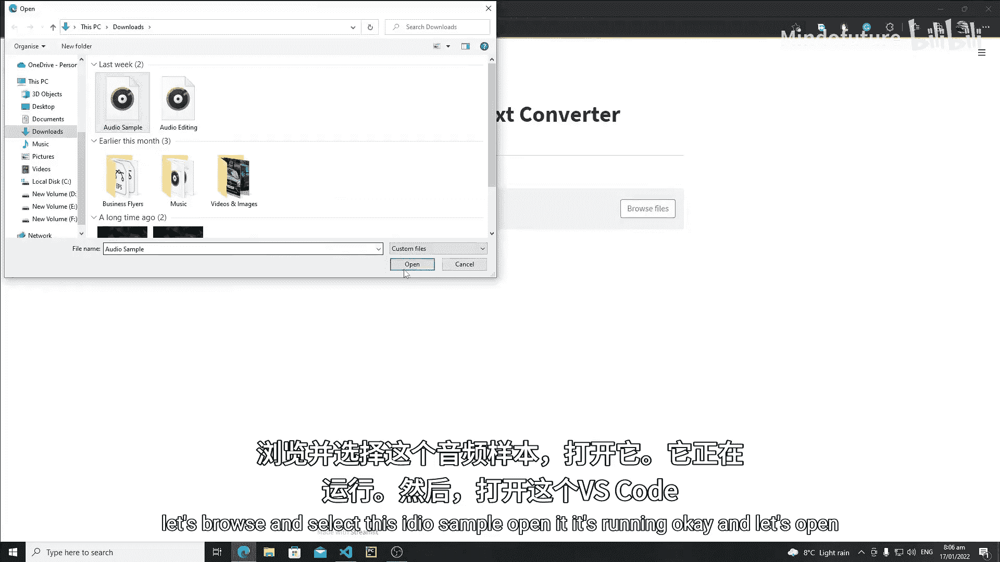
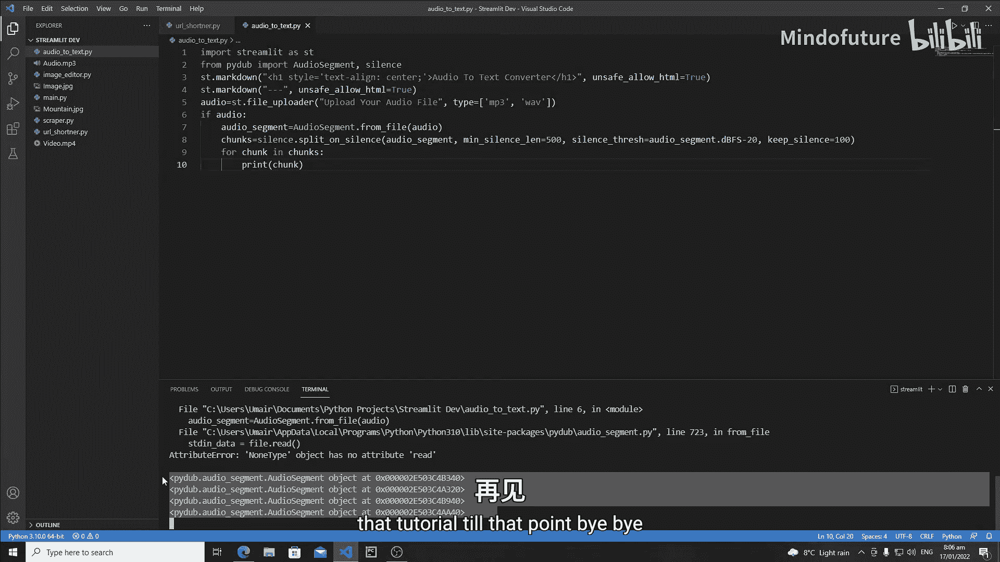

# Python-Streamlit-完全教程-p28-P28-Streamlit-Audio-to-Text-Converter-Web-App---Complete-Streamlit-Python-Course--BV1yHVhz1EUD_p28-

Hi everyone， in this tutorial we will start the development of our audioio to text converter using streamlink library of Python。

 So first of all， let's create here a file okay and I will name it like A U DI or Iio to。

T X text dot Py okay so this will be my file。 And first of all。

 it is obvious that we need to import our streamlit。

 So just right here I impRT import HDR streamlet as S okay so we are now successfully importing our streamlit so just remember the first step the first step was to create file upload a widget and with the help of that widget user will upload files to our application but before I actually create that widget let's create here a heading so I will just copy some lines from URL shortener so first of all let's copy this line just to copy it and paste it right here and let's change the name from URL shortener to something like your idea to T X T text C or NV R T or converter okay so I think it's good sorry let me。

Make this osmal And okay， so I hope that you know very well about this line。 we have used it so much。

 so much that it doesn't need any kind of explanation。

 Now let's create here a line okay so just write here S dot markdown markdown okay and just put this three dashes okay and then say and say hMl to T are U true okay and then let's create our file uploader widget。

 So just right here S dot f file uploader and here my label will be like U P upload your U D Iio upload your id file okay and then I will give a list okay and will say T P type is equals to and this will be a list obviously and we will accept MP3 okay and we will accept。

WAV web formats， Okay， and I will save my ideal file inside this。 sorry。

 let me write your A you D your ideal variable， okay。

And okay so we have completed our step number one and that was creating a file uploader widget and now we need to convert our this audio file into audioio segments。

 so we need to import a library which is pile up obviously and if you don't know how to install Pup so the installation process of Pup is not straight forward okay you need to install FFM packg then you need to have Microsoft build tools then you need to have by Iio and you can't install by Iio using PP so you need to install it using its wheel package and the process is quite long so I will not go into that process because if you go to our YouTube channel and I will give a link down below so if we have a video on how to install by Iio so just watch that tutorial and it's a stepby step process on how to install by Iio you will learn so many things in that tutorial and after installing。

By I， you just need to import pi I So right here I or or import pi Iio okay。

 and I think I should not import the whole pi Iio library。

 I need some classes from the the library So I will say from pi sorry not pi I from P I or import。

 we need to have an Iio segment class。 Okay， because with the help of this class。

 we will convert our this I to our I segment So here let's write a new variable name and that will be A Iio segment I segment or maybe segment Okay I segment is equal to A Iio segment dot M from underscore file Okay so we need to load this I file into our what I say into our p library Okay and we will do this process with the help of。

This line okay so from file and then we need to write here our file name and obviously in this case our file name is this idealio and after converting this idio segments for now let's print it okay so print a U Dio Iio segment you will see nothing but an object okay let's save it and let's come to terminal and let's write here stream sorry stream it are you un run and that is a UDIO。

Okay， so we got an error。 So let's see the error。Okay， so first of all。

 we actually need to check that if we have this ideal file。

 So this means that theuser has selected the ideal file。

 then we need to process each and everything Okay， so let's save it and。

Let's rerun this thing again and see okay so now we are not getting any kind of error。 It's good。

 So now let's browse file and just go to the directory where you have file and here I have this I sample just click it upon it and let's see the okay it's running。

 let's see the output Okay so here we got this object which is pile of I segment object Okay so everything is working fine now let's come to the step number3 or4 I don't know just keep the step in your mind Okay so if know we need to actually split over this ideal segment into I chunks okay so I have told you that we will use Google and there is limitation and that is Google can't translate I file more than one minute for free so if you want to translate5 for 10 minute I you have two choices first of all you need to buy an API other choice。

I to split your audio file into different audio segments now here I'm thinking that we will actually split our audio best on the silences in the audio and that process will be quite good because if you randomly split the audio into different audio chunkncture this will cause some translation issues okay maybe as half of the sentence is in one audio file and half is in the other audio file okay so in order to avoid this type of error it is a good practice to split the audio based on the silences and that's why I am using the spied up audio because spied up perform very very well process when it comes to splitting the audio best on silences so we need to import here and other class of pile up and that is silence okay so SL andC silence so with the help of the silence class we will actually split our audio so here instead of printing it I will say。

That S allency silence dot S underscore on silence okay and now here we need to pass our ideal segments and we have already converted our this ideal file into ideal segment using this ideal segment class So we need just need to pass this name here So just right here your D audioio segment okay and then we need to pass here some more properties and that is first we need to define here minimum silence length and everything will be in milliseconds okay so 1000 is actually not second it's millisecond this means that it is equals to one second okay then we need to define here silence trash okay we need to define keep silence as well So this property will basically keep silence on the start and at the end of our ideal chunk so it's very good to define a value for this property and then we have。

St and we are not concerned with this six step4 now okay so we will leave this property and it is optional as well so first of all we need to define here minimum silence length。

 which is by default to1 second but I will keep it to something like 0。

5 seconds okay so just right here our minimum underscore silence length is equal to and that is 500 so 500 millisecond is equal to 0。

5 seconds okay so it's very basic maths then just right here SLnc silence th SLEncC silence underscore threshold is equal to and here we need to define our silence threshold so by default our silence threshold is minus 16 dv but now we don't know about our ideal DB is okay so it's very good to write here idealio segment idealio segment dot DbfS okay and then we need to subtract minus 20 so。

Will line basically allow us to define a custom silence th based on the idealDBs okay and you will get a better output and if you want to learn more about piled up and idea processing I have a full course on pi up and in that course you will learn almost everything regarding audio processing in Python now let's come to the original topic and that is defining some properties so we have defined idea segment than minimum silence land then silence th and finally we need to keep we need to define a last property and that is keep silence okay so keep silence and I will keep a silence of like 0。

1 second at the start and end of our each audio chunk okay and then I will save my these ideal chunks inside this C and case chunks variable okay this will basically return us a list of different ideal chunks objects okay so we need to loop。

Each object so just right here for CU enter the chunk。In chunks， okay。And again。

 let's print this chunk， CHU and Ka chunk， okay， let's save it。

And let's reload it。Let's browse and select this ID sample， open it。

 it's running O and let's open this V code and yeah here we got this for IDo chunks okay and I think that it's enough for this tutorial and in the next tutorial we will actually export over these I chunks and then we will actually convert these I chunks into text using Google and I will see you in that tutorial till that point bye bye。

