# Python-Streamlit-完全教程-p29-P29-Streamlit-Audio-to-Text-Converter-Web-App---Complete-Streamlit-Python-Course--BV1yHVhz1EUD_p29-

Hi everyone in this tutorial we will continue our development and we have completed our first two steps let's start from step number three and that is exporting our id chunks so here as you can see we are converting our big idea into ID chunks okay and here we are actually printing our id chunks objects but instead of printing here the ido chunks object I will export those ido chunks so we need to write here C and chunk okay and then dot E X P or export okay now this export basically text bunch of arguments one is the out f basically represents our output name okay our output file name okay and then we need to define here the format then we you can define the bedread and there are a bunch of properties but we are concerned with these two properties the format and then the output for file name so first of all we need to give。

Unique output file lamb to each chunk in order to distinguish between them。

 So I will actually give the index number as id chunk name okay so here we will make some modification inside this for loop okay so instead of looping through this id chunks like this I will loop using enumerate function so enumerate function basically allow us to extract the index of each and every id chunk。

 So just right here E and U me E enumerate okay and we need to define here C and case chunks okay and now this enumerate function basically return us two things one is the actual data and the other one is the index So first of all it return us the index so we will store the index inside this index variable and then we will store the chunk inside this chunk variable and now here when it comes to dot export。

Fun we need to convert this index to string okay and I will write here STR okay and then we need I need to pass your IDx index okay and then I also need to define here extension of this chunk and in this case my extension will be wAV because I will use a web format for this so just right here format is equals to WV okay and just keep this thing in mind that whenever you define your format you need to define that extension here as well with this output file map so let's save it okay and just open new terminal okay and write here STR ELI streamlet or maybe instead of defining this whole name I will use this function just use this arrow key is okay and this will automatically extract the previously typed line okay so。

I stream the trans ido to text or Py hit enter， and let's sweat。

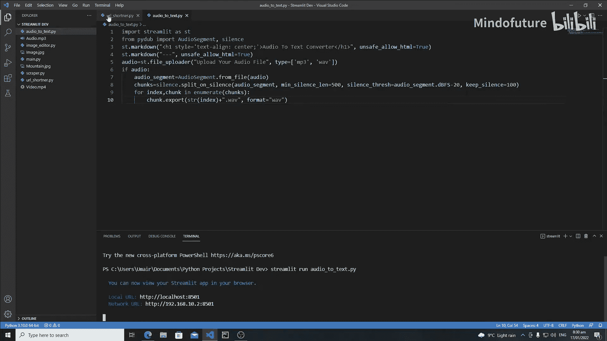

Okay， okay， so let me close this thing。 Okay， so here we have this Io to text converter browse file。

 I sample， open it， it's running， this means processing open the V code， Okay。

 so we don't got any kind of output here but here as you can see we have01 and 2 I files。 Okay。

 so it's cool so let's print here these chunks。 Okay PR and D print C U and K chunk， okay。

 not chunk chunk， okay， let's save it again and let's say read on it。

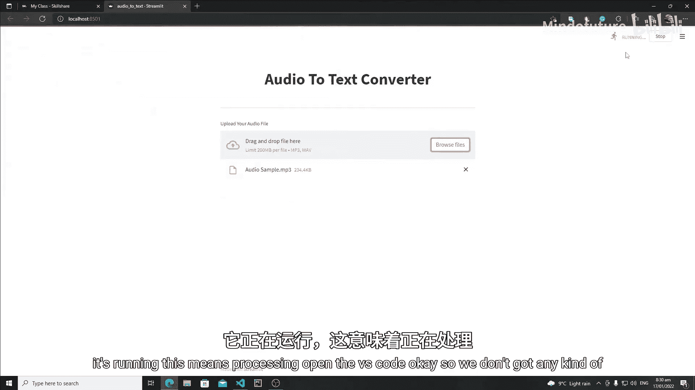

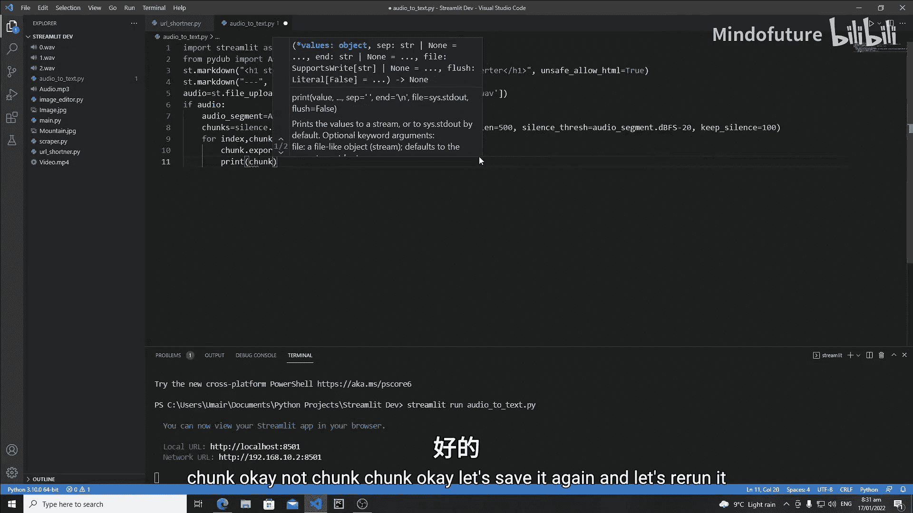

Browse file， okay， I sample， open it press running。 just open via scored。 Okay。

 so here we got three chunks and here we got three chunks as well。

 So this means that everything is perfect。 Everything is working fine。 Okay。

 so you can listen those chunks as well。 So let me open it in Expr and here are my one to and three chunks。

 Okay， so just open this one。

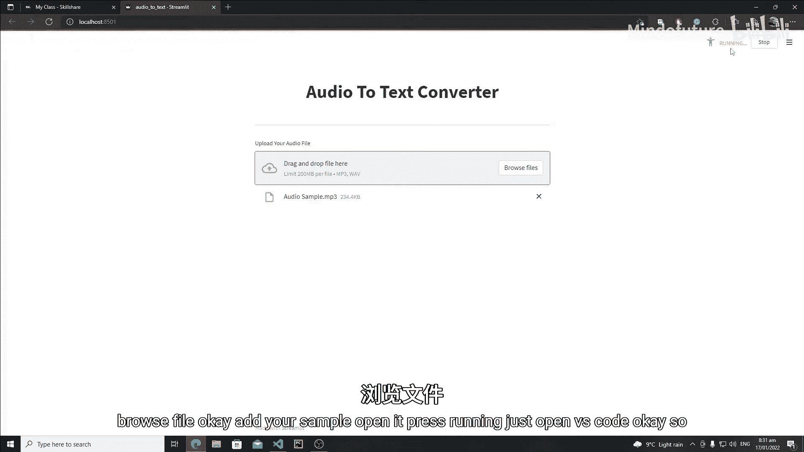

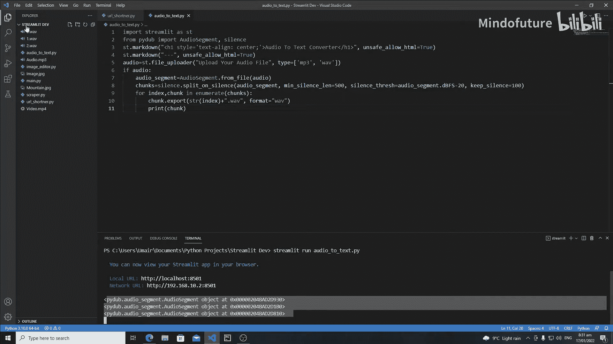

Hello， this is an ideal sample for testing my。Okay。

 so I hope that you have listened the sentence now let's listen to the second one。

Text to audioio converter。Okay， it's good。I have made this application using Stamlit and I will test it using this IDio S。

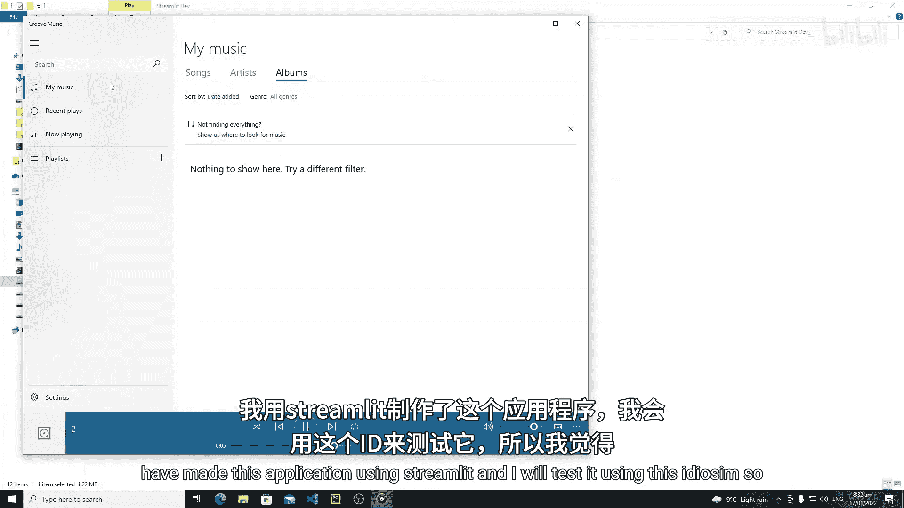

So I think it's good and just open this V code again and now in this step number four we actually need to open these audio chunks which we have exported in the previous step as our sources so instead of printing the chunk again let's remove this line and here I will write I need to import an other library of Python which will basically allow us to convert our audio files into text with the help of Google and that is speech recognition so if you don't have speech recognition。

 just type in the terminal like this a new terminal and write here PIP paper IN install S speech underscore our EC OG and IT speech recognition and this will install speech recognition okay so it didn't found this speech recognition so just。

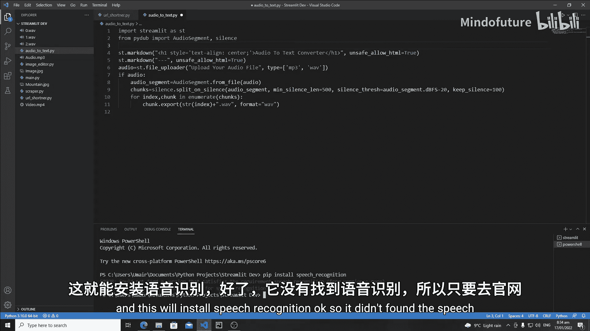

Go to the official and here you instead of writing speech recognition like this。

 you need to write the speech recognition like this。 okay。

 so just copy this line and open the terminal paste it here。

 just hit enter and you can see that requirement already satisfied so I have already installed this speech recognition but if you don't have just type this line and this will install your speech recognition so after installing this speech recognition。

 we need to import it So just right here I or to import SPw speech recognition as I will import it as Sr okay so it' school and now here I will say that I will use this with keyword okay so with Sr do A D I file okay and I need to pass here my file name and my file name will be this index dotv okay so say I will do this sample。

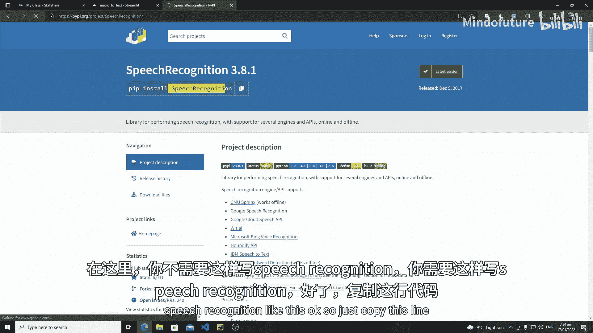

here so just copy this line copy it and paste it right here。 Okay and I will open it as a source。

 So just right here as O U R as source so we have completed our step number4 and that is opening the I file as source now in step number5。

 we actually need to send our this data to the Google but before we actually send our data we need to record this source as well。

 So we need to use an other class of the speech recognition okay and that is recognizedr so just right here our G recognize okay so I'm just instantiating my class so recognizes equals to SR dog and IZDR recognizer so and put these rounded brackets so we are now successfully。

Sating our recognizer and now'm inside this with section we actually need to record it so will save my recorded I file inside this R R DD recorded variable and right here is equals to R recognize dotD record and then we need to pass our source and that is this source So just to write hereRC source and then after recording it we actually need to send this audio to the Google so I will say R G recognize dot GW Google recognize so here we have two options is recognize Google cloud and other one is recognize Google So when you use this recognize Google cloud you need to have an API and obviously if you want that API you need to pay something to the Google in order to fetch that API but。

I will use this recognize Google option， which is free。

 but here is limitation which is one minute okay so I will use this and I will pass my sorry I will pass my source okay and that is this recorded so just copy it and paste it right here okay and then it will return me the text and I will save my text inside this TXD text variable okay but what if Google doesn't recognize our audio then in that case we need to use try and accept keywords okay so this is a very handy feature of Python which allow us to handle errors okay so first of all I will set TR try this okay so try text is equal to recognize Google okay and if we get any kind of error EX we accept we will say that we will just need to print a message something like maybe any none so we have not converted our audio。

I hope that this will work fine， okay， so let's save it and again just to close this one。

 come to the streamlit okay， and just close it again and let's refresh it。

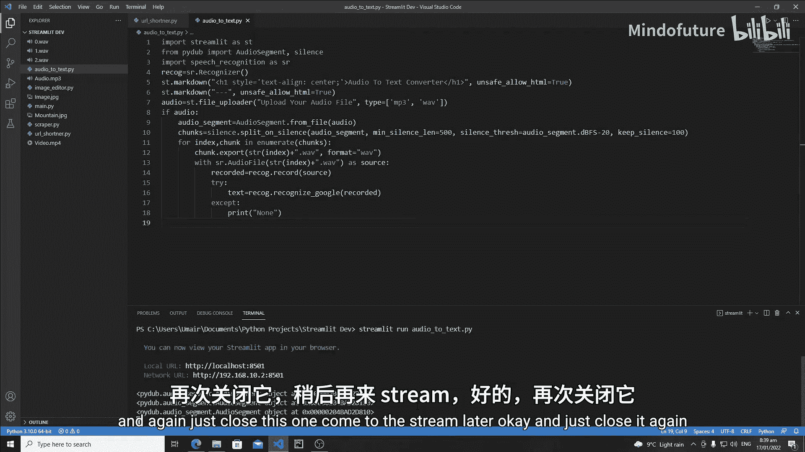

Browse files， okay， and here we just we just need to select this id sample open it。

And it's running okay， it means that it is processing and this will take some time because first of all it will convert our idea into chunks and it will send each chunk one by one to the Google and after translation Google will send that chunks and obviously it will take time and now let's open via code okay so we have not got any kind of output and the reason is that we need to print this text here as also right here print okay and then TXT text okay so let's save it again and just browse file Iio sample open it。

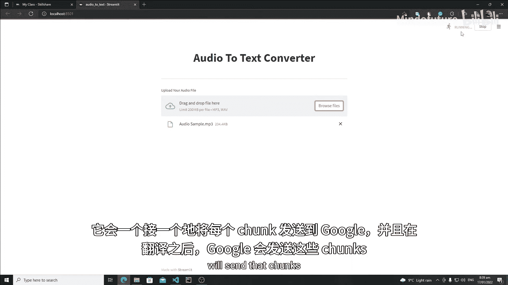

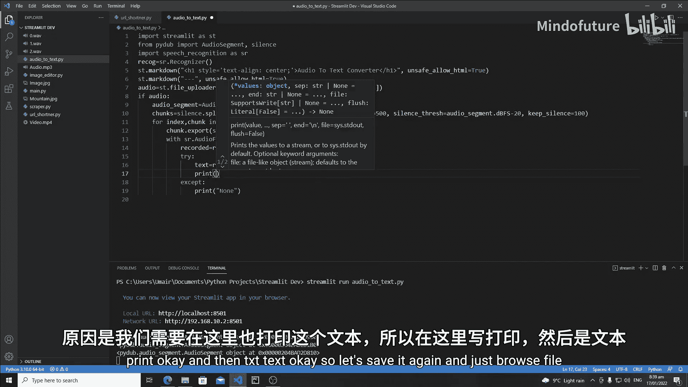

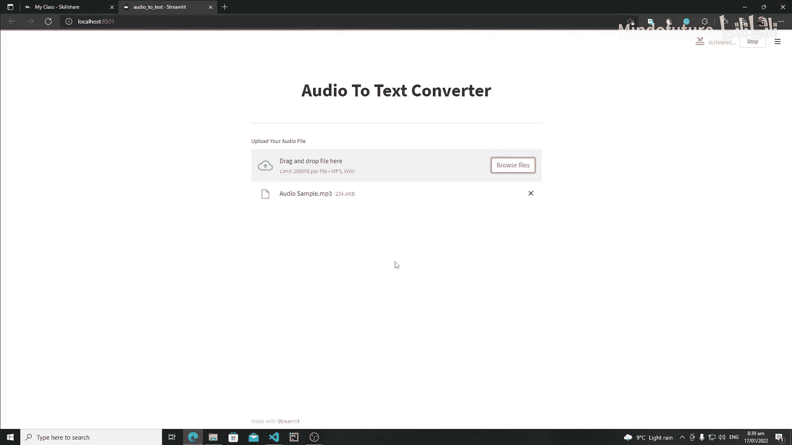

Okay， so open this V code again and yeah this is our output。 Okay， so hello。

 this is an ideal sample for testing my text to Iio converter okay so Google has successfully translated these two I files and now I have made this application using streamlit okay so here Google hasmail domestic and that is stream with okay so it's not stream it streamlit and I will test it using this okay so here I said I sample and we got this error。

 So but this is how you can actually convert your id into text using only few lines okay and I hope that you have enjoyed this tutorial and I think it's enough for this tutorial。

 So in the next tutorial we will actually print over this result on our streamlit and I will see in that tutorial till that point bye bye。

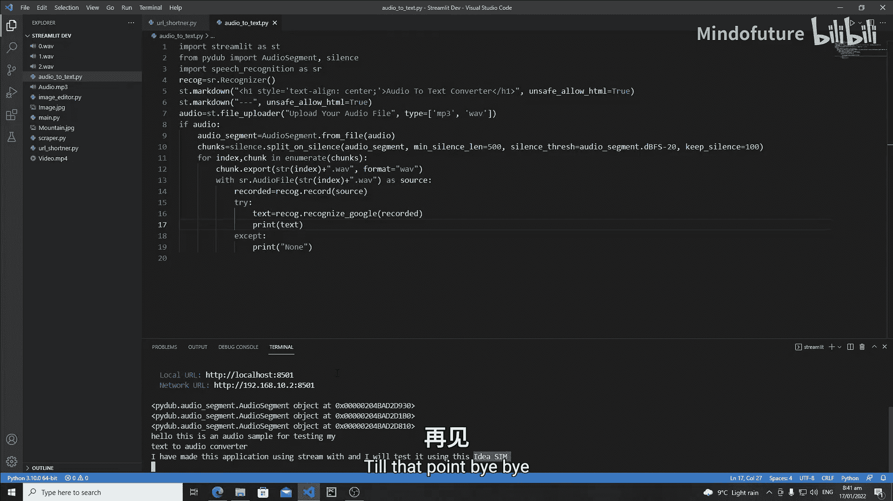